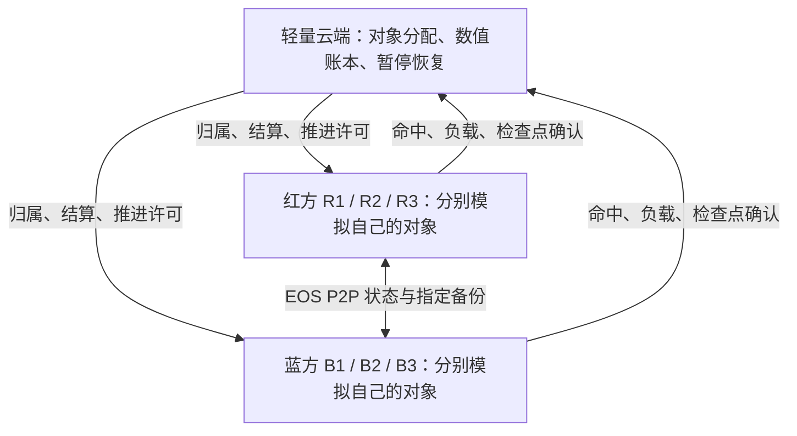

# CS-P2P整合归档

## 当前交付及历史边界

本次交付为编辑器内红方PIE、蓝方NullRHI逻辑客户端和Coordinator三个独立进程，默认双方Commander；主端职位仅在PIE前选择。普通600单位试玩不自动附加500飞行物或验收金手指。对应地图为`/Game/Maps/LVL_CommanderMassPrototype`，使用正式运行清单。

原始93份正式文档保存于Git快照`8649838482fb8302636a95c6793a1c47acc63128`，下方保留各自编号、路径、哈希和历史正文。旧的云端结算、周期备份、换职及多端方案仅代表当时讨论；现行规则以唯一需求文档为准。合并没有把首次失败、准备跳过或部分通过改写为完整通过。

上一轮剩余专项原断言全部通过，实际玩法失败0、依赖未执行0，辅助货物保持准备跳过1；原汇总为`incomplete_collection`。原冻结身份`35c965969fc6e75c5660a0573abdf23512201ac8bdf8aa69f1e9782c2dfd51f3`、证据哈希复核及构建身份一致的结论已封存，原始临时附件清理后不能再次读取核验。完整同基线G→F、玩家和性能验收未在本次执行。

本次构建先修复头文件、对象指针和设置模块链接依赖；首次编辑器启动暴露世界初始化过早的断言，随后改为安全查询并重新构建。最终通过事实以以下实际记录为准。

## 本次构建与PIE证据摘要

```json
{
  "build": {
    "snapshot": "8649838482fb8302636a95c6793a1c47acc63128",
    "editor_exit_code": 0,
    "engine": "D:/UnrealEngine-5.7",
    "module_build_ids": {
      "D:\\UnrealEngine-5.7\\Engine\\Binaries\\Win64\\UnrealEditor.modules": "dd3ee083-a0fd-45c8-814e-67fe5ef95e31",
      "D:\\UE5.7\\test1\\Binaries\\Win64\\UnrealEditor.modules": "dd3ee083-a0fd-45c8-814e-67fe5ef95e31",
      "D:\\UE5.7\\test1\\Plugins\\GuLiFlightNavigation\\Binaries\\Win64\\UnrealEditor.modules": "dd3ee083-a0fd-45c8-814e-67fe5ef95e31",
      "D:\\UE5.7\\test1\\Plugins\\GuLiMapAuthoring\\Binaries\\Win64\\UnrealEditor.modules": "dd3ee083-a0fd-45c8-814e-67fe5ef95e31",
      "D:\\UE5.7\\test1\\Plugins\\UnrealMCP\\Binaries\\Win64\\UnrealEditor.modules": "dd3ee083-a0fd-45c8-814e-67fe5ef95e31",
      "D:\\UE5.7\\test1\\Plugins\\UnrealMCPython\\Binaries\\Win64\\UnrealEditor.modules": "dd3ee083-a0fd-45c8-814e-67fe5ef95e31",
      "D:\\UE5.7\\test1\\Plugins\\VibeUE\\Binaries\\Win64\\UnrealEditor.modules": "dd3ee083-a0fd-45c8-814e-67fe5ef95e31",
      "D:\\UE5.7\\test1\\Plugins\\Tripo3DUEBridge-UE5.7-Win64\\Binaries\\Win64\\UnrealEditor.modules": "dd3ee083-a0fd-45c8-814e-67fe5ef95e31"
    },
    "files": {
      "Binaries/Win64/UnrealEditor-GuLiStrike.dll": "2c94c90deee0ee7a918dcc09bb54a0d6e312d83c3e8affb04fdeaa6cfd058da4",
      "Binaries/Win64/UnrealEditor-GuLiStrikeEditor.dll": "ef7ff636877d0685d349b8a3685ede94a13bc06ff06b02c740a036d33b244529",
      "Config/DefaultEditor.ini": "61cfc2f3c7911ad100d506227977b39a936dd653ed2e008fa8f7d0155e6db7e3",
      "Source/GuLiStrike/Gameplay/CombatEffects/GuLiFlightAcceptanceSubsystem.cpp": "c0c3f3c0dd9d73f39533159cc160feeceb25c29c806e63bdcc235a650f1fc365",
      "Source/GuLiStrike/Gameplay/CombatEffects/GuLiHybridEffectRuntime.cpp": "5f8c785055a9c9412bc680c8c4e5d4df5582d0265738c4749b5dba1ec5deff4d",
      "Source/GuLiStrike/Gameplay/CombatEffects/GuLiHybridProjectilePool.cpp": "05cdb0cdf0d71a440b8f5c07fbaadc8d83d0459a5065fcce46b68c8250f30194",
      "Source/GuLiStrike/Network/GuLiHybridActorWorldSubsystem.cpp": "1fa4285b67dbca614b381f711d788f113c452c399c44387385025ad334638193",
      "Source/GuLiStrike/Network/GuLiHybridWorldSubsystem.cpp": "5bc2674ffbd5f4921ffb77b928bef1e01ae4c1bc6e5021dbda48f3d8a19b39db",
      "Source/GuLiStrike/Network/GuLiNetworkSettings.cpp": "4a8339b1ad5ce60b1fc0565e96ba1e7fcf82d89c39cc841b73eb91278a7cadc1",
      "Source/GuLiStrike/Network/GuLiNetworkSettings.h": "eb06c3da1c9c636f180136eb8f0a10ab459d26a5adea1596f67c30e8f267d626",
      "Source/GuLiStrikeEditor/GuLiStrikeEditor.Build.cs": "ae76820fd89a55a832e9c53846268b659d43d3234cf474a6225dfe7069d18685",
      "Source/GuLiStrikeEditor/Private/GuLiLocalPIESubsystem.cpp": "6e108b9b690e26f13ec8306558c366e803382e943e931488cad777a6d271c673",
      "Source/GuLiStrikeEditor/Private/GuLiStrikeEditorModule.cpp": "f7f44bba0ed69efca2b47afab9c2420b54f52fea8eba5785de6c9eb2297c62a2",
      "Source/GuLiStrikeEditor/Public/GuLiLocalPIESubsystem.h": "c8c311f59183b2b453392ec1a819e04938cea89b50b1bd2b99f0a0b23dfb1ac0",
      "Tools/GuLiCoordinator/build/windows/Release/GuLiCoordinator.exe": "b85d670e9f8738543b275351f40b6fe7864f9885f4552f576ac7853b9190712f"
    },
    "previous_compile_failures": [
      "EditorSubsystem include path",
      "TObjectPtr access",
      "DeveloperSettings link dependency"
    ],
    "final_build_log": "editor-build6.log",
    "coordinator_reused": true,
    "startup_fix": "Editor subsystem now safely checks existing world contexts before map initialization",
    "stop_cleanup_fix": "Wait for each owned child after termination before deleting room log/database files",
    "default_port": 18787
  },
  "verification": {
    "passed": true,
    "plays": [
      {
        "status": {
          "active": true,
          "error": "",
          "room": "4CB0B0A248C58672A1C899AD5E1B7503",
          "role": "Commander",
          "editor_pid": 34312,
          "logic_pid": 22732,
          "coordinator_pid": 35692,
          "logic_running": true,
          "coordinator_running": true,
          "session_directory": "C:/Users/a/AppData/Local/Temp/GuLiStrikePIE/4CB0B0A248C58672A1C899AD5E1B7503",
          "world": "/Game/Maps/UEDPIE_0_LVL_CommanderMassPrototype",
          "standalone": true,
          "can_present": true,
          "world_ready": true,
          "network_error": "",
          "members": [
            {
              "player": "58123F0748B3528D620B48AF1ED9701C",
              "online": true,
              "ready": true,
              "team": "Red",
              "role": "Commander"
            },
            {
              "player": "D90262554386BF02B4D5AD8219039A1F",
              "online": true,
              "ready": true,
              "team": "Blue",
              "role": "Commander"
            }
          ],
          "units": 600,
          "peer_owned_objects": 300,
          "controller": "/Script/GuLiStrike.GuLiCommanderPlayerController",
          "pawn": "/Script/GuLiStrike.GuLiCommanderCameraPawn",
          "hud": "/Script/GuLiStrike.GuLiCommanderHUD"
        },
        "ui": {
          "scene": [
            {
              "class": "/Script/GuLiStrike.GuLiSceneUIWidget",
              "path": "/Engine/Transient.UnrealEdEngine_0:GameInstance_0.GuLiSceneUIWidget_0",
              "in_viewport": true,
              "visible": true,
              "owner_matches": true
            }
          ],
          "commander": []
        },
        "selection": {
          "ready": true,
          "pending": false,
          "revision": 0,
          "members": []
        },
        "building_entry_bound": true,
        "processes": [
          {
            "ProcessId": 34312,
            "ParentProcessId": 33024,
            "Name": "UnrealEditor.exe",
            "CommandLine": "\"D:\\UnrealEngine-5.7\\Engine\\Binaries\\Win64\\UnrealEditor.exe\" \"D:/UE5.7/test1/GuLiStrike.uproject\" /Game/Maps/LVL_CommanderMassPrototype -NoSplash -NoLiveCoding -abslog=\"D:/UE5.7/test1/TestResults/LocalPIEDelivery/editor-runtime3.log\""
          },
          {
            "ProcessId": 35692,
            "ParentProcessId": 34312,
            "Name": "GuLiCoordinator.exe",
            "CommandLine": "\"D:/UE5.7/test1/Tools/GuLiCoordinator/build/windows/Release/GuLiCoordinator.exe\" --dev --bind 127.0.0.1 --port 18787 --expected-red 1 --expected-blue 1 --manifest \"D:/UE5.7/test1/Config/Hybrid/RuntimeManifest-600.json\" --database \"C:/Users/a/AppData/Local/Temp/GuLiStrikePIE/4CB0B0A248C58672A1C899AD5E1B7503/room.sqlite\""
          },
          {
            "ProcessId": 22732,
            "ParentProcessId": 34312,
            "Name": "UnrealEditor-Cmd.exe",
            "CommandLine": "\"D:/UnrealEngine-5.7/Engine/Binaries/Win64/UnrealEditor-Cmd.exe\" \"../../../../UE5.7/test1/GuLiStrike.uproject\" /Game/Maps/LVL_CommanderMassPrototype -game -NullRHI -nosound -unattended -NoSplash -NoLiveCoding -GuLiNetMode=Hybrid -GuLiTransport=LocalUdp -GuLiRoom=4CB0B0A248C58672A1C899AD5E1B7503 -GuLiDevPlayerId=D90262554386BF02B4D5AD8219039A1F -GuLiTeam=Blue -GuLiRole=Commander -GuLiClientRunMode=LogicOnly -GuLiUdpPort=0 -GuLiCoordinatorUrl=\"ws://127.0.0.1:18787/v1/match\" -GuLiManifest=\"D:/UE5.7/test1/Config/Hybrid/RuntimeManifest-600.json\" -abslog=\"C:/Users/a/AppData/Local/Temp/GuLiStrikePIE/4CB0B0A248C58672A1C899AD5E1B7503/logic.log\""
          }
        ],
        "related_pids": [
          22732,
          34312,
          35692
        ],
        "name": "Commander首次",
        "stopped": {
          "status": {
            "active": false,
            "error": "",
            "room": "4CB0B0A248C58672A1C899AD5E1B7503",
            "role": "Commander",
            "editor_pid": 34312,
            "logic_pid": 22732,
            "coordinator_pid": 35692,
            "logic_running": false,
            "coordinator_running": false,
            "session_directory": ""
          },
          "remaining_processes": [
            {
              "ProcessId": 34312,
              "ParentProcessId": 33024,
              "Name": "UnrealEditor.exe",
              "CommandLine": "\"D:\\UnrealEngine-5.7\\Engine\\Binaries\\Win64\\UnrealEditor.exe\" \"D:/UE5.7/test1/GuLiStrike.uproject\" /Game/Maps/LVL_CommanderMassPrototype -NoSplash -NoLiveCoding -abslog=\"D:/UE5.7/test1/TestResults/LocalPIEDelivery/editor-runtime3.log\""
            }
          ],
          "owned_directory_removed": true
        }
      },
      {
        "status": {
          "active": true,
          "error": "",
          "room": "738434D24EB55A59DF16058E6BD68534",
          "role": "Commander",
          "editor_pid": 34312,
          "logic_pid": 37580,
          "coordinator_pid": 36376,
          "logic_running": true,
          "coordinator_running": true,
          "session_directory": "C:/Users/a/AppData/Local/Temp/GuLiStrikePIE/738434D24EB55A59DF16058E6BD68534",
          "world": "/Game/Maps/UEDPIE_0_LVL_CommanderMassPrototype",
          "standalone": true,
          "can_present": true,
          "world_ready": true,
          "network_error": "",
          "members": [
            {
              "player": "28EABCBD446E2652292F50A3E369A5BA",
              "online": true,
              "ready": true,
              "team": "Red",
              "role": "Commander"
            },
            {
              "player": "548CF0B04E07378BAD57C6971654BA5C",
              "online": true,
              "ready": true,
              "team": "Blue",
              "role": "Commander"
            }
          ],
          "units": 600,
          "peer_owned_objects": 300,
          "controller": "/Script/GuLiStrike.GuLiCommanderPlayerController",
          "pawn": "/Script/GuLiStrike.GuLiCommanderCameraPawn",
          "hud": "/Script/GuLiStrike.GuLiCommanderHUD"
        },
        "ui": {
          "scene": [
            {
              "class": "/Script/GuLiStrike.GuLiSceneUIWidget",
              "path": "/Engine/Transient.UnrealEdEngine_0:GameInstance_1.GuLiSceneUIWidget_0",
              "in_viewport": true,
              "visible": true,
              "owner_matches": true
            }
          ],
          "commander": []
        },
        "selection": {
          "ready": true,
          "pending": false,
          "revision": 0,
          "members": []
        },
        "building_entry_bound": true,
        "processes": [
          {
            "ProcessId": 34312,
            "ParentProcessId": 33024,
            "Name": "UnrealEditor.exe",
            "CommandLine": "\"D:\\UnrealEngine-5.7\\Engine\\Binaries\\Win64\\UnrealEditor.exe\" \"D:/UE5.7/test1/GuLiStrike.uproject\" /Game/Maps/LVL_CommanderMassPrototype -NoSplash -NoLiveCoding -abslog=\"D:/UE5.7/test1/TestResults/LocalPIEDelivery/editor-runtime3.log\""
          },
          {
            "ProcessId": 36376,
            "ParentProcessId": 34312,
            "Name": "GuLiCoordinator.exe",
            "CommandLine": "\"D:/UE5.7/test1/Tools/GuLiCoordinator/build/windows/Release/GuLiCoordinator.exe\" --dev --bind 127.0.0.1 --port 18787 --expected-red 1 --expected-blue 1 --manifest \"D:/UE5.7/test1/Config/Hybrid/RuntimeManifest-600.json\" --database \"C:/Users/a/AppData/Local/Temp/GuLiStrikePIE/738434D24EB55A59DF16058E6BD68534/room.sqlite\""
          },
          {
            "ProcessId": 37580,
            "ParentProcessId": 34312,
            "Name": "UnrealEditor-Cmd.exe",
            "CommandLine": "\"D:/UnrealEngine-5.7/Engine/Binaries/Win64/UnrealEditor-Cmd.exe\" \"../../../../UE5.7/test1/GuLiStrike.uproject\" /Game/Maps/LVL_CommanderMassPrototype -game -NullRHI -nosound -unattended -NoSplash -NoLiveCoding -GuLiNetMode=Hybrid -GuLiTransport=LocalUdp -GuLiRoom=738434D24EB55A59DF16058E6BD68534 -GuLiDevPlayerId=548CF0B04E07378BAD57C6971654BA5C -GuLiTeam=Blue -GuLiRole=Commander -GuLiClientRunMode=LogicOnly -GuLiUdpPort=0 -GuLiCoordinatorUrl=\"ws://127.0.0.1:18787/v1/match\" -GuLiManifest=\"D:/UE5.7/test1/Config/Hybrid/RuntimeManifest-600.json\" -abslog=\"C:/Users/a/AppData/Local/Temp/GuLiStrikePIE/738434D24EB55A59DF16058E6BD68534/logic.log\""
          }
        ],
        "related_pids": [
          34312,
          36376,
          37580
        ],
        "name": "Commander重启",
        "stopped": {
          "status": {
            "active": false,
            "error": "",
            "room": "738434D24EB55A59DF16058E6BD68534",
            "role": "Commander",
            "editor_pid": 34312,
            "logic_pid": 37580,
            "coordinator_pid": 36376,
            "logic_running": false,
            "coordinator_running": false,
            "session_directory": ""
          },
          "remaining_processes": [
            {
              "ProcessId": 34312,
              "ParentProcessId": 33024,
              "Name": "UnrealEditor.exe",
              "CommandLine": "\"D:\\UnrealEngine-5.7\\Engine\\Binaries\\Win64\\UnrealEditor.exe\" \"D:/UE5.7/test1/GuLiStrike.uproject\" /Game/Maps/LVL_CommanderMassPrototype -NoSplash -NoLiveCoding -abslog=\"D:/UE5.7/test1/TestResults/LocalPIEDelivery/editor-runtime3.log\""
            }
          ],
          "owned_directory_removed": true
        }
      },
      {
        "status": {
          "active": true,
          "error": "",
          "room": "47B955C649F2F9F52025EEB14F823979",
          "role": "Ground",
          "editor_pid": 34312,
          "logic_pid": 38536,
          "coordinator_pid": 37140,
          "logic_running": true,
          "coordinator_running": true,
          "session_directory": "C:/Users/a/AppData/Local/Temp/GuLiStrikePIE/47B955C649F2F9F52025EEB14F823979",
          "world": "/Game/Maps/UEDPIE_0_LVL_CommanderMassPrototype",
          "standalone": true,
          "can_present": true,
          "world_ready": true,
          "network_error": "",
          "members": [
            {
              "player": "AAB04B9E442FF6696F9E0482D5A0EAE0",
              "online": true,
              "ready": true,
              "team": "Red",
              "role": "Ground"
            },
            {
              "player": "EA69A78A4B3AD25E288EA2A6A48E8D80",
              "online": true,
              "ready": true,
              "team": "Blue",
              "role": "Commander"
            }
          ],
          "units": 600,
          "peer_owned_objects": 683,
          "controller": "/Script/GuLiStrike.GuLiCommanderPlayerController",
          "pawn": "/Game/GuLiStrike/GroundMech/BP_GroundMech_Light.BP_GroundMech_Light_C",
          "hud": "/Script/GuLiStrike.GuLiCommanderHUD"
        },
        "ui": {
          "scene": [
            {
              "class": "/Script/GuLiStrike.GuLiSceneUIWidget",
              "path": "/Engine/Transient.UnrealEdEngine_0:GameInstance_2.GuLiSceneUIWidget_0",
              "in_viewport": true,
              "visible": true,
              "owner_matches": true
            }
          ],
          "commander": []
        },
        "selection": {
          "ready": true,
          "pending": false,
          "revision": 0,
          "members": []
        },
        "building_entry_bound": true,
        "processes": [
          {
            "ProcessId": 34312,
            "ParentProcessId": 33024,
            "Name": "UnrealEditor.exe",
            "CommandLine": "\"D:\\UnrealEngine-5.7\\Engine\\Binaries\\Win64\\UnrealEditor.exe\" \"D:/UE5.7/test1/GuLiStrike.uproject\" /Game/Maps/LVL_CommanderMassPrototype -NoSplash -NoLiveCoding -abslog=\"D:/UE5.7/test1/TestResults/LocalPIEDelivery/editor-runtime3.log\""
          },
          {
            "ProcessId": 37140,
            "ParentProcessId": 34312,
            "Name": "GuLiCoordinator.exe",
            "CommandLine": "\"D:/UE5.7/test1/Tools/GuLiCoordinator/build/windows/Release/GuLiCoordinator.exe\" --dev --bind 127.0.0.1 --port 18787 --expected-red 1 --expected-blue 1 --manifest \"D:/UE5.7/test1/Config/Hybrid/RuntimeManifest-600.json\" --database \"C:/Users/a/AppData/Local/Temp/GuLiStrikePIE/47B955C649F2F9F52025EEB14F823979/room.sqlite\""
          },
          {
            "ProcessId": 38536,
            "ParentProcessId": 34312,
            "Name": "UnrealEditor-Cmd.exe",
            "CommandLine": "\"D:/UnrealEngine-5.7/Engine/Binaries/Win64/UnrealEditor-Cmd.exe\" \"../../../../UE5.7/test1/GuLiStrike.uproject\" /Game/Maps/LVL_CommanderMassPrototype -game -NullRHI -nosound -unattended -NoSplash -NoLiveCoding -GuLiNetMode=Hybrid -GuLiTransport=LocalUdp -GuLiRoom=47B955C649F2F9F52025EEB14F823979 -GuLiDevPlayerId=EA69A78A4B3AD25E288EA2A6A48E8D80 -GuLiTeam=Blue -GuLiRole=Commander -GuLiClientRunMode=LogicOnly -GuLiUdpPort=0 -GuLiCoordinatorUrl=\"ws://127.0.0.1:18787/v1/match\" -GuLiManifest=\"D:/UE5.7/test1/Config/Hybrid/RuntimeManifest-600.json\" -abslog=\"C:/Users/a/AppData/Local/Temp/GuLiStrikePIE/47B955C649F2F9F52025EEB14F823979/logic.log\""
          }
        ],
        "related_pids": [
          34312,
          37140,
          38536
        ],
        "name": "Ground",
        "stopped": {
          "status": {
            "active": false,
            "error": "",
            "room": "47B955C649F2F9F52025EEB14F823979",
            "role": "Ground",
            "editor_pid": 34312,
            "logic_pid": 38536,
            "coordinator_pid": 37140,
            "logic_running": false,
            "coordinator_running": false,
            "session_directory": ""
          },
          "remaining_processes": [
            {
              "ProcessId": 34312,
              "ParentProcessId": 33024,
              "Name": "UnrealEditor.exe",
              "CommandLine": "\"D:\\UnrealEngine-5.7\\Engine\\Binaries\\Win64\\UnrealEditor.exe\" \"D:/UE5.7/test1/GuLiStrike.uproject\" /Game/Maps/LVL_CommanderMassPrototype -NoSplash -NoLiveCoding -abslog=\"D:/UE5.7/test1/TestResults/LocalPIEDelivery/editor-runtime3.log\""
            }
          ],
          "owned_directory_removed": true
        }
      },
      {
        "status": {
          "active": true,
          "error": "",
          "room": "3FDEC80D4A523BC8251F8E91ECB80D92",
          "role": "Air",
          "editor_pid": 34312,
          "logic_pid": 35356,
          "coordinator_pid": 30568,
          "logic_running": true,
          "coordinator_running": true,
          "session_directory": "C:/Users/a/AppData/Local/Temp/GuLiStrikePIE/3FDEC80D4A523BC8251F8E91ECB80D92",
          "world": "/Game/Maps/UEDPIE_0_LVL_CommanderMassPrototype",
          "standalone": true,
          "can_present": true,
          "world_ready": true,
          "network_error": "",
          "members": [
            {
              "player": "0B0BA7C446CC2318F36316BA3091E922",
              "online": true,
              "ready": true,
              "team": "Blue",
              "role": "Commander"
            },
            {
              "player": "79F9C4064DACAA5F9B13BF8FA742B66A",
              "online": true,
              "ready": true,
              "team": "Red",
              "role": "Air"
            }
          ],
          "units": 600,
          "peer_owned_objects": 683,
          "controller": "/Script/GuLiStrike.GuLiCommanderPlayerController",
          "pawn": "/Game/GuLiStrike/Ship/BP_CombatAvatarFly01.BP_CombatAvatarFly01_C",
          "hud": "/Script/GuLiStrike.GuLiCommanderHUD"
        },
        "ui": {
          "scene": [
            {
              "class": "/Script/GuLiStrike.GuLiSceneUIWidget",
              "path": "/Engine/Transient.UnrealEdEngine_0:GameInstance_3.GuLiSceneUIWidget_0",
              "in_viewport": true,
              "visible": true,
              "owner_matches": true
            }
          ],
          "commander": []
        },
        "selection": {
          "ready": true,
          "pending": false,
          "revision": 0,
          "members": []
        },
        "building_entry_bound": true,
        "processes": [
          {
            "ProcessId": 34312,
            "ParentProcessId": 33024,
            "Name": "UnrealEditor.exe",
            "CommandLine": "\"D:\\UnrealEngine-5.7\\Engine\\Binaries\\Win64\\UnrealEditor.exe\" \"D:/UE5.7/test1/GuLiStrike.uproject\" /Game/Maps/LVL_CommanderMassPrototype -NoSplash -NoLiveCoding -abslog=\"D:/UE5.7/test1/TestResults/LocalPIEDelivery/editor-runtime3.log\""
          },
          {
            "ProcessId": 30568,
            "ParentProcessId": 34312,
            "Name": "GuLiCoordinator.exe",
            "CommandLine": "\"D:/UE5.7/test1/Tools/GuLiCoordinator/build/windows/Release/GuLiCoordinator.exe\" --dev --bind 127.0.0.1 --port 18787 --expected-red 1 --expected-blue 1 --manifest \"D:/UE5.7/test1/Config/Hybrid/RuntimeManifest-600.json\" --database \"C:/Users/a/AppData/Local/Temp/GuLiStrikePIE/3FDEC80D4A523BC8251F8E91ECB80D92/room.sqlite\""
          },
          {
            "ProcessId": 35356,
            "ParentProcessId": 34312,
            "Name": "UnrealEditor-Cmd.exe",
            "CommandLine": "\"D:/UnrealEngine-5.7/Engine/Binaries/Win64/UnrealEditor-Cmd.exe\" \"../../../../UE5.7/test1/GuLiStrike.uproject\" /Game/Maps/LVL_CommanderMassPrototype -game -NullRHI -nosound -unattended -NoSplash -NoLiveCoding -GuLiNetMode=Hybrid -GuLiTransport=LocalUdp -GuLiRoom=3FDEC80D4A523BC8251F8E91ECB80D92 -GuLiDevPlayerId=0B0BA7C446CC2318F36316BA3091E922 -GuLiTeam=Blue -GuLiRole=Commander -GuLiClientRunMode=LogicOnly -GuLiUdpPort=0 -GuLiCoordinatorUrl=\"ws://127.0.0.1:18787/v1/match\" -GuLiManifest=\"D:/UE5.7/test1/Config/Hybrid/RuntimeManifest-600.json\" -abslog=\"C:/Users/a/AppData/Local/Temp/GuLiStrikePIE/3FDEC80D4A523BC8251F8E91ECB80D92/logic.log\""
          }
        ],
        "related_pids": [
          30568,
          34312,
          35356
        ],
        "name": "Air",
        "stopped": {
          "status": {
            "active": false,
            "error": "",
            "room": "3FDEC80D4A523BC8251F8E91ECB80D92",
            "role": "Air",
            "editor_pid": 34312,
            "logic_pid": 35356,
            "coordinator_pid": 30568,
            "logic_running": false,
            "coordinator_running": false,
            "session_directory": ""
          },
          "remaining_processes": [
            {
              "ProcessId": 34312,
              "ParentProcessId": 33024,
              "Name": "UnrealEditor.exe",
              "CommandLine": "\"D:\\UnrealEngine-5.7\\Engine\\Binaries\\Win64\\UnrealEditor.exe\" \"D:/UE5.7/test1/GuLiStrike.uproject\" /Game/Maps/LVL_CommanderMassPrototype -NoSplash -NoLiveCoding -abslog=\"D:/UE5.7/test1/TestResults/LocalPIEDelivery/editor-runtime3.log\""
            }
          ],
          "owned_directory_removed": true
        }
      }
    ],
    "map_readback": {
      "saved": true,
      "world": "/Game/Maps/LVL_CommanderMassPrototype.LVL_CommanderMassPrototype",
      "actor_count": 579,
      "resource": {
        "success": true,
        "message": "Resource authoring source and baked runtime definition are current.",
        "nodes": 6240,
        "territories": 49,
        "source_hash": "128dc587700d569556c85b8fbbdddf3af0614f70",
        "layout_hash": "f58debd70001e1f6ac5bd35cb896d13071dd905e"
      },
      "navigation": {
        "success": true,
        "message": "",
        "entries": [
          {
            "object": "/Game/Maps/LVL_CommanderMassPrototype.LVL_CommanderMassPrototype:PersistentLevel.RecastNavMesh-CommanderSoldier",
            "kind": "Ground",
            "status": "Hit",
            "hash": "ea569ad88e3d541c",
            "message": "Validated saved ground tiles."
          },
          {
            "object": "/Game/Maps/LVL_CommanderMassPrototype.LVL_CommanderMassPrototype:PersistentLevel.RecastNavMesh-Default",
            "kind": "Ground",
            "status": "Hit",
            "hash": "6d98f169e5870a7c",
            "message": "Validated saved ground tiles."
          },
          {
            "object": "/Game/Maps/LVL_CommanderMassPrototype.LVL_CommanderMassPrototype:PersistentLevel.GuLiFlightNavigationVolume_0",
            "kind": "Flight",
            "status": "Hit",
            "hash": "d4f5d55800552194",
            "message": "Validated saved flight graph."
          }
        ]
      },
      "manifest": {
        "success": true,
        "error": "",
        "file": "D:/UE5.7/test1/Config/Hybrid/RuntimeManifest-600.json",
        "objects": 690,
        "rules": 163,
        "tables": 0
      },
      "review": [
        {
          "name": "GuLiHybridNetworkReviewActor_0",
          "class": "/Script/GuLiStrike.GuLiHybridNetworkReviewActor"
        }
      ],
      "settings": {
        "main_role": "<GuLiCommanderRole.COMMANDER: 1>",
        "port": 18787
      }
    },
    "manifest_sha256": "b4bd7400e0d5d06e92a68f8b3a6bf357461c851b0f9ca55b673d8356756a7dca",
    "no_acceptance_flags": true,
    "only_editor_renders": true,
    "port_occupied_check": {
      "rejected": 8787,
      "foreign_pid_preserved": 3808,
      "configured_port": 18787
    },
    "initial_failures_preserved": [
      "Initial editor initialization asserted before an editor world existed; fixed and rebuilt.",
      "Owned room directory remained after asynchronous child termination; fixed by waiting for child exit and all four final stop checks passed."
    ],
    "scope": "PIE startup, ready members, objects, role/pawn/UI binding, stop and restart; no complete G/F, player or performance acceptance"
  }
}
```

## 合并与清理合同

需求和开发根ID保留；原子页和增量归档通过本页固定锚点追溯。所有保留文档中的入链及ID关系同步迁移，分散文件删除前核对原SHA-256。此工作项不属于工具维护的三组固定split合同，因此不修改其他工作项的拆分配置。

在保存地图、读取相关实体并完成验证后清理原始测试数据、日志、临时脚本、截图、诊断及可再生缓存。保留运行内容、源码、配置、正式文档、可复用工程工具，以及Editor/Coordinator和运行依赖。既有已授权ArtSource/Artifacts清理删除随本次提交同步，不恢复无关旧临时数据。

源文件可从上述Git快照恢复；未跟踪的临时附件删除后不承诺恢复。清理统计、索引检查和最终Git交付在本页收尾节记录。

## 原始来源索引

| 原编号 | 原文件 | 原SHA-256 |
|---|---|---|
| [ARC-20261011-006](#legacy-arc-20261011-006) | `Progress/Archive/20261011-混合架构基础构建与源码编辑器恢复.md` | `7c3e7827592119a5d4a5098c9c4dd516b7690ff3d9ba31d72b23babfd8e25a8a` |
| [ARC-20261011-007](#legacy-arc-20261011-007) | `Progress/Archive/20261011-混合命令切点修正与源码增量构建.md` | `64f113793292548b39f90808ece4f08a945263c01136a4e132987e2418bd6db4` |
| [ARC-20261012-001](#legacy-arc-20261012-001) | `Progress/Archive/20261012-Ship独占僚机与空席重生六端证据.md` | `426921fc10d513119b0406e546c65cce466b313c98fc3d4166343c84c50e74c7` |
| [ARC-20261013-001](#legacy-arc-20261013-001) | `Progress/Archive/20261013-旧CS路由退役与客户端归属交接构建交付.md` | `bee06360523e7f5a1d0cbbc6e9462ae4ed5d3688c7130d974ff1564275e67ce6` |
| [ARC-20261015-001](#legacy-arc-20261015-001) | `Progress/Archive/20261015-G场十项编排与报告整合.md` | `45b5714eb81590ef3e29dc1c5075a287dff30ab64291c82501a5e7e13903902c` |
| [ARC-20261015-002](#legacy-arc-20261015-002) | `Progress/Archive/20261015-GF资源组新生授权修复与统一构建.md` | `84219863c6afda6903e7a5bd97ef1dfc8fc54737e8113c5021ebb34d628ca4f6` |
| [ARC-20261015-003](#legacy-arc-20261015-003) | `Progress/Archive/20261015-GF交易重试与收包积压修复.md` | `9cf2fd6a6fc8bfbca71781a1104b4eb3df97a148f8b18d6da7113e7b00025d11` |
| [ARC-20261015-004](#legacy-arc-20261015-004) | `Progress/Archive/20261015-GF功能判定与建筑临时依赖修复.md` | `348daec63080f61ddc1995a91585fce0904248c9e9fede3975b739b11ee88bb1` |
| [ARC-20261015-005](#legacy-arc-20261015-005) | `Progress/Archive/20261015-GF准备跳过口径与独立分组采集.md` | `570f0fc0cc9566cd007f8885747684e213027bae145afb17c3d936a7624d2f50` |
| [ARC-20261015-006](#legacy-arc-20261015-006) | `Progress/Archive/20261015-GF数值交付与启动归属修复复测.md` | `b66422b4d30835c77705c780393219aa48792287a339e093aa79ed34360d062e` |
| [ARC-20261015-007](#legacy-arc-20261015-007) | `Progress/Archive/20261015-GF故障独立采集与退出修复复测.md` | `eceb141825786a457e3da1f82faff504a6a722188fe5bf32f014c473124485df` |
| [ARC-20261015-008](#legacy-arc-20261015-008) | `Progress/Archive/20261015-GF重连交接排队修复与复测.md` | `6adf7b9e7b8c160ffaff382c93d25ac6b0025167cc5ec37521436105d75c55bb` |
| [ARC-20261015-009](#legacy-arc-20261015-009) | `Progress/Archive/20261015-GF准备跳过与阶段结果交付.md` | `f2be2f5c5e8ce147a1c2560bb1c0ca69feb8f2f04452aa4e72a4aa26711f330e` |
| [ARC-20261015-010](#legacy-arc-20261015-010) | `Progress/Archive/20261015-GF金手指准备与新增玩法断言验证.md` | `5440219a2c162c7b1afa56a63599593dd4e986ca62a90a7829e9f8384c6c3f7d` |
| [ARC-20261015-011](#legacy-arc-20261015-011) | `Progress/Archive/20261015-GF战斗专项通过与重连故障采集.md` | `88ac99b0bfdf4d9a9c0e50c714ba1e6825c367c05528f46e5c4e1d1aed8640c0` |
| [ARC-20261015-012](#legacy-arc-20261015-012) | `Progress/Archive/20261015-F场独立采集与集中修复清单.md` | `7c97625862df41b8d9c89c756c40f2f9a9deee896845de98376fe5eaeba2e54a` |
| [ARC-20261015-013](#legacy-arc-20261015-013) | `Progress/Archive/20261015-F集中修复构建与掉线证据勘误.md` | `536a9080e0d6f94879d4b64e3cc1d333930dd431c882f98d1d206f4aa1c8f483` |
| [ARC-20261015-014](#legacy-arc-20261015-014) | `Progress/Archive/20261015-GF专项回归与飞行物交接诊断.md` | `80e46a9f6c2aff1fa3c58735bbec7668198261d1564761f842c83e1b2f924388` |
| [ARC-20261015-015](#legacy-arc-20261015-015) | `Progress/Archive/20261015-GF退出队列与数值导入修复.md` | `18c871fcd33644390b1a7eb9584814452b796e43fdc86daf6732571a72c196d4` |
| [ARC-20261015-016](#legacy-arc-20261015-016) | `Progress/Archive/20261015-F资源导出索引与取证编排修复.md` | `765691ae6b3c79f64197eb68ef4d34949b9e93fd4cca708281ecf567821bf866` |
| [ARC-20261016-001](#legacy-arc-20261016-001) | `Progress/Archive/20261016-F业务幂等与整组交接续修.md` | `a5e08478c5503fb057993be5e3a495af3d7acae558969ebd2cc675745adb04bc` |
| [ARC-20261016-002](#legacy-arc-20261016-002) | `Progress/Archive/20261016-F飞行物原子配方与恢复发送修复.md` | `0dec0bde599ac43e2bc819e4fc6bfb0b51619079dab631e668a646b7990f1d7f` |
| [ARC-20261016-003](#legacy-arc-20261016-003) | `Progress/Archive/20261016-F运行场域配方与出生发包顺序修复.md` | `5c78445d0b345c230ba4e9f4f2a0ddee9ed2f1187169215e3ec2aa8afaa5073f` |
| [ARC-20261016-004](#legacy-arc-20261016-004) | `Progress/Archive/20261016-F固定职责回席收尾与原请求UI编排修复.md` | `62f4826aab529fa0de3b5c57796024c4d7713ad57c564658211c9f9e002b8299` |
| [ARC-20261016-005](#legacy-arc-20261016-005) | `Progress/Archive/20261016-F资源整组实证与多来源恢复容量修复.md` | `4ac683cfd290d9d72905eede190819190e96ff70c7e833a71c0fd5ec243e31e7` |
| [ARC-20261016-006](#legacy-arc-20261016-006) | `Progress/Archive/20261016-F多来源恢复读回与退役工作依赖修复.md` | `3f9d7d8f2960bda54c3bfa5129fa2297311a1e80b06557bd59972e1daed94466` |
| [ARC-20261016-007](#legacy-arc-20261016-007) | `Progress/Archive/20261016-F三职责原请求回执与出生恢复修复.md` | `99d39f5ade019de036b5f08fef0ab06053f80dbdd97fa2bdc150b7990f931237` |
| [ARC-20261016-008](#legacy-arc-20261016-008) | `Progress/Archive/20261016-F成员回席新生命与旧消息专项通过.md` | `fb87d3bbeb8009f858661e88e7b2482df3ef1abf4157cb951d628c4beb169222` |
| [ARC-20261016-009](#legacy-arc-20261016-009) | `Progress/Archive/20261016-F独立交接通知合并与金手指供给准备修正.md` | `9a668024c8c8aadad7334aed07fa2b2c16ed8bcb2d8fee523f3059f06c281a93` |
| [ARC-20261016-010](#legacy-arc-20261016-010) | `Progress/Archive/20261016-F供给来源勘误与资源负责人金手指修复.md` | `0dd8093f4c47c709eb9cfbf30978670fb59e3979105925f330407d9adc82e1d3` |
| [ARC-20261016-011](#legacy-arc-20261016-011) | `Progress/Archive/20261016-F十八项独立附证与离席阶段续修.md` | `055bc5e7a306145874401cdc49a43b4a10d920d2a12d216018aacfebd2268375` |
| [ARC-20261016-012](#legacy-arc-20261016-012) | `Progress/Archive/20261016-F共享场域时钟错位实证与修复.md` | `eed9409691ace1c7e3f91e4222a49f7684e966bcb14e2057f91cdbf3a1e3df71` |
| [ARC-20261016-013](#legacy-arc-20261016-013) | `Progress/Archive/20261016-F场域私有交接通过与Ground吞吐续修.md` | `606fb1f1bda4c70b4f40683debcffa0d4ac634f7e93216f1791ed4314def1e71` |
| [ARC-20261016-014](#legacy-arc-20261016-014) | `Progress/Archive/20261016-F数值历史导出瓶颈实证与对象索引修复.md` | `1bda519f6d0fe55aa288b28cbdb3023670ad6d25d933b56ca62c361044a39148` |
| [ARC-20261016-015](#legacy-arc-20261016-015) | `Progress/Archive/20261016-F三职责回执通过与恢复数据拆分续修.md` | `7f0ff94095de88a9eb98095d1a62c6de2a151acc7f7ca3b734da8168f2f0f7b0` |
| [ARC-20261016-016](#legacy-arc-20261016-016) | `Progress/Archive/20261016-F恢复分片通过与离席建造者实证修复.md` | `f59a7e3edc79bb699d465a9e25339e6d0d606c107b05554f0e895c052ab03d00` |
| [ARC-20261016-017](#legacy-arc-20261016-017) | `Progress/Archive/20261016-G准备观察召唤载荷与调度扫描集中修复.md` | `6045387b3e9e22e3985c46a41e19a013e613dd82b4c9247a7ab197710b98c53e` |
| [ARC-20261016-018](#legacy-arc-20261016-018) | `Progress/Archive/20261016-G续测封存与F故障独立采集.md` | `ff024f22cb15511ce6e024410f71eb08e6e40ae2b60f106adca2e4fde0084ac9` |
| [ARC-20261016-019](#legacy-arc-20261016-019) | `Progress/Archive/20261016-F独立采集与晚到状态及残留交接集中修复.md` | `27c6ee7c8479662ca37c4f8ad68ad827359f479e7efce04eb121b33763ea5cc2` |
| [ARC-20261016-020](#legacy-arc-20261016-020) | `Progress/Archive/20261016-回位导航与动作锁准备修正及完整复跑.md` | `5d38db05bdd1b5e88c4a2604700b03af696f9b77d7943a6ccadd1691bfa47e8c` |
| [ARC-20261016-021](#legacy-arc-20261016-021) | `Progress/Archive/20261016-G首轮证据封存与选择准备修复及F续测.md` | `80c10cb02809ab939945b4c7a401ef4e7baa37c70cf12fb5464aab891fd1419e` |
| [ARC-20261016-022](#legacy-arc-20261016-022) | `Progress/Archive/20261016-F十四项独立通过与重连剩余问题封存.md` | `7e4ebc7378de663186b153ab5a19c6b88c8d1448eed9e871038be5533a2daf20` |
| [ARC-20261016-023](#legacy-arc-20261016-023) | `Progress/Archive/20261016-技能专项通过与冷加入恢复集中修复.md` | `ff3bafc43f995f671c0b68f703cf2dda17a2937e99cbf9cc06daa6ab64461366` |
| [ARC-20261016-024](#legacy-arc-20261016-024) | `Progress/Archive/20261016-Ground待回执UI通过与F资源交接续采.md` | `5d92952826c51788e8da72446e42bc06bc7c21e61598708a7c42a29fcfe0fa98` |
| [ARC-20261016-025](#legacy-arc-20261016-025) | `Progress/Archive/20261016-Ground战斗与固定重连补采及目录发布集中修复.md` | `c804785996a6d39761361b730ee494dbb5acbba7c4489d5b0a4b39cc2af00be1` |
| [ARC-20261016-026](#legacy-arc-20261016-026) | `Progress/Archive/20261016-晚期离席封存与目录增量发布及人口准备修正.md` | `f458e847bab9209e556446f11ad1af5f1af855c7d2dfea056e4f11b95727109a` |
| [ARC-20261016-027](#legacy-arc-20261016-027) | `Progress/Archive/20261016-人口缓冲靶子恢复与功能场复跑运行条件核验.md` | `0e0b5621d593c4e2cd48ac33454e1d160f1c46c2cef39b9e2014ac8d482db382` |
| [ARC-20261016-028](#legacy-arc-20261016-028) | `Progress/Archive/20261016-G批量人口通过与晚期重连队列实证及集中修复.md` | `8979ff1480cd01b7a85f4749b0d0bff44928c13a0bcf154057c1073798909c9b` |
| [ARC-20261016-029](#legacy-arc-20261016-029) | `Progress/Archive/20261016-战斗与Commander冷重加入通过及F当前版本续采.md` | `2237b19cb605891459e7120841521744ee2dbac235aee1b23c9c25ac5f73c750` |
| [ARC-20261016-030](#legacy-arc-20261016-030) | `Progress/Archive/20261016-F十八项独立采集与离席及终态目标引用集中修复.md` | `e2066763cf303ad9d9bb35bddb8413455d2baedbf023fa650ebdbc1676c2d1af` |
| [ARC-20261016-031](#legacy-arc-20261016-031) | `Progress/Archive/20261016-附加飞行物旧来源绑定交接修复与组合复测.md` | `ef5ea6c6853788d49c79fe9372cbf36b08bb28048c9f4eba1af6bb4472713197` |
| [ARC-20261016-032](#legacy-arc-20261016-032) | `Progress/Archive/20261016-Air离席采样与并行准备窗口调整及组合复测.md` | `96e3866635815fc84425b41d4eb9b8837bdababef164554cbec3ac826c3f9885` |
| [ARC-20261016-033](#legacy-arc-20261016-033) | `Progress/Archive/20261016-三职责回执回归与观察端交接批次修复及完整续跑.md` | `7abf9f2d2f056d357e6f808c35aff7f41fbc838ad40948120dd66d017192b3fa` |
| [ARC-20261016-034](#legacy-arc-20261016-034) | `Progress/Archive/20261016-G六项通过与晚期Ground离席封存及F续采.md` | `6e55f73fbb698c976f364cc223980ed5e18649726eef17c04c805f2ff6aa3f29` |
| [ARC-20261016-035](#legacy-arc-20261016-035) | `Progress/Archive/20261016-剩余玩法联合回归采集与重连遗留封存.md` | `89e6412ee1945a69738548b10cb61d126bf46ab5297ffad6143eaa7ed8428961` |
| [ARC-20261016-036](#legacy-arc-20261016-036) | `Progress/Archive/20261016-剩余缺口联合复测与离席及库存准备集中修复.md` | `8cc4721e8f7c9b72b22aebc947c9f81b8cf855c22d3d06afd5e9e039ed4daa3e` |
| [DEV-20261011-002](#legacy-dev-20261011-002) | `Progress/DevelopmentDocumentation/20261011-同阵营固定分配与混合P2P架构.md` | `c5ea8e947eb52a132771d79ff8bb1eb29abb96e6e0d8a1a8cfe12519405641cb` |
| [DEV-20261011-002-D01](#legacy-dev-20261011-002-d01) | `Progress/DevelopmentDocumentation/20261011-混合架构基础实施与构建记录.md` | `4206de46f3cfd05e9f7324b81291777d824e64c3ead82c7f4221a3599323bc22` |
| [DEV-20261011-002-D02](#legacy-dev-20261011-002-d02) | `Progress/DevelopmentDocumentation/20261011-六客户端逻辑模式与验收启动器实施记录.md` | `e940d54845f69076f8c87c6bcdda75e1551b9395c9df7dbe3ef15dabb0885987` |
| [DEV-20261011-002-D03](#legacy-dev-20261011-002-d03) | `Progress/DevelopmentDocumentation/20261012-混合架构对象事务与正式建筑迁移.md` | `52a2da12ef222abc55e574bfe1786f45dec7926895f8657b3f4a0954d8dd9d1c` |
| [DEV-20261011-002-D04](#legacy-dev-20261011-002-d04) | `Progress/DevelopmentDocumentation/20261012-职责切换休眠载具与完整验收续实施.md` | `de29480801eea728d11bd26c8279e068f3273527005d3b4e5043eb4a558e6f78` |
| [DEV-20261011-002-D05](#legacy-dev-20261011-002-d05) | `Progress/DevelopmentDocumentation/20261012-正式工程车跨负责人施工与恢复实施记录.md` | `2074b30a2db79756638365de119013e9c7ccf3a32cc9b4b71cb7a9f38e6af1b8` |
| [DEV-20261011-002-D06](#legacy-dev-20261011-002-d06) | `Progress/DevelopmentDocumentation/20261012-资源账本目录与异步事务实施记录.md` | `63a5972f465ae4a0f4abe9023208a3312b5f511fd6da93b628f6e367b8b5a559` |
| [DEV-20261011-002-D07](#legacy-dev-20261011-002-d07) | `Progress/DevelopmentDocumentation/20261012-动态资源工厂施工授权与恢复实施记录.md` | `42afb54227719c1894597894af6557ffb1b0f9b8109219dfcfdeab41a7956d31` |
| [DEV-20261011-002-D08](#legacy-dev-20261011-002-d08) | `Progress/DevelopmentDocumentation/20261012-通用同步能力注册与数据定义实施记录.md` | `bda2fd3ff9807983ab573dc6dfc6c154fa5c20a2e21982e8e348b5cd4caa50a0` |
| [DEV-20261011-002-D09](#legacy-dev-20261011-002-d09) | `Progress/DevelopmentDocumentation/20261012-组件状态片段与僚机同步时基实施记录.md` | `d3fb69beb8a8d784dff1cb6cc2308c3c9f9b74dac24b58e5332de3e6cf565225` |
| [DEV-20261011-002-D10](#legacy-dev-20261011-002-d10) | `Progress/DevelopmentDocumentation/20261012-独立事务工作与来源死亡结算实施记录.md` | `2fee77c6067a56471e0625e513b0b431c6d3f543403c864a3a2b9eb5e777729b` |
| [DEV-20261011-002-D11](#legacy-dev-20261011-002-d11) | `Progress/DevelopmentDocumentation/20261012-共享库存能力与ETW采集实施记录.md` | `16d24c7d52aad22acf35f172cd99e2f8632a6f3d029ddfe51ee377860166eb4b` |
| [DEV-20261011-002-D12](#legacy-dev-20261011-002-d12) | `Progress/DevelopmentDocumentation/20261012-共享冷却能力与Air恢复联调实施记录.md` | `4cd37a35d516e2a27898b766457015dc41627959db3ac41de9a596252fc18d7b` |
| [DEV-20261011-002-D13](#legacy-dev-20261011-002-d13) | `Progress/DevelopmentDocumentation/20261012-运动发送公平排队与六端Air恢复回归.md` | `c6c463fc8674c45d8e668cef49349eda61437a976755affdeca1c603738077fe` |
| [DEV-20261011-002-D14](#legacy-dev-20261011-002-d14) | `Progress/DevelopmentDocumentation/20261012-世界桥统一组件检查点与恢复.md` | `597486ade8aae0eff51fdc036726fddbbc15cbb5bd40bb010532580e70d23e6d` |
| [DEV-20261011-002-D15](#legacy-dev-20261011-002-d15) | `Progress/DevelopmentDocumentation/20261012-共享升级规则与版本化装配目录.md` | `21476009d4f94fc57d378b06780d61e103a8606fb5f67408a085010e7c4f49e3` |
| [DEV-20261011-002-D16](#legacy-dev-20261011-002-d16) | `Progress/DevelopmentDocumentation/20261012-异步升级账本与存续工作合同.md` | `3a3d618c56713d7d592e57b7ae4e40911ff64853cb7ff3b18bbaa1d8eaacccaa` |
| [DEV-20261011-002-D17](#legacy-dev-20261011-002-d17) | `Progress/DevelopmentDocumentation/20261012-通用账本应用与装配恢复桥.md` | `ca737cb68a5682356dc940d6a41b11f5b0f075e5912f28c8e9927ceefe14fffb` |
| [DEV-20261011-002-D18](#legacy-dev-20261011-002-d18) | `Progress/DevelopmentDocumentation/20261012-动态能力私有状态与配置握手.md` | `8df979dc65d91db5b6722d4c966c2b54af9b21bc4b5f6ff550fe68cf9195ec86` |
| [DEV-20261011-002-D19](#legacy-dev-20261011-002-d19) | `Progress/DevelopmentDocumentation/20261012-Ship操控者僚机归属与空席生命周期.md` | `65ac32a0583f3a28a456f6e3b902d0dba457cd3d24a42d0a3d27c05142cfa091` |
| [DEV-20261011-002-D20](#legacy-dev-20261011-002-d20) | `Progress/DevelopmentDocumentation/20261012-Hybrid单架构与旧CS运行路径退役.md` | `2c690a2eba767c51e2981e7761d2eff0fb5b87027cf48e0a4393f9c694cdccf7` |
| [DEV-20261011-002-D21](#legacy-dev-20261011-002-d21) | `Progress/DevelopmentDocumentation/20261012-集中开发与可扩展能力合同.md` | `1024be076acbe6ce93788e7918ca6d67f3fb544e2f9f5fe1895bdba192147635` |
| [DEV-20261011-002-D22](#legacy-dev-20261011-002-d22) | `Progress/DevelopmentDocumentation/20261012-组合库存与原子对象替换.md` | `4177692059364995bee5858920175e7e917454285d3b3307459095507522162a` |
| [DEV-20261011-002-D23](#legacy-dev-20261011-002-d23) | `Progress/DevelopmentDocumentation/20261013-传送与跨切点能力恢复.md` | `490c6eb1515a3799ef35730f24f8b3a79778ceb3c949dc945c2d74b3d87cd445` |
| [DEV-20261011-002-D24](#legacy-dev-20261011-002-d24) | `Progress/DevelopmentDocumentation/20261013-生产蓝图迁移与原地图作者链.md` | `db2ac8722ca65ed07736c1b742ecbcabb5cbf9d0faeb048f348071875b6c024e` |
| [DEV-20261011-002-D25](#legacy-dev-20261011-002-d25) | `Progress/DevelopmentDocumentation/20261013-统一构建与编辑器加载续实施.md` | `91d0ce00ab9c848c4934fb2488a997003e7e1071fb167f0bd6ce32ec2c33ba53` |
| [DEV-20261011-002-D26](#legacy-dev-20261011-002-d26) | `Progress/DevelopmentDocumentation/20261013-统一构建后生产蓝图与原地图交付.md` | `c81c002d68eb987af7bab60e3cb44cc3d0c4f5ac1520d23d9db2d79c26e3e1d2` |
| [DEV-20261011-002-D27](#legacy-dev-20261011-002-d27) | `Progress/DevelopmentDocumentation/20261013-合并场次统一验收与修复.md` | `6b5cd806989fabca104ae49b5687769d35476e66ce290f8c23c6bdcc268968f3` |
| [DEV-20261011-002-D28](#legacy-dev-20261011-002-d28) | `Progress/DevelopmentDocumentation/20261013-客户端负责计算与成员变更暂停.md` | `d234736eceb0f786c12d471ca33d7fb72a3e57dace9dc61e351f5fd30c3e23f1` |
| [DEV-20261011-002-D29](#legacy-dev-20261011-002-d29) | `Progress/DevelopmentDocumentation/20261013-新架构两场合并验收与修复.md` | `32bfe8c89cbabb3094b323fcc00746f5c5a01a43ac69f559d3c9374dcbd1182c` |
| [DEV-20261011-002-D30](#legacy-dev-20261011-002-d30) | `Progress/DevelopmentDocumentation/20261014-经营链回归与本地调度修复.md` | `5ce2c8002078cc4feba4d8c3418e98dbea99313e59772d8b3649dac290793e12` |
| [DEV-20261011-002-D31](#legacy-dev-20261011-002-d31) | `Progress/DevelopmentDocumentation/20261014-连续场次输入与动态生产回归.md` | `6284794dbe3126f80d50855c7ddae1d3d3dcfe6563b22e361dca99d042d02e1a` |
| [DEV-20261011-002-D32](#legacy-dev-20261011-002-d32) | `Progress/DevelopmentDocumentation/20261014-建造受理与组合玩法验收续记.md` | `e87d05b9f7d04ce3d1295ea787f5a9f600e1c1983938027921dbcb9b8a470e01` |
| [DEV-20261011-002-D33](#legacy-dev-20261011-002-d33) | `Progress/DevelopmentDocumentation/20261014-G场剩余项目集中采集与回归.md` | `ba3106d5638f51113b8fb22e35a43b0402a20be27006b052a0079fff20ebbd15` |
| [DEV-20261011-002-D34](#legacy-dev-20261011-002-d34) | `Progress/DevelopmentDocumentation/20261014-旧复制框架清理与GitHub构建交付.md` | `83044a5dc0465f553551f295b293cedb8d9b7feef8b0f7bc535cdac22c6f6e27` |
| [DEV-20261011-002-D35](#legacy-dev-20261011-002-d35) | `Progress/DevelopmentDocumentation/20261014-GF续测与集中修复.md` | `4badd4fa6eb58f22908ae23fe2fa34d65d7595675a8ab12af39101f25601c59b` |
| [REQ-20261011-002](#legacy-req-20261011-002) | `Progress/RequirementDocument/20261011-同阵营固定分配与混合P2P架构.md` | `1ba72baedc9ab0ad01c168c8faa5f1f462280caffb11bc83ce65dbeb58fa2e59` |

以下为当时的原始事实，重复空行已整理，附件链接改为清理说明。

<a id="legacy-arc-20261011-006"></a>

## ARC-20261011-006 — 混合架构基础构建与源码编辑器恢复

原路径：`Progress/Archive/20261011-混合架构基础构建与源码编辑器恢复.md`；原文件SHA-256：`7c3e7827592119a5d4a5098c9c4dd516b7690ff3d9ba31d72b23babfd8e25a8a`。

### 2026-10-11：混合架构基础构建与源码编辑器恢复

当前事实与后续状态见[阶段实施页](20261016-CS-P2P整合归档.md#legacy-dev-20261011-002-d01)。本归档仅记录基础实施与启动修复，不表示全项目迁移完成。

#### 变更与构建证据

- 新增 `Source/GuLiNetCore`，同一份业务源码通过 UBT 与 CMake 构建；在现有 CS 中接入部分健康、护盾、经济和事件身份规则。
- 新增 UE 网络设置、GameInstance 会话、World 桥接、LocalUdp、EOS Connect/P2P、异步提交与检查点合同。正式模拟适配器尚未接通，不提供完整 Hybrid 对局。
- 新增 `Tools/GuLiCoordinator`，以 Boost.Asio/Beast、SQLite 构建独立服务；包含 EOS Token 校验、房间协调和持久化恢复基础。构建脚本固定 vcpkg 基线并可使用 curl 下载入口，不运行服务。
- 用户明确授权 GuLiNetCore、`GuLiStrikeEditor Win64 Development` 与 GuLiCoordinator 编译，限定不启动 PIE、服务或联网测试。
- 实际 UE 引擎为 `D:/UnrealEngine-5.7`；修复首轮编译错误后，`Build.bat GuLiStrikeEditor Win64 Development -Project=D:/UE5.7/test1/GuLiStrike.uproject -WaitMutex -NoHotReloadFromIDE` 退出码 `0`，UBT `Result: Succeeded`，耗时 72 秒。
- 直接读取引擎、项目及六个相关插件的固定 `UnrealEditor.modules` 路径，BuildId 全部为 `dd3ee083-a0fd-45c8-814e-67fe5ef95e31`。未遍历构建目录。
- 独立服务构建命令 `Tools/GuLiCoordinator/build.ps1 -WithEOS -UseCurlDownloads` 退出码 `0`。MSVC 14.44.35207，Release，生成 `Tools/GuLiCoordinator/build/windows/Release/GuLiCoordinator.exe` 及共享核心静态库；没有启动产物。
- 修正身份拒绝响应后的连接清理；持久化事件与检查点遇同身份不同内容时失败，不静默覆盖。

#### 弹窗与引擎关联

用户要求 Computer Use 处理弹窗并询问为什么未运行源码版。观察到 `Missing GuLiStrike Modules` 弹窗属于 Launcher 的 `C:/Program Files/Epic Games/UE_5.7/Engine/Binaries/Win64/UnrealEditor.exe`，项目原 `EngineAssociation=5.7`，与源码版产物不匹配。

通过 Computer Use 取消继续加载；随后进程核对仅余源码版编辑器。将 `.uproject` 关联设为本机注册且路径已核对的源码引擎 GUID `{CD3BD5BF-4DAC-F6BF-194B-18AD041E3961}`，显式打开源码引擎及项目。MCP 55557、12029 的所属进程与源码版进程一致，实际读回地图 `/Game/Maps/LVL_CommanderMassPrototype` 和原生 `GuLiCommanderGameMode`。

另观察到 CombatAvatarFly 材质的旧 `/Game/Fab/.../Textures/...` 缺失提示，未修复资产引用，不与模块版本弹窗混为一项。

#### 静态审计与交付边界

原生候选清单为 274 文件、1315 匹配点；23 项选定蓝图读取中 22 成功，1 个历史 GameMode 路径无效。Ground 继承 `GuLiGroundMechCharacter`；WM01 为独立指挥官兵种。飞船原型蓝图出生构筑仍需接入 Hybrid 业务路径。详见阶段页和链接的原始 JSON 证据。

`git diff --check` 退出码 `0`；PowerShell 构建入口语法检查通过。Progress 索引构建和检查：`errors=0`，`warnings=18`，提示项为现有篇幅及任务数预算。未执行数值回归、PIE、自动化、UDP、EOS 或六端压力验收；未保存 `HybridNetworkReview` 入口。工作项保持 `in_progress/partial`。

<a id="legacy-arc-20261011-007"></a>

## ARC-20261011-007 — 混合命令切点修正与源码增量构建

原路径：`Progress/Archive/20261011-混合命令切点修正与源码增量构建.md`；原文件SHA-256：`64f113793292548b39f90808ece4f08a945263c01136a4e132987e2418bd6db4`。

### 2026-10-11：混合命令切点修正与源码增量构建

承接[基础构建与编辑器恢复](20261016-CS-P2P整合归档.md#legacy-arc-20261011-006)。当前实施范围和未完成内容见[阶段页](20261016-CS-P2P整合归档.md#legacy-dev-20261011-002-d01)，本记录不表示全项目重构完成。

#### 本次变更

- `Source/GuLiNetCore/Private/GuLiNetClient.cpp`：本机/远端命令进入有界逻辑队列；快照保存切点内未执行命令、已执行身份和捕获授权。逻辑接收边界与传输重组 ACK 分离；恢复核对原接收者、纪元、操控版本、模拟版本与生命代次后才重新路由。
- `Source/GuLiNetCore/Private/GuLiNetRoom.cpp`：拒绝同稳定对象并存生命、生命代次倒退，以及销毁对象借死亡来源接口继续取得模拟授权。
- `Source/GuLiStrike/Network/GuLiHybridWorldSubsystem.cpp`、`GuLiHybridSessionSubsystem.cpp` 与 `Tools/GuLiCoordinator/src/Coordinator.cpp`：检查点提交携带接收方逻辑边界；尚未被接收方捕获的发送日志跨检查点保留。恢复不重复补发已捕获的命令。
- 协议和快照均升为 `2`；配置哈希纳入版本。旧版配置/片段不能混用。
- 修正会话旧身份清理、终止错误后的 EOS 回调重连，以及启动参数身份/阵营/席位/超时验证；支持显式 `Observer`。

#### 授权、构建与加载

沿用用户对 GuLiNetCore、GuLiStrikeEditor Win64 Development、GuLiCoordinator 的构建授权；用户另明确同意“保存地图并重启源码版”。首次保存后 Computer Use 被 Esc 中止，当时未退出编辑器或执行 UE 增量构建。用户“继续”后，重新核对没有 PIE，保存原型地图并正常退出旧源码进程。

最新 UE 构建：

```powershell
& 'D:/UnrealEngine-5.7/Engine/Build/BatchFiles/Build.bat' GuLiStrikeEditor Win64 Development '-Project=D:/UE5.7/test1/GuLiStrike.uproject' -WaitMutex -NoHotReloadFromIDE
```

退出码 `0`，`Result: Succeeded`，25 个动作，30.96 秒。STL DLL 接口及已有插件依赖/弃用警告仍在，不能称为零警告。没有运行 Game/打包目标或 Live Coding。

直接读取源码引擎、项目和六个相关原生插件的固定 `UnrealEditor.modules` 清单，BuildId 全部一致：`dd3ee083-a0fd-45c8-814e-67fe5ef95e31`；没有遍历 Binaries。独立构建 `cmake --build Tools/GuLiCoordinator/build/windows --config Release --parallel 4` 同样退出码 `0`，包括共享核心静态库和启用 EOS 校验的服务。

显式重新启动 `D:/UnrealEngine-5.7/Engine/Binaries/Win64/UnrealEditor.exe`，新进程 `39768` 加载项目内 GuLiNetCore、GuLiStrike、GuLiStrikeEditor 三个模块。MCP 55557/12029 均由新源码进程监听。

#### 实体数据与交付边界

读回 `/Game/Maps/LVL_CommanderMassPrototype`，GameMode 为 `/Script/GuLiStrike.GuLiCommanderGameMode`，578 个 Actor，Game World 为 false。地图只保存了原有未保存内容，没有新增 `HybridNetworkReview` Actor 或标签；不能据此声称验证场景已交付。

源码依赖检查确认核心业务头/源没有引擎类型依赖（模块入口除外），编辑器只依赖运行时公开接口。命令队列与恢复接口调用点已同步。构建不代表全局恢复正确性：正式对象工厂、完整清单导出、全部异步业务链和场景入口仍未接通。

未启动协调服务、PIE、自动化或真实联网测试；未新增测试文件或用例。LocalUdp/EOS 运行结果和六端负载验收仍为未执行，工作项保持 `in_progress/partial`。

<a id="legacy-dev-20261011-002"></a>

## DEV-20261011-002 — 同阵营固定分配与混合P2P架构 — 技术方案

原路径：`Progress/DevelopmentDocumentation/20261011-同阵营固定分配与混合P2P架构.md`；原文件SHA-256：`c5ea8e947eb52a132771d79ff8bb1eb29abb96e6e0d8a1a8cfe12519405641cb`。

### 同阵营固定分配与混合 P2P 架构 — 技术方案

本轮G/F续测见[D35](20261016-CS-P2P整合归档.md#legacy-dev-20261011-002-d35)；清理与构建交付见[D34](20261016-CS-P2P整合归档.md#legacy-dev-20261011-002-d34)；剩余项目集中采集见[D33](20261016-CS-P2P整合归档.md#legacy-dev-20261011-002-d33)，建造受理与组合玩法续验见[D32](20261016-CS-P2P整合归档.md#legacy-dev-20261011-002-d32)；此前连续场次回归见[D31](20261016-CS-P2P整合归档.md#legacy-dev-20261011-002-d31)，经营链与本地调度修复见[D30](20261016-CS-P2P整合归档.md#legacy-dev-20261011-002-d30)，早期运行失败与两场合并验收见[D29](20261016-CS-P2P整合归档.md#legacy-dev-20261011-002-d29)。当前构建为协议31、清单24、交接2，完整G/F仍未通过。

当前源码构建、四份新清单和原地图入口见[客户端负责计算与成员变更暂停](20261016-CS-P2P整合归档.md#legacy-dev-20261011-002-d28)。此前构建、两档清单、生产蓝图迁移和原地图保存回读见[交付分册](20261016-CS-P2P整合归档.md#legacy-dev-20261011-002-d26)；历史构建失败见[统一构建分册](20261016-CS-P2P整合归档.md#legacy-dev-20261011-002-d25)，此前作者开发见[作者链分册](20261016-CS-P2P整合归档.md#legacy-dev-20261011-002-d24)。

#### 最新工作边界（2026-10-13）

**当前以[客户端负责计算与成员变更暂停](20261016-CS-P2P整合归档.md#legacy-dev-20261011-002-d28)为准。** 用户取消周期检查点、备份许可、全局账本聚合及云端数值结算；只有加入或退出触发的状态交接/归属分配可以暂停全场。下方较早方案保留历史语境，不再作为冲突部分的执行要求。

用户授权的执行顺序是修正准备问题、统一构建，再执行G正式玩法、F交接/成员故障及六轮性能。D28已清理旧CS路径并构建交付；新方案首场就绪超时，失败证据见D29。尚无正式玩法完整通过结果，不能把历史G1/专项结果归给当前构建。

生产蓝图本轮进行了退役引用与依赖检查；此前两项表现判断迁移仍保留。完整语义、UI与Rendered/LogicOnly效果列入后续玩法场次。旧[合并场次计划](20261016-CS-P2P整合归档.md#legacy-dev-20261011-002-d27)的检查点、全局账本、缺片及许可要求由D28取代。verification/partial表示已完成的构建与场景交付，不表示运行全通过。

#### 实施记录（2026-10-11）

用户已确认全项目实施，并选定 EOS Connect Device ID 匿名身份；本地多进程使用独立开发身份。下文原技术方案及历史证据不代表当前实现完成。阶段状态由本节与 front matter 维护。

- `GuLiNetCore`、UE 会话/世界桥接与 `Tools/GuLiCoordinator` 基础代码已落地。CS 健康、建筑护盾半径、死亡/奖励身份和队伍经济已接入部分共享规则。

- 用户授权后，源码版 `GuLiStrikeEditor Win64 Development` 与启用 EOS 校验适配的独立协调服务 Release 构建通过；未启动服务、PIE、自动化或联网验收。

- 随后补齐暂停期间命令暂存、逻辑接收边界、未接收日志保留及恢复旧授权校验；协议/快照版本为 2。该增量已通过 CMake 核心/服务和源码 UE Editor 构建；按用户授权保存地图后，源码编辑器已重启加载新模块。

- 原生入口清单更新为 274 个文件、1315 个匹配点，另经源码编辑器读取 23 项蓝图请求（22 成功、1 历史路径无效）；均不等于逐入口迁移完成。

- 实施、构建、引擎关联修复和剩余边界见[基础实施记录](20261016-CS-P2P整合归档.md#legacy-dev-20261011-002-d01)。正式对象适配、完整配置导出、一致检查点与地图验证入口仍须完成。

- 六客户端逻辑模式、CPU物理核分组、七进程启动器、Ground/Air基础玩法及恢复证据见[六客户端验收实施记录](20261016-CS-P2P整合归档.md#legacy-dev-20261011-002-d02)。异步对象操作及正式调用链见[对象事务实施记录](20261016-CS-P2P整合归档.md#legacy-dev-20261011-002-d03)。空席换职、休眠载具、弹速与Ground战斗证据见[续实施分册](20261016-CS-P2P整合归档.md#legacy-dev-20261011-002-d04)；正式工程工厂、跨三负责人命令和导航恢复见[工程施工与恢复分册](20261016-CS-P2P整合归档.md#legacy-dev-20261011-002-d05)。当前资源合同与构建见[资源账本分册](20261016-CS-P2P整合归档.md#legacy-dev-20261011-002-d06)，协议13、快照14、清单6；不将局部场次作为全项目通过。

- 按用户新要求移除网络世界具体单位注册清单和建筑/工厂编号分流，采用原生能力注册及数据定义映射；实现、版本合同与回归见[通用同步能力分册](20261016-CS-P2P整合归档.md#legacy-dev-20261011-002-d08)。源码构建、核心/能力合同、两档回读、CS工厂施工及LocalUdp施工恢复专项通过；不等于全部玩法或性能通过。

- 组件施工／生产恢复与统一僚机时基见[组件时基分册](20261016-CS-P2P整合归档.md#legacy-dev-20261011-002-d09)。最新独立受理工作、来源死亡结算合同、build22／协议15／快照16／清单9与真实六端专项见[存续事务分册](20261016-CS-P2P整合归档.md#legacy-dev-20261011-002-d10)。

最新共享库存与采集证据见[库存分册](20261016-CS-P2P整合归档.md#legacy-dev-20261011-002-d11)；共享冷却、build25／26及Air失败修复见[冷却与Air联调分册](20261016-CS-P2P整合归档.md#legacy-dev-20261011-002-d12)。

运动队列饥饿修复、源码29与真实六端Air恢复回归见[发送公平分册](20261016-CS-P2P整合归档.md#legacy-dev-20261011-002-d13)。

世界桥通用组件检查点、源码30与新恢复合同见[组件恢复分册](20261016-CS-P2P整合归档.md#legacy-dev-20261011-002-d14)。

共享升级规则、源码31及正式版本化目录见[升级目录分册](20261016-CS-P2P整合归档.md#legacy-dev-20261011-002-d15)。

异步升级账本、存续工作schema2与源码33见[升级事务分册](20261016-CS-P2P整合归档.md#legacy-dev-20261011-002-d16)。

通用组件账本应用、装配恢复桥与源码35见[装配桥分册](20261016-CS-P2P整合归档.md#legacy-dev-20261011-002-d17)。

动态能力私有片段、配置握手及草稿导出修正见[能力状态分册](20261016-CS-P2P整合归档.md#legacy-dev-20261011-002-d18)。

#### 1. 交付范围与选型

2026-10-12用户最新调整覆盖此前CS保留/对照约定：不再维护或验收旧CS；已迁移的CS专用路径直接删除，共享算法、数值与表现继续复用。Hybrid为唯一运行模式；未迁通玩法先接新合同再删除其旧调用。最终性能仅Hybrid LocalUdp、3v3/1v1、600单位＋500附加飞行物、每组合三次，共6轮，每轮30秒预热＋60秒采样，净窗口9分钟，加载与清理另计。固定六客户端、仅一个渲染，1v1四端待机；仅后端与渲染PID采集性能。启动器清单已回读（历史附件不随交付保留，实际清理状态见收尾；原路径：`../../TestResults/HybridFullAcceptance/Implementation/final-hybrid-matrix6-plan-readback.json`），有效0/6，不作为性能通过。退役边界和构建/回归见[单架构退役分册](20261016-CS-P2P整合归档.md#legacy-dev-20261011-002-d20)；此前历史CS记录保留。

配套[需求文档](../RequirementDocument/20261011-同阵营固定分配与混合P2P架构.md)是产品边界来源。以下保留已确认的设计；实际实施状态与证据以上方实施记录及阶段页为准。

采用多房间复用的轻量云端服务，客户端分担模拟。云端不运行完整 UE 世界，不加载地图、NavMesh、体素或碰撞场景，不执行 AI、寻路、避障、弹道及几何命中。客户端持有导航资源、自己负责对象的完整模拟、远端查询代理、表现和指定备份。



图为职责示意，同队之间也交换状态和命令。采用 `EOS_RC_AllowRelays` 直连优先、失败后 EOS 转发，自建云端不转发模拟状态。[EOS relay 策略](https://dev.epicgames.com/docs/en-US/api-ref/enums/eos-e-relay-control)

| 新依赖 | 价值/前提 | 回退与验证成本 |

|---|---|---|

| EOS P2P / Connect | 配置 SDK、ProductUserId、产品环境和 Client Policy，绑定房间身份 | 实测目标地区、NAT、转发与重连；不可用时不能假装同步完成 |

| 独立协调/账本服务 | 多房间复用；认证、成员/版本及可恢复账本 | 不可达时暂停，恢复超时中止 |

| 对象恢复适配 | 同队接管、跨队备份 | 每类对象补齐私有状态，验证一致切点和备份带宽 |

EOS 不自动提供对象权威、账本和检查点。按[官方接入文档](https://dev.epicgames.com/docs/epic-online-services/multiplayer/nat-p2p-interface/p2p-guide/p2p-intro?lang=en-US)实施；当前无已接通证据，不承诺费用和覆盖率。CS 保留作对照及模式级回退，不在进行中的对局里无协议地切换。

#### 2. 身份、字段写入权与接口

##### 2.1 三种权责

服务端/客户端的逐项职责以[需求文档的职责合同](../RequirementDocument/20261011-同阵营固定分配与混合P2P架构.md)为准。云端只验证客户端提出的空间事实之身份、时间和数值约束，不复算空间真实性；不在客户端掉线时接管寻路。

建设、生产和技能用战斗逻辑时刻记录开始/完成/冷却，客户端推进过程并提请求，云端提交资源和正式完成结果。根对象由云端登记生命周期；飞行物/法术场继承授权在客户端创建终止。纯资源和胜负状态不进入客户端分配队列。

操控、模拟和结算权不可合并成一个 `Owner`。攻击权威指攻击对象的模拟负责人，不一定是下令玩家。

消息按域分流：Command 由操控者发给对应负责人；HitFact 由攻击负责人提交云端；Motion/Behavior/Flight/Field 由负责人发给其他端；数值账本和分配/暂停/许可由云端发布；CheckpointChunk 仅由指定来源发给指定备份或接管者。

最低协议身份：

```text

MatchId, MatchEpoch

ObjectType, StableObjectId, LifeGeneration

ControllerId, ControlEpoch

SimOwnerId, OwnerEpoch

CommandId / EventId, StreamSeq, LogicalTick

LedgerRevision, CheckpointId, SchemaVersion, ConfigRevision

```

`MatchEpoch` 隔离恢复分支，`LifeGeneration` 防止对象 ID 复用后误收旧数据，`OwnerEpoch` 隔离旧负责人，`ControlEpoch` 防止旧操控者继续下令。稳定对象身份不能用 UObject 指针、ActorChannel 编号或 FMassEntityHandle 替代。飞行物由源身份和不重复的发射序号派生身份，并带必要来源代次。

接收端从认证连接取得发送者身份，不信任载荷自称的 OwnerId。先校验对局/配置、发送者及授权，再处理去重、序号与生命周期。新负责人消息若先于归属增量到达，应短暂有界等待或请求归属，不通过接受未知负责人绕过检查。

##### 2.2 拟抽取的逻辑接口

| 接口职责 | 输入/输出与边界 |

|---|---|

| 对象授权查询 | 给定稳定对象身份、数据域及版本，查询本机是否可模拟或写入 |

| 命令路由 | 冻结选择、校验控制权限、按负责人拆分、关联去重和回执 |

| 网络承载适配 | 复用可移植编码，区分 EOS 状态连接和云端控制连接 |

| 命中提交 | 接收 HitFact，异步返回提交序号和结果，不再同步修改远端账本 |

| 对象恢复适配 | 捕获/恢复逻辑状态，重建 UE 句柄、派生缓存和导航任务 |

| 对局时钟 | 可暂停的战斗 Tick 与持续运行的网络/超时墙钟分离 |

先以 DTO 和纯数值规则隔离网络、UE 世界和云端服务。当前 Actor 回调、UWorld 查询或 UE 网络包不能直接放进独立云端核心。具体模块依赖在第一阶段确定，避免基础协议反向依赖玩法 Actor。

#### 3. 固定分配与云端计算量

登记表保存身份、阵营、操控者、模拟负责人、版本和生命周期。队列只保存无有效负责人的身份并去重，不能代替登记表。

1. 新生或失去负责人的存续对象登记为 Unowned 并排队。

2. 从最多三名同队可用客户端选预计成本最低者；同分按稳定玩家 ID 排序。

3. 发送提议，候选确认资源、导航、配置及恢复片段就绪。

4. 云端提交 OwnerId/OwnerEpoch 并广播增量。

5. 客户端获得正式授权后才模拟和发布，准备阶段不得抢先写入。

k 个待分配对象约比较 k × 同队候选数，最多 k × 3。用增量计数，不逐对象扫描全场。每秒报告模拟耗时、估计成本、内存、发送压力和备份状态；提议阶段预留成本，防止同轮任务全堆向一人。

成本包含武器和子效果的预期负担。权重仅影响新生、无主、离线回收任务，旧对象热点只进入诊断，不触发迁移。分配耗时和并发房间容量仍待测。

飞行物/法术场继承源授权，不逐发排队；源死亡后保留存续效果的来源信息。接管需覆盖单位及其存续子效果，不能因源已销毁漏掉效果。正常销毁不排队；阵营变化使旧同队授权失效时，按生命周期重新登记或分配。

Ground和Air玩家载体的操控者必须也是模拟者，不参加最低成本分配；高负载、加入及恢复均保持本人模拟，缺少对应操控者时不能由其他席位代算。其运动、武器与几何命中由操控者权威，最终数值由云端提交。其他可分配对象换操控者仍不自动换模拟负责人。保留角色选择和每队三人限制。

#### 4. 客户端模拟与跨负责人命令

每个模拟步：

```text

接收并验证 → 应用账本/远端状态 → 执行本机对象命令

→ 推进本机对象 → 生成状态/命中事实 → P2P发布/提交命中 → 更新表现

```

仅推进本机对象的 AI、寻路、避障、运动和攻击；远端对象保留位置、速度、碰撞范围、生命代次和必要战斗属性。查询索引须覆盖相关远端代理，否则避障和选敌会遗漏目标。

操控端冻结选择并按 OwnerId/OwnerEpoch 分组。本机部分走同语义本地队列，远端部分仅发对应负责人。分组可共享 CommandId，但执行去重区分命令与对象/分片，不能执行一组后误丢其余组。

命令附控制版本、可解析的冻结对象集合、目标、统一队形槽位和逻辑时间。各端仅处理自己的槽位，不独立重排整支编队。归属变化期间暂停并重路由未确认命令，重复投递不再执行。

保留约 10 Hz Mass 调度、路径规划、邻居限制、转向、缓存和预算。共享路径/空间缓存改为各端维护后产生重复成本，不能承诺原中心化缓存收益全部保留；远端代理的新鲜度单独记录。

#### 5. 命中事实、云端账本与表现

攻击负责人本地执行弹道、射线和范围查询，提交来源/目标身份、技能配置、攻击/命中序号、逻辑时间及必要命中数据。云端依次：

1. 校验认证发送者、对局和负责人版本。

2. 核对来源/目标生命代次，存续效果使用保留来源。

3. 检查 EventId 重复、配置、次数、冷却/数值范围及阵营规则。

4. 应用护盾、血量、死亡、资源及奖励规则。

5. 分配房间 LedgerRevision，更新去重进度，异步下发结果。

云端不重算轨迹、视线或 AOE 查询；接收负责人给出的命中目标列表并检查数值/数量约束，按账本提交顺序结算。建筑护盾仅需位置、半径、供电/建成关系及上报目标位置，必须约定其时间和配置版本，不引入云端物理世界。

逐事件结算和对外广播解耦：血量/护盾按目标合并，最高 10 Hz；死亡、关键资源和胜负及时通知。确认序号、缺口窗口及检查点范围限定内存，记录回收后仍须拒绝过旧序号。

表现规则：

- 保持发射/终止和本地重建，不逐帧广播弹丸位置。

- 观察端视觉碰撞不提交伤害；发射、终止、爆炸用稳定身份去重。

- 远端目标与飞行物使用一致呈现时基，本地玩家保留即时响应。

- 预测命中可立即播放，正式血量、死亡与奖励等待账本确认；拒绝时修正预测。

- 短命表现可过期，伤害事务不随表现 TTL 丢弃。

同步 CommitDamage 改为提交与异步回执，不能提交后立即假定已死亡或发奖；源死亡后的存续效果仍须合法结算。

#### 6. 网络去重、队列与现有积压

##### 6.1 唯一发布不等于只传输一次

发送前检查本机写入权；收到别人的状态只应用，不再发布。客户端的单位状态包不得把云端血量等字段重新夹带出去。编码一次可复用于多个收件人，但实际每个收件人都有一份传输，字节统计不得混淆。

每个收件人只保留对象最新的待发送可替换状态。差分基线必须与该收件人的确认版本一致，缺基线时发修复快照，不将尚未到达的状态用作增量基线。稳定身份、量化和批量思想可复用，依赖 UE PackageMap/ActorChannel 的原始网络包不能直接作为通用 EOS 载荷。

##### 6.2 按语义拆分发送队列

| 消息类别 | 堆积或丢包处理 |

|---|---|

| 可替换运动/姿态状态 | 覆盖同对象旧待发状态；有版本和修复入口 |

| 短命装饰表现 | 有期限地发送，过期可跳过；不承担伤害事务 |

| 持续飞行物/法术场 | 保留生命周期、活跃快照和终止墓碑，可补全/修复 |

| 命令、命中、账本、归属、暂停恢复 | 可靠投递与幂等处理，不能按视觉 TTL 丢弃 |

| 大体积检查点 | 指定来源、分片、压缩、预算和确认；不可挤占控制消息 |

独立应用队列有各自预算、积压年龄和上限；不能因为 SDK 有不同 Channel 就假设一定没有底层队头阻塞。优先级与限速需在提交 SDK 前生效，已塞入可靠传输层的旧包不能依赖事后清理解决。

[现有飞行发送器](../../Source/GuLiStrike/Gameplay/CombatEffects/GuLiFlightReplication.cpp)把 PendingFlights 追加到每连接队列，受连接预算与批次数约束；消费后的前缀整理不等于有界清理尚未发送的旧事件。迁移时同时解决应用层积压，不能只换承载或把全部可靠消息改为不可靠。

新增玩家的每个分片/状态域指定一个 bootstrap 提供者；活跃效果只恢复其当前必要状态，避免多个客户端各发整场快照或重播历史枪口。中途加入、重连和故障恢复共用身份与生命周期检查。

#### 7. 检查点、暂停与恢复协议

##### 7.1 默认参数与快照内容

| 参数 | 方案默认 | 说明 |

|---|---:|---|

| 负载报告 | 1 Hz | 仅影响待分配对象 |

| 检查点候选周期 | 0.5 秒 | 以完整性确认后的版本为恢复依据 |

| 保留完整检查点 | 最近 2 代 | 每片至少一个指定备份，优先跨阵营 |

| 最大未备份推进 | 1 秒战斗逻辑时间 | 最近完整检查点后的推进上限 |

| 普通 HP/护盾状态 | 最高 10 Hz | 关键生命周期/结果另行及时通知 |

| 空阵营等待 | 30 秒墙钟 | 战斗暂停时仍计时 |

通用连接/恢复超时是独立配置，不能把空阵营 30 秒直接当作所有故障的超时值；首次联网原型需基于连接与快照时间确定该配置，交付时记录实际值。

每片快照包括对象生命代次、位置/速度、行为、冷却、随机状态、待执行命令，活跃飞行物/法术场的剩余运行状态，已应用账本版本，未确认关键消息、确认边界和去重窗口，以及可恢复导航任务的语义描述。每类适配器另列必要代理版本与私有状态清单。

不传输 NavMesh、地图资产、GPU 资源、UObject 指针、Mass 句柄或可重建缓存。恢复者用自己加载的相同配置/地图资源创建本地实体、导航任务和派生索引；恢复耗时计入暂停预算。客户端约 3 GB 内存不是快照大小。

##### 7.2 完整检查点必须覆盖在途消息

仅备份坐标会漏掉“飞行物已经终止，但伤害请求仍在网络上”的事件；盲目重放又可能重复扣血。分布式快照需要覆盖节点状态与通信状态。[Chandy–Lamport 原始论文](https://lamport.azurewebsites.net/pubs/chandy.pdf)提供这一依据，但其原始通道假设不能直接视为 EOS 丢包/重排环境的实现保证。

拟采用公共逻辑切点、消息序号边界、片段哈希和备份确认：

1. 云端定义候选 CheckpointId、逻辑切点、参与成员和归属版本。

2. 各端在切点记录私有状态及关键流的发送/接收边界，保留切点内尚未确认的消息；边界标记与普通消息的排序关系必须由应用协议保证。

3. 云端捕获对应账本与去重状态。备份端接收完整片段、校验并回执；云端记录片段、来源、备份位置及完整性信息。

4. 所有必需片段、可靠消息边界和账本边界一致后才提交完整检查点。候选快照未完整时不能提前提升“最近可恢复时间”。

5. 截止切点内已结算但尚未确认的消息与未结算消息，都以相同事件身份恢复：前者去重，后者提交一次。

不可靠最新状态不能套用可靠通道 marker 的假设，应由权威对象快照和版本修复覆盖；需要恢复的关键生命周期必须另有可靠或可恢复表示。该一致切点协议尚待原型验证，抽象消息去重模型不证明其已经实现。

##### 7.3 推进许可与恢复分支

云端按最近完整检查点下发带对局版本的推进许可，允许的最大 LogicalTick 不超过该检查点后一秒。客户端每个战斗步检查许可；耗尽即停止战斗逻辑，但继续网络、心跳与备份。不依赖“心跳超时后才暂停”来保证回退范围。

恢复时以同一个完整检查点恢复客户端私有状态和云端账本，更新 MatchEpoch，撤销旧负责人版本。恢复清单明确哪些旧检查点消息需要带原事件身份重新封装到新分支；不能把新纪元当成清空去重记录后全部重扣的理由。普通旧分支迟到包直接拒绝。

切点之后且不属于恢复清单的操作随回退丢弃或由玩家重新输入。检查点内已终止对象不能因迟到发射消息再次出现；如果合法回退本身回到终止前，则按该切点恢复对象，不把这类回退误判成重复复活。

##### 7.4 成员变化及异常

| 事件 | 顺序 |

|---|---|

| 加入 | 资源预热/连接准备 → 全局暂停 → 单一来源 bootstrap → 登记成员 → 就绪确认 → 恢复；不迁移旧对象 |

| 正常退出 | 暂停 → 最终完整交接状态 → 使离线归属失效 → 仅分配其存续对象 → 确认恢复 |

| 突然掉线 | 推进许可限制不可恢复区间 → 暂停 → 统一回退检查点 → 分配无主对象 → 新版本恢复 |

| 一队无人 | 暂停并等待默认 30 秒；允许跨队存储的快照留待重连者使用，超时判负 |

| 云端不可达 | 消耗完有效推进许可后暂停，保留最后确认状态；恢复超时中止 |

| 必需备份缺失 | 不提交不完整恢复；超时中止，不能凭显示代理推断完整战斗状态 |

跨阵营备份只授予存储权，不能用于对方模拟。哈希能检查传输内容损坏，不能保证备份者一定提供数据，也不能证明原模拟者诚实；负责人和唯一备份同时消失可能无法恢复。

对局内资源、死亡和奖励随账本切点恢复。局外账户奖励必须等最终对局结果后，以对局级幂等事务提交一次。持续外部故障不能伪装为正常胜负并发奖。

#### 8. 历史实测与抽象模型

历史 UE 采样与前序内存规则模型分开列出。模型没有运行 UE/EOS 或真实网络，不能推导 FPS、NAT 成功率和月费。1 KB = 1000 B。

##### 8.1 原 CS 网络证据

来源：[2026-10-11 网络对照归档](20261011-Mass避障简化转向提速与网络对照.md)。同进程专服、两个 1280×720 客户端及编辑器；200 单位或 600 单位＋三来源共 500 附加飞行物，原第四来源已退役。

| 项目 | 历史记录 |

|---|---|

| 每连接预算 | 250000 B/s，不是整场唯一数据量 |

| 普通/压力流量 | 约 73–74 / 249.8–250.0 KB/s/连接 |

| 应用飞行队列 | 约 +836 事件/秒；结束队首年龄约 11.50 秒 |

| UE 丢包/最大未确认可靠 bunch | 0 / 约 20–25，不能称为 UE 可靠队列大量积压 |

| 压力飞行事件产量 | 1031.5 → 1039.3/墙钟秒，不等于伤害次数 |

| 避障耗时 | 200：0.610 → 0.426 ms；压力：6.471 → 2.244 ms |

约 0.35 秒射击入口门槛拦截旧事件；压力真实枪口出生为零的样本不支持完整表现/GPU 收益。应用载荷、UE 字节和连接两端分别计量；同进程结果不代表独立客户端 FPS，更不是 P2P 收益。

##### 8.2 固定负责人模型

假设两队各 300 个等成本根对象，同队按当前估计成本选择分配者；蓝方始终各 100。

| 红方事件 | R1 | R2 | R3 | 新玩家 R4 |

|---|---:|---:|---:|---:|

| 初始 | 100 | 100 | 100 | 未入场 |

| R1 退出，回收 100 个对象 | 离线 | 150 | 150 | 未入场 |

| R4 加入 | 离线 | 150 | 150 | 0 |

| 再创建 60 个对象 | 离线 | 150 | 150 | 60 |

初次分配模型对 600 个对象最多比较 1800 个候选项，不是测得的服务器耗时。若随后 R2 旧对象成本变为原先三倍，成本为 R2=450、R3=150、R4=60；固定归属仍不会迁移。这说明权重与增量账本不能消除旧热点。

##### 8.3 六人带宽与备份模型

定义 B 为整场主模拟状态每秒产生一次的去重载荷。所有六人都需要全场状态、每人生成 B/6，且暂不计命令、账本、备份、包头和重传：

```text

每人上传 = 5B/6

每人下载 = 5B/6

全场有向传输 = 5B

不均分时：up_i = 5 × b_i；down_i = B - b_i；Σb_i = B

```

| B | 每人上传 | 每人下载 | 全场传输 | 错误地六人全量发布 |

|---:|---:|---:|---:|---:|

| 50 KB/s | 41.7 KB/s | 41.7 KB/s | 250 KB/s | 1.5 MB/s |

| 250 KB/s | 208.3 KB/s | 208.3 KB/s | 1.25 MB/s | 7.5 MB/s |

| 500 KB/s | 416.7 KB/s | 416.7 KB/s | 2.5 MB/s | 15 MB/s |

错误模式为每人生成完整 B 并发五人，总计 30B，是正确模式六倍。500 KB/s 只是模型输入/此前讨论上限，不能视作整场实测平均值。现有 CS 若向六人各发 B，其云端出站为 6B；P2P 的 5B 主要改变支付方和上传分布，不能说物理流量消失。

假设整场每个检查点新增私有数据 S，只发送给一个备份，间隔 0.5 秒：

| S | 额外全场备份传输 | 六端均分时每人额外上传 |

|---:|---:|---:|

| 64 KB | 128 KB/s | 21.3 KB/s |

| 256 KB | 512 KB/s | 85.3 KB/s |

| 1024 KB | 2048 KB/s | 341.3 KB/s |

备份必须记录实际私有增量和压缩率；不可直接复制客户端内存。EOS 中转比例、初始化快照、修复和重传另计；真实带宽需用源→目的有向字节统计。

##### 8.4 延迟与攻击端判定模型

目标速度 10 米/秒，攻击端目标状态落后 150 ms。在逻辑时间 200 ms，攻击端看到目标位于 0.5 米，目标自己已显示到 2 米。爆炸中心 0.5 米、半径 0.25 米：攻击端判命中，受击端视觉未命中。

假设合法伤害 40、初始 HP=100，云端在 240 ms 提交；六个客户端分别在 260、280、320、270、340、390 ms 收到确认，最终全部 HP=60。模型只说明“最终一致与暂时观感不同可以同时成立”，没有证明真实渲染时延。

##### 8.5 去重与恢复规则模型

前序内存模型输入 1000 个唯一合法事件、412 次重复投递及 100 次旧负责人版本消息，共 1512 条；按发送者、OwnerEpoch 和 EventId 校验后，接受 1000 条，拒绝 412 次重复和 100 次旧版本。只验证这几条规则，不包含完整 HP 语义、EOS 乱序或检查点采集协议。

| 检查点中的命中状态 | 切点账本 | 恢复处理 | 最终 HP |

|---|---|---|---:|

| 飞行物已结束，40 点伤害尚未提交 | HP=100，去重中未见 | 恢复清单重发一次 | 60 |

| 伤害已提交，发送方未收到确认 | HP=60，去重已见 | 相同事件重发被判重复 | 60 |

两例均拒绝旧分支迟到的额外 20 点伤害；只有恢复清单中的消息可重新封装。

推进许可算例：最近完整切点为 2000 ms，只允许推进到 3000 ms。负责人在 2230 ms 崩溃，即使墙钟到 4100 ms 才发现，合法战斗进度仍不超过 3000 ms，回退最多 1000 ms。该上界依赖全部客户端实际执行许可规则，不是单靠心跳配置得到。

##### 8.6 云端账本成本模型

假设每秒 H 次伤害，每次结果 64 B，逐次向六人发送：

```text

云端出站 = H × 64 × 6 B/s

H=100  → 38.4 KB/s

H=1000 → 384 KB/s

```

H 是假设，不取历史飞行物产量直接代入。采用逐事件结算、按目标最高 10 Hz 合并普通状态及有限确认窗口后，需要重新实测吞吐、出站和内存。每局不超过 500 MB、总体节省比例和阿里云月费均未在本方案中验证。

#### 9. 现有代码迁移与优化保留

UE 默认复制围绕服务端权威组织；EOS P2P 不会自动把 Actor/RPC 改成多负责人模型。[UE 5.7 官方网络说明](https://dev.epicgames.com/documentation/en-us/unreal-engine/networking-overview-for-unreal-engine?application_version=5.7)

| 现有入口/能力 | 可保留 | 需要适配 |

|---|---|---|

| Mass 寻路、避障和转向 | 算法、六邻居限制、缓存、预算及转向优化 | 仅推进本机对象；索引容纳远端代理 |

| 编队与共享路径 | 规划及路径复用思路 | 跨负责人统一槽位；每端独立缓存有重复成本 |

| 单位量化与批量增量 | 量化、采样、版本与批量策略 | 可移植 wire 数据及收件人基线，替换发送权限 |

| 插值、LOD、表现池 | 消费侧和资源体系 | 接收多负责人流，统一呈现时间基准 |

| 飞行物、法术场 | 发射/终止、本地重建、表现去重 | 几何计算迁到负责人，异步账本与生命周期修复 |

| 伤害、死亡、资源奖励 | 事件身份、去重和数值规则 | 提取无世界依赖核心，替换 Actor 读写回调 |

| 玩家载体运动 | 本地算法、输入和远端平滑 | P2P 状态适配；原服务端复算/校正留在 CS 路径 |

| 僚机客户端模拟与租约 | Owner/Backup、版本校验、接管经验 | 扩展为全对象模型；现有组接管不等于整场恢复 |

源码核对入口：

| 入口 | 当前耦合与迁移要点 |

|---|---|

| [DefaultEngine.ini](../../Config/DefaultEngine.ini) | `bAllowClientSideNavigation=False`；新模式启用所需导航，不无条件改变旧 CS 基线 |

| [Mass 子系统](../../Source/GuLiStrike/Commander/Mass/GuLiBattleAuthoritySubsystem.cpp) | 排除 NM_Client；私有状态含规划、路径及缓存，不能只搬坐标 |

| [移动命令](../../Source/GuLiStrike/Commander/Network/GuLiCommanderTypes.h) | SelectionRevision 引用服务端冻结选择，需各负责人可解析的分组 |

| [飞行发送](../../Source/GuLiStrike/Gameplay/CombatEffects/GuLiFlightReplication.cpp) | ActorChannel/RPC 和每连接队列需适配 |

| [飞行事件](../../Source/GuLiStrike/Gameplay/CombatEffects/GuLiFlightEvent.h) | 发射配方/终止不承载伤害或逐帧位置，保留职责分离 |

| [伤害账本](../../Source/GuLiStrike/Battle/Combat/GuLiCombatDamageLedger.cpp) | 世界权威、同步提交、Actor 回调不能原样搬到薄云端 |

| [逻辑导弹](../../Source/GuLiStrike/Battle/Combat/GuLiLogicalMissileSubsystem.cpp) / [建筑护盾](../../Source/GuLiStrike/Gameplay/Building/GuLiBuildingShieldComponent.cpp) | 分开几何推进与数值屏障规则 |

| [飞船运动](../../Source/GuLiStrike/Gameplay/Ship/GuLiShipMovementComponent.cpp) / [地面机甲运动](../../Source/GuLiStrike/Gameplay/GroundMech/GuLiGroundMechMovementComponent.cpp) | ServerMove/服务端校正需模式适配 |

| 僚机接管（历史附件不随交付保留，实际清理状态见收尾；原路径：`../../Source/GuLiStrike/Battle/Relay/GuLiWingmanRelayServer.h`） | 复用版本及 Owner/Backup 经验，现有组接管不等于全场恢复 |

不能全局替换 `HasAuthority()` 或删除所有 `NM_Client` 限制。独立客户端世界可能都被 UE 视为 authority，仍须按对象、数据域和版本检查，否则六端会重复模拟、扣血和发布。

重防号 WM01（UnitTypeId=2）与 Ground 玩家地面机甲分别迁移，不按历史 WarMachine 名称混为同一系统。

#### 10. 后续实施阶段

以下为完整阶段目标；基础代码已有部分落地，但尚无整项闭环证据，因此不勾选完成。保留 CS，六端恢复与容量验收通过后再评估默认模式切换。

##### 阶段一：接口与 CS 对照

- [ ] 建立对象/字段职责清单与协议身份，分离操控、模拟和结算权。

- [ ] 抽取授权、命令路由、传输、时钟、异步账本接口并接入 CS 适配。

- [ ] 梳理私有快照、在途消息及句柄恢复；分类发送队列、指标和可替换旧状态。

##### 阶段二：两端最小闭环

- [ ] 接通 EOS、云端身份和登记、Ready/Commit 授权及固定分配。

- [ ] 接通两端模拟、跨负责人命令、HitFact 和异步结算。

- [ ] 原型化切点、备份、推进许可、去重及恢复，实测连接/快照后确定通用超时。

##### 阶段三：全部玩法链路

- [ ] 扩展建筑、飞行物、法术场、玩家、资源和控制权变化，补齐生命周期。

- [ ] 接通多来源表现；核对量化、插值、LOD、表现池及存续效果恢复。

- [ ] 提取无世界依赖账本，完成合并与去重回收；覆盖固定归属、空队和局外幂等奖励。

##### 阶段四：六端与场景交付

- [ ] 准备六端、3v3/2v3/1v3/1v1、加入退出及网络条件验证，记录完整指标。

- [ ] 完成代码静态检查；分别记录获准执行的编译、运行验证和玩家反馈。

- [ ] 开发收尾在原 Map 保存场景并读取实体数据核对；达到需求验收后评估默认模式和多房间容量。

#### 11. 验收、指标与当前验证状态

以[需求验收清单](20261016-CS-P2P整合归档.md#legacy-req-20261011-002-5-%E9%AA%8C%E6%94%B6%E6%A0%87%E5%87%86)为准，覆盖唯一负责人、一次执行、最终账本一致、固定归属、在途命中恢复和旧分支拒收。

| 层次 | 必须记录 |

|---|---|

| 客户端 | 模拟、共享查询、表现耗时/P95；资源、私有状态、代理、备份内存 |

| 状态网络 | 唯一产量、每收件人实际发送、协议/重传开销、直连/转发路径 |

| 应用队列 | 长度、最老年龄、合并/丢弃原因、预算阻塞及修复次数 |

| 云端 | 每房间/总吞吐、结算延迟、出站、确认窗口和内存 |

| 检查点 | 完整切点间隔、私有增量、传输时间、缺片、暂停/恢复时长与回退量 |

未来复用 `/Game/Maps/LVL_CommanderMassPrototype` 的 200 单位、600 单位＋500 附加飞行物，扩展六端；保持负载可比，记录同进程或独立机器，不混推 FPS。

玩家流程：跨负责人下令、制造远端移动目标和密集攻击，依次加入/退出/断线/重连，观察归属、血量、暂停恢复和空队倒计时。场景交付时补齐实际 Actor、入口和前置条件，当前没有已可玩入口。

方案首次交付时仅有文档/索引和定向源码核对；现在已进入实施，基础编译及后续增量边界见本文开头与[阶段记录](20261016-CS-P2P整合归档.md#legacy-dev-20261011-002-d01)。尚无 PIE、EOS 或六端运行结果，尚未保存功能验证入口；编译和玩家效果验收分别记录，不复用其他任务的测试许可。

#### 12. 设计边界与尚待实测项

一人承担全队的容量、缓存、转发、备份与账本成本待测；固定归属不保证均衡，一秒回退依赖一致切点及推进许可。

区块链不进入实时链路，无法替代对象分工及队列整改。迁移无法无痛完成；算法与表现优化可保留，收益需同负载对照。

R111与r134增量：G保留21条通过且哈希核验一致；原准备跳过和正常离席15秒故障分别留档，F未执行。r134开发选择准备接通实际指令快照，额外人口余量改为8，三目标构建及核心验收通过；新R112采集全部既有F独立项目。详见[本次归档](20261016-CS-P2P整合归档.md#legacy-arc-20261016-021)。完整同基线G→F、玩家验收与性能验收仍分别待完成。

r134 F独立采集增量：R112通过6项必需断言，R114通过三职责UI的两项必需断言，R115通过固定职责、成员退出/加入、空席僚机新生、旧归属/生命/对局消息拒收及空队终止6项，合计同基线14/18且哈希一致。剩余四项受准备问题影响，冷加入容量与已提交建筑物化故障原样保留；R116补采G技能和战斗后集中修复。详见[新增归档](20261016-CS-P2P整合归档.md#legacy-arc-20261016-022)。分房结果不构成完整G→F通过。

#### 2026-10-16 Ground战斗、固定重连补采与r137集中修复

R122保留30条G通过及原15秒正常离席失败；R123 Air九项、R124 Ground与固定重连七项独立通过且哈希一致。r137减少未变化目录的重复编码，补上卡牌入口真实可操作状态的准备读回，撤回未解决故障的r136绘制尝试；三个获准目标、既有核心验收和八份BuildId核对通过。R125在新冻结基线完整G→F中，跨基线F18项仍不登记整场。详见[增量归档025](20261016-CS-P2P整合归档.md#legacy-arc-20261016-025)。

#### 2026-10-16 晚期离席封存与目录增量发布

R125保留28条G通过及首次卡牌取消恢复，但原15秒离席仍失败、unit/101命中对应未齐；R126仅建造1/工程师两项通过，准备期间可用人口变化单列。r139b保留全部历史，以规范编码区段缓存和变更键发布减少五万条目录反复扫描，同时修正人口准备目标与异步读回。三目标及既有核心验收通过、八份BuildId一致；R127完整G→F进行中，未登记整场、玩家或性能通过。详见[增量归档026](20261016-CS-P2P整合归档.md#legacy-arc-20261016-026)。

#### R129战斗与Commander冷重加入通过、F当前版本续采

R129已结束，28条G通过及哈希一致；Ground离席仍触发15秒原期限，F未进入。r143准备脚本冻结后，R130通过原有F独立采集入口继续执行，见[增量归档029](20261016-CS-P2P整合归档.md#legacy-arc-20261016-029)。完整同基线G→F、玩家和性能仍各自待完成。

#### F十八项当前版本独立采集与r144集中修复

五房间原断言、首次失败、终态目标引用实证、有界离席流水和准备修正、构建及R135组合回归入口见[增量归档030](20261016-CS-P2P整合归档.md#legacy-arc-20261016-030)。r143独立F18/18与r144当前专项不替代最终完整同基线G→F。

#### 附加飞行物旧来源绑定修复与r145组合复测

R135四项原F断言和新冷加入失败、5个槽位重复迁移及4个父键冲突、r145单文件修复与构建、R136组合入口见[增量归档031](20261016-CS-P2P整合归档.md#legacy-arc-20261016-031)。保留原500负载与父键校验，尚未登记最终完整G→F。

#### Air离席窗口采样与r146组合复测

R136通过项、500实际负载、Air离席首次失败与对端分布采样，以及默认元数据准备窗口128→256的明确容量变化、构建和R137入口见[增量归档032](20261016-CS-P2P整合归档.md#legacy-arc-20261016-032)。仍未登记最终完整G→F。

#### 三职责回执回归与r147观察端批次修复

R137已通过6项F原必需断言及真实生产，Air正常离席、Ground切换与原请求回执闭环均通过；Air冷加入实际使用37次终态目标元数据。Ground首个候选经原生邻近位置准备成功，未覆盖位置回退分支。切回Commander时Blue Air观察端因缺少部分临时对象私有记录而整批拒绝提交，留下8个Mass单位待定，依赖阶段停止。

r147仅修正交接观察者：已经认证登记、且本端不是来源或接收者的对象允许只跟踪归属元数据，仍核对前后归属及控制版本；来源和接收者的完整记录、目标安装确认、原子组和全部原时限保持。三个获准构建目标及既有核心验收通过，八份BuildId一致。R138在新基线完整G→F中，尚未登记整场通过。详见[增量归档033](20261016-CS-P2P整合归档.md#legacy-arc-20261016-033)。

#### R138六条G通过与晚期Ground离席封存、F同基线续采
R138保留31条原断言通过及哈希一致，十条主项中G01、G02、G04、G05、G06、G07完整通过。第二批人口准备、编队、卡牌取消/提交、传送落地/取消及战斗本次均通过。G03建筑8放置点拒绝单列准备问题；Commander冷返回通过后，Ground离席仍触发原15秒，G08/G09/G10停止依赖阶段，完整F未由Gate进入。
R139沿用r147原有F独立采集入口，不改清单或门槛；后续汇报沿用既定十条主项，F原有底层断言留在相关回归证据中，不另作新增主项计数。详情见[增量归档034](20261016-CS-P2P整合归档.md#legacy-arc-20261016-034)。

<a id="legacy-dev-20261011-002-d01"></a>

## DEV-20261011-002-D01 — 混合架构基础实施与构建记录

原路径：`Progress/DevelopmentDocumentation/20261011-混合架构基础实施与构建记录.md`；原文件SHA-256：`4206de46f3cfd05e9f7324b81291777d824e64c3ead82c7f4221a3599323bc22`。

### 混合架构基础实施与构建记录

关联[技术方案](../DevelopmentDocumentation/20261011-同阵营固定分配与混合P2P架构.md)。主文档已超过 30 KB，本页单独记录阶段事实，不改写前序方案和归档结论。

#### 已落地的源码范围

| 部分 | 当前实现 | 尚不能据此声称完成的内容 |
|---|---|---|
| `Source/GuLiNetCore` | 同一组 C++20 源码经 UBT/CMake 构建；显式编码、身份/版本、数值规则、预留分配、有界可靠分片、配置哈希、检查点合同和恢复分支 | 实际玩法的私有状态捕获、生产调用链、一致切点的运行正确性 |
| `Source/GuLiStrike/Network` | DeveloperSettings/命令行入口；GameInstance 会话、World 登记；LocalUdp 与 EOS Device ID/Connect/P2P；异步伤害提交、备份持久化与恢复适配接口 | 正式对象工厂尚未注册；完整启动清单导出尚未接通，Hybrid 仍不能开始完整对局 |
| CS 兼容路径 | 部分血量/护盾、建筑屏障半径、死亡/奖励事件身份、经济预留/提交/退款使用共享纯数值代码 | 未执行数值回归或玩家验收；其余同步结算入口仍需迁移 |
| `Tools/GuLiCoordinator` | Asio/Beast WebSocket、多房间、SQLite、固定同队分配、Ready/Commit、Device ID Token 环境校验、恢复纪元持久化 | 未启动服务；正式生命周期、关系/资源业务、最终奖励及所有恢复故障场景尚未贯通 |

模式保持 `LegacyCS` 默认；`Hybrid` 显式启用。缺少清单、EOS 配置或对象适配时拒绝启动相应路径，不能以空世界或本地 CS 自动生成冒充混合模式。

建筑、工程、采矿运输、据点、技能、肉鸽、传送、Mass、僚机、飞船和 Ground 等业务仍需逐类完成。WM01（`UnitTypeId=2`，重防号）与玩家 Ground 地面机甲保持独立路由和原反射类路径。

#### 已授权构建

用户明确授权：“GuLiNetCore、GuLiStrikeEditor Win64 Development 和 GuLiCoordinator，仅构建，不启动 PIE、服务或联网测试。”本记录中的构建没有运行游戏或协调服务。

##### UE 源码引擎

实际命令：

```powershell
& 'D:/UnrealEngine-5.7/Engine/Build/BatchFiles/Build.bat' GuLiStrikeEditor Win64 Development '-Project=D:/UE5.7/test1/GuLiStrike.uproject' -WaitMutex -NoHotReloadFromIDE
```

首轮暴露模块导出宏、显式 `FGuid` 构造、EOS SDK 包含及不完整私有实现类型的 UHT 构建问题；修正后第二轮退出码 `0`，UBT 返回 `Result: Succeeded`（72 秒）。构建包含 `GuLiNetCore`、`GuLiStrike` 和 `GuLiStrikeEditor`。已有测试源码随模块编译，不代表执行了测试。

直接读取固定清单，没有遍历 `Binaries`。引擎、项目，以及 GuLiFlightNavigation、GuLiMapAuthoring、UnrealMCP、UnrealMCPython、VibeUE、Tripo3DUEBridge-UE5.7-Win64 的 `UnrealEditor.modules` 均为：

```text
dd3ee083-a0fd-45c8-814e-67fe5ef95e31
```

该轮仍有 STL DLL 接口提示、Roster 解码局部变量初始化提示及现有插件依赖/弃用提示；不将它们写成“零警告”。后续已初始化 Roster 解码变量，并随下述增量构建通过；STL DLL 接口和现有插件提示仍存在。原生源码再次改动后需重新记录构建基线。

##### 独立协调服务

可复现入口为 `Tools/GuLiCoordinator/build.ps1`，只配置和构建，不运行服务或测试：

```powershell
& './Tools/GuLiCoordinator/build.ps1' -WithEOS -UseCurlDownloads
```

本机使用 VS2022 / MSVC 14.44.35207，Release，EOS SDK 来自 `D:/UnrealEngine-5.7/Engine/Source/ThirdParty/EOSSDK/SDK`。构建退出码 `0`，输出：

- `Tools/GuLiCoordinator/build/windows/Release/GuLiCoordinator.exe`
- `Tools/GuLiCoordinator/build/windows/GuLiNetCore/Release/GuLiNetCore.lib`

源码核心同时完成 UBT 动态模块与独立静态库构建。服务的 EOS 校验路径参与编译，但未提供实际产品凭据、登录或联网。

`vcpkg.json` 固定基线 `e456309491fd875487bf02b8a0dca76c1b1b00cc`（Boost 1.92.0、SQLite 3.53.4）。VS 自带旧工具先遇到 WinHTTP 87 和工具脚本版本不匹配；改用忽略的构建目录内同基线 vcpkg，构建进程可选使用 [vcpkg 官方 x-script 下载入口](https://learn.microsoft.com/en-us/vcpkg/users/assetcaching)。未修改系统代理。构建脚本固定同一 MSVC 工具集，避免服务与依赖分别使用 14.38、14.44。

服务拒绝身份后发送错误再关闭连接；SQLite 对重复事件及检查点核对既存字节和版本，内容冲突返回失败，不以覆盖旧记录充当幂等。未运行这些路径的故障验收。

#### 后续增量：命令队列与可靠流切点

在上述基础构建之后继续静态审查，发现传输重组完成不等于命令已进入切点状态，暂停时直接调用业务还会丢弃命令。现已完成以下代码修正：

- 命令先进入有界队列，本机和远端统一由逻辑时钟消费；按流连续序号推进业务接收边界，未来时刻不提前纳入。队列最多 16384 项、16 MiB，序号缺口最多 4096，耗尽则暂停并报错。
- 快照包含尚未执行的切点内命令、已执行的“命令＋对象”身份和捕获时的授权。捕获切点后禁止在同一逻辑时刻新发本地命令/事务；网络仍可收发，迟到命令由在途记录覆盖。
- 提交检查点时广播接收方的逻辑边界。仅清理已被接收方纳入提交切点的发送日志，未收到的命令继续保留，避免下一代检查点缺少记录。
- 恢复只补回接收边界之后的在途命令。校验原纪元、原接收者、捕获时操控/模拟版本和生命代次后，再映射当前模拟归属；不把记录在日志中的旧归属消息自动升级成有效授权。
- 拒绝同稳定身份的并存生命及倒退代次；销毁对象不能借“允许死亡来源”继续获得模拟授权。保留死亡来源与正式销毁的区别。
- 协议及快照版本均升为 `2`，配置哈希包含两者，不兼容旧版片段。EOS 与 LocalUdp 使用相同合同。
- 会话停止时清空旧身份；EOS 刷新回调不能在终止错误后悄悄重连。命令行错误身份、阵营、席位和非法超时明确报错，支持 `Observer` 席位。

对上述增量执行 `cmake --build Tools/GuLiCoordinator/build/windows --config Release --parallel 4`，最新退出码 `0`；共享核心静态库及启用 EOS 校验的协调服务均生成。未执行产物或新增/运行测试。接口调用点、模块依赖和差异继续做定向静态检查；这些证据不等于一致恢复场景验收。

**增量已通过 UE 构建并重新加载。** 用户授权“保存地图并重启源码版”。首次保存后用户按 Esc 中止 Computer Use，当时没有执行退出和增量构建；收到“继续”后，重新确认无 Game World/PIE，保存原型地图并在退出保存对话框选择保存，确认旧进程退出后才开始构建。

仍使用上面的固定源码引擎 Editor 命令，最新退出码 `0`、`Result: Succeeded`，25 个构建动作，耗时 30.96 秒。直接读取上述八份固定模块清单，BuildId 仍全部为 `dd3ee083-a0fd-45c8-814e-67fe5ef95e31`。未使用 Launcher、Live Coding、Hot Reload 或 Game/打包目标。

随后显式打开 `D:/UnrealEngine-5.7/Engine/Binaries/Win64/UnrealEditor.exe` 与当前项目。新进程 `39768` 加载项目内 `UnrealEditor-GuLiNetCore.dll`、`UnrealEditor-GuLiStrike.dll`、`UnrealEditor-GuLiStrikeEditor.dll`；55557/12029 均归属该源码进程。MCP 读回原型地图、原生 `GuLiCommanderGameMode`、578 个 Actor，Game World 为 false。未运行 PIE、服务或联网验收。

原地图本次只保存既有未保存内容，**未新增验证入口**；实体查询中的 `HybridNetworkReview` 为零。地图保存和模块加载不能视为 Hybrid 场景交付或玩法效果验收。该增量的独立归档见[命令切点修正与源码增量构建](20261016-CS-P2P整合归档.md#legacy-arc-20261011-007)。

#### 源码版编辑器启动修复

用户反馈模块弹窗并要求 Computer Use 处理。弹窗来自 `C:/Program Files/Epic Games/UE_5.7/Engine/Binaries/Win64/UnrealEditor.exe`，当时 `.uproject` 的 `EngineAssociation` 为 `5.7`，而项目产物已来自源码版；这是模块版本不匹配的直接原因。

通过 Computer Use 取消继续启动，核对 Launcher 进程退出。本机注册表的源码引擎关联为 `{CD3BD5BF-4DAC-F6BF-194B-18AD041E3961}`，对应 `D:/UnrealEngine-5.7`；项目关联已改为该已核对值。随后显式启动源码编辑器，进程路径及 MCP 端口的所属进程均确认是源码版。

编辑器成功打开 `/Game/Maps/LVL_CommanderMassPrototype`；UnrealMCP 55557 与 UnrealMCPython 12029 可读。消息日志中另见 CombatAvatarFly 材质引用 `/Game/Fab/.../Textures/...` 缺失提示，尚未修复资产引用；这与模块 BuildId 弹窗分开记录。

#### 原生与蓝图审计

- [原生候选清单](../DevelopmentDocumentation/20261011-hybrid-authority-inventory.json)：源代码范围内 274 文件、1315 匹配点。自动匹配字段仍为 `unclassified`，不能当作完成逐点审计；包含开发/测试源码，需继续区分正式入口。
- [蓝图读取证据](../DevelopmentDocumentation/20261011-hybrid-blueprint-audit.json)：23 次选定蓝图读取，22 成功。`/Game/GuLiStrike/Blueprints/BP_GuLiStrikeGameMode` 未能加载，Asset Registry 对该对象路径返回无效，仍需确认历史引用。
- 原地图 WorldSettings 的实际 GameMode 为 `/Script/GuLiStrike.GuLiCommanderGameMode`。
- Ground 蓝图继承 `GuLiGroundMechCharacter`；飞船、武器部件多为原生类配置壳；工程/矿车蓝图有采矿表现函数，工厂蓝图有门动画时间轴。它们不等于已经接入逻辑暂停或恢复。
- `BP_GM_ShipWingmanAirCombatPrototype` 含出生/比赛状态触发的 `CommitConfirmedChoice` 初始构筑路径，已读取其 EventGraph，后续需审计 Hybrid 业务权限和提交结果应用。

本次只读相关资产信息，没有编辑或保存蓝图图表，没有开始 PIE。未读取二进制资产文件内容。

#### 剩余实施条件

1. 原生入口逐项分类；补齐生产蓝图引用和对应业务写入权。
2. 经运行时导出接口完成编辑器数值配置与地图启动清单，覆盖完整玩法数据和配置握手；当前不能提供可运行的完整清单。
3. 接通操控者分配、动态对象生成、角色出生、Mass/Actor/僚机工厂与远端查询代理，保持旧对象模拟归属固定。
4. 将现存同步伤害/经济、生产完成、关系、冷却、随机状态和持久效果全部迁入相应异步合同与逻辑时钟。
5. 将已修正的命令执行队列与可靠流切点接入正式玩法并验证；补齐效果流、源死亡效果、在途事务、私有状态及恢复后副作用语义。当前不能据基础合同声称全局一致恢复已完成。
6. 完成最终奖励记录、全局暂停/恢复与所有正式适配器；之后才在原地图保存 `HybridNetworkReview` 功能入口并回读实体数据。

验证入口**尚未保存，当前不可作为完整 Hybrid 验收场景**。保持 `in_progress/partial`，不进入 `verification`。LocalUdp 与 EOS 均无实际联网结果，六端负载、网络成本、恢复正确性与玩家反馈均未验收。

<a id="legacy-dev-20261011-002-d02"></a>

## DEV-20261011-002-D02 — 六客户端逻辑模式与验收启动器实施记录

原路径：`Progress/DevelopmentDocumentation/20261011-六客户端逻辑模式与验收启动器实施记录.md`；原文件SHA-256：`e940d54845f69076f8c87c6bcdda75e1551b9395c9df7dbe3ef15dabb0885987`。

### 六客户端逻辑模式与验收启动器实施记录

沿用[全项目技术方案](../DevelopmentDocumentation/20261011-同阵营固定分配与混合P2P架构.md)和 `WORK-20261011-002`。用户已授权完整玩法及多进程验收，保留之前对核心、源码Editor和协调服务构建，以及保存地图、重启源码编辑器的授权。

#### 实现状态与边界

| 部分 | 已落地 | 剩余工作 |
|---|---|---|
| 运行模式 | 独立 `Rendered/LogicOnly` 设置和命令行；LogicOnly要求NullRHI；表现、UI及性能入口按模式分流 | 继续核对全部生产蓝图、载具和特效入口；逻辑端仍需实测完整玩法 |
| 六席位 | CS开发对局校验URL身份、队伍、席位，精确占位并确认200单位已复制；Hybrid等待全部预期成员Ready分配，原生本地PlayerState与Ground占有接通 | Air等其余正式对象及操控绑定继续验证 |
| 异步经济 | 请求身份、提交结果、权威余额应用；稳定对象及生命代次派生经济账户；预留/提交/退款可在负责人更换后恢复 | 工程、生产、采矿等正式同步调用链全部迁往异步接口 |
| 对象身份 | 协议7/快照8/清单4；共享Ordinal及初始朝向；逐对象真实命令回执；空对象负责人也捕获必须的操控私有片段；对象事务合同见后续分册 | 其余正式工厂及生产蓝图继续迁移 |
| Mass | 已接入真实Mass工厂、查询代理、现有量化/确认基线/插值路径、统一编队槽位及任务队列；对象私有状态和CommanderMass/CommanderTasks共享片段已接入 | 实战命令、主动技能、持久效果和掉线恢复仍需运行验证；状态树连续状态、肉鸽修饰与部分私有状态尚待补齐 |
| Ground玩家地面机甲 | 正式生产蓝图工厂；本人操控及60Hz模拟、30Hz运动、远端查询代理；私有适配器2加入异步建造队列，保存移动/火箭/武器输入/后坐/外部控制 | 射击、待提交命中、持续效果和云端燃料/升级结算尚未形成完整验收链 |
| Air飞船 | 正式蓝图基础工厂与CMC逻辑推进、可靠语义输入、查询姿态、基础装配/运动历史/修饰和操控片段；CS与Hybrid基础飞行、Hybrid活动输入恢复已通过 | 有活动装配能力时基础版本明确拒绝捕获，能力私有状态、云端升级与战斗仍需迁移 |
| 配置导出 | 运行时接口编码及校验；正式数值与选择器参与哈希；200/600单位分别包含双方Ground与Ship，导航/碰撞验证出生位置 | 当前coverage为Mass,Ground,Ship；其余种类及正式规则仍需补齐 |
| 启动器 | 管理本轮七进程、身份/端口/日志、就绪及清理；原生Review消费者输出实际目录、归属和检查点；启动前先由协调服务校验清单 | 正式玩法断言和故障注入待补齐；bootstrap仅证明启动合同，不能作为完整功能认证 |
| 服务证据 | 开发入口输出真实房间、成员、登记、许可、检查点及事务/数据库耗时；未实现的完整玩法断言保持空且不通过 | 对照六端实际权责、账本、可靠流边界与故障恢复证据 |

没有正式适配器时拒绝启动；不能把存活进程、空世界或共享核心测试视为完整玩法通过。Ground玩家地面机甲与WM01重防号（UnitTypeId=2）保持独立路由。

#### CPU分组与性能范围

通过 `GetSystemCpuSetInformation` 读取本机24个物理核、32个逻辑线程；同一物理核所有SMT线程归入同组。实际拓扑首次方案如下，运行前仍会重新发现并记录：

| 进程 | 物理核 | 逻辑线程 | 亲和掩码 |
|---|---:|---:|---|
| 服务端 | 2个性能核 | 4 | `0x0000000f` |
| 实机客户端 | 6个性能核 | 12 | `0x0000fff0` |
| 逻辑1 | 2个能效核 | 2 | `0x00030000` |
| 逻辑2 | 2个能效核 | 2 | `0x000c0000` |
| 逻辑3 | 2个能效核 | 2 | `0x00300000` |
| 逻辑4 | 2个能效核 | 2 | `0x00c00000` |
| 逻辑5 | 2个能效核 | 2 | `0x03000000` |
| 系统保留 | 6个能效核 | 6 | `0xfc000000` |

绑定函数使用 `GetProcessAffinityMask` 回读核对；下面的实际七进程场次七份亲和掩码均与上述方案一致。服务端和实机客户端为唯一性能采集PID，逻辑端显式 `GuLiPerfCapture=None`。逻辑端60Hz；渲染端1920×1080、Epic、100%比例、关闭VSync/动态分辨率且不限帧。CPU/内存采集不遍历或采样五个逻辑PID。启动场次没有开启性能采集。网络字节字段目前为实际应用编码字节，不能冒充UDP/IP/EOS承载头在内的链路字节。

2026-10-12用户进一步取消旧CS测试：最终性能仅Hybrid LocalUdp×3v3／1v1×600单位＋500附加飞行物×三次，共6轮。每轮预热30秒、采样60秒，净窗口9分钟，启动和加载另计。启动器已物理移除CS后端、NetDriver连接及CS端口参数；`steady`默认all生成6轮，见清单回读（历史附件不随交付保留，实际清理状态见收尾；原路径：`../../TestResults/HybridFullAcceptance/Implementation/final-hybrid-matrix6-plan-readback.json`）。功能专项仍可明确选择200档或其他阵型。有效性能0/6，没有FPS、GPU或帧时间结论；只采后端与渲染PID，不外推六端成本。旧48/12轮为已取消的历史范围。

#### 构建及测试事实

- 正式引擎为 `D:/UnrealEngine-5.7`；当前源编辑器原型地图为 `/Game/Maps/LVL_CommanderMassPrototype`。
- LogicOnly及CS席位批次最初遇到UHT枚举缺少0、首包含顺序和Actor.Role遮蔽，修正后源码Editor增量构建退出0。
- 共享编号、清单字符串哈希及生产配置导出批次执行 `GuLiStrikeEditor Win64 Development -WaitMutex -NoHotReloadFromIDE`，46项动作，退出0，44.69秒；包含新导出库。
- 引擎、项目及GuLiFlightNavigation、GuLiMapAuthoring、UnrealMCP、UnrealMCPython、VibeUE、Tripo3DUEBridge八份固定模块清单一致：`dd3ee083-a0fd-45c8-814e-67fe5ef95e31`。不遍历Binaries目录。
- 初期按原授权经MCP确认非PIE、保存地图、重启源码编辑器41924；该进程随后已关闭。未把既有地图保存当作HybridNetworkReview入口交付。
- CMake Release核心及启用EOS身份验证适配的协调服务构建退出0。
- `GuLiNetCoreAcceptance`共享核心测试已执行，最近一轮1/1通过、0.04秒；范围为预留/退款恢复、死亡来源效果、去重和六成员三负责人命令。后续新增编号和配置哈希用例等待记录其实际运行结果。这些用例没有启动UE或真实网络。

#### 最新实施与七进程启动证据

- Mass工厂及命令回执/编队批次源码Editor构建57项动作、退出0、53.09秒；原生Review/恢复请求批次43项动作、退出0、48.00秒。清单精度修复批次7项动作、退出0、6.22秒。八份BuildId仍一致。构建日志位于 `Tools/GuLiCoordinator/build/ue-editor-acceptance-build.log` 和 `ue-editor-manifest-build.log`。
- CMake Release最新构建退出0。共享核心验收最近1/1通过、0.03秒，包含负命令回执去重、共享私有片段恢复和清单双精度精确往返；仍不代表UE完整玩法通过。
- 首场 `f43e94cc-d323-454b-885a-166c8d45a7ea` 协调服务因清单哈希不匹配退出；启动器清理自己创建的六个客户端，结果为failed、无有效性能测量。
- 原因是UE与Boost.JSON的数字转换差异。清单3将浮点值保存为可精确往返的十进制字符串，UBT和CMake共用转换函数；不舍弃精度或绕过哈希。200/600清单均重新从原地图导出：分别200/600个真实Mass启动对象、6条伤害规则、26份DataTable目录，UE与协调服务均校验成功。大美术表仅导出目录身份，业务数值与选择器继续参与配置哈希。
- 修复后实际场次 `0683bbc0-d506-4341-9baf-1abb593d7010` 使用LocalUdp、3v3、200单位和协调端口18787。证据目录：`TestResults/HybridAcceptance/Hybrid-3v3-n200-r1-0683bbc0`，包含launch/readiness/result及各端状态、独立日志。
- 服务PID34652；红Commander实机PID46392；其余逻辑PID32116/38732/42528/43728/14992。运行时读回归属数为34/33/33/33/33/34，合计200；六端目录哈希相同，纪元1、账本版本0，检查点零已提交。结果为`passed_bootstrap`、`measurement_valid=false`、`forced_cleanup=[]`；七个进程正常退出。
- 该历史场次六端`gameplay_complete=false`，正式玩法checks为空，不能作为完整玩法验收。48轮性能矩阵和EOS实测均未执行。
- 保存及导出使用源码编辑器42252；MCP确认非PIE并保存成功后正常关闭，未将地图保存计作HybridNetworkReview场景入口交付。

#### Ground及活动能力恢复证据

- 生产工厂加载原GameMode的Ground蓝图，保留反射路径和WM01独立路由。远端负责人不创建虚假控制器；在延迟生成完成前设置无控制器物理运行，避免CMC初始化遗漏默认运动模式。逻辑端保留碰撞、导航和战斗骨骼计算，查询端仅应用状态。
- 历史快照7增加必需操控片段；即使当前无模拟对象也保存操控输入。缺失必需片段或重复负责人在重建前拒绝恢复。当时允许Ground由其他席位代算；此分配规则已被下方2026-10-12用户确认的本人模拟规则替代。
- 许可耗尽边界修复允许已许可的最后一个逻辑片正常调用原生推进，执行完立即暂停；网络续发许可可继续运行。活动火箭能力恢复先重建GAS输入按下状态，再激活原能力，避免WaitInputRelease立即结束恢复的能力。
- 源码Editor相关构建均退出0：操控片段64项动作78.39秒、无控制器修复5项13.84秒、许可边界13项20.74秒、活动能力恢复14项29.28秒。最新CS布局/就绪批次18项38.22秒，运行对照正在执行。日志在`Tools/GuLiCoordinator/build/ue-editor-control-checkpoint-build.log`、`ue-editor-ground-unpossessed-build.log`、`ue-editor-permit-boundary-build.log`、`ue-editor-ground-recovery-build.log`、`ue-editor-cs-parity-build.log`。
- CMake Release退出0，核心验收1/1通过、总0.05秒，含无对象操控片段、远端Ground分配与最后许可片；此处仍为共享核心用例。
- 200/600清单重新经源码编辑器31856导出并被协调服务校验通过：202/602对象（200/600 Mass＋双方Ground）、7条伤害规则、26份DataTable目录。源码编辑器确认非PIE、保存后正常关闭。
- 失败场次`6bf08f3f-2bf7-4a67-b9e0-2a1636b86591`保留：蓝Ground远端输入被负责人接收，但无控制器CMC没有移动或消耗燃料。修复初始化后场次`4a21b68b-7e25-4bbc-b88c-7ec98db3e606`结果`passed_ground`；双方真实输入驱动位移、火箭推力及燃料消耗。证据目录`TestResults/HybridGroundAcceptance/Hybrid-3v3-n200-r1-4a21b68b`。
- 活动能力恢复场次`4cb53785-2cbe-456c-991c-788f7f5a97fa`为`passed_ground_recovery`。证据目录`TestResults/HybridGroundAcceptance/Hybrid-3v3-n200-r1-4cb53785`。服务PID46940；红Commander实机48444；逻辑端48148/19708/48228/48052/35888。亲和分组与启动清单一致。
- 六端均观察暂停并恢复到纪元2，目录哈希相同；双方Ground完成移动和火箭检查。红Ground由48148模拟，蓝Ground由另一席位48228模拟，两台原生机甲各记录一次活动火箭重建，证明跨负责人操控及恢复输入都经过正式对象路径。
- 两场通过结果均为`measurement_valid=false`、`forced_cleanup=[]`，七进程正常退出；未采集五逻辑端性能，也未将移动用例标为完整玩法。`gameplay_complete`持续为false，射击关闭，账本版本0；没有血量、奖励或燃料云端一致性通过结论。

#### CS对照及Ground实机场次

- CS场次`bfe8eefa-cff8-46ff-90e4-c817d15e6b89`因席位临时数组指针失效、地图兵营扩增人口而就绪超时，保留失败证据。修复时复制席位数组后查找，验收场次使用指定人口的一半作为各队上限；正常对局仍用既有可配置上限。接收名册和全部预期席位均到齐后才报告就绪。
- 后续CS场次`d956a611-3a8f-4ac5-a6ac-17f554d229dc`已确认200单位和六席位就绪，但Review错误地在专用服务器上执行了玩家输入，结果failed。修复Review只在相应玩家客户端驱动正式输入，保留原失败结果。
- CS通过场次`77f69ca1-3c3d-44a5-b98b-f35a9bd07dd2`，目录`TestResults/CSAcceptance/LegacyCS-3v3-n200-r1-77f69ca1`，结果`passed_ground`。UE专用服务器36100、红Commander实机22156、逻辑端39656/49904/29228/48564/41228。七端就绪时均读到200单位、红蓝各三席；双方Ground通过移动、火箭推进和燃料消耗。范围为CS原生权威路径，不包含Hybrid唯一归属断言。
- Ground独立实机场次`5d6829c2-7360-4ac1-8b64-d7c30ce943b6`，目录`TestResults/HybridGroundAcceptance/Hybrid-3v3-n200-r1-5d6829c2`，结果`passed_ground`。协调49216、红Ground实机49616、其余逻辑38228/49324/48424/41504/34416；始终一个渲染端，实机继续使用6个性能核，角色变更后重新分配五个逻辑掩码。
- 两场均未进入性能采集、`measurement_valid=false`、`forced_cleanup=[]`，七进程正常退出。CS修复构建5项23.61秒、Review修复4项13.93秒，均退出0。
- Air基础工厂构建首次因TObjectPtr推导、外部状态void接口和命令路由名称三处类型问题失败；修复批次11项18.36秒、退出0。八份模块BuildId一致。没有把构建通过计作Air玩法验收。
- 源码编辑器40572核对生产父蓝图`/Game/GuLiStrike/Ship/BP_GuLiStrikeShip`：父类为GuLiStrikeShip，三个默认事件、一个默认构造函数，未包含额外玩法逻辑。重新导出清单分别204/604对象（Mass＋双方Ground＋双方Ship）、7规则、26表；协调服务校验两份通过。确认非PIE并保存后正常关闭。
- 飞船当前基础私有适配器版本2，保存语义输入、运动参数、装配名册、修饰、canonical运动历史与外部控制；活动能力私有状态未接通时拒绝检查点，避免恢复时丢弃状态。云端装配升级、僚机、武器和待提交效果尚未完成。

#### Air基础飞行及最新Ground回归

- 基础Air Review构建28项动作30.75秒、席位配置就绪与Ground输入频率修复构建5项16.89秒，均退出0。实际七进程使用源码版，启动前八份模块BuildId核对一致；没有开启性能采样。
- Air实机场次`c0871370-c83c-4781-a4be-8abdfd249448`，目录`TestResults/HybridShipAcceptance/Hybrid-3v3-n200-r1-c0871370`，结果`passed_ship`。协调49764、红Air实机23412；逻辑39112/28692/35160/48544/34304。双方正式飞船通过推进、转向、速度与加力检查，六端204对象（200 Mass＋双方Ground＋双方Ship）；每台Ship唯一模拟者，查询位置按姿态逻辑时刻与原生速度上限核对。
- 飞行恢复场次`4265e38d-df39-4f88-affb-ecfebd71d7ac`，目录`TestResults/HybridShipAcceptance/Hybrid-3v3-n200-r1-4265e38d`，结果`passed_ship_recovery`。协调35444、红Air实机22220；逻辑20004/46168/43424/35116/39404。六端均观察暂停并恢复到纪元2，两台原生Ship各记录一次活动飞行输入恢复。断言读取`gameplay.json`，退出清理后的状态不作为运行断言依据。
- CS Air对照`b8ba4242-443f-4a63-9ef4-2bd0e9fd62ba`，目录`TestResults/CSAcceptance/LegacyCS-3v3-n200-r1-b8ba4242`，结果`passed_ship`。通过真实CS推进、转向、速度与加力；不声称完成Hybrid查询/唯一归属断言。
- 最新204对象且红Ground实机的回归`b773bb53-0f78-478d-b84d-23943dfa6450`，目录`TestResults/HybridGroundAcceptance/Hybrid-3v3-n200-r1-b773bb53`，结果`passed_ground_recovery`。覆盖同一版本下Air基础对象与Ground活动火箭恢复共存，操控输入最多每逻辑片提交一次。
- 上述四场均`measurement_valid=false`、`forced_cleanup=[]`，七进程正常退出。`gameplay_complete=false`；没有武器、装配能力、云端燃料、完整玩法或性能通过结论。48轮性能矩阵和EOS实测仍未执行。

#### 场景与验收待办

2026-10-12用户明确要求Ground和Air操控者必须同时是模拟者，运动、碰撞、武器与几何命中由本人进程权威；云端仍提交正式数值。核心分配即使本人负载最高也只向本人提议，Ready/Commit、接收授权和恢复再次校验；缺少对应玩家时不回退到Commander。启动器新增六端身份核对，在就绪和恢复后读取真实操控及模拟授权。上方跨席位Ground代算场次保留为历史证据，不能用作当前规则的通过结论。当前回归与构建事实见[对象事务实施记录](20261016-CS-P2P整合归档.md#legacy-dev-20261011-002-d03)。

异步对象操作及正式建筑调用链的后续事实见[对象事务实施记录](20261016-CS-P2P整合归档.md#legacy-dev-20261011-002-d03)，本页保留此前局部场次的构建及协议基线。

先补全部正式适配器及私有状态、异步生命周期和关系/资源事务，再完成真实玩法脚本与故障场次。最后在原地图保存HybridNetworkReview入口并读取其属性及绑定；当前入口未交付，不能进入verification阶段。LocalUdp与EOS结果分别记录，EOS实际联网仍独立验收。

<a id="legacy-req-20261011-002"></a>
<a id="legacy-req-20261011-002-5-验收标准"></a>
## REQ-20261011-002 — 同阵营固定分配与混合P2P架构

原路径：`Progress/RequirementDocument/20261011-同阵营固定分配与混合P2P架构.md`；原文件SHA-256：`1ba72baedc9ab0ad01c168c8faa5f1f462280caffb11bc83ce65dbeb58fa2e59`。

### 同阵营固定分配与混合 P2P 架构

**2026-10-13最新决定：** 全部玩法结果由客户端负责人计算，服务只管房间、席位和归属；各端10Hz交换最新状态，不做周期检查点、备份推进许可或全局账本聚合。全局暂停只允许发生在玩家加入或退出时的一次状态交接和归属分配窗口，完成即恢复；普通换职只交接载具。此决定覆盖下文旧方案的冲突要求。实现及验证边界见[当前实施分册](20261016-CS-P2P整合归档.md#legacy-dev-20261011-002-d28)。

2026-10-12确认的续实施边界：每队三人、Commander/Ground/Air各一席，只能换入本队空席；重连保留身份与阵营并重新选职。Ground/Air操控者本人模拟本队现有载具，空席载具静止并保留状态，Mass继续任务；按后续确认，僚机全部由Ship操控者模拟同步，Air空席全部停止并销毁，接管后新生命代次悉数生成。三类地面Mass机枪速度2400→4800cm/s。用户随后确认不再维护旧CS，已迁移CS路径可以直接删除；Hybrid为唯一运行模式。完整正式玩法和故障通过后，仅执行Hybrid LocalUdp、3v3与1v1、600单位＋500附加飞行物、各重复三次，共6轮最终性能验收；每轮预热30秒、采样60秒，仅采后端与一个渲染端PID，另保留五个逻辑客户端进程。200档及缩编专项作为功能证据另记。阶段事实见[Ship僚机分册](20261016-CS-P2P整合归档.md#legacy-dev-20261011-002-d19)，不以局部场次替代全项目验收。

2026-10-12补充扩展性约束：通用网络层不按具体单位/建筑编号增加适配分支。已接入能力的新内容通过数据定义复用；新玩法机制在玩法层登记版本化状态、授权使用和恢复合同，协议、可靠流、账本提交与恢复调度保持共用。实际实现与验证边界见[通用同步能力分册](20261016-CS-P2P整合归档.md#legacy-dev-20261011-002-d08)。

#### 1. 背景与目标

当前游戏最多 3v3，允许中途加入、退出和重连。原集中式服务器承担大量单位模拟；用户希望把寻路、避障和战斗几何计算分给客户端，大幅降低服务器成本，同时保留现有 Mass 算法、同步编码及客户端表现优化。

**采用“轻量云端分配与结算＋客户端分担模拟＋EOS P2P 同步”。** 不再要求绝对零服务器，也不选一名玩家承担整场模拟。云端为多房间复用的独立协调与数值服务，不为每局加载一个完整 UE 世界。

历史[网络对照归档](20261011-Mass避障简化转向提速与网络对照.md)显示：压力场景每连接接近 250 KB/s，应用飞行队列仍持续增长，采样结束队首年龄约 11.50 秒。改变连接结构不会自动解决生产速度高于发送速度的问题，队列语义和发送预算必须同时调整。

本工作项只记录需求与后续开发方案。本次不修改游戏代码、配置、地图或资产，不启动 UE/EOS 运行验证；不把方案落盘记为架构实现完成。

#### 2. 网络同步对象与权责

网络同步对象包括需要共享状态的单位、建筑、玩家载体、逻辑飞行物、法术场，以及必要的资源和对局状态。纯本地粒子、拖尾、表现池实例不单独分配模拟权。数据属于同一同步对象，不代表所有字段由同一方写入。

| 权责 | 含义 | 规则 |
|---|---|---|
| 操控者 | 可以下达命令的玩家 | 沿用角色、阵营及操控权限 |
| 模拟负责人 | 推进运动、行为、攻击与几何命中的客户端 | 同阵营中的唯一客户端 |
| 结算者 | 最终修改血量、护盾、资源、奖励及胜负 | 云端账本 |

指挥官可以操控由队友电脑计算的单位。攻击方权威具体指**发起攻击的对象之模拟负责人**，不一定是下令的指挥官本人。Ground地面机甲和Air飞船的操控者必须同时是其模拟负责人：本人进程计算运动、碰撞、武器和几何命中；云端仍提交血量、护盾、资源和正式死亡。该规则于2026-10-12经用户明确确认。

云端不加载地图、NavMesh、导航体素和世界碰撞场景，不运行单位 AI、寻路、避障、弹道推进、射线和范围命中查询。客户端加载这些数据，仅对本机负责的对象运行完整模拟，其他对象为表现和局部查询保留轻量代理。

云端可以保存小型配置、对象登记、归属版本、血量与资源账本，并执行数值、阵营、供电关系和简单半径规则检查；这不等于在云端复算世界碰撞。

##### 2.1 服务端与客户端职责合同

本表规定业务边界。客户端列中的“计算”仅由当前模拟负责人执行，观察端仅保留查询代理和表现。纯资源数值、胜负等云端状态不进入客户端模拟分配队列。

| 工作 | 云端服务端负责 | 客户端负责 | 最终写入权 |
|---|---|---|---|
| 身份、成员与分配 | 核验房间身份、阵营和控制权限；登记对象；选定及提交负责人版本 | 认证连接、报告负载、准备资源并确认就绪 | 云端 |
| 地图、导航、物理 | 不加载地图、NavMesh、体素和碰撞世界 | 加载本地资源与导航数据；维护查询结构 | 客户端本地资源 |
| AI、寻路、避障、运动 | 不计算路径、局部避障、选敌或运动积分 | 推进本机对象；用远端代理查询；发布运动和行为 | 对象模拟负责人 |
| 操控与编队 | 登记控制权限及其版本 | 操控者冻结选择、统一槽位并路由；模拟负责人执行对应部分 | 操控者写命令，负责人写模拟结果 |
| 技能、弹道、范围命中 | 校验配置、攻击次数、数值和关键冷却/逻辑时间；不复算几何命中 | 推进攻击、弹道和法术场，执行射线/范围查询，提交命中事实 | 攻击负责人写命中事实 |
| 血量、护盾、死亡、胜负 | 去重、排序、应用数值规则并提交唯一结果 | 提交事实，消费结果；可做可撤销表现预测 | 云端 |
| 采集、运送、建造、生产 | 核验成本、产量、权限和完成逻辑时刻；提交资源事务与生成许可 | 推进动作、寻路和空间交互，显示进度，提交采集或完成请求 | 云端写资源和正式完成结果 |
| 单位、建筑、玩家载体生命周期 | 登记稳定身份及生命代次，确认正式生成、死亡、销毁和阵营变化 | 执行资源加载与本地实例创建；计算落点、可建造等空间条件并上报 | 云端登记；负责人写空间状态 |
| 飞行物、法术场生命周期 | 保留结算必需的来源/时间版本；不逐发排队分配 | 继承源授权，创建、推进、终止；保存存续效果 | 继承授权的模拟负责人 |
| 建筑护盾、供电等关系 | 保存确认后的关系和数值；对已上报目标做规则/半径数值检查 | 计算需要世界数据的空间条件并上报，表现防护效果 | 云端写数值和关系结果 |
| 状态网络与补全 | 发送分配、账本、时钟和恢复控制消息 | EOS 直连/转发发送本机权威状态；限速、去重、代理更新和指定补全 | 按数据域唯一发布者 |
| 备份与恢复 | 定义切点、保存账本和片段目录、提交完整性、发放推进许可 | 捕获私有状态、P2P 备份、重建本地对象及导航任务 | 云端提交检查点，客户端保存片段 |
| 画面、声音、UI | 不执行画面表现 | 插值、预测、LOD、动画、特效、音效与 UI | 各客户端本地 |

关键时间用可暂停的战斗逻辑时刻表达。云端可记录生产或冷却的起止时刻，在收到请求时核验；无需逐帧运行建筑、采矿单位或技能对象。客户端收到“请求已接收”不等于资源已增加，必须等待账本提交。

**客户端提出空间事实，云端决定数值结果。** 云端不遍历场景查找范围目标、不寻路判断是否到达、不射线验证是否挡住、不根据完整场景判断能否建造；这些由客户端承担，云端在本方案的信任边界内接受通过身份和数值检查的事实。简单半径规则只针对已提供的目标数据，不演变成云端空间模拟。

单名玩家掉线后，可分配单位的计算由同队新负责人接管。Ground和Air玩家载体不能交给其他席位代算，须等待对应操控者恢复连接，或按正式退出、恢复超时处理；不能为继续对局临时拆开操控与模拟。云端不接管AI或寻路，EOS转发只传递数据。

#### 3. 已确认的产品规则

##### 3.1 人数与固定分配

- 每队最多三名在线玩家，沿用现有角色和席位选择规则，不额外规定必须由指挥官、地面、空中各一人组成。
- 模拟只交给同阵营客户端；云端维护对象登记表和待分配队列。
- **已有对象的模拟负责人固定。** 加入新玩家、报告权重变化或旧对象进入交战，不触发自动重新均衡。
- 只分配新生、无主和离线负责人留下的存续对象。正常销毁或阵营改变等使授权失效的事件按生命周期处理。
- Ground和Air玩家载体始终由本人模拟，不参与最低成本分配；负载波动及恢复也不能交给其他席位。操控转移必须与模拟授权一起提交。其他可分配对象更换操控者仍不自动迁移既有模拟负责人。
- 飞行物和法术场继承发射单位的模拟负责人，不逐发进入云端分配队列。发射源死亡后仍存续的效果保留必要归属和来源信息。
- 云端可根据增量成本、模拟耗时、内存和发送压力选择下一批对象的负责人，不通过调整账本权重假装迁移了旧工作。

固定分配优先保证稳定性，不能保证实时均衡。新加入者可能暂时没有旧对象可算；当每队只剩一名玩家时，该玩家可能承担本队全部存续对象。最低配置和容量验收必须覆盖这个边界。

##### 3.2 命令、命中与最终一致

同一操控命令按模拟负责人拆分，只发送对应对象集合。本机负责部分进入本地队列；远端部分只发送给相应负责人。每条命令必须可去重、可核对控制权限，跨负责人编队使用统一槽位描述。

攻击负责人计算弹道、射线、范围查询，并提交命中事实。受击客户端不能用本地画面否决命中。云端核验发送身份、归属、生命周期、事件重复、配置、数值、阵营及结算规则，按房间账本提交顺序处理，通过异步结果统一血量、护盾、死亡、资源和胜负。

目标是最终结果一致，允许不同端短时看到不同表现。接受“本地已经躲开，随后仍收到伤害”；不要求严格竞技公平。攻击端可以立即播放预测命中，但正式死亡和奖励以账本确认。该信任模型不能阻止合法负责人虚构几何命中。

观察客户端的飞行物碰撞只服务表现，不生成正式伤害。继续采用发射、终止及必要状态驱动本地重建，不恢复逐帧弹丸位置广播。过期短命表现可跳过，合法伤害不能随表现过期被丢弃。

##### 3.3 唯一发布与网络承载

| 数据类别 | 唯一正式发布者 |
|---|---|
| 单位运动和行为 | 当前模拟负责人 |
| 逻辑飞行物、法术场 | 继承的攻击模拟负责人 |
| 血量、护盾、资源与结算状态 | 云端账本 |
| 成员、分配与暂停恢复 | 云端协调服务 |
| 恢复片段 | 被指定的来源，发送给指定备份或接管者 |

收到远端状态后只应用，不再次广播；客户端状态包不重复包含云端权威字段。新加入者的每个恢复片段只指定一个数据提供者，禁止多个玩家同时推送整场快照。

六人对局时，同一对象发给五个不同收件人属于必要分发；需要消除的是多个正常发布源、回环转发和积压的旧状态。编码可复用，但不能把五条实际网络传输计算成一条。

状态直连优先，失败时使用 EOS 转发；自建云端仅承担协调和账本。官方 `EOS_RC_AllowRelays` 支持该连接策略，但传输服务不负责游戏对象授权、分配和结算。[EOS 官方说明](https://dev.epicgames.com/docs/en-US/api-ref/enums/eos-e-relay-control)

##### 3.4 加入、退出与恢复

允许成员变化时全局短暂停顿。战斗逻辑暂停期间，网络、心跳、备份和重连计时继续运行。

| 情况 | 要求 |
|---|---|
| 新玩家加入 | 先预热资源和建立连接，再暂停同步并入场；旧对象不迁移 |
| 正常退出 | 暂停并完成交接，只回收离线者留下的存续对象 |
| 突然掉线 | 恢复最近完整检查点，统一回退模拟与云端账本，再分配无主对象 |
| 恢复完成 | 切换对局版本，拒绝旧分支消息，当前成员确认就绪后继续 |
| 一方无人 | 暂停并保留默认 30 秒重连窗口，仍无人则判负 |
| 云端持续不可达、恢复数据缺失 | 暂停；恢复超时中止对局，不伪造正常结算 |

故障允许约一秒回退。备份落后必须暂停，不能为了保持运行而无限扩大不可恢复区间。检查点必须包含对象私有状态、云端账本边界、未确认关键消息和去重进度；不能只备份显示坐标。

允许跨阵营保存恢复片段，存储备份不取得模拟或结算权。接管者使用自身资源和导航数据恢复，不传输地图、NavMesh、UE 指针或整块客户端内存。

对局内结果可随检查点回退；局外奖励仅在最终结算时一次性提交。单一备份不保证负责人和备份同时丢失时仍可恢复。

#### 4. 性能与成本边界

本方案把模拟 CPU 与私有运行状态移到客户端，保留云端的小型账本与协调工作。客户端仍需全场可见对象的表现、地图、导航、远端查询代理和备份缓存；**客户端约 3 GB 内存不能按参与人数直接相除**，云端每局不超过 500 MB 仍是待测预算。

500 KB/s 为讨论中的上限，不是持续平均值，也尚未统一到整局去重数据或单连接的统计口径。不得把它乘以全天在线时长直接视为已验证月费；不得把历史单连接 250 KB/s 等同于整场唯一数据量。

若整场去重模拟载荷为 B、六人均分且均需要全场状态，则每人上传和下载分别约为 5B/6，全场有向传输为 5B。命令、账本、备份、包头、重传和转发另计。详细模型、参数、限制见[开发文档](../DevelopmentDocumentation/20261011-同阵营固定分配与混合P2P架构.md)。

必须分别记录：本机模拟、共享查询与表现耗时，唯一数据产量与实际传输量，各类队列长度和年龄，云端账本吞吐和内存，备份增量大小，暂停及恢复耗时。固定负责人热点、备份上行和结算广播可能成为新的瓶颈。

#### 5. 验收标准

以下是未来实现的验收条件，当前均未进行 UE/EOS 运行验收：

- [ ] 每个有效模拟对象只有一个负责人；远端代理不重复运行完整 AI、寻路或攻击循环。
- [ ] 云端不加载导航及碰撞场景，世界寻路、避障和碰撞查询调用为零。
- [ ] 同一指挥命令跨三个负责人正确拆分，每个对象仅执行一次；编队槽位不相互覆盖。
- [ ] 加入玩家不迁移旧对象；退出只回收其存续对象；成本波动不会暗中触发重新均衡。
- [ ] 飞行物、法术场继承源负责人的计算权，源死亡或离线后的存续效果正确交接。
- [ ] 不同延迟下允许观感差异，所有客户端的血量、死亡、资源和胜负最终一致。
- [ ] 重复、乱序、旧负责人、旧生命周期及旧对局版本消息不重复修改结果。
- [ ] 云端字段不被客户端重发，单个状态域只有一个正式发布源，接收后不回环广播。
- [ ] 可替换状态不会形成无限旧状态队列；持久效果丢包可修复，合法伤害不受表现 TTL 影响。
- [ ] 检查点包含在途命中、命令和未确认事务，恢复后不重复扣血或奖励，不错误复活已终止对象。
- [ ] 备份落后时推进许可耗尽即暂停战斗时钟；网络与备份继续工作，回退范围符合约一秒预算。
- [ ] 加入、正常退出、突然掉线及重连均可完成版本切换和就绪确认。
- [ ] 空阵营等待超时判负；云端故障或恢复数据不足按异常路径结束，不伪造正常奖励。
- [ ] 覆盖 3v3、2v3、1v3、1v1，包含一名玩家承担本队完整对象规模的容量情形。
- [ ] 记录六端直连及转发路径、全部流量类别和暂停恢复时间；不把抽象模型当作性能实测。
- [ ] 原 Mass 算法、量化同步、插值、LOD 和表现池按迁移矩阵核对；CS 对照模式可用。

未来验证复用 `/Game/Maps/LVL_CommanderMassPrototype`，以 200 单位和 600 单位＋500 附加飞行物场景扩展六端与网络条件。历史同进程专服、双客户端及编辑器结果不能冒充独立客户端帧率。具体开发阶段和场景交付见配套开发文档。

#### 6. 关联与交付状态

- 配套[开发方案](../DevelopmentDocumentation/20261011-同阵营固定分配与混合P2P架构.md)：接口、数据流、队列、恢复约束、迁移矩阵、抽象模型和实施阶段。
- 历史[Mass 网络对照归档](20261011-Mass避障简化转向提速与网络对照.md)：当前发送端积压证据，保留原验证范围。
- 需求状态为 `draft`，开发状态为 `planned`；产品选择已记录，运行验收未完成。当前仅文档交付，无需搭建无关测试场景。

<a id="legacy-arc-20261012-001"></a>

## ARC-20261012-001 — Ship独占僚机与空席重生六端证据

原路径：`Progress/Archive/20261012-Ship独占僚机与空席重生六端证据.md`；原文件SHA-256：`426921fc10d513119b0406e546c65cce466b313c98fc3d4166343c84c50e74c7`。

### 2026-10-12：Ship操控者僚机归属、空席销毁和接管重生

#### 用户规则

用户确认所有僚机均由Ship操控者计算、模拟及同步。Air空席期间Ship静止，僚机全部停止并销毁；新玩家接管后全组重新生成。旧生命代次保留结算来源身份，不能重建为存续实体。该规则替代此前“僚机继续任务”的约定。

#### 实现与修复

- 核心将Wingman纳入操控者等于模拟者的对象合同，空席和职责切点原子撤销其授权及生命状态。恢复比较封存与当前Air任期，阻止旧成员复活；独立受理效果和事务保留来源授权。
- 正式机库选择走共享升级账本，成员生成须校验已提交能力目录。对象工厂按定义和能力注册，未在网络路由加入具体兵种或建筑型号分支。
- 原生成员适配复用现有行为、FlightNav和运动积分，30Hz模拟、10Hz发布；每成员独立片段恢复，接收端只应用。机库保留待出生事件及补充时刻，接管生成下一生命代次。
- 修复升级提交应用误用关系版本校验、默认对象舰体半径漏算附件父级0.2缩放、位置诊断使用上一发布时间，以及载具诊断混入僚机。
- 恢复片段本地读取前检查文件大小和哈希，磁盘尝试按已有1秒请求节奏；没有本地副本继续请求指定持有端，避免缺文件日志逐帧重复。

主要代码位于`Source/GuLiNetCore`、`Source/GuLiStrike/Gameplay/Wingman`、`Gameplay/Ship/Capabilities/GuLiShipHangarHybrid.cpp`、`Gameplay/Ship/GuLiHybridShipAdapter.cpp`和`Network/GuLiHybridWorldSubsystem.cpp`。验收脚本为`Scripts/Network/wingman_acceptance.py`、`wingman_roles_acceptance.py`及`flight_acceptance.py`。

#### 构建与静态检查

沿用用户已授权的源码构建、保存重启、自动化和多进程验收范围，未重复申请权限。

- 引擎`D:/UnrealEngine-5.7`，`GuLiStrikeEditor Win64 Development`，source52（历史附件不随交付保留，实际清理状态见收尾；原路径：`../../TestResults/HybridFullAcceptance/Implementation/source-editor-build52.log`）退出0。引擎、项目与六个原生插件模块（历史附件不随交付保留，实际清理状态见收尾；原路径：`../../TestResults/HybridFullAcceptance/Implementation/source-build52-modules.json`）BuildId一致：`dd3ee083-a0fd-45c8-814e-67fe5ef95e31`。
- core30（历史附件不随交付保留，实际清理状态见收尾；原路径：`../../TestResults/HybridFullAcceptance/Implementation/core-ctest30.log`）通过，含操控归属、空席退休、任期防复活、升级结果编码应用及重复幂等合同。source46原生成员恢复（历史附件不随交付保留，实际清理状态见收尾；原路径：`../../TestResults/HybridFullAcceptance/Implementation/native-wingman-build46/index.json`）1通过，0失败；source47机库恢复（历史附件不随交付保留，实际清理状态见收尾；原路径：`../../TestResults/HybridFullAcceptance/Implementation/native-hangar-build47/index.json`）1通过。
- 协议23、快照24、清单18、WingmanMember片段1、Hangar片段2、Equipment片段3、LinearFlight片段4；两档正式清单回读（历史附件不随交付保留，实际清理状态见收尾；原路径：`../../TestResults/HybridFullAcceptance/Implementation/manifest-readback-v18-wingman-member-v1.json`）通过。三类地面Mass机枪速度均4800cm/s。
- Python语法检查通过；Progress索引构建及检查为0错误、18个既有尺寸提示。失败的V1至V4和Roles V1日志保留，未覆盖成通过结果。

#### 真实进程证据

每场一个协调服务和六个源码UE客户端，一个完整渲染、五个NullRHI。使用启动器的实际物理核拓扑和独立开发身份，只管理该场次创建的进程；以下场次未采集性能。

| 场次 | 实际范围 | 结果 |
|---|---|---|
| 200档成员V5（历史附件不随交付保留，实际清理状态见收尾；原路径：`../../TestResults/HybridFullAcceptance/ShipWingmanOwnerV5/Hybrid-3v3-n200-r1-94e0eca0/result.json`） | 正式机库选择、50架云端出生和真实实体；Ship独占30/10Hz；查询不回环；纪元2恢复且身份/生命不变 | passed_ship_wingmen_recovery |
| 200档职责V2（历史附件不随交付保留，实际清理状态见收尾；原路径：`../../TestResults/HybridFullAcceptance/ShipWingmanRolesV2/Hybrid-3v3-n200-r1-46d44f75/result.json`） | 真正终止Air PID8172、空席Ship静止和25架红方销毁；争抢空席唯一赢家；再生代次2、3；蓝方代次1保持；PID46644重连选职，六端纪元7一致 | passed_ship_wingmen_roles |
| 600档成员V1（历史附件不随交付保留，实际清理状态见收尾；原路径：`../../TestResults/HybridFullAcceptance/ShipWingman600V1/Hybrid-3v3-n600-r1-56842d58/result.json`） | 600单位、500附加飞行物下50架成员生成与恢复，纪元3一致；附加池各端100/100/100/69/67/64 | passed_ship_wingmen_recovery |
| 真实500飞行物V1（历史附件不随交付保留，实际清理状态见收尾；原路径：`../../TestResults/HybridFullAcceptance/RealFlight500V1/Hybrid-3v3-n600-r1-5c811d53/result.json`） | 正式Strafe池500真实飞行物；唯一归属；至少三个5秒寿命周期；恢复前后11个身份重合；98次正确性采集、1118个实测速度样本符合4800cm/s容差 | passed_flights_recovery |

各场`forced_cleanup`为空。掉线场次中手动终止一个Air是计划内故障，不计强制清理；完整对照矩阵的有效性能轮次仍为0/48。

#### 地图与边界

使用`/Game/Maps/LVL_CommanderMassPrototype`真实本地世界，读回其FlightNav烘焙有效，高度上界50750cm。修正导出半径后飞船高度约21452cm，未修改烘焙资产。该地图的最终`HybridNetworkReview`入口仍应在全部正式功能实现后完成保存及绑定回读；当前场次的脚本入口不等于最终玩家场景交付。

正式僚机目标获取、攻击、导弹及法术场，剩余技能/肉鸽/传送/供电/生产及生产蓝图，完整故障矩阵、CS与Hybrid同场景对照、双PID完整采集合同及48轮性能均未完成。LegacyCS按已确认顺序保留至最终对照封存后退役，EOS实际联网另验。用户尚未提供本增量玩家效果验收。

<a id="legacy-dev-20261011-002-d03"></a>

## DEV-20261011-002-D03 — 混合架构对象事务与正式建筑迁移

原路径：`Progress/DevelopmentDocumentation/20261012-混合架构对象事务与正式建筑迁移.md`；原文件SHA-256：`52a2da12ef222abc55e574bfe1786f45dec7926895f8657b3f4a0954d8dd9d1c`。

### 混合架构对象事务与正式建筑迁移

沿用[根方案](../DevelopmentDocumentation/20261011-同阵营固定分配与混合P2P架构.md)和[六客户端实施记录](20261016-CS-P2P整合归档.md#legacy-dev-20261011-002-d02)。持续沿用用户对源码Editor、共享核心、协调服务构建、地图保存及重启，以及完整玩法/多进程验收的授权。CS仍为默认，EOS实测独立。

#### 新合同与权责

| 操作 | 输入与提交约束 | 应用结果 |
|---|---|---|
| 生成 | 对象负责人报告稳定目标键、空间事实；清单规则固定类型/定义、血量/护盾、模拟成本、生成状态、成本和来源下存活数量上限 | 云端原子消费匹配预留并登记，分配Ready/Commit之后才允许推进；服务分配Ordinal，同一稳定身份换生命代次保留Ordinal |
| 建筑完成 | 负责人提交自身对象、规则、期望关系版本；云端检查类型、存续状态和最小逻辑年龄 | 绝对Completed状态和新关系版本；正式副作用只在第一次提交应用时触发 |
| 退场 | 负责人只可提交自身对象，校验生命/归属/关系版本 | 绝对Destroyed状态并停止模拟；几何退场不伪造击杀或奖励事件，重复请求返回既有结果 |
| 关系 | 对象负责人提交自身供电、相位或父对象事实；值和成本由规则决定，父对象必须存续、完成且同队，拒绝循环 | 绝对关系记录和递增版本；旧版本不能覆盖新关系，不再次发布 |

`UGuLiHybridWorldSubsystem::SubmitObjectOperation/SubmitObjectOperationNative` 对外使用请求身份、提交回执与权威应用。返回请求身份只是本地保留请求，不代表正式完成。反射接口仍在运行模块，可移植类型封装在私有转换层；编辑器只经运行时导出接口写清单。

账本保存绝对对象记录、关系版本、幂等结果及原子经济状态；SQLite保存提交结果并参与现有恢复。恢复进入新纪元并撤销废弃分支回调，只有封存事件和恢复清单可使用原事件身份。新增对象缺少正式工厂时客户端拒绝应用并暂停，不能通过空代理掩盖缺失。

这是生成/完成/退场和三个关系种类的基础合同。矿节点库存、车内货物、工厂队列、据点所有权、装配升级和持续效果仍需各自的正式合同及调用链，不能由任意Credit或通用布尔关系代替。

#### 构建与验证证据

- 当前协议7、快照8、清单4；旧版本明确拒绝。源UE与CMake复用相同显式编解码和数值规则。新增字段和规则参数参与配置/地图哈希。
- CMake Release核心/协调服务构建退出0。新增对象事务核心用例最初失败于恢复后仍沿用旧归属版本的断言；明确验证旧授权被拒绝，再使用新授权读取封存回执，修复用例后1/1通过、0.03秒。失败日志保留于`Tools/GuLiCoordinator/build/object-contract-tests.log`，通过日志为`object-contract-test-repair.log`。
- 用例包含预留与生成原子提交、错误生命代次拒绝且无变更、Ready/Commit前不模拟、重复生成不重复扣款/造对象、最小逻辑年龄、供电付款与关系版本、相位、循环父关系拒绝、对象退场去重、绝对记录编解码及统一账本恢复。它们使用纯C++适配桩，只验证共享核心，不代表生产UE或七进程完整玩法通过。
- 源码Editor对象合同构建首次68项动作50.07秒、退出6：回调容器重命名遗漏Deinitialize一处引用。修复构建5项动作7.50秒、退出0。实际引擎为`D:/UnrealEngine-5.7`，目标`GuLiStrikeEditor Win64 Development -WaitMutex -NoHotReloadFromIDE`。
- 引擎、项目及六个原生插件八份固定模块BuildId一致：`dd3ee083-a0fd-45c8-814e-67fe5ef95e31`。正式Tripo插件路径为`Plugins/Tripo3DUEBridge-UE5.7-Win64`。
- 源码编辑器45236确认原地图和非PIE，重新导出清单4：204/604对象、7伤害规则、26表；UE自校验与独立协调服务两份校验均成功。当前coverage仍为Mass,Ground,Ship，没有把新事务接口计作建筑/工程/资源玩法已完成。
- 原地图生产建筑目录实际读取到定义1～8；兵营定义4使用既有单位1、10秒周期、每批24。后续迁移保留原数值和真实调用语义。

#### 普通建筑及异步放置增量（2026-10-12）

普通建筑定义1～5复用AGuLiPlacedBuilding、原目录数值、碰撞与导航，身份在BeginPlay前安装。对象负责人按逻辑时钟推进施工及兵营周期，云端完成生成、完成及退场提交；重复账本应用不再次触发生命周期副作用。私有适配器1保存工作量、阶段、槽位代次和待提交生产队列。兵营沿用单位1、10秒及每批24，由生成许可登记并Ready/Commit分配，不直接在本机扩军。

Ground原建造入口保留真实地面、视线、碰撞、距离和数量检查，按可靠语义命令进入本人执行队列，再异步预留、生成或退款；接收提交结果才确认正式成功。Ground私有适配器2保存建造请求和预留身份，经济请求号使用稳定63位身份。最终非伤害回执提供有界缓存，恢复/重复回执仍可完成等待队列，正式副作用另行去重。

新增规则固定生成操控席位及阵营人口限制，共享核心用例覆盖较便宜的其他席位不能抢占Ground/Air本人载体、错误控制席位及不一致接收授权拒绝、恢复后保持本人、Air掉线后不回退到其他席位。Mass、僚机和WM01不因该玩家载体规则改变路由。

- 普通建筑源码Editor构建77项动作78.19秒退出0；放置构建最初因FString::Printf使用条件格式失败，修复后本人模拟批次33项17.95秒退出0。最新授权证据导出批次4项7.41秒退出0，日志为`Tools/GuLiCoordinator/build/ue-editor-player-grant-evidence-build.log`。
- CMake Release核心/协调构建退出0。新核心检查点用例首次使用非Mass对齐切点1而失败，改为6后实际1/1通过、总0.04秒；以`player-controller-authority-tests-final.log`为有效结果，失败日志保留。这是纯核心范围，不代表UE完整玩法通过。
- 源码编辑器6900确认原地图578个Actor、非PIE；204/604对象、33规则、26表分别重新导出，双方Ground/Ship选择器为ControllerSimulation/v1并参与哈希。两份独立协调校验通过。保存地图成功后已正常退出；未将既有地图保存当作Review入口交付。
- 固定八份模块BuildId仍为`dd3ee083-a0fd-45c8-814e-67fe5ef95e31`。协议7/快照8/清单4；当前startup/coverage仍只有Mass,Ground,Ship，独立building_adapter标识Placed/1-5不冒充完整建筑覆盖。

工厂6、据点7和转换建筑8尚未迁移，工程贡献者/槽位、供电与护盾恢复、建筑战斗及矿运对象仍缺完整调用链；活动施工贡献者无法完整捕获时明确拒绝检查点。Ground放置和生产仅已构建，尚无真实运行通过证据。

#### Ground/Air本人模拟运行回归

六个客户端分别读取真实玩家对象的操控者、模拟者、生命代次与归属版本，启动器在就绪及恢复后逐端核对同一身份、同一授权版本、唯一模拟进程及正确席位。快照解码与私有恢复额外校验捕获时的操控者身份，非法片段在实体重建及纪元更新前拒绝。纯核心用例同时验证合法Ground/Air片段仍能恢复、Commander不能提交这两种玩家对象的模拟/命中事实。

- 首场`db209b25-3766-450a-a021-c6bc059cf988`在就绪校验报failed，实际六端授权均正确；原因是UE输出大写GUID，启动器使用小写开发身份。比较时按规范统一大小写后重跑；保留该失败结果，没有把失败改为通过。
- Ground场次`0b372469-806b-43b2-a9a2-ee2e8b1cd7d9`，目录`TestResults/HybridGroundAcceptance/Hybrid-3v3-n200-r1-0b372469`，`passed_ground_recovery`。协调40344、红Ground实机45748；逻辑45120/48588/48880/8576/46824。两台Ground均由本人的Ground客户端模拟，移动/火箭检查和活动输入重建通过；六端统一恢复到纪元2，两台Air授权也保持本人。
- Air场次`4b1e3dc5-16d0-49bf-aeab-ddfda6ef8616`，目录`TestResults/HybridShipAcceptance/Hybrid-3v3-n200-r1-4b1e3dc5`，`passed_ship_recovery`。协调23868、红Air实机43916；逻辑42032/49712/46060/25684/22248。两台Ship的推进、转向、速度、加力和活动输入重建通过，六端统一纪元2；Ground和Air全部操控者与模拟者一致。
- 减少席位仍启动六个客户端：1v1的`75ec6860-a2e3-419c-b3a1-b16c20206418`登记200个Mass、无玩家载体；2v3的`4bdb58eb-2e84-4da9-93d8-7e39ffeccd91`登记203对象；1v3的`034c69b1-ed08-4689-bba1-5ed0d15d8685`登记202对象。目录均在`TestResults/HybridPlayerAuthorityAcceptance`，三场`passed_bootstrap`，只登记参赛席位的载体，待机端不参加登记、模拟或备份。
- 五场均`measurement_valid=false`、`forced_cleanup=[]`，七进程正常退出；每场仅一个渲染窗口，亲和分组实际回读符合方案。它们没有进入稳态性能采样，也没有完整武器、伤害/燃料账本、装配能力或全玩法通过结论；账本版本仍为0。
- 快照授权加固后的CMake Release构建退出0，核心最近1/1通过、总0.05秒（`player-checkpoint-ownership-final-tests.log`）；源码Editor增量5项7.68秒退出0（`ue-editor-player-checkpoint-ownership-build.log`），八份固定BuildId仍一致。两场活动输入运行证据来自加固前同版本的本人模拟构建，缩减席位2v3/1v3来自加固后构建；额外非法片段和合法片段恢复由最新纯核心用例验证。

#### 交付边界

仍处实施阶段。完整正式工厂、能力与玩法私有状态、异步资源和关系调用、全功能/故障脚本、48轮性能采样及原地图HybridNetworkReview入口均须完成。此前Ground/Air局部结果保留在前一分册；不以构建、纯核心用例或局部场次替代完整验收。

<a id="legacy-dev-20261011-002-d04"></a>

## DEV-20261011-002-D04 — 职责切换休眠载具与完整验收续实施

原路径：`Progress/DevelopmentDocumentation/20261012-职责切换休眠载具与完整验收续实施.md`；原文件SHA-256：`de29480801eea728d11bd26c8279e068f3273527005d3b4e5043eb4a558e6f78`。

### 职责切换休眠载具与完整验收续实施

沿用[根方案](../DevelopmentDocumentation/20261011-同阵营固定分配与混合P2P架构.md)、[对象事务实施记录](20261016-CS-P2P整合归档.md#legacy-dev-20261011-002-d03)和用户最新连续实施计划。继续沿用源码Editor、共享核心与协调服务构建、保存与重启，以及完整玩法和多进程验收授权。LegacyCS保持默认，EOS实际联网单独验收。根方案已超过开发文档30KB预算，本阶段新增事实记录在本分册，保留旧记录。

#### 当前职责合同

每队最多三名在线成员，Commander、Ground、Air各限一人。换职通过请求身份、当前席位版本、准备确认和最终结果，只接受本队空席；房间串行预留目标席位，准备超时保留原职责。重复请求返回原结果，旧版本不能再改变席位。身份及阵营在重连时保留，重新进入选职状态，不能挤掉已接管旧职责的队友。

Hybrid在全局暂停/恢复切点一起更新席位、操控与模拟授权；Ground/Air的新操控者也是本人载具的模拟者。普通Mass与僚机保留既有模拟归属和任务。载具稳定身份、位置及数值恢复后接管，持续输入清除，避免延续前任操控。

无操控者的载具使用Dormant状态，操控与模拟身份均为空，速度归零，碰撞保留。指定StateCustodian只保管完整私有片段，不能提交运动或新的操控/命中事实。休眠片段进入正常检查点和恢复，不能因空席阻塞其他对象推进。冷却、被动数值及先前产生的合法效果仍需完整玩法适配继续覆盖。

独立服务SQLite升级成员席位版本，并将角色决定和成员变更原子保存。恢复从封存游戏状态重建后，按当前持久成员目录重新绑定职责。新协议8、快照9、清单5拒绝不兼容旧数据；CS公共握手同步升级为25。UE核心类型仍在私有桥接中，公开接口提供请求身份与提交结果。

#### 三种Mass机枪弹速

源表[GuLiStrikeSecondaryWeapons.xlsx](../../data/Excel/GuLiStrikeSecondaryWeapons.xlsx)的UnitSkills中，SoldierA_Strafe、WM01_Strafe、SweeperSummon_Strafe均由2400改为4800cm/s，分别写入L4、L5、L9。射速、伤害、散布、寿命、射程及其他武器未变；Ground玩家机枪和Air武器属于不同路由。

使用excelize-cli写入及读取源表，按原管线导出JSON。源码UE仅导入正式`/Game/GuLiStrike/Data/DT_GuLiStrikeCommander_UnitSkills`，保存后通过DataTable导出回读三项速度；全部为4800。证据在`TestResults/HybridFullAcceptance/Implementation/machinegun-import-readback.json`。没有使用已知会阻塞的fill_data_table导入接口。

源码Editor重新加载原地图，经正式导出接口生成两档清单，schema5、204/604对象、33规则，三项速度均4800。文件读回与哈希证据为`manifest-readback.json`；配置哈希分别`e8c0bec1071a801c7b1b44d9ae2f6029cd381ea23e1fc04cc70b470eb9bc5ef2`、`a3402e09972e2d1767225a4c37eae648f8965beb04e2c5515ed5bfe30424a8d4`。当前coverage仍仅Mass,Ground,Ship，不把目录存在当作其他玩法已迁移。

#### 当前证据

- CMake共享核心/协调Release退出0；新增用例覆盖占席拒绝、空席串行争抢、准备超时、载具私有片段、非法休眠模拟身份、切点接管、位置/生命/护盾继承、普通对象归属固定、幂等结果及重连选职。核心1/1通过、总0.04秒，日志`role-core-tests.log`。纯核心范围不代替生产玩法。
- 初次源码GuLiStrikeEditor增量构建93项动作，74.54秒退出0；八份固定引擎/项目/插件BuildId一致，`dd3ee083-a0fd-45c8-814e-67fe5ef95e31`。证据`role-source-build.log`、`role-build-modules.json`。
- 实际七进程2v3场次`94b385b6-3e38-4ad0-b274-01a09093b2e1`，目录`TestResults/HybridFullAcceptance/RoleBootstrap/Hybrid-2v3-n200-r1-94b385b6`，passed_bootstrap、measurement_valid=false、forced_cleanup=[]。六客户端仍独立启动，一端渲染、五端NullRHI；缺席端待机。参赛端一致登记204对象，四台队伍载具均存在，红Air空席休眠、零操控/模拟权，私有保管者唯一，检查点已提交。
- CS与Hybrid统一PlayerController请求/回执及CS载具保留、席位原子更新代码在继续构建。首次UHT拒绝RPC参数Role遮蔽AActor已有成员；已改为RequestedRole，修复构建进行中。失败日志保留，没有计为通过。

##### 后续修复与实际换职结果

上条为当时构建状态，现已完成源码增量构建和两模式换职场次。CS在PlayerController的PawnLeavingGame阶段保留载具，避免引擎先销毁Pawn再进入Logout；休眠Air的配置有效性与旧连接解绑。Hybrid忽略已退休投递纪元的在途消息，并对换职请求及WorldReady重试到收到决定/成员表确认；选职Observer不参与检查点片段与备份。验收控制文件和状态文件在Windows上允许共享替换，临时读锁失败按有界阶段等待重试，身份或格式错误仍使验收失败。

- CS场次`c5e99b8e-4ae2-40bc-9c6d-49f0726b9707`，`TestResults/HybridFullAcceptance/RoleGameplay/LegacyCS-3v3-n200-r1-c5e99b8e/result.json`为passed_roles。
- LocalUdp场次`fb5a0632-1d6b-4c0f-a6b1-1a5fef32fc8a`，`TestResults/HybridFullAcceptance/RoleGameplay/Hybrid-3v3-n200-r1-fb5a0632/result.json`为passed_roles。
- 两场均为一服务、六独立客户端、一端渲染、五端NullRHI；11个阶段覆盖占席拒绝、掉线恢复、Air静止、两人争抢仅一人提交、接管稳定身份和位置、退出Air、连续换职、同身份重连选职、拒绝挤占及选空席。measurement_valid=false、forced_cleanup=[]，不能代替全玩法、装备/冷却/效果完整继承或性能通过。
- 中途失败场次原样保留：CS先暴露引擎断线销毁及休眠配置问题；Hybrid先暴露过期投递纪元、控制文件共享锁和重连WorldReady未重试。修复后重新执行，不将失败场次改写为通过。

授权且新鲜的最终事务拒绝进入账本和SQLite，重复请求、切点恢复及余额后续变化仍返回原拒绝与账本版本；暂停/延期继续等待，未授权请求不能占用事件身份。新增核心验证同时覆盖负结果不应用模拟状态、各端账本版本连续和拒绝持久恢复。`final-rejections-tests.log`、`transport-metrics-core-tests.log`均1/1通过。

最新源码Editor构建`reconnect-ready-source-build.log`82项动作、75.76秒退出0。实际UDP socket成功收发字节、分片/ACK/重传以及检查点流字节已新增独立计数；WebSocket应用提交量与实际socket量明确区分，不将提交当交付。性能窗口保留完整帧分布，溢出标记无效。弹丸/法术场改读Hybrid逻辑时间，运行许可暂停时停止步进；这些后续改动仍需针对性运行验证，不宣称完整恢复或性能指标已齐全。

#### 持续实施与验收边界

##### 弹丸授权与实际负载续实施

协议9、快照10、清单6、CS握手26已替代上述旧版本，拒绝不兼容数据。核心新增独立Flight/Field登记：已授权效果保留生产进程的模拟归属，来源死亡或操控版本变化后仍可结算；可靠效果先等待对象登记及逻辑时刻，应用后才确认可靠流边界，缺少切点内效果不能封存。核心版本化构建与验收退出0，`flight-core-v9-build.log`、`flight-core-v9-tests.log`。目前是核心合同验证，正式UE效果工厂及完整私有恢复仍在接入，不能据此宣称Hybrid正式弹丸已经完整迁移。

源码Editor构建`flight-load-source-build.log`150动作、94.13秒退出0；补充实际弹速采样后`flight-speed-samples-build.log`6动作、9.09秒退出0。两档清单经源码UE重新导出及回读，schema6、204/604对象、33规则，三个机枪行仍为4800cm/s；哈希保存在`TestResults/HybridFullAcceptance/Implementation/manifest-readback-v6.json`，coverage仍为Mass,Ground,Ship。

真实CS七进程场次`55c25674-b896-40d7-b895-dbd1dda287d7`，目录`TestResults/HybridFullAcceptance/FlightLoad/LegacyCS-3v3-n600-r1-55c25674`。正式弹丸池从真实Mass来源读取Strafe伤害、速度、寿命、扫掠半径及挂点，用固定身份序列维持500个附加逻辑弹丸。服务端和六客户端分别回读500个附加弹丸、普通武器弹丸0；服务端已创建1500次、拒绝0，补充后最低数量500；64次实际位置/采样时刻差测得速度4800cm/s（最大浮点读数4800.000000000001）。批次编解码携带独立附加负载标记，NullRHI接收端仍登记查询状态，接收不回环发布。`passed_bootstrap`、`measurement_valid=false`、`forced_cleanup=[]`，只验证负载生成、补充、实测速率及六端接收，尚未完成三兵种实际开火、命中、完整玩法或性能窗口验收。

Hybrid高负载入口明确拒绝缺少正式Flight工厂和检查点适配器的配置，未将Preparing对象或纸面数量计为活动飞行物。该承载的500飞行物和完整恢复继续实施。启动器只探测当前模式实际使用的端口，保留已有8787服务，不因CS未使用的协调端口而终止场次。

###### 正式线性弹丸工厂与LocalUdp启动证据

上述Hybrid缺少工厂的边界已推进：新增正式线性弹丸对象工厂和`LinearFlights`私有系统适配器（版本2）。弹丸先提交独立根登记，获准后才启用几何；命中或寿命结束立即停止几何，伤害请求和正式退役由独立记录继续等待回执。私有状态包含冻结配方、连续扫掠历史、当前几何、待命中和退役事件，恢复重建本地池句柄。共享时钟在最后一个许可tick仍调用系统步进，暂停时保留事务服务。切点内已封存的登记可结合生产者待请求和冻结配方重建，不能仅凭目录伪造私有状态。上述合同核心测试通过，UE实际命中、来源死亡和完整故障覆盖仍待验证。

高负载场次`4156d6f6-ad0a-417b-8f7a-a8608e798451`暴露客户端仍按普通新生对象的Registered状态校验直接授权弹丸，已修正，并新增128个连续登记回执和重复回执测试。旧模拟版本与已知旧生命消息作为拒绝消费可靠流位置，不留下检查点缺口；Flight/Field规则禁止将操控者重定向到其他席位。`effect-receipt-core-build.log`、`effect-receipt-core-tests.log`、`effect-receipt-source-build.log`退出0。失败场次保留，不覆盖为成功。

源码版Low场次`7ae5617a-a7a4-4bc3-9a69-318b5b1b8b47`通过六端、204初始对象和初始检查点检查。High场次`8e0bf074-3d85-4f95-a381-06181cc1069e`通过启动检查：604初始对象加500真实独立弹丸，账本版本500，六端各回读500附加活动配方，生产者合计500个真实本地活动池对象。两次均为`passed_bootstrap`、无强制清理、不是完整玩法或性能通过。证据在`TestResults/HybridFullAcceptance/LinearAdapter/`。正式新版清单54规则，仍只标记Mass,Ground,Ship的完整启动覆盖；两档配置哈希为`b5c4eb803c4bf6d2369aea51a961124977decc9423521b423aac2cda0c873de2`和`93ed71f57c5bfb49de3b6a285c8438c0d7940392b3f2b0add9e093dbb6eab7c9`，三种弹速4800；完整回读见`Implementation/manifest-readback-v6-linear-v2.json`。

后续`AcceptanceFlights`版本1保存固定来源、当前/替补身份及下一生成序号，避免恢复后重建另一批负载。替补获准后等待未来启用时刻，计数排除等待对象和已过寿命对象；检查点校验缺失则拒绝恢复。源码增量构建`flight-cohort-checkpoint-build.log`29动作、44.02秒，`flight-focused-case-build.log`6动作、9.09秒，均退出0；引擎、项目与六插件BuildId一致，见`flight-focused-build-modules.json`。持续三轮寿命及活动弹丸恢复专项场次尚未通过；`a356329e-9e17-4cf3-9a36-838a63819fc1`的捕获失败保留，正在补充诊断并核对异步登记与切点等待，不能将启动证明扩写为恢复证明。

###### 切点封存与持续补充修复记录

切点捕获后拒绝在同一逻辑tick发布新的事实，下一tick才恢复发布；切点内尚待目录的效果保留有界等待，网络继续处理。Mass释放恢复前缓存的确切TargetHandle，账本读取排除旧纪元Soldier句柄，避免同一600来源混入上个纪元。源码构建`closed-cut-source-build2.log`6动作、7.23秒退出0；前一版错误读取不存在的TargetHandle.MatchEpoch字段，失败证据原样保留。`closed-cut-core-tests.log`1/1通过。

当前正式清单增加`startup/acceptance_flight_adapter=1`兼容标记，仍为schema6、54规则、204/604初始对象。配置哈希分别`b07b3d77ec0d3660241afb7edd15e3d2a05a6d29b9d51a3081f53645ca6a1c86`、`6e7340a8016e1bb7a4c3a78d04e56818563e7284629de39efe9055ba252aa1f3`，回读证据`Implementation/manifest-readback-v6-linear-v2-cohort-v1.json`。

持续场次`e06ba500-1a78-4a23-aad2-2513cda57713`、`9fad4eec-a9a3-4850-b86f-845a485f1877`和`cbb1e1b3-a9d1-40a4-9c4e-581893382fa8`均未通过。分别保留切点后自动恢复、切点预告迟到及恢复消息适配缺失证据。协调服务调整为先预告下一个切点、再发推进许可，保持0.5秒候选间隔和1秒最大未备份推进；`future-cut-coordinator-build.log`退出0、`future-cut-core-tests.log`1/1通过。第四场已进入第二批500真实弹丸（1604累计目录对象），随后检查点超时进入恢复，并非持续负载通过。

新增效果消息恢复重放和已退役但未确认请求的切点合同，核对原事件、源授权及请求指纹；查询重放不得再次提交伤害或发布状态。核心测试覆盖篡改已提交请求被拒绝、合法原请求可封存、效果恢复去重及旧纪元普通消息拒绝，`effect-replay-core-tests.log`1/1通过、0.05秒。源码版构建与真实专项复验仍在进行，完整恢复没有通过结论。

###### 三寿命周期实际负载与活动恢复复验

效果恢复重放源码构建`effect-replay-source-build.log`86动作、68.52秒退出0。持续负载改为最多提前一个完整寿命的500个替补配方；实际活动数量排除未来启用和等待登记对象，两模式使用相同策略。线性适配器升级3、AcceptanceFlights升级2，两档正式清单经源码UE保存回读：配置哈希`f8a2903beb151c7c100e9e94b7a85f5ccb7641194de6671dcd9778395588f879`、`ed50532a37c8fdcdb282c500e101b5c9c0b22b356ae0a2084e8e1cfdf67d463a`，三项机枪速度仍4800cm/s。证据`Implementation/manifest-readback-v6-linear-v3-cohort-v2.json`。

- LocalUdp持续专项`1525c18a-8a3e-4250-b510-2900a1ccc7b4`，`FlightCohort/Hybrid-3v3-n600-r1-1525c18a`：passed_flights，91次正确性核对、489次实测速度采样，六端实际查询活动500、唯一模拟者合计500，逻辑推进15秒覆盖三个5秒寿命，检查点推进至32/33。
- CS持续专项`3c1b5fe5-a0f0-48e1-8995-32bc07b03560`，`FlightCohort/LegacyCS-3v3-n600-r1-3c1b5fe5`：passed_flights，76次核对、117次速度采样，同样覆盖三寿命周期。
- 两场measurement_valid=false、forced_cleanup=[]，不代表三兵种实际开火命中、全部玩法或任何性能窗口通过；未来替补的容量和开销需单独记录。
- LocalUdp活动恢复专项`244c8df2-352e-44fc-a28d-dccd99683268`：六端恢复到纪元2并继续推进，随后client3回读497活动配方，场次failed。保留`flight-resumed.json`、`flight-failure-state.json`和时间线，不写恢复通过。继续定位逐弹丸启用时刻、授权和查询缺口。

`cohort-prefill-source-build.log`10动作、11.87秒退出0；`dormant-passive-source-build.log`12动作、28.55秒退出0，最新八份BuildId一致。休眠Ground只由唯一私有保管者推进既有燃料被动恢复，不授予操控或运动发布权，CS服务端也保持此被动路径；核心保管者时钟与许可耗尽验证通过，实际休眠燃料继承待专门运行证明。协调服务证据文件替换失败改为有界重试；运行时读取统一使用共享读取接口，避免Windows临时读锁影响原子替换。`review-sharing-coordinator-build.log`及核心用例退出0。

###### Ground生命路径和活动飞行物恢复结果

Ground原生角色新增独立CombatHealth组件，并将武器来源、受击目标和稳定Ground身份绑定同一生命代次。正式死亡来自账本状态，只触发一次通知，停止移动及输入并保留碰撞；LogicOnly不创建受伤表现观察器。Ground与WM01路由独立。当前Ground默认最大生命1000来自新增通用生命组件默认值，作为可配置清单输入；不是既有Ground平衡数值的还原，后续平衡仍需玩家确认。生命恢复依赖公共账本，私有Ground适配器升级3。

两档清单重新正式导出，schema6、54规则、204/604初始对象，Ground两台载具生命均1000、ground_adapter=3，三项Mass机枪仍4800。配置哈希分别`ec8717fb82c4d58fdb36e89f8c75b900fc0f2827064be8a478eabfeb10a50232`、`f7947c1538e0441fa84864f7020b200014bdd280f6d246f8446087fee2859c14`；地图清单哈希分别`6f52c47bdadcbe696aadc0d66a80b6d40aa3610485a7e66826165f3c93f01226`、`dd6e9b1e68a020650702495b0e6c1fd34a6496ffbdabdd5305d8fd8c34250ad9`。证据`Implementation/manifest-readback-v6-ground-v3.json`；清单哈希变化由生成事实变化导致，没有据此声称原地图入口已修改。

- CS正式Ground战斗`c04a7eb5-9127-4554-a1cd-c97a1a51012b`，`GroundCombat/LegacyCS-3v3-n200-r1-c04a7eb5/result.json`为passed_ground_combat。一端渲染红Ground、五端NullRHI，真实输入驱动接近、瞄准和开火；101次正式射击、719次核对，目标生命1000→0，六端同一目标身份均为死亡并保持稳定至少两秒。无直接设置伤害或生命；此结果只证明上述入口和状态同步。
- LocalUdp活动飞行物恢复`97fbcfcf-fd30-4ed6-b04f-9279a495531a`，`FlightCohort/Hybrid-3v3-n600-r1-97fbcfcf/result.json`为passed_flights_recovery。恢复后原身份重合500；92次正确性核对、554次实际速度样本，并继续三个寿命周期。两场measurement_valid=false、forced_cleanup=[]，不代表完整玩法、来源死亡待提交伤害或性能通过。
- 中间失败保留：`75dee033`暴露池使用float时刻而查询使用double造成边界499；现统一按实际池float时刻核对。`305a85d8`因配置导出部分失败而使用旧600清单，属启动失败，随后两档重新成功导出。`6ec9dc4d`恢复后真实池已还原而生成器活动缓存尚为零；证据改为直接读取实际池，未放宽500条件。导出初次失败报告亦保留。

切点已捕获的逻辑时刻禁止生成新事实，身份序列只在真实启动成功后递增。定点逻辑时基仍为60Hz。最新构建`restored-flight-observation-source-build.log`四动作、13.58秒退出0；此前`ground-health-flight-clock-source-build.log`119动作、78.64秒，`ground-scene-input-source-build.log`六动作、9.14秒均退出0。八份固定模块BuildId一致，仍为源码引擎`dd3ee083-a0fd-45c8-814e-67fe5ef95e31`。配置coverage仍仅Mass,Ground,Ship，未增加完整完成标志。

###### Ground正式战斗与受伤恢复结果

LocalUdp场次`a537e0fb-0853-46d9-aa7f-d448a93dcb87`，`GroundCombat/Hybrid-3v3-n200-r1-a537e0fb`：passed_ground_combat，102发实际开火、666次核对；通过正式输入前进、瞄准、机枪弹丸和账本，将蓝方Ground从1000血结算至0，六端同一生命身份一致死亡。该场对应`ground-flight-provenance-source-build2.log`四动作、7.74秒退出0。前一编译因FName判断写法错误失败，日志保留；此前`51c5f982`未通过协调阶段白名单，`f776e94a`在已有7发实际伤害时被Ground可选武器绑定的私有验证拒绝，修复采用独立Ground来源校验，没有将Ground伪装为Army/WM01绑定。

恢复场次`bb954527-978d-43c6-8ed6-025597b4cef5`，`GroundCombat/Hybrid-3v3-n200-r1-bb954527`：passed_ground_combat_recovery，103发、673次核对。正式武器造成伤害后由红方Commander发起开发恢复，六参与端进入新纪元并就绪，继续开火后同一目标生命身份一致死亡。measurement_valid=false、forced_cleanup=[]，仅证明Ground开火/伤害私有状态和正式死亡同步，不证明明确注入的未提交命中、来源死亡、全部玩法或性能。首场`841170ea`脚本错误地让Ground发起仅允许Commander的操作，第二场`64590f5c`已恢复并死亡，但请求UUID大小写断言错误；两场失败原样保留，修正后第三场通过。

核心固定效果来源授权：换职不修改已生成Flight/Field的原操控版本；恢复只回收失联模拟者，保留已发生效果的生产者来源。`frozen-effect-core-tests.log`1/1通过0.04秒，覆盖Ground生产者恢复、断连重分配后的命中及重复请求；不等同UE法术场已迁移。Ground持续输入只在按下/松开边缘发可靠CS开火RPC，保持原瞄准更新；CS该优化回归仍待本轮执行。

建筑私有适配器2已保存施工者、槽位、任务版本和生产任务。构建`construction-private-v2-source-build.log`81动作64.14秒退出0；修正导出末尾旧版本覆盖与线性适配器数值版本后，`construction-private-v2-source-build2.log`五动作6.49秒退出0，八份固定模块BuildId与源码引擎一致。`manifest-readback-v6-building-v2.json`两档成功回读，配置哈希`a33593e4603346241bdd096b5c34cc57e569cc0a088bea476ab37da7bee96744`、`febcb0d22933806b6963589577212bd1fb7feca43a1e03c6a927e23dafa25bb6`；三项机枪4800，coverage仍Mass,Ground,Ship。初次导出失败报告保留，未用部分导出进入恢复场次。

正在接入正式工程Actor工厂、生产配置的初始工程车、固定逻辑导航/Detour、旅行和工单私有片段、恢复时Actor/StateTree重建，以及由建筑负责人接受的跨进程施工事实。这些后续工程代码尚未形成运行通过证据，不能把建筑快照结构或工厂注册当作完整工程玩法通过。资源、工厂、供电和生产蓝图等缺口继续保留。

- [x] 三类地面Mass机枪源表、正式DataTable及两档清单保存回读。
- [x] Hybrid席位版本、异步准备/提交、空席预留、休眠片段与核心恢复合同。
- [x] CS/LocalUdp真实空席换职、争抢、Air静止、位置/身份接管及重连选职场次。
- [ ] 补齐装备、资源、冷却、被动数值、存续效果及Mass/僚机任务继续的完整状态继承证明。
- [ ] 补齐正式工程、资源、工厂、供电、装配、升级、传送、持续效果和对应生产蓝图。
- [ ] 捕获活动施工、预留槽位、生产/装配/选牌、随机与冷却、待伤害/退款及可靠边界。
- [ ] 完整正式入口脚本及故障注入通过，实际维持500个附加逻辑飞行物。
- [ ] 两种模式、四阵型、两负载、三重复共48轮，仅采样服务与实机两PID；所有必需指标齐全且窗口一致。
- [ ] 收尾在`/Game/Maps/LVL_CommanderMassPrototype`保存HybridNetworkReview入口并回读实体属性和绑定。

当前仍处in_progress/partial。完整实现及场景交付后才进入verification/partial，玩家确认后才完成。尚无完整功能或性能通过结论；CS载具先前不存在的空席创建、待回执工作的独立存续、完整恢复及性能计数仍按实际代码和证据逐项推进。

<a id="legacy-dev-20261011-002-d05"></a>

## DEV-20261011-002-D05 — 正式工程车跨负责人施工与恢复实施记录

原路径：`Progress/DevelopmentDocumentation/20261012-正式工程车跨负责人施工与恢复实施记录.md`；原文件SHA-256：`2074b30a2db79756638365de119013e9c7ccf3a32cc9b4b71cb7a9f38e6af1b8`。

### 正式工程车跨负责人施工与恢复实施记录

沿用[根方案](../DevelopmentDocumentation/20261011-同阵营固定分配与混合P2P架构.md)及[职责与战斗续实施分册](20261016-CS-P2P整合归档.md#legacy-dev-20261011-002-d04)。沿用用户对源码构建、编辑器保存重启和独立多进程验收的授权。LegacyCS保持默认，EOS实际联网单独记录。本分册承接新增事实，避免继续扩张已有长文；现有归档和失败证据保留。

#### 已落地的工程合同

- 正式`unit/4`从生产单位表解析，使用既有工程车Actor、StateTree、导航与Crowd算法。初始每队8辆来自资源配置，与CS既有数量一致；增加的是Hybrid登记和对象工厂，未新增兵种或修改数量平衡。
- 启动清单用稳定键、生命代次和独立Actor序号登记工程车。每端建本地模拟实体或查询代理；收到授权后才启动任务。位置、地面移动、运输阶段、外部操控和施工事实共用同一对象身份。
- 工程车、角色和Mass沿各自正式路径推进。混合模式关闭工程车世界Tick，通过许可内逻辑步推进原有路径跟随、CharacterMovement、Crowd、任务和施工；暂停期间不推进战斗，网络仍运行。
- 工程车只发布自己的姿态、施工意图、任务版本和到位事实。建筑模拟负责人校验阵营、登记身份、槽位代次、距离与新鲜度，串行确认占位并累计工作。接收代理只应用状态，不重新发布。两队正式放置、支付、工程车施工与提交完成已经实测，施工中一致恢复专项也通过。
- 私有片段包含运输路由、工程工作分段、失败路径重试、待路径请求、施工目标、槽位预留、任务版本、取消和占位确认。导航句柄、查询索引与UE对象指针在恢复时重建；全局CommanderTasks片段链接恢复后的真实工程车。
- World对象键到Actor使用弱映射，切图/销毁撤销绑定，重复绑定不同Actor暂停；Building私有版本2保存原建造玩家、原型工程车、贡献者和占位状态。

实现位置：[工程适配器](../../Source/GuLiStrike/Gameplay/Building/GuLiHybridEngineerAdapter.cpp)、[工程导航检查点](../../Source/GuLiStrike/Gameplay/Units/GuLiEngineeringCheckpoint.cpp)、[施工检查点](../../Source/GuLiStrike/Gameplay/Building/GuLiConstructionWorkCheckpoint.cpp)、[建筑负责人施工事实](../../Source/GuLiStrike/Gameplay/Building/GuLiHybridConstructionFacts.cpp)。工程适配器私有版本1；协议9、整体快照10、配置清单6、CS公共协议26保持当前基线，私有片段版本独立校验。

#### 构建与正式配置证据

证据根目录为`TestResults/HybridFullAcceptance/Implementation`。

- 首次工程构建`engineer-owner-facts-source-build.log`退出6：两个检查点实现中的成员名遮蔽，以及PlayerArray的TObjectPtr推导错误。修复后第二次退出6，补充导航过滤器完整类型头；第三次`engineer-owner-facts-source-build3.log`退出0，5项动作、6.33秒。
- 原生选兵和工程任务证据入口`engineer-review-source-build.log`退出0，5项动作、18.43秒。它提交正式选兵与任务，不直接移动Actor，不设定完成标志。
- 对象种类去重计数与施工证据构建`engineer-command-count-building-review-build.log`退出6，修复Pawn智能指针推导；`engineer-command-count-building-review-build2.log`退出0，5项动作、9.96秒。同时修复Hybrid放置组件归属Pawn时取得实际PlayerController的路径，CS的Controller组件入口保留。
- 每个成功基线均读取固定八份源码引擎/项目/插件清单，BuildId均为`dd3ee083-a0fd-45c8-814e-67fe5ef95e31`。当前证据为`engineer-command-count-building-review-build2-modules.json`，源码引擎路径`D:/UnrealEngine-5.7`、目标GuLiStrikeEditor Win64 Development。
- `engineer-v1-export-ue.log`导出退出0，`manifest-readback-v6-engineer-v1.json`回读成功。200/600分别220/620登记对象、54条规则、16工程车，coverage为Mass,Ground,Ship,Engineer。Engineer标识只说明工厂与启动合同，未把全部Engineering玩法标为完成。
- 两档配置哈希分别`175c78601b9e698195cd0821879c08235b25a8742f7fdbae9135a267d39d19c7`、`686201cf03a3cc88adc05820df8df8a5f70cafe73e57d6b9a6f7440d86cc9cff`；地图启动清单哈希分别`3ce267b69bcdda37242d399cdaed1dc9ed7e3ea6f96ec7a552f6ce34e60fc14c`、`b37635240a46ad7c4828e0fd72d76410c13533d9943411a01f2cef6af4183712`。三种Mass机枪均回读4800cm/s。

#### 七进程专项结果

下列场次均为源码引擎、Hybrid/LocalUdp、3v3、200单位、协调服务18787；一端渲染红Commander，五端NullRHI，沿用实际物理核分组。全部measurement_valid=false，不属于性能数据。

| 场次 | 结果与边界 |
|---|---|
| `f7edf5f3-c014-4344-a1a3-086091b5c2a2` | EngineerBootstrap下passed_bootstrap；220个登记对象、唯一模拟分配、六端提交含工程私有片段的检查点。仅启动与检查点，非完整玩法。 |
| `188b7ab9-6e38-4b47-b9a9-effaee816b57` | Engineering下failed：实际16辆均接令并移动，但断言误把Ground/Air持续输入也计入工程命令，观察70次。保留该失败，后续改读Engineer种类的生产去重记录，未放宽逐对象一次条件。 |
| `125fb81e-6236-433f-b241-9d2bdcd7213f` | Engineering下failed：脚本把一致暂停中的CanSimulate=false误判为对象缺失。修复为暂停/重建期间等待，恢复后重新严格核对全体真实对象和唯一模拟。 |
| `590b78b7-26be-4f91-aabb-d27c53347d2d` | passed_engineer_recovery；44次观测，16辆跨每队三名负责人真实移动，发起一致恢复，纪元1→2后身份保留并继续原导航任务。只验证实际移动及任务恢复，不代表到达全部编队终点或施工/运输完成。 |
| `de5d97ab-a2ca-43e9-bf44-f23a3422ca4d` | passed_engineer；34次观测，两名Commander各冻结8辆，经正式选兵和任务通道提交；每队跨三名负责人，生产去重记录共16次，逐对象执行一次。 |

所有场次forced_cleanup=[]，仅清理启动器创建的进程。成功与失败场次分别保留`readiness.json`、输入、最终或失败实体状态、时间线、启动参数及日志。无完整Trace或逻辑端性能采样。

#### 正式施工与CS对照续验

- `placement-receipt-owner-facts-source-build.log`退出0，18项动作、27.84秒，固定八模块BuildId一致（`placement-receipt-owner-facts-build-modules.json`）。生产放置组件支持Pawn所属的真实Controller，查询候选仍使用原射线、碰撞、坡度、范围和空间约束；临时切点与队列不可发布期间等待，拒绝命令返回正式收据。
- Construction下`c47390fd-d253-45bb-a85c-58c807bfa720`失败证据保留：临时切点路由拒绝被证据入口永久记为失败，实际另一队已生成；固定位置还可能不满足生产空间约束。修复证据入口等待与正式候选查询，不绕过校验或直接生成建筑。
- `3a3c2386-dce5-4c03-add3-0bb7412297e3`为passed_construction，147次观测；红Ground为渲染端，五端NullRHI。两队Ground各经正式放置入口建成一座炮塔，实际工程车占位并推进生产StateTree；六端最终两座均Completed、Work10/10、账本版本6，每队只扣一次正式成本20蓝矿/0红矿，各Ground获得一份成功放置收据。
- `44291f6b-96de-4706-9aad-29c9941f2b5d`为passed_construction_recovery，148次观测；已观察实际在建工作后由Commander请求一致恢复，新纪元恢复同一建筑和工程任务，继续建成，两队成本仍各只扣一次。forced_cleanup=[]。只证明放置、施工、支付和私有恢复，未证明建筑攻击、供电、全部玩法或性能。
- CS Engineering首次`16f69cd0-1f26-4e2d-91a0-5ba90b78ddfc`失败于16工程车启动条件。回读服务端和六客户端均18辆，非复制缺失；原地图`GuLiBiZhiMaoReviewActor`自动另加红方2辆并赠送120蓝/60红，污染统一负载与经济初值。保留失败；后续验收入口隔离该历史自动Review副作用，普通玩家单独预览入口保留。
- 继续审计发现新生命复用旧序号、Engineer/Miner及Building/Territory各自编号碰撞，以及任务入口默认Generation=1。修复共享编号域、每生命新序号、实际任务代次映射，协议10/整体快照11/CommanderTasks私有2构建与核心回归通过，后续独立工作对象扩展到协议11/快照12；旧专项保留各自当时协议9/快照10基线，不改写其结果。

#### 独立建造工作与新生命合同

- 新生命保留StableId/Generation合同，每一生命另取新UE序号；Engineer/Miner共用Actor序号域，Building/Territory共用建筑序号域。核心登记、启动清单、客户端目录和账本恢复共同拒绝冲突。任务静态入口改从World弱映射或Soldier目标身份取得真实代次，使用常数时间查找；CommanderTasks私有版本2，不再把Generation固定为1。
- `object-life-ordinal-source-build.log`退出0，112项动作、80.48秒；协调服务构建0，`object-life-ordinal-core-tests.log`1/1通过，覆盖新生命、共享编号碰撞和双生命账本。随后`review-load-isolation-source-build.log`0，6项动作、18.28秒；验收进程隐藏历史砌墙喵预览并禁其自动赠款/增兵，普通预览不变。`review-load-isolation-build-modules.json`固定八清单一致。
- CS Engineering的`fadc172d-1d23-4555-832c-de96da205c65`仍失败：原生实体已正确为16，但脚本使用进程本地Actor名称比较跨端身份。CS改用已有复制的Actor序号、阵营和生命代次；保留原始名称和失败证据。`8b3caa4f-c93b-4201-9bc8-235e3e5974aa`passed_engineer，33次观测、16真实工程车均经正式选兵/任务实际移动，forced_cleanup=[]；此场次使用protocol10构建基线，不代表Hybrid当前协议11运行效果。
- CS Construction的`99a88b85-08bc-46ec-a3a6-5c0a4139653b`脚本失败证据保留。实际两队炮塔均Completed、Work10/10、每Ground有1成功收据；脚本误读客户端未复制的占位，并用净余额断言支付，混入合法工厂产出。新入口从实际服务器读施工占位，另读正式Economy.Commit之后的建造次数及成本累加；不关闭采矿、工厂或经济玩法来制造固定余额。
- 引入附加对象种类BusinessWork（保留既有枚举值），作为已受理业务的独立授权和私有片段；不是玩家载具或法术场。正式Ground放置校验后立即提交工作登记，工作工厂独立执行预留、再验场址、正式建筑生成、失败退款和无战斗奖励的退休。工作来源和初始操控者保持冻结，恢复可回收模拟权；建造者标识从工作来源保留。机甲销毁或解除操控后，不再依赖其组件Tick推进已登记建造工作。
- 复用现有Overlap、Mass圆盘、坡度、地表和建筑数量规则，再验场址不查询旧玩家职责或要求旧机甲仍存在。范围和视线在正式输入接受时已经校验。云端只读取数值与规则，不查询UE空间。
- 当前协议11、整体快照12、Ground私有4、放置Admission私有2、独立工作私有1、CommanderTasks私有2；Building私有2、Engineer私有1、配置清单6保持。`placement-work-source-build.log`0，108项动作、74.76秒；`placement-work-payment-evidence-build.log`0，16项动作、19.29秒。固定八清单当前为`placement-work-payment-build-modules.json`，BuildId仍与源码引擎一致。
- `placement-work-coordinator-build.log`0，初版来源死亡核心用例1/1通过。掉线恢复补测先发生用例编译错误（错用Leave，实际API为Disconnect），修复后用例选择了不满足10Hz切点条件的T=3；保留失败日志，改到合法T=6。`placement-work-recovery-core-build3.log`0和`placement-work-recovery-core-tests2.log`1/1通过：来源死亡且原模拟者掉线后，恢复工作由新模拟者继续，原来源授权保留；建筑与支付各一次，退休无死亡/奖励事件。此为纯核心证据，真实UE源死亡/掉线还待故障场次验证。
- `placement-work-v1-export-ue.log`退出0，`manifest-readback-v6-placement-work-v1.json`两档回读通过，三种机枪仍4800cm/s；新增5种建造工作各自登记及退休规则。
- 协议11七进程施工恢复`f186acc4-a16e-4eb2-96bc-5819486f1770`为passed_construction_recovery，148次观测，两队正式放置、独立工作支付、工程施工以及纪元恢复后继续完成，forced_cleanup=[]。这次恢复在建筑已有实际工作时执行，不证明UE中尚未支付的工作在来源死亡/掉线后的恢复；该项仍待真实故障场次。
- CS施工对照`6d364a62-e74b-427a-b63e-0e537b86ca14`为passed_construction，118次观测、两座实际完成建筑。通过服务端私有占位证据和正式Economy.Commit支付累加，各队只提交一次20蓝矿成本；工厂合法产出仍继续。forced_cleanup=[]。当前原生基线为placement-work-payment-evidence-build.log；两场measurement_valid=false，不能计入性能矩阵。

#### 剩余实施和交付

- [x] Ground正式放置、资源预留/提交及两队工程施工完成实测，施工中一致恢复。
- [ ] CS工程输入回归、实际重复消息与旧授权拒绝；当前Hybrid专项不能代替CS或故障验收。
- [ ] 工厂、矿车、资源世界、据点供电、建筑攻击、盾恢复及生产异步合同与私有恢复。
- [ ] Ground与Air完整装备、选牌、冷却、存续效果和待回执工作；来源死亡/换职后由独立状态继续维护。
- [ ] 全部Mass/僚机/重防号、技能、肉鸽、传送、曲线飞行物、法术场和生产蓝图实际迁移与全功能输入脚本。
- [ ] 断线换职完整状态、缺片/重复/乱序/迟到/服务重启等真实故障注入和跨端账本核对。
- [ ] 完整功能通过后执行48轮有效性能矩阵；完整窗口帧时间、GPU、实际socket字节等指标缺失时该轮无效。
- [ ] 原`/Game/Maps/LVL_CommanderMassPrototype`保存并回读HybridNetworkReview选职、建造、负载与恢复入口，再进入verification/partial。玩家确认前不标记done/passed。

<a id="legacy-dev-20261011-002-d06"></a>

## DEV-20261011-002-D06 — 资源账本目录与异步事务实施记录

原路径：`Progress/DevelopmentDocumentation/20261012-资源账本目录与异步事务实施记录.md`；原文件SHA-256：`63a5972f465ae4a0f4abe9023208a3312b5f511fd6da93b628f6e367b8b5a559`。

### 资源账本目录与异步事务实施记录

承接[工程施工分册](20261016-CS-P2P整合归档.md#legacy-dev-20261011-002-d05)和[根方案](../DevelopmentDocumentation/20261011-同阵营固定分配与混合P2P架构.md)，保留LegacyCS默认，沿用已授权的源码构建、保存重启和本地独立多进程验收。该分册记录新增资源合同，不把基础接口或纯核心用例计为正式UE玩法通过。

#### 核心与房间合同

- 新增[GuLiNetResourceLedger](../../Source/GuLiNetCore/Public/GuLiNetResourceLedger.h)，同一实现编入UBT和CMake，不依赖UE、世界查询、SQLite或承载。维护固定矿点与簇归属、原矿余量、按稳定键和生命代次登记的货物、工厂FIFO、处理逻辑时刻及持久幂等决定。
- 采矿一次只转移一单位原矿；卸货原子地清空对应货物并写入队列；队列满、原矿耗尽和授权失败不能丢弃货物或额外入账。单独记录原投递事件、来源生命与收益阵营，处理时不读取来源当前操控者。
- 工厂处理回调必须完成数值入账，之后才消费对应原矿。入账延期保留原事件和原队列，重复提交不再次入账。源矿车已死亡的合法卸货仍可由存续工厂处理；新生命不继承旧生命货物。
- 资源快照执行守恒检查：剩余矿石＋全部货物＋队列原矿＋已处理原矿必须等于目录初始总量；拒绝凭空增货、恢复已耗尽原矿、缺少目录、冲突簇和不兼容版本。队列、重组数据和决定缓存有明确容量限制，容量耗尽由房间暂停，不丢弃待提交事务。
- 新增Extract/Deliver/Process正式事务种类，保留旧枚举值。房间使用已登记连接、对象生命和模拟归属授权，复用流序号、事件指纹、延期切点、持久拒绝和恢复重发清单。客户端只应用提交结果，不回环发布。
- 房间账本快照同时保存经济与资源状态。恢复校验矿车/工厂键属于同一对象目录，不单独恢复钱而遗漏队列。公共目录仅发送矿石余量及据点所属；完整资源账本与幂等决定不放进公共目录。
- [UE世界接口](../../Source/GuLiStrike/Network/GuLiHybridWorldSubsystem.h)新增Blueprint可用的资源提交请求及结果字段。返回FGuid是受理身份，随后由正式结果携带货物、转移量、入账量和原投递身份。现阶段生产矿车和工厂仍未改接，不能以接口存在代替迁移。

#### 构建与配置证据

证据根目录为`TestResults/HybridFullAcceptance/Implementation`。

- `resource-core-build.log`和`resource-core-tests.log`通过原矿/货物/FIFO基础用例；`resource-room-core-build.log`及`resource-room-core-tests.log`通过房间授权、提交与快照用例。
- `resource-directory-core-build.log`成功但出现目录读取局部变量C4701告警。显式初始化后，`resource-directory-core-build2.log`退出0；`resource-directory-core-tests2.log`1/1通过、0.05秒。补测了原矿车死亡后的工厂产出、客户端提交版本推进、旧纪元拒绝和恢复不复活矿车。
- `resource-ledger-source-build.log`源码GuLiStrikeEditor Win64 Development退出0，109项动作、78.75秒；局部目录修复的`resource-ledger-source-build2.log`退出0，4项动作、4.23秒。固定八份清单为`resource-ledger-build-modules.json`，均为源码引擎BuildId `dd3ee083-a0fd-45c8-814e-67fe5ef95e31`。
- `resource-ledger-v1-export-ue.log`与标准输出日志退出0，`manifest-readback-v6-resource-ledger-v1.json`passed=true。两档均回读6240矿点、9600单位原矿；协议12、整体快照13、清单6、资源账本1，现有Ground4、Engineer1、Building2、独立工作1版本保留。清单显式保存协议与快照版本，不接受旧合同。
- 200档220对象、64规则，配置哈希`5eca128a9baea5bfa9a6c03df29fdd2fc8fc923ec4c0e09947dcb0fb8f3eee10`；600档620对象、64规则，配置哈希`055796bcc45ca1b39a7a283802638402b41491a8eee44e4b1d878a8b851f7850`。地图启动哈希分别保留`3ce267b69bcdda37242d399cdaed1dc9ed7e3ea6f96ec7a552f6ce34e60fc14c`和`b37635240a46ad7c4828e0fd72d76410c13533d9943411a01f2cef6af4183712`。三种Mass机枪回读4800cm/s。
- coverage仍为Mass,Ground,Ship,Engineer；没有虚增Miner、Factory或全资源完成标识。现阶段6240矿点是云端数值目录，UE正式采矿、运输、处理和据点供电不因此通过。

#### 运行验证与剩余工作

- 公共目录七进程复验使用18787。8787上已有PID21844的非本轮服务；首次预检发现端口占用，未创建验收进程，保留原服务并改用本轮端口。仍只管理启动器新建的进程。
- 首轮`ResourceBootstrap/Hybrid-3v3-n200-r1-99efa9df`失败：新目录跨WebSocket帧，旧OnRawMessage把当前分片的BytesRemaining=0误当完整消息。保留失败证据，清理本轮进程（client1/client2需强制清理）。依据源码IWebSocket与Lws实现，改用OnBinaryMessage的bIsLastFragment；仍保留4MB单消息和16MB邮箱上限。
- `resource-fragments-source-build.log`源码构建退出0、7项动作、6.54秒；固定八份模块清单为`resource-fragments-build-modules.json`，BuildId一致。`resource-fragments-source-baseline.json`记录本次源码哈希；`resource-fragments-core-build.log`和`resource-fragments-core-tests.log`退出0，1/1、0.04秒。核心补测保留CS允许双方采中立矿区的规则，占领后拒绝敌方新开采。
- `ResourceBootstrap/Hybrid-3v3-n200-r1-e75f26a9`为passed_bootstrap：六端公共矿石目录、对象授权与初始检查点通过，forced_cleanup为空。仅证明启动链，不计全玩法或性能通过。
- `Construction/Hybrid-3v3-n200-r1-4522f939`为passed_construction_recovery：153个样本、两栋真实完成建筑、各队正式付款一次，恢复后继续运行，forced_cleanup为空。只证明施工/恢复范围，不证明矿车、工厂、炮塔战斗或48轮性能。
- 新增Hybrid矿石查询投影：核对本地烘焙LayoutHash和全部节点后应用云端目录，各端创建240个静态碰撞/导航代理；只在Rendered端创建矿石表现。普通结果按节点应用，完整目录/恢复重建全部矿点和障碍启用状态，回滚可重新启用曾耗尽的簇。目录与节点回调随World撤销；接收路径不写FastArray脏标记或回环发布。
- 查询投影保持bRuntimeReady=false，不能代替矿车、工厂、据点生命周期和供电授权；Hybrid旧同步MineNodeRaw和SetTerritoryOwner入口拒绝本地数值写入。LogicOnly/专服的CS矿石场清空视觉实例并跳过模型加载；世界状态的纯表现组件由CanPresent控制，保留现有碰撞与导航路径。
- `resource-query-scene-source-build.log`源码构建退出0、106项动作、80.60秒；`resource-query-scene-build-modules.json`固定八份清单一致，`resource-query-scene-source-baseline.json`记录本次源码/启动器哈希。协议与清单数值未改变，沿用上述两档配置哈希。
- `ResourceQuery/Hybrid-3v3-n200-r1-d68e94be`为passed_bootstrap：六端各240个启用碰撞/导航簇、6240矿点/9600原矿且navigation_ready=true。渲染端visual_components=24，五个逻辑端均为0；实际CPU掩码与启动分组一致，forced_cleanup为空。
- `ResourceQuery/Hybrid-3v3-n200-r1-85f42c10`为passed_construction_recovery：新增矿石碰撞后155个样本、两栋完成建筑、各队付款一次、恢复后继续运行，forced_cleanup为空。
- `ResourceQuery/LegacyCS-3v3-n200-r1-c34f8547`为passed_bootstrap：上述纯表现分流后的CS专服和六端启动通过，forced_cleanup为空；尚未作为CS采矿/工厂共享核心验收。全部记录measurement_valid=false，不计性能轮数。
- 新增[MiningReservations可移植核心](../../Source/GuLiNetCore/Public/GuLiNetMiningReservations.h)：以簇及原始八角采样身份登记位置，占用令牌绑定矿车稳定键/生命和任务；按房间串行顺序授予位置和节点，失败保留原占用，旧令牌不能释放新任务。源清理可重复调用，不给新生命继承旧占用。
- 矿位私有快照版本1，恢复重建位置/节点索引；校验活动令牌来自正式受理结果、最新任务和最新节点结果，拒绝重叠位置、节点跨簇、冲突令牌或以旧受理数据回滚新占用。以三个矿车生命键执行争抢、旧令牌、重复结果、生命变化及伪造快照的可移植用例；该用例不代表三进程正式采矿验证。
- `mining-reservations-core-build.log`/`mining-reservations-core-tests.log`退出0、1/1、0.04秒；补齐最新任务/节点校验后，`mining-reservations-core-build2.log`/`mining-reservations-core-tests2.log`退出0、1/1、0.03秒。`mining-reservations-source-build.log`源码构建退出0、4项动作、10.08秒；`mining-reservations-build-modules.json`八份清单一致，源码哈希保存在`mining-reservations-source-baseline.json`。
- 上述矿位核心首轮构建时尚未接入房间事务，基线为协议12/快照13；后续接线见下节。正式采矿完成标志仍为未完成。

#### 矿位房间接线增量

- 新增ClaimMiningPosition、ClaimMiningNode、ReleaseMiningPosition事务，保留旧枚举值。原矿提取必须携带云端已提交的位置令牌及独占节点；房间核对登记连接、对象生命、模拟归属、规则、队伍和节点目录。失败保留原占用；正式死亡/销毁幂等释放占用。
- 占用表、幂等决定和资源账本一起封存。恢复校验矿车目录、活动生命和原节点簇；公共查询只携带活动矿位，省去私有历史。UE新增反射请求、回执和查询接口；旧回执不回滚新占用，接收路径不发回事务。
- 协议13、整体快照14。核心首次接线用例因测试请求混入旧经济账号字段失败，保留mining-protocol13-core-tests.log；修正请求后mining-protocol13-core-build2.log及mining-protocol13-core-tests2.log退出0，1/1、0.04秒。覆盖缺少预留、合法节点、活动占用恢复及死亡释放。仍是可移植核心用例。
- mining-protocol13-source-build.log源码GuLiStrikeEditor Win64 Development退出0，112项动作、70.92秒；mining-protocol13-build-modules.json固定八份清单BuildId一致，mining-protocol13-source-baseline.json记录11个相关源码哈希。
- mining-protocol13-export-ue.log和标准输出退出0，manifest-readback-v6-mining-reservations-v1.json为passed=true；两档均回读6240矿点、9600原矿及三类Mass机枪4800cm/s。200档220对象/64规则，配置哈希f12035542366cf6af3b0c5ff8c5906b43c3362f65e82ebe745c418b94f37935f；600档620对象/64规则，配置哈希8c7aee25f96c16d50641f824d90c3e1c4d8aa337925c6d15867efa5a79a86748；地图启动哈希保持上一版。
- MiningProtocol13/Hybrid-3v3-n200-r1-c2e7c639为passed_bootstrap，六端mining_book_committed=true、初始矿位为空，公共矿石目录、碰撞/导航与表现分流通过；forced_cleanup为空，measurement_valid=false。coverage仍为Mass,Ground,Ship,Engineer，正式矿车管理器、工厂、存续资源工作和私有导航恢复仍待接通。
- MiningProtocol13/Hybrid-3v3-n200-r1-dc1103bd为passed_construction_recovery：151个样本，两栋真实建筑完成、每队一次正式付款，统一恢复后继续推进；forced_cleanup为空。仅是协议13施工恢复回归。

#### 正式矿车与工厂接入增量

- 新增Miner1和Factory1适配，使用正式矿车类、既有生产StateTree、导航、战斗健康和工厂模型。操控端冻结矿车集合，经正式选择及任务接口拆至各负责人；矿位使用原始八角采样身份，位置/节点提交后才推进作业。
- 矿车货物由Extract/Deliver回执应用，工厂FIFO由交货回执追加、产出提交后逐单位消费。重复或旧版本只读应用，不回环发布。独立存续资源工作与源死亡前待提取/交货的授权仍未完成，不能据此宣称全部死亡边界通过。
- 私有片段捕获货物、任务状态、路径、槽位令牌、等待事件及逻辑期限；MiningSlots2保存待授权操作和失败矿位重试数据，几何缓存与局部句柄重建。核心恢复增加对象依赖合同，先验证缺失/循环，再按顺序创建工厂和矿车；拆除顺序相反。当前尚未取得该采矿恢复运行证据。
- 仅验收夹具显式控制enable_mining，准备阶段保持初始矿量，专项场次隔离输入；普通对局不创建该夹具。LogicOnly保留矿车战斗插槽和碰撞，关闭纯表现定时器和特效。
- formal-mining-v1-core-build.log退出0，formal-mining-v1-core-tests.log为1/1通过、0.05秒。源码首轮formal-mining-v1-source-build.log因表现参数类型、逻辑推进访问权限及证据JSON类型错误退出6；修正后formal-mining-v1-source-build2.log退出0，31项动作、29.09秒。八份清单formal-mining-v1-build-modules.json均匹配源码BuildId dd3ee083-a0fd-45c8-814e-67fe5ef95e31；formal-mining-v1-source-baseline.json保存11份相关源码哈希。沿用用户已有源码构建授权。
- formal-mining-v1-export-ue.log与标准输出退出0，manifest-readback-v6-formal-mining-v1.json为passed=true。200档238对象/70规则，配置哈希ed4556fde5b849caadacd3c05d5b6a3715f4539ab54a1dbd29349942b40ee437，地图启动哈希fe040fc86cb631fa1b97cd0763d643b71fb99fca76e568176ea07d99952b7e39；600档638对象/70规则，配置哈希b62e72bf018babc77f551f7d8dc9dc752f42cb30d9f022a0f4949ba5d06df9aa，地图启动哈希a000727be4bf942a8eb9aee532ad19a76dd20f549259e76e659cb2d5578ca2ce。三类Mass机枪仍为4800cm/s。
- FormalMiningV1/Hybrid-3v3-n200-r1-c9e5d91b为passed_bootstrap：六端各创建16矿车和两座工厂，唯一模拟覆盖、目录与检查点通过。关闭阶段client1需强制清理，按事实保留forced_cleanup；measurement_valid=false，不计完整玩法或性能轮数。
- 当前coverage为Mass,Ground,Ship,Engineer,Miner,Factory，仅表示上述正式对象工厂和配置存在。采矿回执/FIFO/统一恢复尚待本轮结果；动态工厂/矿车、据点供电和CS资源共享核心入口仍不完整。

#### 正式采矿推进修正记录

- `formal-mining-v1-source-build3.log`与`source-build4.log`分别修正正式能力验证、物理操作入口误用整场资源就绪条件的问题。矿石查询与矿车/工厂就绪独立于尚未迁移的据点供电。两次源码构建退出0；固定八份模块BuildId一致，相关源码哈希各自保存。
- `formal-mining-v1-core-build2.log`和`core-tests2.log`退出0，1/1通过、0.04秒。对象恢复按显式稳定键依赖拓扑排序，真实CoreClient恢复用例确认工厂先于矿车；缺少依赖、自依赖、循环在Detach前拒绝。此为核心恢复合同证据，不计UE采矿恢复通过。
- `FormalMiningV1/Hybrid-3v3-n200-r1-e5bdcc79`保留正式Mine输入被InvalidTarget拒绝的失败证据；修正上述验证入口。`bd18f2bd`两队各八台接受输入，但操作入口仍被整场就绪条件阻塞；主动结束场次并保留`early-stop-reason.json`。启动器结果中的server exited来自该提前停止，forced_cleanup为空。
- `418bb4d1`两队各八台接受正式输入；云端位置、节点授权已提交，实际矿车到达槽位，但异步等待节点留下WaitingPosition，阻断后续推进。主动结束并保存原因，forced_cleanup为空。修正为仅在原MovingToCluster物理步骤内按逻辑时间5Hz继续等待已申请的节点；取得授权后清除等待标志，仍由正式StateTree选择下一动作。
- `formal-mining-v1-source-build5.log`退出0，4项动作、15.75秒；`formal-mining-v1-build5-modules.json`固定八份模块BuildId一致，`build5-baseline.json`保存矿车源码哈希。正在真实六端重跑采矿；失败记录、编译成功及核心用例均不计完整玩法或性能轮数。

#### 共享CS资源入口与后续修正

- `bb35189d`首次开采已在SQLite提交，但六端拒绝结果。查出UE默认空对象键生命代次为1，便携空键为全零；桥接对缺省空键统一编码，保留有效对象完整生命身份。`source-build6.log`退出0，23项动作、20.03秒。该失败不是源对象授权或网络版本通过的证据。
- `a8bf03b8`输入恰好落在已封存检查点时刻，Frozen Hybrid command could not be routed。输入队列现在等待CanPublishFacts，不在不可写时刻发送或丢弃已冻结成员。`source-build7.log`退出0，4项动作、15.51秒。
- `b27e3ac7`已实际提取21单位原矿，余量9579，货物应用成功；等待下一节点时错误把正在Extract的物理步骤改为MovingToCluster，留下CanMine而不再进入原动作，尚无入厂/处理。主动结束、forced_cleanup为空，原因保存在early-stop-reason。修正只继续已有Extract动作的5Hz节点等待，初次到达槽位仍由正式StateTree选择开采。
- 新增`GuLiLocalResourceSettlement.cpp`，CS世界复用GuLiNetResourceLedger。正式矿车登记、开采、卸货、工厂FIFO处理使用事件身份与异步回执；接受后的队列由世界维护，撤销Actor回调不撤销已受理事件，切图清理队列与回调。资源入账通过经济核心的可失败提交完成后才消耗队列。旧CS手动EnqueueRaw及同步兼容入口保留，正式矿车不再调用这些入口；不能据此认定所有生产蓝图已迁移。
- CS同步维护据点/工厂阵营到资源核心；结果按版本应用矿石及货物，重复结果不回滚原矿或重复追加FIFO。CS正式资源登记失败停止对应采矿推进。当前仍需真实CS采矿/处理及来源死亡证据；Hybrid存续资源工作尚未补齐。
- `formal-mining-v1-source-build8.log`退出0，48项动作、50.06秒；固定八份模块BuildId一致，八个相关源文件哈希保存在build8-baseline。协议13、整体快照14、清单6及现有数值哈希未改变。源码编译与上述局部失败修复不代表完整功能或任何性能轮通过。

#### 首次正式采矿通过与CS无画面修正

- `171b5801`保留部分正式输入被拒绝的记录：本机两台接受，部分远端仍保留自动任务。各进程独立轮询验收开关，输入不得先于资源场景启用；启动器新增参与端mining_ready屏障并保存mining-ready.json，之后再发同一批正式命令。未据此修改生产授权或去重规则。
- `f8dd8a07`实际提取80单位且开始卸货，但工厂私有封存失败。共享资源核心Deliver回执遗漏Beneficiary，客户端队列据此写成空阵营；核心原始队列阵营正确。补齐回执，恢复校验要求投递收益阵营与原矿车一致，补测经过编解码仍保留阵营。`formal-mining-v1-core-build3.log`、`core-tests3.log`退出0、1/1通过；`source-build9.log`退出0，4项动作、6.55秒。八份BuildId及核心/脚本哈希独立保存。
- `FormalMiningV1/Hybrid-3v3-n200-r1-41388422`为passed_mining，163个样本、16台正式矿车、两座工厂。两队各八台通过正式Commander冻结输入，跨各队三名模拟者逐对象执行一次；实际提取81原矿，Red/Blue分别处理入账5/3，矿石、货物、FIFO、账本与各端查询结果一致，forced_cleanup为空。该结果只覆盖采矿/运输/处理输入链，measurement_valid=false，不计统一恢复、全玩法或性能通过。
- `LegacyCS-3v3-n200-r1-48fa1d3b`正式采矿和卸货运行，但无入账。专服工厂OnRep_DoorState因CanPresent=false关闭整个Actor Tick，导致业务处理不运行。提前结束并保存原因，forced_cleanup为空；修正为CS权威端保留业务Tick。增加便携资源核心的货物、FIFO、守恒与决定证据，启动器逐项对照实际Actor及经济。
- 此次CS实际场景存在14座工厂（包含既有据点赠予流程），Hybrid当前启动清单仅登记两座初始工厂；需补齐据点/赠予生命周期及启动清单，不能把两种场景记为全玩法等价。采矿专项最终报告按真实工厂数量记录。

#### CS账本实体交叉检查增量

- `formal-mining-v1-source-build10.log`因局部JSON数组名称Factories遮蔽成员而失败（C4458）；改为FactoryRows后`source-build11.log`退出0，5项动作、8.10秒。固定八份模块BuildId一致，五个相关源码/脚本哈希保留。
- `LegacyCS-3v3-n200-r1-055f51c2`已正式提取90原矿、入账Red/Blue 5/4，共享核心conserved=true；原矿、货物、真实队列数量正确。启动器误把已销毁赠予工厂的空历史库存当作活动实体，导致FIFO集合检查失败，forced_cleanup为空，保留失败记录。
- CS核心证据增加稳定保留的序号及active标志，工厂实体增加稳定键和生命代次。活动实体与核心逐项匹配；任何无实体对应的非零库存仍使该场失败，历史空记录保留，不伪造活动实体。`source-build12.log`退出0，5项动作、7.62秒，固定八份BuildId一致，三项相关哈希独立保存。
- CS据点/赠予流程会动态创建、替换、销毁工厂；数量按每次真实场景记录，不能把单个启动时刻数量作为最终稳定数量。完整生命周期与Hybrid等价迁移仍待完成。

#### CS正式采矿专项通过

- `FormalMiningV1/LegacyCS-3v3-n200-r1-d547b175`为passed_mining：158个样本、16台真实矿车，最终11座活动工厂；实际提取85原矿，两队入账Red/Blue 3/2。CS专服的共享资源核心configured/conserved为true，真实货物、活动工厂FIFO、矿石与经济逐项一致，forced_cleanup为空，measurement_valid=false。
- 当场结果scope文本沿用旧通用模板“three same-team simulators”，仅适用于Hybrid。此处勘误：该CS场次由专服模拟；六客户端实际运行正式Commander输入。后续脚本按模式生成准确scope，保留原结果文件，不把文本错误改写成历史实现事实。
- 两种模式的正式采矿/卸货/处理与数值守恒专项已有运行证据；Hybrid采矿一致恢复开始验证。源死亡后尚未提交资源工作、动态生产/赠予、据点供电、能力与生产蓝图仍不能标记完成。

#### 正式采矿统一恢复通过

- `FormalMiningV1/Hybrid-3v3-n200-r1-37d74f47`为passed_mining_recovery：197个样本，16台矿车、两座工厂；两队入账Red/Blue 12/3，实际提取81原矿。持有货物后触发一次全局恢复，六端由纪元1切到2并重新就绪，工厂先于依赖矿车恢复，任务和导航继续运行，货物/FIFO/已封存结果应用与云端一致，forced_cleanup为空。
- 保留mining-recovery-cut与mining-recovery-resumed证据；不把该主动恢复替代来源死亡、任意缺片、晚到事务或服务重启故障验收。measurement_valid=false，48轮性能仍未开始。
- 200档CS与Hybrid采矿/卸货/处理，以及Hybrid统一恢复专项通过。开始在600单位及500附加逻辑飞行物场次复验；动态生产、存续资源工作、据点供电及全部正式能力/蓝图继续实施。

#### 600档采矿与检查点恢复增量

- `4ef1548f`保留真实高负载失败：飞行物命中矿车时目标未绑定。所有Actor健康适配统一在ApplyHybridHealth绑定稳定对象键与生命代次；死亡后保留映射供存续命中回执使用。`source-build13.log`退出0，4项动作、13.11秒，固定八份BuildId一致。
- `d4db5491`、`6351201e`采矿证据在许可暂停时把CanSimulate当成模拟归属，造成“矿车丢失”的假判定。证据分为local_simulation归属与advancing推进，恢复过渡单独记录，在所有端重新就绪后检查实体。`formal-mining-v1-source-build14.log`退出0，4项动作、14.68秒，八份BuildId一致；未据此放宽生产授权。
- `8843e89c`在恢复到纪元2后，废弃候选检查点的半片仍按旧15秒计时，触发真正的fragment timeout。恢复清除废弃纪元重组/待发片段，保留当前候选和恢复清单；只保留最近两代已提交快照文件。当前候选缺片仍按超时失败，不以清理掩盖缺片。`formal-mining-v1-source-build15.log`退出0，52项动作、52.48秒；八份BuildId一致，相关源码与脚本哈希保存。
- Hybrid高负载结果（历史附件不随交付保留，实际清理状态见收尾；原路径：`../../TestResults/HybridFullAcceptance/FormalMiningV1/Hybrid-3v3-n600-r1-acd6fa94/result.json`）：passed_mining_recovery，262样本、27个恢复过渡样本、16台矿车、两座工厂；提取80原矿，Red/Blue入账14/3。纪元1→2后继续导航、卸货及加工，货物、FIFO、矿石和账本守恒一致。六端最终及每个稳态样本的附加逻辑飞行物均为500。
- CS高负载结果（历史附件不随交付保留，实际清理状态见收尾；原路径：`../../TestResults/HybridFullAcceptance/FormalMiningV1/LegacyCS-3v3-n600-r1-d05cdefc/result.json`）：passed_mining，164样本、16台矿车、最终17座活动工厂；提取90原矿，Red/Blue入账4/2，共享资源核心与实际实体一致。六端每个采矿样本附加逻辑飞行物均为500。
- 两个通过场次forced_cleanup为空，measurement_valid=false，仅代表正式采矿及已说明恢复范围。上述失败证据均保留；当前候选缺片、源死亡前未提交事务、服务重启、动态赠予与全部资源玩法不能因此记为通过。200/600两档CS与LocalUdp正式采矿/FIFO，以及LocalUdp统一恢复已有运行证据，48轮性能仍未开始。

#### 待交付范围

- [x] 可移植资源账本、守恒与队列来源合同。
- [x] 房间授权、可靠事务、经济与资源共同快照。
- [x] 核心与源码构建，两档正式清单及弹速回读。
- [x] 七进程公共目录与协议12施工/恢复运行回归。
- [x] UE矿石查询投影、碰撞/导航代理和Rendered/LogicOnly表现分流。
- [x] 矿位房间授权、可靠事务、共同快照、公共查询及协议13七进程启动。
- [x] UE初始正式矿车、工厂，跨负责人矿位与导航私有恢复；CS正式采矿入口改接共享规则，两档专项运行通过。
- [ ] 动态生产、据点占领/供电、退款、真实故障注入及全部正式能力/蓝图。
- [ ] 完整功能通过后48轮性能及原地图HybridNetworkReview保存、实体回读；全部实现和场景交付后再进入verification/partial，玩家确认前不标done/passed。

<a id="legacy-dev-20261011-002-d07"></a>

## DEV-20261011-002-D07 — 动态资源工厂施工授权与恢复实施记录

原路径：`Progress/DevelopmentDocumentation/20261012-动态资源工厂施工授权与恢复实施记录.md`；原文件SHA-256：`42afb54227719c1894597894af6557ffb1b0f9b8109219dfcfdeab41a7956d31`。

### 动态资源工厂施工授权与恢复实施记录

承接[资源账本分册](20261016-CS-P2P整合归档.md#legacy-dev-20261011-002-d06)及[根方案](../DevelopmentDocumentation/20261011-同阵营固定分配与混合P2P架构.md)。沿用用户已有源码构建、保存重启和独立多进程本地验收授权，LegacyCS保持默认，Ground与WM01独立。

#### 实现与静态检查

- 正式放置路由、独立BusinessWork支付/退款流程和版本化建筑目录支持DefinitionId=6资源工厂，导出固定价格、生命、施工量及对应规则。通用Placed适配仍只承载1–5，6由[资源工厂适配器](../../Source/GuLiStrike/Gameplay/Resources/GuLiHybridResourceFactoryAdapter.cpp)创建正式AGuLiResourceFactoryActor，不将其替换为占位建筑。
- Factory私有版本升级为2，包含共同施工状态（历史附件不随交付保留，实际清理状态见收尾；原路径：`../../Source/GuLiStrike/Network/Private/GuLiHybridConstructionState.h`）：施工量、待结算贡献、槽位及代次、稳定工程车引用、活动贡献者、待完成事件；同时保留FIFO投递来源、处理时刻、待资源回执、装卸位置和门状态。私有片段不保存UE指针或本机导航任务ID。
- 来源Builder、原生施工回调、正式生命周期和对象授权来自已提交目录。接收端只应用状态；建造完成、销毁和生成通知依提交结果触发，恢复不重播业务通知。片段恢复先校验工程车依赖，再重建对象、槽位与引用。
- 房间从已登记的初始资源对象提取同定义的不可变库存容量及处理周期。动态生成先预备库存登记，再提交价格和对象目录；失败不会仅扣费或仅生成无账本工厂。账本恢复同时恢复新工厂库存和未完成生命周期，拒绝同定义容量/周期冲突。
- 证据明确区分local_simulation归属与advancing推进，许可暂停不造成“模拟者丢失”的假判定。验收脚本检查逐建筑唯一模拟者和云端库存，不只检查客户端存在Actor。
- `git diff --check`无差异错误；Python语法检查通过。协议14、整体快照15、清单7，Miner1、Factory2、MiningSlots2、Engineer1、Building2；旧协议/片段按版本拒绝，不混用。

#### 构建与两档清单

证据目录为`TestResults/HybridFullAcceptance/Implementation`。

- `dynamic-factory-v2-source-build16.log`：源码引擎D:/UnrealEngine-5.7，GuLiStrikeEditor Win64 Development退出0，46项动作、26.23秒。固定八份模块清单`dynamic-factory-v2-build16-modules.json`，BuildId均为`dd3ee083-a0fd-45c8-814e-67fe5ef95e31`；16项源码/脚本哈希保存于build16-baseline。
- `dynamic-factory-v2-core-build4.log`退出0，CMake Release共享核心、协调服务和验收程序完成；`dynamic-factory-v2-core-tests4.log`1/1通过，0.05秒。新增用例验证动态工厂库存继承、重复入场不追加库存，以及未完成工厂/资源账本共同封存。纯核心用例不代表UE玩法通过。
- 通过源码UnrealEditor-Cmd加载原地图导出，两档回读清单证据（历史附件不随交付保留，实际清理状态见收尾；原路径：`../../TestResults/HybridFullAcceptance/Implementation/manifest-readback-v7-resource-factory-v2.json`）passed=true：238/638对象、77条规则、6240矿点、9600原矿；三个指定UnitSkills弹速均4800cm/s。

| 负载 | config_hash | map_hash | 文件SHA-256 |
|---|---|---|---|
| 200 | 52da54020e0e34e3d7e3e882d6e7487d2d977458d6f29be77439a2f8c1673896 | 8fc4fa1dc3ef1c4b4b8c6784d36cbe975bf45d2acdd4c22c7d36657f0c6665ae | 1ca9ae3d428589284a3deaac75283a5c1c60a8533f8873c34c89fef2de26470e |
| 600 | d563852573c96a5ba036f1d3b9b093800c33f6d8e8d406ff15042328e170f6b7 | 263282f61c123e883f6a1b664a353765132a9ea68a9cdd575c833a1ac918ff21 | f9cf46f8e2b08aadc7b0d5713640644fb20c0af800c736f1b32f901b06329e09 |

#### 正式入口运行证据

- `DynamicFactoryV2/Hybrid-3v3-n200-r1-06533ab8`：两队Ground正式输入均已提交，但工厂需要40蓝＋10红，开局红资源为0，支付被正确拒绝，无实体。主动保存early-stop-reason并结束，结果failed/server exited during construction，forced_cleanup为空；保留失败证据，未补款或修改正式价格。
- 后续脚本先由六端正式Commander采矿/运输/加工获得费用，冻结采矿后再记录建造基线。各队一次工厂费用从该基线核对，不能把采矿收入抵消重复扣费。
- LocalUdp施工恢复结果（历史附件不随交付保留，实际清理状态见收尾；原路径：`../../TestResults/HybridFullAcceptance/DynamicFactoryV2/Hybrid-3v3-n200-r1-2323dd4c/result.json`）：passed_construction_recovery，118个施工样本。前置采矿230个样本、93原矿，两队分别处理入账25/12；随后两队Ground各创建一座正式资源工厂，工程车通过生产StateTree进入工作槽，实际贡献并完成10工作量。
- 施工中触发一次统一恢复，六端进入纪元2并继续施工；两座工厂稳定身份、Builder、唯一模拟者和目录一致，最终各队扣蓝40、红10一次，实际资源工厂与云端FIFO库存一致。保存funding/admitted/cut/resumed/final/timeline、启动参数、七进程日志及SQLite证据，forced_cleanup为空。
- measurement_valid=false，该场仅覆盖正式支付、施工、施工私有恢复和库存登记，不代表新工厂加工、动态矿车生产、据点供电、来源死亡工作、全部玩法/蓝图或48轮性能通过。CS200对照正在运行。

#### 待交付与场景边界

- [x] 资源工厂动态放置、不可变库存授权和Factory2施工私有状态。
- [x] 源码与协调服务构建，两档清单导出及回读。
- [x] LocalUdp两队正式采矿支付、建造、一次性扣费和施工中统一恢复专项。
- [ ] CS动态建造对照、新工厂处理与动态矿车生产。
- [ ] 来源死亡/操控解除后的待结算资源工作、据点/供电、全部正式能力及蓝图。
- [ ] 全部功能/故障后48轮性能；最后保存原地图HybridNetworkReview并回读选职、负载与恢复入口。

当前导出只是读取`/Game/Maps/LVL_CommanderMassPrototype`，尚未保存HybridNetworkReview入口，不把它写成场景交付。根工作项继续in_progress/partial，玩家确认前不标记done/passed。

#### 后续校验勘误与通用化

`DynamicFactoryV2/LegacyCS-3v3-n200-r1-cd8125dc`最终结果failed，forced_cleanup为空。两队正式工厂已达到完成，脚本费用核对已执行，但最后将building_states的生命周期InstanceId 86/87与factory_states的控制ID 1051/1052进行比较，触发“Completed factory identities are missing”。这是两套身份口径错误，不能据此标记CS通过，也不能把两个控制身份改成一个来掩盖问题。新增明确building_ordinal证据后另开回归，保留原失败。

用户随后要求新单位/建筑不逐次修改网络底层；本页1–5/6分流与清单7为build16历史事实，后续能力目录及清单8变更见[通用同步能力分册](20261016-CS-P2P整合归档.md#legacy-dev-20261011-002-d08)。

后续build19的CS正式矿链、两队工厂放置/施工与支付核对已通过，LocalUdp重新通过施工恢复。记录与边界详见[通用同步能力分册](20261016-CS-P2P整合归档.md#legacy-dev-20261011-002-d08)；原cd8125dc失败证据保持不变。

<a id="legacy-dev-20261011-002-d08"></a>

## DEV-20261011-002-D08 — 通用同步能力注册与数据定义实施记录

原路径：`Progress/DevelopmentDocumentation/20261012-通用同步能力注册与数据定义实施记录.md`；原文件SHA-256：`bda2fd3ff9807983ab573dc6dfc6c154fa5c20a2e21982e8e348b5cd4caa50a0`。

### 通用同步能力注册与数据定义实施记录

用户要求通用网络基建位于底层，新增建筑或单位不必逐次改网络底层。承接[根方案](../DevelopmentDocumentation/20261011-同阵营固定分配与混合P2P架构.md)与[动态资源工厂分册](20261016-CS-P2P整合归档.md#legacy-dev-20261011-002-d07)。沿用源码构建和独立多进程本地验收授权；保留LegacyCS默认。

#### 审计结论与边界

原实现已有共享协议、授权、分配、可靠流、账本与恢复协调，但UE世界逐个注册玩法工厂，通用Placed限定DefinitionId 1–5，资源工厂按building/6选择。矿车建立与恢复引用、云端资源初始登记也包含固定编号，因此此前只能称为部分通用。

当前按“定义 → 玩法能力类型 → 通用调度”拆开：新数据定义使用现有能力类型，不增加网络路由分支。出现新玩法机制时，玩法层仍必须实现该机制的私有状态、依赖、执行和恢复；不能自动复制所有UObject字段或跳过恢复合同。当前是能力类型注册，不宣称任意组件组合或未迁移的玩法已经自动支持。

模块边界保持既定方向：`GuLiStrikeEditor → GuLiStrike → GuLiNetCore`，协调服务直接复用GuLiNetCore。

| 层 | 责任 | 扩展位置 |
|---|---|---|
| GuLiNetCore | 稳定身份、授权、路由、可靠流、事务与恢复；纯数据资源能力参数 | 通用规则机制，不能依赖UE类、世界查询或建筑编号 |
| GuLiStrike网络层 | 能力目录、配置兼容校验及统一对象调度 | 不维护具体单位/建筑列表 |
| GuLiStrike玩法层 | 对象工厂、模拟与查询、私有片段和恢复依赖 | 新机制注册一次；已有机制的数据变体复用 |
| GuLiStrikeEditor | 调用运行时导出、生成握手哈希和场景数据 | 既有能力目录导出随数据变化 |

未新增模块依赖、反射类型、蓝图类迁移或资产重定向；核心类型仍留在运行时私有实现。

#### 本轮实现

- [能力目录](../../Source/GuLiStrike/Network/GuLiHybridAdapterRegistry.h)提供原生模块生命周期注册。GroundPlayer、ShipPlayer、Engineer、Miner、PlacedBuilding、ResourceFactory和PlacementWork在各自玩法实现旁注册；目录不持有会话、World或Actor。
- [世界调度](../../Source/GuLiStrike/Network/GuLiHybridActorWorldSubsystem.cpp)发现能力类型，安装共享检查点系统，再按对象种类安装通用路由；创建时依据导出配置映射选择能力。取消世界层的逐家族注册清单及building/6分支。
- 配置包含`adapter/contract=1`、`adapter/definition/<定义>`、能力的对象种类与私有片段版本；参与原配置哈希。启动目录和动态Spawn目标均须有声明；未知能力、种类不匹配或恢复版本不兼容在启动前拒绝，运行实例版本还会与声明核对。
- 建筑目录按Category和CompletionUnitTypeId选择能力，取消1–5/6编号上限。尚未迁移的施工转Mass、据点捕获/供电能力明确不导出；据点不能借用普通建筑合同。放置和放置工作恢复以已导出的声明校验，不使用固定最大定义编号。
- 资源工厂创建和重建以实际building定义读取目录及生命周期；矿车工厂依赖校验使用能力声明。矿车目录根据正式ActorClass家族导出所有兼容定义，初始矿车类型仍来自生产配置；新增兼容矿车不需要改网络世界注册表。
- 云端新增按`(ObjectKind, Definition)`声明不可变容量/处理周期的纯数据入口。资源目录为所有兼容定义导出`resource/profile/...`；即使开局没有该类型实例，动态生成也可原子登记库存。去掉云端building/6匹配，拒绝容量冲突、非法种类及无效周期。
- 投递/处理规则使用实际矿车型号及目标建筑定义，配置导出自动生成组合，不依赖固定工厂规则名。CS资源处理仍走既有共享资源核心。
- 整体清单版本升级8；报文协议14、整体快照15及各能力私有字节格式保持不变。此次新增的是版本化配置合同，旧清单须重新导出，不能与清单7混用。
- 为CS证据增加工厂building_ordinal，明确区分建筑生命周期身份与矿车/工厂控制身份。此前CS建造最终核对混用两套ordinal，失败记录保留；校验脚本使用同一建筑生命周期身份，不能将脚本错误算作运行通过。

#### 静态检查与构建

静态检查（历史附件不随交付保留，实际清理状态见收尾；原路径：`../../TestResults/HybridFullAcceptance/Implementation/adapter-families-v1-static-check.json`）passed=true；两个修改的Python脚本语法检查通过，git diff --check退出0，保留已有工作区改动。25项源码/脚本SHA-256保存于构建基线（历史附件不随交付保留，实际清理状态见收尾；原路径：`../../TestResults/HybridFullAcceptance/Implementation/adapter-families-v1-build17-baseline.json`）。原生构建期间冻结源码；实际构建和回归见下方。

#### 交付与剩余项

- [x] 数据定义与同步能力注册分离；建筑与资源底层移除具体编号分流。
- [x] 哈希声明、启动/生成目标校验与恢复版本兼容检查。
- [x] 源码构建、核心新定义库存恢复用例、能力目录回归、两档清单回读。
- [x] CS正式工厂施工、LocalUdp正式工厂施工与统一恢复专项回归；CS未运行P2P式恢复。
- [ ] 独立存续资源工作、正式生产、供电、技能等全部玩法状态与蓝图迁移。
- [ ] 原地图HybridNetworkReview入口保存回读、真实故障和48轮性能。

本分册没有用户可观察场景的独立资产修改。整体原地图入口仍是根工作项的必要收尾；原地图读取导出不等于保存Review入口。

#### 实际构建与合同检查

- Source build17退出0，39动作/32.36秒；能力目录初版及资源能力配置编译完成。build18修正既有共同施工文件的首个包含头布局，4动作/5.84秒退出0；该修改不改变私有字节格式。
- build19（历史附件不随交付保留，实际清理状态见收尾；原路径：`../../TestResults/HybridFullAcceptance/Implementation/adapter-families-v1-source-build19.log`）将零余额回执修复及据点拒绝边界加载，8动作/11.86秒退出0。build20（历史附件不随交付保留，实际清理状态见收尾；原路径：`../../TestResults/HybridFullAcceptance/Implementation/adapter-families-v1-source-build20.log`）导出价格直接读取实际Definition.Cost，避免同类定义误取另一行价格，4动作/17.21秒退出0。引擎固定D:/UnrealEngine-5.7，目标GuLiStrikeEditor Win64 Development；未构建额外Game/Server目标。
- 八份模块清单（历史附件不随交付保留，实际清理状态见收尾；原路径：`../../TestResults/HybridFullAcceptance/Implementation/adapter-families-v1-build20-modules.json`）均为`dd3ee083-a0fd-45c8-814e-67fe5ef95e31`。各阶段基线SHA文件保留；build19/20原生玩法代码一致，最后差异只在编辑配置导出价格取值。玩法回归实际加载build19，不能把它标注为重新跑过build20。
- CMake Release core-build5/core-build6退出0。核心用例验证无初始实例的新工厂定义声明容量/周期、动态原子登记、重复生成及相同恢复目录；同时验证占用回执保存真实余额。core-tests6因测试错误地假定样例红资源为0失败；样例实际初始两色均100。只修正断言并重新构建测试目标，core-tests7（历史附件不随交付保留，实际清理状态见收尾；原路径：`../../TestResults/HybridFullAcceptance/Implementation/adapter-families-v1-core-tests7.log`）1/1通过，0.05秒；保留失败记录，不隐去。
- UE原生能力专项（历史附件不随交付保留，实际清理状态见收尾；原路径：`../../TestResults/HybridFullAcceptance/Implementation/adapter-families-v1-native-tests-build19/index.json`）1 succeeded/0 failed，测试本身0 warnings/0 errors。覆盖building/106复用工厂能力、错误对象种类、冲突定义、未声明生成目标、恢复版本不兼容，以及据点/施工转单位不能冒充普通建筑。此为目录合同证据，不等于新增106型号已在UE场景生产运行。
- 最终静态检查（历史附件不随交付保留，实际清理状态见收尾；原路径：`../../TestResults/HybridFullAcceptance/Implementation/adapter-families-v1-final-static-check.json`）通过：差异检查、Python语法、当前各建筑规则价格与数据定义一致，两个负载均核对。

#### 两档配置回读

通过源码UnrealEditor-Cmd加载原地图导出。回读结果（历史附件不随交付保留，实际清理状态见收尾；原路径：`../../TestResults/HybridFullAcceptance/Implementation/manifest-readback-v8-adapter-families-v1.json`）passed=true，两档238/638初始对象、77规则、16定义映射、6240矿点/9600原矿；指定三类机枪均4800cm/s。七个能力类型自行注册，数据声明只包含当前已支持的能力。

| 负载 | config_hash | map_hash | 文件SHA-256 |
|---|---|---|---|
| 200 | 529d4b0005dfd6ea6d33ca3d1ec24abb0c54933a9fb3c6790dd2c9033644c610 | f40ba4fedfc77b49fc4607f70381055e8802563a11c3fb633ebe89156c93846a | cc13d00b4d65eaf19ca3ff86bf852f5f8d3b820bace0304bdfe63845ad0a5d74 |
| 600 | 0ca311897b68825b0a6312b45dc411a9bacbcb811ca2bb3f63ac280ca08500c0 | 43fb11962db7b95a35b1681998e2204367bb93042a7b0602b7df613e8e8bb0ab | 762d48591ee3e78911da6d391d246df31e5e65f704f2916dc4bef0d0e65679c8 |

build20再导出，两档哈希与文件内容均与build19一致。build18曾错误声明未迁移的Stronghold为PlacedBuilding；其配置回读另存build18文件，随后移除该声明，不能将该版本当作据点迁移证据。

#### 正式场次与余额修复

每场独立创建一个后端、一个渲染客户端与五个NullRHI逻辑客户端，沿用实际物理核分组。全部场次measurement_valid=false，不作为性能或全玩法通过。

- LocalUdp首次失败（历史附件不随交付保留，实际清理状态见收尾；原路径：`../../TestResults/HybridFullAcceptance/AdapterFamiliesV1/Hybrid-3v3-n200-r1-f2871d12/result.json`）：采矿期间原矿9490、货物40、FIFO36，但客户端推算Blue=-40，资源守恒检查失败；forced_cleanup为空。实际云端并没有消费初始40蓝资源；是ClaimMiningPosition/ClaimMiningNode等非花费事务没有填余额，通用接收端用默认0覆盖了该队账户。共享Room提交出口现在为所有成功事务填写对应账本版本的真实余额；原请求的幂等回执仍保存原版本结果，旧回执不能覆盖新余额。新增通用核心断言，未让每个矿车或建筑单独补救。
- LocalUdp修复后（历史附件不随交付保留，实际清理状态见收尾；原路径：`../../TestResults/HybridFullAcceptance/AdapterFamiliesV1/Hybrid-3v3-n200-r1-72f122ba/result.json`）：passed_construction_recovery。正式Commander采矿233样本、104原矿、Red/Blue处理25/12，随后两队Ground放置并各付40蓝+10红一次。正式工程车施工，施工中统一恢复，121施工样本、两座Factory完成，身份和唯一模拟归属保持，云端FIFO登记存在。forced_cleanup为空。只证明工厂建造/私有施工恢复与既有矿链，不证明新工厂已接受矿车处理。
- CS对照（历史附件不随交付保留，实际清理状态见收尾；原路径：`../../TestResults/HybridFullAcceptance/AdapterFamiliesV1/LegacyCS-3v3-n200-r1-55fd5a2d/result.json`）：passed_construction。资金来自正式矿链，203样本、125原矿、Red/Blue处理13/10；建造114样本，两队工厂完成、正式支付计数各一次。building_ordinal使生命周期身份与factory_states确切对应；forced_cleanup为空。CS据点仍有既有自动赠送工厂（资金阶段12座），两模式尚不能据此称为全部资源玩法等价。

三个场次均保留启动参数、真实CPU分组、阶段输入、六端实体和账本证据及当场配置副本。原地图只读加载，未保存HybridNetworkReview入口；根项保持in_progress/partial。独立存续资源工作、全部正式蓝图/玩法、系统故障与48轮性能仍待完成。

<a id="legacy-dev-20261011-002-d09"></a>

## DEV-20261011-002-D09 — 组件状态片段与僚机同步时基实施记录

原路径：`Progress/DevelopmentDocumentation/20261012-组件状态片段与僚机同步时基实施记录.md`；原文件SHA-256：`d3fb69beb8a8d784dff1cb6cc2308c3c9f9b74dac24b58e5332de3e6cf565225`。

### 组件状态片段与僚机同步时基实施记录

承接[通用能力与定义映射](20261016-CS-P2P整合归档.md#legacy-dev-20261011-002-d08)和[根方案](../DevelopmentDocumentation/20261011-同阵营固定分配与混合P2P架构.md)。按用户已确认的续实施计划执行，沿用源码构建、地图保存重启及独立多进程验收授权。全项目状态保持实施中；局部合同测试不能代替完整玩法和48轮有效性能验收。

#### 共用组件恢复合同

- [组件目录](../../Source/GuLiStrike/Network/Private/GuLiHybridComponentState.h)按模块生命周期注册能力名称、版本、组件类、捕获、校验、分阶段恢复和依赖提取。对象适配器自动汇总Actor所用的已注册组件，不按单位或建筑编号增加网络路由。
- 聚合格式携带能力名、组件稳定名称、能力版本和有容量限制的片段。恢复必须与实际组件集合逐项一致，缺片、多片、未知能力、错误版本、错误字段类型都拒绝；不反射复制任意UObject字段。
- Construction能力共用施工进度、未提交贡献、贡献者、槽位、导航准备状态与完成事件。Production能力共用生产周期、观察阵营、生产状态和待回执作业队列。私有贡献者用稳定对象键保存，按依赖重新链接UE句柄。
- 普通建筑与资源工厂改为汇总组件施工状态；普通建筑同时汇总生产状态。移除普通建筑内重复的施工/生产序列化；资源工厂库存/FIFO暂仍属于其对象私有状态，后续提取能力。
- 创建前只解析结构和稳定身份；组件状态与引用在重建后链接。恢复前仍对全部片段做预校验，避免销毁旧Actor后再访问旧Actor。远端应用先校验全部运动字段，再更新施工/生产状态，不再次发布。
- 能力版本只有注册描述和导出的统一合同作为来源。删除被替代的startup家族版本字符串及校验，并删除两个空壳头文件；保留活跃CS代码直到最终对照完成。

当前聚合格式1，Construction/Production均1；PlacedBuilding和ResourceFactory私有格式由2升3。其他家族和整体协议14、快照15、清单8暂保持；旧建筑格式2不能恢复为3。

#### 僚机时基

用户要求僚机网络同步10Hz。核对发现CS Owner姿态上传和公共下发此前已经10Hz，不能把30Hz私有轨迹采样当作网络发送频率。此次将两处发布间隔接到同一运行时入口，并在可移植核心与导出清单中记录：逻辑60Hz、Mass模拟10Hz、僚机模拟30Hz、僚机运动发布10Hz。

当前配置WingmanMotionRateHz=10，不兼容的启动配置明确失败。上传每三个僚机模拟tick取最新端点；卡顿后不追发过时运动样本。私有轨迹仍30Hz，攻击和生命周期可靠消息不受运动10Hz节流。Hybrid正式僚机适配和实际发布/平滑/恢复证据继续实施，不能用本次清单回读代替运行验收。

#### 构建与合同证据

- 协调服务及核心build8（历史附件不随交付保留，实际清理状态见收尾；原路径：`../../TestResults/HybridFullAcceptance/Implementation/coordinator-core-build8.log`）：Release成功；核心验收8（历史附件不随交付保留，实际清理状态见收尾；原路径：`../../TestResults/HybridFullAcceptance/Implementation/core-test8.log`）1/1通过，0.06秒。
- 源码Editor build21（历史附件不随交付保留，实际清理状态见收尾；原路径：`../../TestResults/HybridFullAcceptance/Implementation/source-editor-build21.log`）：GuLiStrikeEditor Win64 Development，D:/UnrealEngine-5.7，退出0，总92.20秒。
- 模块回读（历史附件不随交付保留，实际清理状态见收尾；原路径：`../../TestResults/HybridFullAcceptance/Implementation/source-build21-modules.json`）：源码引擎、项目与六个原生插件均dd3ee083-a0fd-45c8-814e-67fe5ef95e31。
- 原生合同测试build21（历史附件不随交付保留，实际清理状态见收尾；原路径：`../../TestResults/HybridFullAcceptance/Implementation/component-capabilities-v1-native-build21-ue.log`）：AdapterRegistry成功，关联BeginEvents/EndEvents之间无测试错误；覆盖缺少能力、未知能力、版本不兼容与合同字段类型错误。
- 差异空白检查及两个Python入口语法检查通过。启动器补齐工厂施工两个通过状态的识别，避免成功场次仍被矩阵当作失败。
- 两档清单回读（历史附件不随交付保留，实际清理状态见收尾；原路径：`../../TestResults/HybridFullAcceptance/Implementation/manifest-readback-v8-component-capabilities-v1.json`）：passed=true，238/638对象、77规则。施工/生产能力1及两个建筑家族3均与运行时一致；三类Mass机枪4800cm/s；两档均为60/10/30/10时基。

| 负载 | config_hash |
|---|---|
| 200 | d7cf3d8f45f474c870b94b2909c99ed26ac9354b66b13c528db9182ccee30a74 |
| 600 | c74581ed0d4e7822f991de00388067573be3cef632cbd2f45aeba80d475d1ecc |

原地图仅只读加载导出，不代表已保存HybridNetworkReview。

- 六端组件施工恢复专项（历史附件不随交付保留，实际清理状态见收尾；原路径：`../../TestResults/HybridFullAcceptance/ComponentCapabilitiesV1/Hybrid-3v3-n200-r1-ebd5586a/result.json`）：源码build21，LocalUdp、3v3、200单位；passed_construction_recovery，measurement_valid=false，未强制终止进程。
- 正式采矿226个样本，累计100份原矿、红队24/蓝队12份产出；随后两座工厂正式付费施工118个样本，两队各40蓝/10红一次扣款，恢复后继续推进。
- 本专项验证组件施工/导航恢复及正式输入，不包含新工厂加工、全玩法、故障矩阵或性能通过。协议14/快照15/清单8是本次实测基线，后续协议增量须重新构建和验收。

#### 已确认的收尾边界

先完成剩余正式玩法、生产蓝图、真实故障以及48个有效CS/LocalUdp对照轮次。最终对照前LegacyCS保持默认；封存实际源码、配置、资源版本、构建产物和报告后，退役CS专属模拟/RPC/复制/分流/启动入口，Hybrid成为默认。删除接口前必须核对原生调用与蓝图引用并完成替换，保留共享算法和既有反射类路径。

清理后重新构建并执行Hybrid功能/恢复回归，历史性能数据始终标注其实际采集构建；EOS公网联网独立验收。全部实现和原地图入口保存回读后进入verification/partial，玩家确认后完成。

<a id="legacy-dev-20261011-002-d10"></a>

## DEV-20261011-002-D10 — 独立事务工作与来源死亡结算实施记录

原路径：`Progress/DevelopmentDocumentation/20261012-独立事务工作与来源死亡结算实施记录.md`；原文件SHA-256：`2fee77c6067a56471e0625e513b0b431c6d3f543403c864a3a2b9eb5e777729b`。

### 独立事务工作与来源死亡结算实施记录

承接[组件与时基分册](20261016-CS-P2P整合归档.md#legacy-dev-20261011-002-d09)。沿用用户已授权的源码构建、多进程验收和地图保存重启；用户另明确同意只提升ETW助手，不提升游戏或协调服务。

#### 独立受理与结算

- [共享核心工作合同](../../Source/GuLiNetCore/Private/GuLiNetWork.cpp)使用通用work/transaction定义。最终事件身份不变，受理事件和工作稳定键由最终事件分别派生。
- 资源来源必须仍存活并有有效模拟授权；经济提交／退款允许仍持合法模拟授权的已死亡来源使用先前预留凭证完成收尾。协调服务冻结原请求、来源生命代次、规则及必要凭证。
- 受理时只冻结空间／资源事实并预留原矿或工厂容量，不提前扣库存或发钱。每个来源至多一个活动工作，前一工作未终结时不能开启下一资源预留，不能抢用该工作的事件或凭证。
- [事务工作适配器](../../Source/GuLiStrike/Network/Private/GuLiHybridTransactionWork.cpp)没有来源Actor生命周期依赖；模拟者按冻结配方提交最终请求。来源死亡、解除操控或恢复换纪元后仍能继续。
- 最终结算、工作退役、原矿／容量冻结释放共用一个账本版本和SQLite结果记录。已授权最终拒绝持久化；暂停、延期及未形成账本决定的旧授权／旧纪元拒绝不终结合法待回执事件。
- 活动工作和冻结配方随账本恢复，矿与容量索引从目录校验重建。工作私有片段保存已提交状态和逻辑时刻；可靠流与待回执请求由全局检查点保存。篡改冻结配方不能占用原最终事件身份。

本增量覆盖Extract、Deliver、Process和经济Commit／Refund。生产队列、全部生命周期／关系、装备、技能和升级的独立存续状态仍继续补齐，不将这些入口算作完成。

协议15、全局快照16、清单9，冻结工作配方与TransactionWork私有片段均1。两档启动合同均包含work/transaction家族1，旧格式明确拒绝。

#### 构建与专项证据

- 核心build11（历史附件不随交付保留，实际清理状态见收尾；原路径：`../../TestResults/HybridFullAcceptance/Implementation/coordinator-core-build11.log`）Release成功；核心test11（历史附件不随交付保留，实际清理状态见收尾；原路径：`../../TestResults/HybridFullAcceptance/Implementation/core-test11.log`）1/1通过，0.03秒。新增断言覆盖三种资源工作及经济提交／退款、死亡前后受理、恢复、旧生命原矿归属、防抢占、原配方不可更改、原子退役、重复回执、客户端不复活来源和账本再恢复。
- test9失败（历史附件不随交付保留，实际清理状态见收尾；原路径：`../../TestResults/HybridFullAcceptance/Implementation/core-test9.log`）保留：测试用ImportMember创建了离线成员后直接要求恢复，未建立在线恢复确认；修正为当前已登记在线成员执行恢复，test10和test11通过。没有删除失败证据。
- 源码Editor build22（历史附件不随交付保留，实际清理状态见收尾；原路径：`../../TestResults/HybridFullAcceptance/Implementation/source-editor-build22.log`）：D:/UnrealEngine-5.7，GuLiStrikeEditor Win64 Development，退出0，89.99秒。
- 模块回读22（历史附件不随交付保留，实际清理状态见收尾；原路径：`../../TestResults/HybridFullAcceptance/Implementation/source-build22-modules.json`）：引擎、项目和六个原生插件均dd3ee083-a0fd-45c8-814e-67fe5ef95e31。
- 两档导出回读（历史附件不随交付保留，实际清理状态见收尾；原路径：`../../TestResults/HybridFullAcceptance/Implementation/manifest-readback-v9-admitted-work-v1.json`）：passed=true，238／638对象、77规则；三类机枪4800cm/s、60／10／30／10时基和能力合同一致。

| 负载 | config_hash |
|---|---|
| 200 | 97e60399db614c1f762f06cfc0f3c3e3b2144c6048e11fc65f36119b0f468f89 |
| 600 | bcfa81b3d3828d20c50ac644957f5d21000e1b210c7e8e940818d00636835821 |

- 六端工厂施工恢复（历史附件不随交付保留，实际清理状态见收尾；原路径：`../../TestResults/HybridFullAcceptance/AdmittedWorkV1/Hybrid-3v3-n200-r1-b7124512/result.json`）：build22，LocalUdp、3v3、200单位，passed_construction_recovery，measurement_valid=false，forced_cleanup为空。
- 正式采矿233个样本，99份原矿、红26／蓝12份产出；随后两队各一座工厂完成真实付费施工122个样本，统一恢复后继续推进。
- SQLite只读回读（历史附件不随交付保留，实际清理状态见收尾；原路径：`../../TestResults/HybridFullAcceptance/AdmittedWorkV1/Hybrid-3v3-n200-r1-b7124512/admitted-work-ledger-readback.json`）：437个持久结果，包含144次工作受理、99次Extract、7次Deliver、38次Process，纪元1与2。结果前缀计数证明本次真实资源链路经过独立受理，不替代每项故障和工作终结专项。

该运行不包含新工厂加工、全玩法、来源死亡实际故障或性能通过；核心死亡合同不能冒充多进程故障证据。

#### 网络性能采集准备

[ETW采集入口](../../Scripts/Network/windows_network_trace.py)为本轮创建具名系统网络会话，保存指定两个PID的事件，以载荷PID归属和原始QPC时间为依据；容量溢出、丢事件／缓冲、窗口错误及未知网络格式都使结果无效。它不停止已有未知会话，不修改系统设置。

校准用已知UDP／TCP回环socket收发与ETW包大小交叉核对；未校准不能进入有效性能矩阵。普通权限预检（历史附件不随交付保留，实际清理状态见收尾；原路径：`../../TestResults/HybridFullAcceptance/Implementation/network-etw-preflight1.json`）实际返回访问拒绝5。权限来源是[微软StartTraceW](https://learn.microsoft.com/en-us/windows/win32/api/evntrace/nf-evntrace-starttracew)，载荷PID和size依据[微软UdpIp_TypeGroup1](https://learn.microsoft.com/en-us/windows/win32/etw/udpip-typegroup1)。管理员助手校准待结果，尚不宣称ETW可用或已取得性能数据。

继续完成全部正式玩法、生产蓝图与真实故障后执行48个有效对照轮次。LegacyCS在最终对照前保留；封存实际版本、构建和报告后退役专属路径，再做Hybrid回归。原地图入口尚未保存，项目仍为in_progress／partial。

<a id="legacy-dev-20261011-002-d11"></a>

## DEV-20261011-002-D11 — 共享库存能力与ETW采集实施记录

原路径：`Progress/DevelopmentDocumentation/20261012-共享库存能力与ETW采集实施记录.md`；原文件SHA-256：`16d24c7d52aad22acf35f172cd99e2f8632a6f3d029ddfe51ee377860166eb4b`。

### 共享库存能力与ETW采集实施记录

承接[独立事务工作分册](20261016-CS-P2P整合归档.md#legacy-dev-20261011-002-d10)。沿用既有源码构建、多进程验收授权；仅ETW助手可提升，游戏与协调服务保持普通权限。

#### 共用库存及逻辑推进

- [库存组件](../../Source/GuLiStrike/Gameplay/Resources/GuLiResourceInventoryComponent.h)拥有原料FIFO、冻结受益队伍和卸货事件、加工累积量、下一逻辑时刻、待回执请求及已应用账本版本。库存变化只应用已提交结果，重复回执不再减库存或发钱。
- 库存私有合同（历史附件不随交付保留，实际清理状态见收尾；原路径：`../../Source/GuLiStrike/Network/Private/GuLiHybridResourceInventoryState.h`）为ResourceInventory1；片段有容量、数量、金额、身份、版本及配置检查。来源可以已死亡，仍按原稳定身份和受益队伍校验，不依赖其Actor存续。
- 工厂原有Actor与Blueprint入口保留，FGuLiFactoryQueueEntry反射路径保留。移除工厂家族适配器中的重复FIFO／待回执字段和编码；ResourceFactory升级4，聚合施工和库存能力。
- [组件状态注册](../../Source/GuLiStrike/Network/Private/GuLiHybridComponentState.h)增加统一逻辑推进回调；施工、生产、库存自行注册。建筑和工厂适配器调用聚合入口，新增采用相同机制的建筑可以组合组件与数据，无须向网络路由增加型号分支。
- 暂时无法原子退款（例如余额上限）返回延期，保留预留凭证及活动工作；后续容量恢复再提交。核心测试实际覆盖延期、后续提交和重复回执。
- 协议16、全局快照17、清单10。旧快照和缺少库存能力的清单不得静默恢复。

本增量为FIFO能力。采矿载荷、装备、随机状态、技能／冷却等仍需继续完成对应共用合同，不宣称全部适配已完成。

#### 构建与导出

- 核心build12（历史附件不随交付保留，实际清理状态见收尾；原路径：`../../TestResults/HybridFullAcceptance/Implementation/core-build12.log`）及test12（历史附件不随交付保留，实际清理状态见收尾；原路径：`../../TestResults/HybridFullAcceptance/Implementation/core-test12.log`）成功，1/1测试通过。
- 源码Editor build23（历史附件不随交付保留，实际清理状态见收尾；原路径：`../../TestResults/HybridFullAcceptance/Implementation/source-editor-build23.log`）：D:/UnrealEngine-5.7，GuLiStrikeEditor Win64 Development，退出0，58.52秒；模块回读23（历史附件不随交付保留，实际清理状态见收尾；原路径：`../../TestResults/HybridFullAcceptance/Implementation/source-build23-modules.json`）引擎、项目和六个插件均dd3ee083-a0fd-45c8-814e-67fe5ef95e31。
- 两档清单回读10（历史附件不随交付保留，实际清理状态见收尾；原路径：`../../TestResults/HybridFullAcceptance/Implementation/manifest-readback-v10-inventory-v1.json`）passed=true，238／638对象、77规则，ResourceInventory1／ResourceFactory4，三类机枪4800cm/s及60／10／30／10时基一致。
- 配置哈希：200档986320db32aa9b3145317dd65cba8e1b381dbcf5293d9011c80091e67d1b29af；600档3830c535966d6825be94ac27c1351305e4fbd6ed8ead598a94ae9a535d0a88ad。
- 启动器原先重复限定工厂快照3，导出4后在启动前拒绝。已改为检查必需能力；各运行端依据原生注册校验准确版本。
- LocalUdp ee6bb452（历史附件不随交付保留，实际清理状态见收尾；原路径：`../../TestResults/HybridFullAcceptance/InventoryCapabilityV1/Hybrid-3v3-n200-r1-ee6bb452/result.json`）passed_construction_recovery，103原矿、红24／蓝11加工产出，2座动态工厂、119施工样本，恢复后继续；无强制清理。
- CS f3247805（历史附件不随交付保留，实际清理状态见收尾；原路径：`../../TestResults/HybridFullAcceptance/InventoryCapabilityCS/LegacyCS-3v3-n200-r1-f3247805/result.json`）passed_construction，127原矿、红14／蓝11加工产出，2座动态工厂、114施工样本；无强制清理。CS初始工厂12、Hybrid初始2，此专项未用于稳态性能对照，性能前须统一启动对象。

#### ETW口径与失败证据

- [采集助手](../../Scripts/Network/windows_network_trace.py)创建并停止自己拥有的网络ETW会话，使用QPC和网络事件载荷PID，仅保留指定两个PID；不清理其他会话，不启动游戏，不修改系统设置。接入失败、丢事件、缓冲丢失、容量溢出或窗口不完整均使采样无效。
- 普通权限StartTraceW返回5，已留存preflight1。用户明确授权仅提升ETW助手；preflight2管理员会话成功但时间戳选项写错，保留失败证据并修复。
- preflight3实际捕获12事件，零丢失；UDP双向各1625字节、TCP双向各1643字节。TCP接收事件sport为本地接收端口，原校验错误使用发送端口；修正后的离线校准4（历史附件不随交付保留，实际清理状态见收尾；原路径：`../../TestResults/HybridFullAcceptance/Implementation/network-etw-calibration4-offline.json`）通过，明确属于原始第三次采集的重新核验，未伪造新采集。
- [双进程校准器](../../Scripts/Network/network_trace_calibration.py)由普通权限启动独立发送／接收进程，仅采集助手提升。双PID5等待UAC确认超时，夹具随后退出，Windows随后返回用户取消，保留result.json和stderr。
- 双PID6结果（历史附件不随交付保留，实际清理状态见收尾；原路径：`../../TestResults/HybridFullAcceptance/Implementation/network-etw-two-pid6/result.json`）passed=true、two_pid_attribution=true，普通权限发送38660、接收37152，管理员助手46188；UDP1625／TCP1643字节，各方向归属正确，零丢失／溢出，三个进程均正常退出。助手启动后证据目录创建存在一次竞态，元数据写入先失败；通过helper-ready回读实际PID后补记，未重新启动助手或伪造采集。后续先等助手就绪再启动夹具。
- 后续采样按统一QPC窗口保存两个目标PID的事件及UDP／TCP口径，原始事件另存gzip JSONL。此处回环校准不代表六端玩法、真实故障或48轮性能已通过。

#### 后续边界

继续Air装配／僚机、装备／冷却／随机能力、正式蓝图与全功能脚本；完成实际故障后才执行48轮有效对照。当前LegacyCS仍默认；封存实测版本后退役专属路径，清理后重新构建与Hybrid回归。原地图HybridNetworkReview最终入口尚未保存，玩家验收未完成。

<a id="legacy-dev-20261011-002-d12"></a>

## DEV-20261011-002-D12 — 共享冷却能力与Air恢复联调实施记录

原路径：`Progress/DevelopmentDocumentation/20261012-共享冷却能力与Air恢复联调实施记录.md`；原文件SHA-256：`4cd37a35d516e2a27898b766457015dc41627959db3ac41de9a596252fc18d7b`。

### 共享冷却能力与Air恢复联调实施记录

承接[共享库存分册](20261016-CS-P2P整合归档.md#legacy-dev-20261011-002-d11)。沿用源码构建、地图保存重启、多进程验收授权。ETW双PID6已通过；其授权仅用于采集助手，不提升UE或协调服务。

#### 通用能力

- [GuLiNetCooldown](../../Source/GuLiNetCore/Public/GuLiNetCooldown.h)提供逻辑tick冷却预留、重复请求、回滚、域清理及有界编码。重复活动请求不延长截止时间，暂停不消耗冷却，版本或时刻溢出不得丢失活动预留。
- [GuLiLogicalCooldownComponent](../../Source/GuLiStrike/Gameplay/Capabilities/GuLiLogicalCooldownComponent.h)封装核心，原生注册Cooldown1；公开UE接口不暴露核心类型。机库能力移除旧FTimerHandle和重复冷却字典，继续使用原Blueprint和UI接口。
- 共用对象桥接按60Hz许可时钟推进所组合的组件，删除建筑／工厂家族的重复推进调用。休眠载具由唯一私有保管者推进被动冷却，运动仍静止。
- ShipPlayer3聚合组件片段；协议17、快照18、清单11。恢复必须校验组件集合、绑定及准确版本，不静默忽略缺失能力。
- build26将冷却上限收敛为128项，使最大长度名称的所有合法预留均可装入128KB对象组件片段；核心测试覆盖容量耗尽不创建不可恢复状态。

装备、装配中间态、选牌和完整僚机私有状态仍未完成。当前Ship合同仍拒绝无法恢复的活动装配状态，不宣称完整Air已迁移。

#### 构建和已有结果

- build24（历史附件不随交付保留，实际清理状态见收尾；原路径：`../../TestResults/HybridFullAcceptance/Implementation/source-editor-build24.log`）失败：逻辑tick接口拼写及UHT生成代码遇到不完整私有类型；原始失败保留。修正为GetLogicalTick与隐藏实现TSharedPtr。
- build25（历史附件不随交付保留，实际清理状态见收尾；原路径：`../../TestResults/HybridFullAcceptance/Implementation/source-editor-build25.log`）成功，14.93秒；模块25（历史附件不随交付保留，实际清理状态见收尾；原路径：`../../TestResults/HybridFullAcceptance/Implementation/source-build25-modules.json`）八份清单均dd3ee083-a0fd-45c8-814e-67fe5ef95e31。
- 清单回读11（历史附件不随交付保留，实际清理状态见收尾；原路径：`../../TestResults/HybridFullAcceptance/Implementation/manifest-readback-v11-cooldown-v1.json`）通过，238／638对象、77规则；三类机枪4800cm/s、逻辑60／Mass10／僚机模拟30／运动10。200配置7243c44fefbc8dd42d90f91848ae072fb61cc65d0d6772a9520cd8aea0dd33af；600配置9ed9febecc58d0a434b25afc9440867df7bedb631c517f9982d8c66a365c30a9。
- 原生机库build25（历史附件不随交付保留，实际清理状态见收尾；原路径：`../../TestResults/HybridFullAcceptance/Implementation/native-hangar-build25/index.json`）：6成功、0失败、0警告，退出0。测试夹具由实际冷却组件组合构建；这不等于真实六端Air战斗或僚机通过。
- 核心test14（历史附件不随交付保留，实际清理状态见收尾；原路径：`../../TestResults/HybridFullAcceptance/Implementation/core-test14.log`）1/1通过，0.05秒。build26（历史附件不随交付保留，实际清理状态见收尾；原路径：`../../TestResults/HybridFullAcceptance/Implementation/source-editor-build26.log`）成功，17.28秒；模块26（历史附件不随交付保留，实际清理状态见收尾；原路径：`../../TestResults/HybridFullAcceptance/Implementation/source-build26-modules.json`）八份与源码引擎一致。

#### Air失败与修复范围

- 7543c056（历史附件不随交付保留，实际清理状态见收尾；原路径：`../../TestResults/HybridFullAcceptance/CooldownCapabilityAirV1/Hybrid-3v3-n200-r1-7543c056/result.json`）为七个普通权限独立进程、红Air唯一渲染、其余五端NullRHI。输入和本机推进完成，但查询运动tick相差超过120，status=failed、measurement_valid=false；无强制清理，不计性能有效轮次。
- 调查发现LocalUdp每游戏帧最多读取512包，且每包分配64KB读取缓冲；低渲染帧率下无法及时排空检查点和运动流量。build26改为后台socket接收，身份验证、解码、业务回调仍由会话主线程执行。
- 接收队列最多16384包／16MB，超容量或15秒超时明确失败，停止线程后才销毁socket。计数保存实际socket字节、队列长度／年龄、溢出及过期，不隐藏丢失；网络快照进入正确性证据，不启用逻辑端性能Trace。
- 启动器在stop前保存failure_states.json，避免退出释放席位覆盖失败时输入；Ship仅在成功排队后标记已发布。
- 修复后必须真实重跑原Air恢复及共用逻辑桥接的工厂恢复；失败门槛仍为120逻辑tick，尚未放宽。

#### 剩余交付

统一两模式启动对象和资源（既有CS工厂12、Hybrid2仍不适合性能对照）；完成生产Blueprint、全部正式机制、真实故障和48个有效轮次。原地图Review最终入口尚未保存。CS暂保留默认，完成封存后按用户要求物理退役其专属路径，清理后重新构建和回归。

后续真实失败、发送饥饿定位与修复后的Air回归见[发送公平分册](20261016-CS-P2P整合归档.md#legacy-dev-20261011-002-d13)，不改写上述原失败证据。

<a id="legacy-dev-20261011-002-d13"></a>

## DEV-20261011-002-D13 — 运动发送公平排队与六端Air恢复回归

原路径：`Progress/DevelopmentDocumentation/20261012-运动发送公平排队与六端Air恢复回归.md`；原文件SHA-256：`c6c463fc8674c45d8e668cef49349eda61437a976755affdeca1c603738077fe`。

### 运动发送公平排队与六端Air恢复回归

承接[共享冷却与Air联调](20261016-CS-P2P整合归档.md#legacy-dev-20261011-002-d12)。沿用源码构建和多进程验收授权；所有UE及协调服务均普通权限。ETW校准助手已正常退出，无需提升游戏。

#### 失败链与定位

- build25的7543c056、build26后台接收8c30244f（历史附件不随交付保留，实际清理状态见收尾；原路径：`../../TestResults/HybridFullAcceptance/WorkerReceiveAirV1/Hybrid-3v3-n200-r1-8c30244f/result.json`）均因Air查询时刻落后超过120tick失败。后台接收消除了游戏帧512包读取上限，但接收队列零溢出时仍复现，不能将此改动声称为根因修复。
- build27接收诊断6a2cbfa6（历史附件不随交付保留，实际清理状态见收尾；原路径：`../../TestResults/HybridFullAcceptance/MotionDiagnosticsAirV1/Hybrid-3v3-n200-r1-6a2cbfa6/failure_states.json`）显示收到的Air运动均应用，授权、未来许可、旧时刻、解码拒绝均为0。远端保留旧状态是新运动消息未到达。
- build28发布诊断57991774（历史附件不随交付保留，实际清理状态见收尾；原路径：`../../TestResults/HybridFullAcceptance/PublishDiagnosticsAirV1/Hybrid-3v3-n200-r1-57991774/failure_states.json`）进一步证明本地编码无失败、每次发布成功排队，但载具姿态长期未送达。所有失败结果原样保留，不计有效轮次。
- 原[PeerChannel](../../Source/GuLiNetCore/Private/GuLiNetTransport.cpp)按最新流序号发送；同对象待发状态被替换后移到队尾。较大的载具报文可能长期无法获得带宽，而较小报文持续使用剩余令牌。队列创建时间同时重置，掩盖真实等待年龄。

#### 通用修复

- 覆盖同对象未开始发送的运动状态时保留首次等待时刻与服务顺序，数据仍替换为最新样本；队列年龄按实际首次等待计算。
- 运动通道按等待顺序服务，最老样本令牌不足时等待下一次补充，较小的新报文不抢占这一份额。控制、效果和检查点仍保留各自预算，默认带宽不变。
- 已开始分片的样本允许发完，后面只保留一个最新待发样本；重组以独立流序号隔离，不能拼接两个样本。每应用报文含头／分片仍不超过1000B。
- 待发消息上限4096与16MB并用；可靠超时、运动样本过期、接收重组容量均保留。此处只改变调度与诊断，不升级序列化版本。
- 接收诊断按已登记对象记录应用／拒绝类别；发布诊断区分授权、时钟和排队失败。逻辑端仅保存协议与正确性证据，没有性能Trace。

#### 构建与回归

- core-test15修复前（历史附件不随交付保留，实际清理状态见收尾；原路径：`../../TestResults/HybridFullAcceptance/Implementation/core-test15-congestion-before.log`）复现65个对象在混合大小、10Hz／30Hz发布与限速下的载具饥饿。原队列失败，未放宽断言。
- core-test16修复后（历史附件不随交付保留，实际清理状态见收尾；原路径：`../../TestResults/HybridFullAcceptance/Implementation/core-test16-congestion-after.log`）通过。同样数据、带宽和两秒等待约束，所有对象获服务。
- build17测试夹具遗漏algorithm头导致编译失败，证据保留；build18（历史附件不随交付保留，实际清理状态见收尾；原路径：`../../TestResults/HybridFullAcceptance/Implementation/core-build18.log`）与test18（历史附件不随交付保留，实际清理状态见收尾；原路径：`../../TestResults/HybridFullAcceptance/Implementation/core-test18-fragment-fairness.log`）通过，包含300B／1800B样本、持续覆盖、所有对象公平、1000B报文上限、分片内容与时刻一致性。
- 源码Editor build29（历史附件不随交付保留，实际清理状态见收尾；原路径：`../../TestResults/HybridFullAcceptance/Implementation/source-editor-build29.log`）退出0、12.49秒；模块29（历史附件不随交付保留，实际清理状态见收尾；原路径：`../../TestResults/HybridFullAcceptance/Implementation/source-build29-modules.json`）八份清单均与源码引擎dd3ee083-a0fd-45c8-814e-67fe5ef95e31一致。诊断增量build27／28分别21.25／34.49秒，均成功。
- 七进程f817e1f7（历史附件不随交付保留，实际清理状态见收尾；原路径：`../../TestResults/HybridFullAcceptance/FairMotionAirV1/Hybrid-3v3-n200-r1-f817e1f7/result.json`）passed_ship_recovery，红Air唯一完整渲染、五端NullRHI、一个协调服务，源码UE独立进程，实际CPU映射记录在launch.json。唯一模拟、远端位置与时刻、活动输入私有恢复、暂停和纪元恢复断言均通过；所有进程正常退出。

专项覆盖正式Air推力、转向、速度、加速与基础恢复。尚不覆盖装配、升级、攻击及完整僚机，measurement_valid=false，不能作为48轮性能中的一轮。共用逻辑时钟下工厂／库存已取得后续专项证据，仍须统一CS／Hybrid启动对象并完成全部功能／真实故障。最终地图入口和旧CS退役继续待交付。

#### 共用逻辑时钟工厂回归

source29六端CommonClockFactoryV1／222258c2（历史附件不随交付保留，实际清理状态见收尾；原路径：`../../TestResults/HybridFullAcceptance/CommonClockFactoryV1/Hybrid-3v3-n200-r1-222258c2/result.json`）通过。正式Commander采矿、库存FIFO和产出取得16名矿工、两座初始工厂、227份样本证据，实际开采93份原料，红方产出21、蓝方11。正式Ground放置、资源支付、施工StateTree与完成提交产生两座动态工厂，121份样本包含暂停及统一恢复；所有进程正常退出，无强制清理。

这是世界桥统一推进施工、生产、库存和冷却后的专项回归。它不验证新竣工工厂的处理、塔楼攻击、完整装配／僚机，也不计入性能矩阵。当前后续改动将组件检查点统一下沉到世界桥，需在新构建再次回归，不能借用本轮旧构建结果。

<a id="legacy-dev-20261011-002-d14"></a>

## DEV-20261011-002-D14 — 世界桥统一组件检查点与恢复

原路径：`Progress/DevelopmentDocumentation/20261012-世界桥统一组件检查点与恢复.md`；原文件SHA-256：`597486ade8aae0eff51fdc036726fddbbc15cbb5bd40bb010532580e70d23e6d`。

### 世界桥统一组件检查点与恢复

承接[发送公平与六端恢复](20261016-CS-P2P整合归档.md#legacy-dev-20261011-002-d13)。本次将已存在的组件能力合同下沉到世界桥，保持对象适配器负责引擎实体和该对象族的私有数据。

#### 通用恢复合同

- 世界桥对所有已绑定Actor自动枚举注册的组件片段，捕获、校验并合并恢复依赖。组件的逻辑推进同样由世界桥统一调用。增加同能力建筑或单位只需组合已有组件及数据定义，不向中央网络路由新增型号分支。
- 建筑、资源工厂和飞船移除各自重复的组件序列化、依赖枚举和恢复调用。对象私有包络分别携带族版本、族数据、Actor存在标识和组件片段；独立存续工作明确没有Actor，不可夹带组件状态。
- 恢复先逐对象验证完整包络，再拆除／创建实体。Create阶段只校验组件；对象均创建后在Link阶段还原组件引用与私有状态，Activate阶段再激活对象。缺失、额外、未知或版本不兼容的组件均不能静默跳过。
- 单块族数据和组件数据均限1MiB，总包络有界；非法存在标记、截断、尾随数据、错误版本及超限状态均拒绝，失败解码保留调用者此前验证的结果。
- 本次公共包络schema1，清单声明adapter/actor_components=1。协议18、快照19、清单12；PlacedBuilding4、ResourceFactory5、ShipPlayer4。旧格式禁止启动或恢复。

#### 当前证据

source30源码Editor构建（历史附件不随交付保留，实际清理状态见收尾；原路径：`../../TestResults/HybridFullAcceptance/Implementation/source-editor-build30.log`）成功，37.39秒。八份模块登记的引擎BuildId一致，记录于source30模块清单（历史附件不随交付保留，实际清理状态见收尾；原路径：`../../TestResults/HybridFullAcceptance/Implementation/source-build30-modules.json`）。BuildId只证明源码引擎加载兼容性，不能代替实测源码及产物归档。

独立服务／核心build19（历史附件不随交付保留，实际清理状态见收尾；原路径：`../../TestResults/HybridFullAcceptance/Implementation/core-build19.log`）成功，test19（历史附件不随交付保留，实际清理状态见收尾；原路径：`../../TestResults/HybridFullAcceptance/Implementation/core-test19.log`）通过。原生包络及能力合同（历史附件不随交付保留，实际清理状态见收尾；原路径：`../../TestResults/HybridFullAcceptance/Implementation/native-object-components-build30/index.json`）两项成功，无失败、警告或未运行。

两档正式清单回读（历史附件不随交付保留，实际清理状态见收尾；原路径：`../../TestResults/HybridFullAcceptance/Implementation/manifest-readback-v12-object-components-v1.json`）通过，238／638对象、77规则；三类机枪均4800cm/s，60Hz逻辑、Mass10Hz、僚机30Hz模拟／10Hz运动合同保持一致。

source30真实六端Air／dbcc97f9（历史附件不随交付保留，实际清理状态见收尾；原路径：`../../TestResults/HybridFullAcceptance/ObjectComponentsAirV1/Hybrid-3v3-n200-r1-dbcc97f9/result.json`）专项通过，包含实际输入、唯一模拟、远端查询位置、活动输入检查点重建及纪元恢复；七进程正常退出，无强制清理。measurement_valid=false，未覆盖完整装配、攻击和僚机，不计入性能矩阵。

source30六端工厂／15ccd906（历史附件不随交付保留，实际清理状态见收尾；原路径：`../../TestResults/HybridFullAcceptance/ObjectComponentsFactoryV1/Hybrid-3v3-n200-r1-15ccd906/result.json`）专项通过。正式采矿取得16矿工、两座初始工厂、229份样本，实际开采112份原料，红方产出21、蓝方12；正式Ground放置、支付和施工完成两座动态工厂，121份样本证明暂停及统一恢复。七进程正常退出，无强制清理。它不验证新竣工工厂处理、塔楼战斗、完整玩法或性能。

上述两场均使用source30的新包络和清单，没有借用source29结果。后续源码31将升级规则下沉到共享核心，并增加清单13的升级目录；该变化另册记录。

#### 尚未覆盖

动态Air装配仍需可重建的组件绑定与正式异步升级；完整僚机、全部技能／建筑机制、真实故障及48轮性能继续实施。两项原生合同测试不等于完整玩法通过。性能有效轮次仍为0，旧CS未退役；原地图最终入口尚未交付。

<a id="legacy-dev-20261011-002-d15"></a>

## DEV-20261011-002-D15 — 共享升级规则与版本化装配目录

原路径：`Progress/DevelopmentDocumentation/20261012-共享升级规则与版本化装配目录.md`；原文件SHA-256：`21476009d4f94fc57d378b06780d61e103a8606fb5f67408a085010e7c4f49e3`。

### 共享升级规则与版本化装配目录

承接[世界桥组件恢复](20261016-CS-P2P整合归档.md#legacy-dev-20261011-002-d14)。飞船过去的选择算法只存在UE，Hybrid入口会拒绝升级。本阶段先将规则统一到可移植核心，并导出正式目录供协调服务校验；仍继续实现正式异步提交和装配恢复，不能将目录完成作为玩法通过。

#### 单一规则实现

GuLiNetCore新增通用升级目录与规则，涵盖All／Any／AtLeast、历史选择、路线等级、已安装能力、前置替换、路线互斥、挂载占用、独占运行域及持续能力依赖。选择历史保留，升级只替换当前装配；失去实际提供者可暂停依赖能力，但不能删除历史选择。

UE的GuLiShipBuildCatalog保留原反射类及接口，读取挂载资源、组件类和能力配置后调用共享核心。旧UE表达式求值、历史选择和条件验证实现已移除；公共接口不暴露核心类型，核心缓存由运行时私有实现封装。标识从FName规范为小写UTF8，保留FName的大小写无关语义；装配应用保持原FName排序。

规则与目录都有容量限制，循环、重复子条件、无效引用、不可满足的前置条件及互斥路线组合在目录阶段拒绝。编辑中的草稿可参与配置检查，但不得进入正式选择池。新路线、同能力部件和建筑机制可继续通过数据定义接入，不添加中央型号分支。

#### 版本化配置与证据

目录codec1。以有界分块进入参与配置哈希的清单，每块最多4096个十六进制字符；协调服务采用同一解码和编译实现校验。缺块、额外块、错误版本、循环依赖或无效编码禁止配置生效。清单升级为13；此阶段没有新增线上事务／快照字段，协议仍18、快照19。

source31源码构建（历史附件不随交付保留，实际清理状态见收尾；原路径：`../../TestResults/HybridFullAcceptance/Implementation/source-editor-build31.log`）成功，42.02秒；八份模块登记（历史附件不随交付保留，实际清理状态见收尾；原路径：`../../TestResults/HybridFullAcceptance/Implementation/source-build31-modules.json`）与源码引擎加载标识一致。此标识不代替源码与实测产物归档。

独立服务build20（历史附件不随交付保留，实际清理状态见收尾；原路径：`../../TestResults/HybridFullAcceptance/Implementation/core-build20.log`）与核心test20（历史附件不随交付保留，实际清理状态见收尾；原路径：`../../TestResults/HybridFullAcceptance/Implementation/core-test20.log`）通过。核心覆盖替换历史、互斥、持续依赖、不可满足前置、重复条件、循环、草稿限制、目录往返、所有截断长度、版本及分块完整性。原生升级规则（历史附件不随交付保留，实际清理状态见收尾；原路径：`../../TestResults/HybridFullAcceptance/Implementation/native-shared-upgrades-build31/index.json`）两项成功，无警告或未运行。

两档正式目录回读（历史附件不随交付保留，实际清理状态见收尾；原路径：`../../TestResults/HybridFullAcceptance/Implementation/manifest-readback-v13-shared-upgrades-v1.json`）通过。正式飞船目录revision1、13节点、2427B、两块；两档目录sha256均为c7eb6240c2a07544efde09146348ba2b0f209d772c48d99d19104e30e124b6a9。200档配置哈希d4c8b60f4ccec01a12f685a8d2a19d2eb9ffe89f18f5a7b363c480b491b96472，600档a6d2dfcfa407f0aa4737a13b889792bc69c0f39d00f646157179e074a0458a1d。三类机枪4800cm/s与僚机30Hz模拟／10Hz运动合同保持。

#### 后续接口与实际边界

必须将正式选择改为请求身份、协调提交、权威状态应用，封存准备状态和待回执工作，再重建全部动态能力。当前仍保留Hybrid升级拒绝保护；没有把本地准备或发送成功当作云端提交。装配、攻击及完整僚机恢复仍未交付。

全部玩法、真实故障和48轮性能继续实施，有效性能为0。CS对照默认及专属运行路径保留到对照封存后，原地图最终入口待完成。

#### 新构建运行回归

source31现有六项飞船能力与重生（历史附件不随交付保留，实际清理状态见收尾；原路径：`../../TestResults/HybridFullAcceptance/Implementation/native-hangar-build31/index.json`）全部成功，无警告、失败或未运行，保留能力授权、武器绑定和已提交装备重生语义。source31七进程目录握手／32dccf26（历史附件不随交付保留，实际清理状态见收尾；原路径：`../../TestResults/HybridFullAcceptance/SharedUpgradeHandshakeV1/Hybrid-3v3-n200-r1-32dccf26/result.json`）通过，就绪、对象授权、公共目录和检查点零一致，七进程正常退出。该场只证明启动及目录握手，measurement_valid=false，不能代替正式升级提交、完整玩法或性能轮次。

<a id="legacy-dev-20261011-002-d16"></a>

## DEV-20261011-002-D16 — 异步升级账本与存续工作合同

原路径：`Progress/DevelopmentDocumentation/20261012-异步升级账本与存续工作合同.md`；原文件SHA-256：`3a3d618c56713d7d592e57b7ae4e40911ff64853cb7ff3b18bbaa1d8eaacccaa`。

### 异步升级账本与存续工作合同

承接[共享升级目录](20261016-CS-P2P整合归档.md#legacy-dev-20261011-002-d15)。本阶段完成核心事务与持久化合同；装备侧应用及完整恢复仍在实施，不能将核心测试当作正式选牌或全玩法通过。

#### 提交和恢复

每个对象持有有界的升级域、目录版本、选择版本和追加历史。升级事务由数据规则选择目录，只允许提交本对象；协调服务校验当前操控授权、生命代次、目录兼容及预期选择版本，再调用共享规则。重复事件返回原决定，陈旧选择的最终拒绝同样保存；选择不修改资源余额。

独立工作在来源仍有合法授权时受理，冻结原选择和版本。受理本身不应用装备或改变选择历史；来源随后死亡，工作仍可提交，选择更新与工作终结原子完成，不复活来源。检查点及持久化恢复必须带同一目录；缺少目录、历史不合法或选择版本不匹配时拒绝恢复。

存续工作schema从1升为2，UE和核心读取同一常量，删去UE重复的版本来源。协议19、快照20、清单14统一拒绝旧编码，事件稳定身份不因schema升级改变。

#### 构建与证据

首次source32（历史附件不随交付保留，实际清理状态见收尾；原路径：`../../TestResults/HybridFullAcceptance/Implementation/source-editor-build32.log`）和core21（历史附件不随交付保留，实际清理状态见收尾；原路径：`../../TestResults/HybridFullAcceptance/Implementation/core-build21.log`）保留失败证据：误用不存在的房间阶段及局部变量遮蔽。修正后source33（历史附件不随交付保留，实际清理状态见收尾；原路径：`../../TestResults/HybridFullAcceptance/Implementation/source-editor-build33.log`）成功，7.58秒；八份模块登记（历史附件不随交付保留，实际清理状态见收尾；原路径：`../../TestResults/HybridFullAcceptance/Implementation/source-build33-modules.json`）与源码引擎标识一致。

独立服务build22（历史附件不随交付保留，实际清理状态见收尾；原路径：`../../TestResults/HybridFullAcceptance/Implementation/core-build22.log`）和核心test22（历史附件不随交付保留，实际清理状态见收尾；原路径：`../../TestResults/HybridFullAcceptance/Implementation/core-test22.log`）通过。升级用例覆盖正式提交、事件内容不匹配、重复决定、陈旧版本、错误连接、受理后来源死亡、检查点恢复、工作终结、提交结果编码及目录缺失；原资源和恢复用例同时通过。

两档清单回读（历史附件不随交付保留，实际清理状态见收尾；原路径：`../../TestResults/HybridFullAcceptance/Implementation/manifest-readback-v14-upgrade-transactions-v1.json`）通过。200档配置哈希ad8117bca2bc7e7b0e61fa6872016352fd1f7af7503cc9134703d65ca33d96a9，600档5210fd1ec69a27bc7317c88c3f1caa9cc4dc619c8b1b88bd2d414e3174351f7b。正式目录仍为revision1、13节点、2427B；机枪4800cm/s与僚机30Hz模拟／10Hz运动合同保持。

#### 尚未交付

当前正式清单暂不发布升级事务规则，玩法入口仍拒绝Hybrid同步选择，避免账本更新后装备无法完整应用或恢复。继续补齐动态装配、待回执选择、能力私有状态、僚机及正式玩法。48轮有效性能为0，原地图最终入口和CS退役未交付。

#### 新协议运行回归

source33六端工厂施工恢复／88da5564（历史附件不随交付保留，实际清理状态见收尾；原路径：`../../TestResults/HybridFullAcceptance/UpgradeWorkSchemaV1/Hybrid-3v3-n200-r1-88da5564/result.json`）通过，七进程正常退出。正式采矿入口覆盖16采矿单位及两初始工厂，224个样本、107原矿；新增两动态工厂有117个施工样本，并完成暂停、私有重建和恢复推进。该场measurement_valid=false，不代表正式升级、工厂战斗、全玩法或性能通过。

<a id="legacy-dev-20261011-002-d17"></a>

## DEV-20261011-002-D17 — 通用账本应用与装配恢复桥

原路径：`Progress/DevelopmentDocumentation/20261012-通用账本应用与装配恢复桥.md`；原文件SHA-256：`ca737cb68a5682356dc940d6a41b11f5b0f075e5912f28c8e9927ceefe14fffb`。

### 通用账本应用与装配恢复桥

承接[异步升级事务](20261016-CS-P2P整合归档.md#legacy-dev-20261011-002-d16)。组件能力可以注册绝对账本应用及恢复准备回调，世界桥统一调用。新单位或建筑复用能力合同和数据映射，网络路由无需按型号添加条件。

#### 状态与恢复

私有纯数据结构使用命名字段编码，保留64位整数、稳定名称、嵌套结构和有界集合。拒绝UObject指针、未知类型／字段、非有限数、截断及容量溢出；不将整个Actor或过程句柄自动序列化。资源与资产仍经各自显式定义合同接入。

装配能力聚合选择历史、组、缺失挂点、各机制片段及激活决定。Create阶段重建组和部件，Link阶段恢复机制状态，Activate阶段连接执行。飞船家族删除重复的选择列表回填，并仅管理独立于装配组的基础部件和运动私有状态。尚未迁移的机制会明确拒绝捕获，不能静默漏掉状态。

source35阶段：协议20、快照21、清单15、组件执行合同2、Equipment片段1和ShipPlayer家族5。后续动态能力增量升级其片段和协议，版本证据分别保存。

#### 已取得证据

source34失败（历史附件不随交付保留，实际清理状态见收尾；原路径：`../../TestResults/HybridFullAcceptance/Implementation/source-editor-build34.log`）保留成员Serialize名称遮蔽的编译错误；修正后source35（历史附件不随交付保留，实际清理状态见收尾；原路径：`../../TestResults/HybridFullAcceptance/Implementation/source-editor-build35.log`）成功，7.63秒。八份模块清单（历史附件不随交付保留，实际清理状态见收尾；原路径：`../../TestResults/HybridFullAcceptance/Implementation/source-build35-modules.json`）与源码引擎一致。独立服务build23（历史附件不随交付保留，实际清理状态见收尾；原路径：`../../TestResults/HybridFullAcceptance/Implementation/core-build23.log`）及核心test23（历史附件不随交付保留，实际清理状态见收尾；原路径：`../../TestResults/HybridFullAcceptance/Implementation/core-test23.log`）通过。

网络原生合同（历史附件不随交付保留，实际清理状态见收尾；原路径：`../../TestResults/HybridFullAcceptance/Implementation/native-network-build35/index.json`）三项全部成功，无警告、失败或未运行。覆盖能力登记、对象封包，以及纯状态的嵌套值、精确64位校验、所有截断长度、类型／版本错配、对象字段拒绝和集合容量限制。

两档清单15回读（历史附件不随交付保留，实际清理状态见收尾；原路径：`../../TestResults/HybridFullAcceptance/Implementation/manifest-readback-v15-equipment-recovery-v1.json`）通过。200档哈希2dad7781dc3c0d7abad9e4dd052e73db9d4350096abdadfb6a70525b98be9163，600档5bfa7e2294a3f6493020296de5920c0c66c2721588f1fca51069ff8f626d4ffb。

source35六端Air恢复／789158c4（历史附件不随交付保留，实际清理状态见收尾；原路径：`../../TestResults/HybridFullAcceptance/EquipmentBridgeAirV1/Hybrid-3v3-n200-r1-789158c4/result.json`）通过，七进程正常退出。证明生产飞船输入、运动、唯一负责人、查询副本及新装配桥下的基础切点重建；没有挂载僚机，不代表完整装配或攻击恢复通过。

#### 当前边界

动态挂载能力、异步选择回执和完整僚机仍在实施。完整正式玩法、真实故障集、48轮有效性能、原地图最终入口及CS退役尚未交付。最终对照前继续保留LegacyCS默认及历史证据。

<a id="legacy-dev-20261011-002-d18"></a>

## DEV-20261011-002-D18 — 动态能力私有状态与配置握手

原路径：`Progress/DevelopmentDocumentation/20261012-动态能力私有状态与配置握手.md`；原文件SHA-256：`8df979dc65d91db5b6722d4c966c2b54af9b21bc4b5f6ff550fe68cf9195ec86`。

### 动态能力私有状态与配置握手

2026-10-12后续增量见[Ship操控者僚机归属与空席生命周期](20261016-CS-P2P整合归档.md#legacy-dev-20261011-002-d19)。source46已加入异步选装、成员工厂、机库片段2及成员恢复桥；下文source37/清单16为历史证据，不代表最新六端场次已通过。

承接[装配恢复桥](20261016-CS-P2P整合归档.md#legacy-dev-20261011-002-d17)。装配通过机制自身的版本、配置校验及私有片段恢复能力；新增相同机制的数据型号不需要添加网络路由分支。

僚机仓片段1保存装配、投影身份、输入、能力修订、冷却视图及冷却域所有权。公共冷却片段保存实际截止时刻和预留令牌。丢弃未提交的准备组件不会清除当前能力的冷却。Hybrid 不创建旧CS僚机Relay；完整僚机对象模拟、攻击及补充链路仍在实施。

Equipment片段2保存每个能力的配置哈希。启动与恢复必须匹配可执行能力合同，校验失败即拒绝，不静默丢弃状态。协议21、快照22、清单16、ShipPlayer片段5及组件执行合同2。

#### 资产核对与导出修正

源码36正式目录回读（历史附件不随交付保留，实际清理状态见收尾；原路径：`../../TestResults/HybridFullAcceptance/Implementation/ship-capability-catalog-build36.json`）证明13组中仅Group_08僚机仓可执行，其余12组为草稿且没有能力类。没有修改草稿标记或虚构射击实现。

导出36失败（历史附件不随交付保留，实际清理状态见收尾；原路径：`../../TestResults/HybridFullAcceptance/Implementation/manifest-readback-v16-capability-state-v1.json`）保留错误证据：导出器误把草稿空能力当成运行必需合同。修正为仅导出可执行能力；仍严格拒绝可执行但缺少实现、版本或配置校验的能力。原生合同覆盖草稿排除、缺失可执行能力拒绝及配置改变拒绝。

#### 构建与检查证据

source36（历史附件不随交付保留，实际清理状态见收尾；原路径：`../../TestResults/HybridFullAcceptance/Implementation/source-editor-build36.log`）成功，60.68秒；source37（历史附件不随交付保留，实际清理状态见收尾；原路径：`../../TestResults/HybridFullAcceptance/Implementation/source-editor-build37.log`）成功，7.75秒。source37八份模块清单（历史附件不随交付保留，实际清理状态见收尾；原路径：`../../TestResults/HybridFullAcceptance/Implementation/source-build37-modules.json`）与源码引擎BuildId一致。core24构建（历史附件不随交付保留，实际清理状态见收尾；原路径：`../../TestResults/HybridFullAcceptance/Implementation/core-build24.log`）及核心test24（历史附件不随交付保留，实际清理状态见收尾；原路径：`../../TestResults/HybridFullAcceptance/Implementation/core-test24.log`）通过。

source37原生能力合同（历史附件不随交付保留，实际清理状态见收尾；原路径：`../../TestResults/HybridFullAcceptance/Implementation/native-hangar-build37/index.json`）七项成功，无警告、失败或未运行。新私有恢复检查覆盖配置改变、截断、未知版本、完整恢复、冷却和原令牌一次性退款；其余六项保留CS能力合同与重生回归。

两档清单16回读（历史附件不随交付保留，实际清理状态见收尾；原路径：`../../TestResults/HybridFullAcceptance/Implementation/manifest-readback-v16-capability-state-v2.json`）通过。200档配置哈希cb37daf461b7eaa2da3454b4e5d9ca93a10be523c67b84daad549e83dfa9cfd1；600档2763351bcf7c587c8445b828a64724116ae8b07ebd7c049a87643a8a01e9af31。僚机仓配置校验16607268305266747158以十进制字符串保存，避免浮点丢失64位精度。

#### 验收边界

上述证据证明合同和配置导出，不代表已挂载僚机的六端正式攻击或恢复通过。异步选装、完整正式玩法、真实故障集、48轮有效性能、原地图最终入口和CS退役仍未完成。LegacyCS继续保持默认，EOS实测单独记录。

<a id="legacy-dev-20261011-002-d19"></a>

## DEV-20261011-002-D19 — Ship操控者僚机归属与空席生命周期

原路径：`Progress/DevelopmentDocumentation/20261012-Ship操控者僚机归属与空席生命周期.md`；原文件SHA-256：`65ac32a0583f3a28a456f6e3b902d0dba457cd3d24a42d0a3d27c05142cfa091`。

### Ship操控者僚机归属与空席生命周期

用户2026-10-12确认：僚机全部由Ship操控者计算、模拟和同步。Air空席时Ship停止运动，僚机全部停止并悉数销毁；接管后再悉数生成。此规则替代此前“僚机继续既有任务”和按同队成本分配僚机的约定。Mass保持原固定归属及任务。

#### 已落地合同

- 核心只向当前Air操控者提议僚机模拟权，负载变化不会分给Commander或Ground；协议、私有片段及客户端安装拒绝操控/模拟不一致的僚机授权。
- 空席结果在一致恢复或职责切点由协调核心撤销模拟权、提交成员销毁状态；不会产生击杀奖励。客户端取消导航并释放成员实体，空席成员不取得飞船休眠托管权限。
- 恢复比较封存席位和当前席位身份/版本。原Air任期未变时保留成员；换职或重连开始新任期时，旧私有片段不复活上一批成员，即使玩家身份相同。飞船仍继承身份、位置、生命、装备及冷却。
- 正式机库选择走共享升级账本；成员出生规则校验已提交配置及能力。适配器每成员复用现有运动/行为实现；模拟30Hz、运动发布10Hz，查询实体只应用接收状态。
- 机库私有片段2保存待生成事件和补充时刻，旧成员销毁后接管生成下一生命代次。弹丸及独立事务的存续授权不因成员销毁被移除。
- 网络层按能力目录/工厂登记及对象键路由，未加入建筑或兵种型号分支。新增同机制配置复用既有合同；用户最新取消CS维护与对照，已迁移CS专用路径立即退役；最终范围仅Hybrid LocalUdp、3v3/1v1、600＋500、三次共6轮。

#### 当前证据

沿用已授权源码构建和运行验收。源码引擎为`D:/UnrealEngine-5.7`；当前协议23、全局快照24、清单18、WingmanMember片段1、机库片段2、线性飞行物片段4。

- source46构建（历史附件不随交付保留，实际清理状态见收尾；原路径：`../../TestResults/HybridFullAcceptance/Implementation/source-editor-build46.log`）：退出0；模块清单（历史附件不随交付保留，实际清理状态见收尾；原路径：`../../TestResults/HybridFullAcceptance/Implementation/source-build46-modules.json`）八项BuildId一致。
- core29构建（历史附件不随交付保留，实际清理状态见收尾；原路径：`../../TestResults/HybridFullAcceptance/Implementation/core-build29.log`）和核心验收（历史附件不随交付保留，实际清理状态见收尾；原路径：`../../TestResults/HybridFullAcceptance/Implementation/core-ctest29.log`）通过。新增断言覆盖25架固定Air归属、空席全部销毁、查询不复活、接管新生命以及同身份重连防复活。
- 原生成员恢复（历史附件不随交付保留，实际清理状态见收尾；原路径：`../../TestResults/HybridFullAcceptance/Implementation/native-wingman-build46/index.json`）：1通过，0警告/失败，验证独立推进不推进兄弟、完整状态重建、截断/版本/身份拒绝，以及纯配置投影与正式机库投影一致。
- 两档清单回读（历史附件不随交付保留，实际清理状态见收尾；原路径：`../../TestResults/HybridFullAcceptance/Implementation/manifest-readback-v18-wingman-member-v1.json`）通过，包含能力前置条件、成员工厂、数值和哈希；三类机枪仍为4800cm/s。
- source43变量遮蔽、source44迭代器类型和source45诊断字段类型错误均已修复；首次核心空席伪造用例错误选中了Ship而非Wingman，纠正对象选择后core29通过。失败日志保留。

##### 正式六端成员恢复

- source47／core30修复升级结果应用：升级只更新提交的选择历史，不能按关系或生命周期提交要求校验。提交编码、重复回执以及伪造血量改变的拒绝用例通过；协调服务接入正式选装验收阶段。
- V2、V3选装已提交，但无法生成成员。V3诊断显示飞船出生高度约94147cm，超出原地图FlightNav高度上界50750cm。只读地图回读确认烘焙有效，详见导航核对（历史附件不随交付保留，实际清理状态见收尾；原路径：`../../TestResults/HybridFullAcceptance/Implementation/flight-navigation-map-readback48.json`）。source49改为累乘默认对象组件附件链的相对缩放，舰体半径由45434.66修正为9086.93cm，清单飞船高度约21452cm；未改动地图导航资产。
- source50构建（历史附件不随交付保留，实际清理状态见收尾；原路径：`../../TestResults/HybridFullAcceptance/Implementation/source-editor-build50.log`）退出0；八项模块（历史附件不随交付保留，实际清理状态见收尾；原路径：`../../TestResults/HybridFullAcceptance/Implementation/source-build50-modules.json`）BuildId均为`dd3ee083-a0fd-45c8-814e-67fe5ef95e31`。本轮清单回读见上方两档报告，修正前清单及报告已另存保留。
- V4已完成50架生成和恢复，但坐标核对失败。采集器取了当前模拟位置，却记录上次发布时刻；source50修正为当前位置对应的实际模拟时刻，未放宽核对阈值。
- V5结果（历史附件不随交付保留，实际清理状态见收尾；原路径：`../../TestResults/HybridFullAcceptance/ShipWingmanOwnerV5/Hybrid-3v3-n200-r1-94e0eca0/result.json`）为`passed_ship_wingmen_recovery`，强制清理为空。一个协调服务、一个Air渲染端、五个NullRHI端实际完成正式机库选择、50架云端登记及本地实体、唯一且与Ship一致的模拟归属、30/10Hz计数、查询无回环及纪元2私有恢复。恢复前后稳定成员身份和生命代次一致。

##### 空席和高负载证据

- Roles V1实际掉线已完成红方25架销毁和蓝方25架保留，随后诊断将僚机混入四台玩家载具清单导致场次失败。source51将该诊断范围改为可休眠载具，未改变模拟授权规则。
- Roles V2（历史附件不随交付保留，实际清理状态见收尾；原路径：`../../TestResults/HybridFullAcceptance/ShipWingmanRolesV2/Hybrid-3v3-n200-r1-46d44f75/result.json`）为`passed_ship_wingmen_roles`，一个Commander渲染端、五个NullRHI端；真实终止Red Air PID8172，重连PID46644。红方全组在空席销毁，接管和连续换职分别生成生命代次2、3，蓝方代次1保持。六端最终在纪元7核对一致。争抢空席只提交一人，重连先Observer、不能挤占Air、再进入本队空席；飞船保持稳定身份和位置。
- source52将恢复中的本地片段磁盘尝试限制到既有1秒重试节奏；读取前检查文件存在及64MiB上限。缺少本地备份时继续从指定持有端获取，不再每帧产生缺文件日志；校验仍要求完整哈希。构建退出0、八项模块一致，见source52（历史附件不随交付保留，实际清理状态见收尾；原路径：`../../TestResults/HybridFullAcceptance/Implementation/source-editor-build52.log`）和模块清单（历史附件不随交付保留，实际清理状态见收尾；原路径：`../../TestResults/HybridFullAcceptance/Implementation/source-build52-modules.json`）。
- 600档V1（历史附件不随交付保留，实际清理状态见收尾；原路径：`../../TestResults/HybridFullAcceptance/ShipWingman600V1/Hybrid-3v3-n600-r1-56842d58/result.json`）成员场次通过，纪元3一致，真实50架成员恢复；附加飞行物按正式Strafe池维持各负责人100/100/100/69/67/64，总数500，六端查询均500，普通飞行物单独计数为0。此结果未独立核对所有附加飞行物身份和三个寿命周期，因此另开`RealFlight500V1`专项，不能将本场次写成完整飞行物验收或性能通过。
- 真实500飞行物V1（历史附件不随交付保留，实际清理状态见收尾；原路径：`../../TestResults/HybridFullAcceptance/RealFlight500V1/Hybrid-3v3-n600-r1-5c811d53/result.json`）独立专项已通过：98次正确性采集、1118个4800cm/s实测速度样本、至少三个5秒寿命周期、唯一归属、恢复前后11个身份重合；不计完整玩法或性能。阶段事实已写入[增量归档](20261016-CS-P2P整合归档.md#legacy-arc-20261012-001)。

#### 剩余边界

僚机适配器当前完成成员运动、私有恢复以及真实空席/再生成链路，正式目标获取、攻击、导弹/法术场仍需补齐。完整正式玩法、生产蓝图迁移、真实故障矩阵、6轮Hybrid有效性能、最终原地图入口尚未交付；已迁移层的CS退役正在构建及回归，见[退役分册](20261016-CS-P2P整合归档.md#legacy-dev-20261011-002-d20)。当前成功构建不能代表这些项目通过；EOS实测独立记录。

<a id="legacy-dev-20261011-002-d20"></a>

## DEV-20261011-002-D20 — Hybrid单架构与旧CS运行路径退役

原路径：`Progress/DevelopmentDocumentation/20261012-Hybrid单架构与旧CS运行路径退役.md`；原文件SHA-256：`2c690a2eba767c51e2981e7761d2eff0fb5b87027cf48e0a4393f9c694cdccf7`。

### Hybrid单架构与旧CS运行路径退役

2026-10-12用户确认“不再管旧CS架构，已迁移的部分可以直接删了，性能测试也只测新架构”。此决定覆盖此前LegacyCS默认、最终对照后退役和12/48轮计划；沿用构建、重启及多进程授权。历史证据保留，之后不维护或执行CS回归。

#### 已修改的边界

- 运行选项只保留Hybrid，默认配置同样为Hybrid；承载仍为LocalUdp/EOS，客户端仍为Rendered/LogicOnly。旧CS命令行显式报已退役，不静默启用旧分支。
- 启动器移除UE专用服务器、CS地址/端口与两模式展开，保留一个协调后端、一个渲染客户端、五个NullRHI客户端及原物理核分组。
- 公共GameMode从757行缩为81行，只保留角色Pawn配置、云端确认后的Commander镜头Pawn和引擎出生防重复入口；移除本地选席、换职提交、复活定时器、掉线载具托管和僚机重分配。Ground/Air出生、空席及接管由对象登记和提交结果驱动。
- 公共PlayerNetSync移除连接复制字段、确认RPC和重试/就绪写入；只读GameInstance/World的连接与当前PlayerState就绪。保留既有反射类路径和Blueprint就绪Getter。
- PlayerState删除身份、阵营、职责、席位、席位版本和两种就绪字段的CS复制登记及三个RepNotify；保留原属性名、反射类和Blueprint只读Getter。协调成员提交结果直接更新本地镜像。未迁通的资源和装备接口不在此次删除范围内。删除前文本及哈希（历史附件不随交付保留，实际清理状态见收尾；原路径：`../../TestResults/HybridFullAcceptance/Implementation/cs-player-role-replication-source59/files.json`）保留。
- PlayerController换职直接提交协调服务，删除旧Server/Client换职RPC对及本地死亡排队回调。被移除方法没有BlueprintCallable/Pure暴露；原生调用已同步替换。
- 飞船运动组件移除项目的CMC输入打包、SavedMove、服务器重演/纠正、配置确认RPC、复制屏障和连接身份；1141行缩至441行。World逻辑时钟调用本机积分，查询端不推进。原转向积分和碰撞移动函数逐字复用，并保存算法哈希（历史附件不随交付保留，实际清理状态见收尾；原路径：`../../TestResults/HybridFullAcceptance/Implementation/cs-ship-movement-retirement-source56/reused-algorithms.json`）；Hybrid显式私有快照字段未变，Ship版本保持5。
- Ground运动删除专用SavedMove、移动/回执容器、燃料和平台纠正、支撑ID复制与旧网络Tick；物理删除两个MovementNetwork文件，删除只验证旧CMC报文的测试及旧重复序列化。保留Mass连续碰撞、平台支撑、火箭燃料、障碍登记和碰撞片段回放；12项物理函数逐字复用，哈希及文本快照（历史附件不随交付保留，实际清理状态见收尾；原路径：`../../TestResults/HybridFullAcceptance/Implementation/cs-ground-movement-retirement-source61/files.json`）留档。Ground显式快照字段未变，适配器保持4，与WM01独立；source62构建及600档移动/火箭恢复专项通过，战斗回归单独记录。
- 在600档正式战斗恢复V3通过后，删除Ground两个开火/瞄准RPC、旧输入/Tick分支、姿态与休眠复制、开火计数/来源/瞄准复制、燃料/上限RepNotify、火箭状态复制及旧CMC燃料基线入口；GAS火箭仅本机执行，输入与推进仍由操控者/模拟者和World逻辑时钟驱动。稳定反射类、属性名及Blueprint输入/Getter保留。11份删除前文本及六项未改合同/算法哈希（历史附件不随交付保留，实际清理状态见收尾；原路径：`../../TestResults/HybridFullAcceptance/Implementation/cs-ground-input-fuel-retirement-source62/reused-contracts.json`）留档，Ground快照版本保持4。未完成的Ground升级入口及其复制登记仍待迁移，不把静态清理当成升级通过。
- 将原僚机选敌算法抽为共享玩法函数，旧实现中的重复算法已移除；保留Hungarian分配、切换惩罚、距离回差、地形和廊道检查。该抽取为复用准备，Hybrid攻击尚未接通，不作为全玩法完成。

#### 检查与证据

- 退役前文本快照及哈希（历史附件不随交付保留，实际清理状态见收尾；原路径：`../../TestResults/HybridFullAcceptance/Implementation/cs-role-retirement-source53/files.json`）仅用于历史恢复，不进入编译。共享数值、资源和表现没有因退役而删除。
- source53（历史附件不随交付保留，实际清理状态见收尾；原路径：`../../TestResults/HybridFullAcceptance/Implementation/source-editor-build53.log`）构建退出0，八项模块（历史附件不随交付保留，实际清理状态见收尾；原路径：`../../TestResults/HybridFullAcceptance/Implementation/source-build53-modules.json`）与源码引擎一致。范围调整前执行的原生Attack检查（历史附件不随交付保留，实际清理状态见收尾；原路径：`../../TestResults/HybridFullAcceptance/Implementation/native-targeting-build53/index.json`）为14通过、1失败；失败为NullRHI关闭描边与渲染测试预期冲突，不能写整组通过。该检查不代表Hybrid攻击验收。
- source54（历史附件不随交付保留，实际清理状态见收尾；原路径：`../../TestResults/HybridFullAcceptance/Implementation/source-editor-build54.log`）在UHT阶段因单枚举缺零值失败，已把唯一反射值Hybrid改为0。便携核心模式不参与该反射序列化。source55（历史附件不随交付保留，实际清理状态见收尾；原路径：`../../TestResults/HybridFullAcceptance/Implementation/source-editor-build55.log`）发现参数名隐藏Actor.Role和两处已移除连接握手调用；完成修正后source56（历史附件不随交付保留，实际清理状态见收尾；原路径：`../../TestResults/HybridFullAcceptance/Implementation/source-editor-build56.log`）构建退出0，八项模块（历史附件不随交付保留，实际清理状态见收尾；原路径：`../../TestResults/HybridFullAcceptance/Implementation/source-build56-modules.json`）与源码引擎一致。
- core31构建（历史附件不随交付保留，实际清理状态见收尾；原路径：`../../TestResults/HybridFullAcceptance/Implementation/core-build31.log`）退出0，核心检查（历史附件不随交付保留，实际清理状态见收尾；原路径：`../../TestResults/HybridFullAcceptance/Implementation/core-ctest31.log`）1/1通过。
- 六轮启动清单（历史附件不随交付保留，实际清理状态见收尾；原路径：`../../TestResults/HybridFullAcceptance/Implementation/final-hybrid-matrix6-plan-readback.json`）回读为Hybrid LocalUdp×3v3/1v1×600＋500×三次，每轮30秒预热/60秒采样。六客户端、仅一个渲染，1v1四端待机，采集仅后端和渲染两个PID。有效性能0/6。
- HybridOnlyRoles600V1（历史附件不随交付保留，实际清理状态见收尾；原路径：`../../TestResults/HybridFullAcceptance/HybridOnlyRoles600V1/Hybrid-3v3-n600-r1-9f64b9da/result.json`）未通过：最终重连选职已提交、六端到达纪元7并持有一致账本/目录与50个实体，但脚本等待六端同时`ready`；高负载检查点许可等待导致各端`paused`错开。保留失败，不能事后改为通过。新增`state_ready`检查完整目录、检查点、适配器、配置和导航/飞行物数量，职责状态核对不依赖瞬时推进许可；运动与暂停验收仍单独要求实际逻辑推进/停止。
- source57（历史附件不随交付保留，实际清理状态见收尾；原路径：`../../TestResults/HybridFullAcceptance/Implementation/source-editor-build57.log`）发现一处已删除CMC重演标志引用与UE5.7 JSON函数参数不符；修复后source58（历史附件不随交付保留，实际清理状态见收尾；原路径：`../../TestResults/HybridFullAcceptance/Implementation/source-editor-build58.log`）退出0，八项模块（历史附件不随交付保留，实际清理状态见收尾；原路径：`../../TestResults/HybridFullAcceptance/Implementation/source-build58-modules.json`）匹配。目标差异静态检查和两个验收脚本Python语法检查通过；该构建后的高负载角色回归结果见下文。
- V2（历史附件不随交付保留，实际清理状态见收尾；原路径：`../../TestResults/HybridFullAcceptance/HybridOnlyRoles600V2/Hybrid-3v3-n600-r1-567bb3c2/result.json`）和source59诊断场次V3（历史附件不随交付保留，实际清理状态见收尾；原路径：`../../TestResults/HybridFullAcceptance/HybridOnlyRoles600V3/Hybrid-3v3-n600-r1-b0f02519/result.json`）均未通过。V3证明在切点35.000秒，多个端已把计划35.033～35.417秒才激活的飞行物恢复成Active；纪元均为3，无缺少配方证据。原因是共享/对象适配器重建结束后才回退逻辑时钟，重建阶段读到废弃分支的较晚时间。
- 调整共享核心恢复顺序：完整校验后、任何Detach/Create/Link/Activate之前，撤销旧事务回调并恢复切点时钟、纪元和账本版本；重建期间保持暂停。快照字段和协议版本不变，不能通过放宽切点验证或丢弃必需片段规避失败。新增检查修复前（历史附件不随交付保留，实际清理状态见收尾；原路径：`../../TestResults/HybridFullAcceptance/Implementation/core-ctest32.log`）稳定失败，修复后core33（历史附件不随交付保留，实际清理状态见收尾；原路径：`../../TestResults/HybridFullAcceptance/Implementation/core-ctest33.log`）1/1通过。
- source60（历史附件不随交付保留，实际清理状态见收尾；原路径：`../../TestResults/HybridFullAcceptance/Implementation/source-editor-build60.log`）构建通过，整理文件末尾空行后source61（历史附件不随交付保留，实际清理状态见收尾；原路径：`../../TestResults/HybridFullAcceptance/Implementation/source-editor-build61.log`）再次构建退出0，八项模块（历史附件不随交付保留，实际清理状态见收尾；原路径：`../../TestResults/HybridFullAcceptance/Implementation/source-build61-modules.json`）匹配；本次目标差异检查通过，随后600档角色V4通过。
- 600档V4（历史附件不随交付保留，实际清理状态见收尾；原路径：`../../TestResults/HybridFullAcceptance/HybridOnlyRoles600V4/Hybrid-3v3-n600-r1-5e8cf73d/result.json`）通过11个职责阶段：正式Hangar选装、Air掉线恢复、旧僚机销毁、空席Ship静止、争抢唯一提交、连续换职重生及同身份重连选空席。红僚机生命代次1→2→3，蓝方25个保持原代次，各端唯一模拟且控制者等于模拟者；最终六端账本/目录一致，50实体存在，query端无推进或回环发布。measurement_valid=false，forced_cleanup=[]；不作为攻击或性能通过。
- 1v1启动专项（历史附件不随交付保留，实际清理状态见收尾；原路径：`../../TestResults/HybridFullAcceptance/HybridOnlyIdle600V1/Hybrid-1v1-n600-r1-a9b752c5/result.json`）通过：一个后端、六独立客户端、一个渲染/五NullRHI；600单位和500实际附加飞行物，两参赛端登记和账本一致、已提交检查点，四非参赛端待机。measurement_valid=false，forced_cleanup=[]；只证明启动、登记、查询场景和检查点，不替代完整玩法。
- Ground运动清理的source62构建（历史附件不随交付保留，实际清理状态见收尾；原路径：`../../TestResults/HybridFullAcceptance/Implementation/source-editor-build62.log`）17动作、36.83秒退出0，八项模块（历史附件不随交付保留，实际清理状态见收尾；原路径：`../../TestResults/HybridFullAcceptance/Implementation/source-build62-modules.json`）匹配。目标差异检查通过。Ground正式战斗/恢复脚本采用“完整状态重建＋全部端实际逻辑时钟继续前进”核对恢复，不要求六端瞬时推进许可同时有效；恢复完成与战斗继续均需证据。
- Ground600战斗V1（历史附件不随交付保留，实际清理状态见收尾；原路径：`../../TestResults/HybridFullAcceptance/HybridOnlyGround600V1/Hybrid-3v3-n600-r1-2ee17b26/result.json`）失败：13,571次正式语义输入被接受、零拒绝，位移约两米，未进入射程，零开火/伤害。初始位置正前方为密集重防号队列；这份失败保留，不能改写为通过。600档测试路线改为按冻结启动清单确定队列外侧走廊，两机甲使用正常冲刺/火箭输入接近；不移动实体、不关闭碰撞、不写入伤害。
- Ground600移动/火箭恢复（历史附件不随交付保留，实际清理状态见收尾；原路径：`../../TestResults/HybridFullAcceptance/HybridOnlyGroundMovement600V1/Hybrid-3v3-n600-r1-7f637273/result.json`）通过：双方实际移动、消耗燃料并产生推力，在持续输入期间捕获并重建火箭状态，六端进入纪元2，控制者唯一模拟、查询位置一致。measurement_valid=false、forced_cleanup=[]；仅证明移动/火箭与恢复，不代表开火或完整玩法。
- Ground600战斗V2（历史附件不随交付保留，实际清理状态见收尾；原路径：`../../TestResults/HybridFullAcceptance/HybridOnlyGround600V2/Hybrid-3v3-n600-r1-e1af50c9/result.json`）未通过：双方按正常输入离开队列、目标实际血量1000→840；首个恢复在场次第113.95秒、脚本尚未提交请求时发生。之后主动请求又推进至纪元3，脚本以“未请求的第二次恢复”终止。检查点、物理、弹丸和账本真实链路均未被绕过；不能将此场次写为战斗恢复通过。协调服务core34（历史附件不随交付保留，实际清理状态见收尾；原路径：`../../TestResults/HybridFullAcceptance/Implementation/core-build34.log`）增加只在验收入口记录的恢复触发来源、废弃候选及拒绝切点历史；V3未重现，原因仍待完整故障证据。
- Ground600战斗V3（历史附件不随交付保留，实际清理状态见收尾；原路径：`../../TestResults/HybridFullAcceptance/HybridOnlyGround600V3/Hybrid-3v3-n600-r1-a2461b36/result.json`）通过：111次实际开火，目标1000血量经提交结果变为0，六端确认同一生命代次死亡；伤害/武器检查点恢复后继续开火和结算。本次协调历史只有一次`development request`恢复，纪元1→2，没有提前自动恢复；V2原因仍待后续故障诊断，不反推V2通过。measurement_valid=false、forced_cleanup=[]。
- Ground输入/燃料清理后的source63构建（历史附件不随交付保留，实际清理状态见收尾；原路径：`../../TestResults/HybridFullAcceptance/Implementation/source-editor-build63.log`）20动作、36.78秒退出0，八项模块（历史附件不随交付保留，实际清理状态见收尾；原路径：`../../TestResults/HybridFullAcceptance/Implementation/source-build63-modules.json`）匹配。删除项原生引用核对、目标差异检查通过。
- source63的移动恢复V2（历史附件不随交付保留，实际清理状态见收尾；原路径：`../../TestResults/HybridFullAcceptance/HybridOnlyGroundMovement600V2/Hybrid-3v3-n600-r1-9c2d6631/result.json`）保留为失败：两端移动、燃料、推力及重建断言均通过，但审查输出把`CanSimulate`（持有授权且当前未暂停）当作`local_simulation`（持有授权）。负责人等待推进许可时被误记为无负责人；登记表的唯一授权仍存在。审查输出分别记录`local_simulation`与`can_advance`，恢复还需六端各自实际逻辑时钟推进，不只检查目录恢复。
- source64（历史附件不随交付保留，实际清理状态见收尾；原路径：`../../TestResults/HybridFullAcceptance/Implementation/source-editor-build64.log`）因审查诊断变量作用域错误编译失败。误启动场次（历史附件不随交付保留，实际清理状态见收尾；原路径：`../../TestResults/HybridFullAcceptance/HybridOnlyGroundMovement600V3/Hybrid-3v3-n600-r1-489fe7f3/invalidated-build.json`）使用旧source63产物，已取消、标记无效；模块核对（历史附件不随交付保留，实际清理状态见收尾；原路径：`../../TestResults/HybridFullAcceptance/Implementation/source-build64-modules.json`）同样标记构建无效，匹配BuildId不能替代编译成功。
- 修正诊断作用域后，source65（历史附件不随交付保留，实际清理状态见收尾；原路径：`../../TestResults/HybridFullAcceptance/Implementation/source-editor-build65.log`）4动作、18.64秒退出0，八项模块（历史附件不随交付保留，实际清理状态见收尾；原路径：`../../TestResults/HybridFullAcceptance/Implementation/source-build65-modules.json`）与源码版引擎一致。删除前后六项合同/算法和236行删除数量再次核对，两个验收脚本语法检查通过。
- 清理后移动/火箭恢复V4（历史附件不随交付保留，实际清理状态见收尾；原路径：`../../TestResults/HybridFullAcceptance/HybridOnlyGroundMovement600V4/Hybrid-3v3-n600-r1-b6c8654c/result.json`）通过：双方最低燃料约60、实际推力与移动，机甲各重建一次火箭状态，六端观察暂停并进入纪元2；恢复时钟（历史附件不随交付保留，实际清理状态见收尾；原路径：`../../TestResults/HybridFullAcceptance/HybridOnlyGroundMovement600V4/Hybrid-3v3-n600-r1-b6c8654c/role-recovery-clock.json`）六端均实际继续推进，控制者唯一模拟、查询位置一致。measurement_valid=false、forced_cleanup=[]；正式战斗单独回归。

#### 剩余工作

- [x] 完成席位/飞船退役后的源码构建、模块核对与Hybrid六端角色/对象恢复回归，补充1v1待机启动专项。
- [x] 完成Ground运动网络退役后的构建、正式移动/开火及恢复回归。
- [ ] 完成进一步删除Ground输入/燃料旧同步后的构建与两项运行回归。
- [ ] 逐机制完成异步结算与私有恢复，迁通后删除剩余CS专用RPC、复制和模拟路径；不可用删除替代迁移。
- [ ] 审计生产蓝图，迁移其正式入口，保留稳定反射类和资源引用。
- [ ] 完成全玩法和真实故障后执行6个有效性能轮次；EOS公网验收另记。
- [ ] 在/Game/Maps/LVL_CommanderMassPrototype保存并回读最终HybridNetworkReview入口，再进入verification/partial；玩家确认后才完成。

#### 最新续实施

用户改为全部内容集中开发，本轮不测试，开发完成后统一总结。source65战斗V4的第二次恢复失败已保留；新能力合同与源码增量、待完成内容见[集中开发分册](20261016-CS-P2P整合归档.md#legacy-dev-20261011-002-d21)。

<a id="legacy-dev-20261011-002-d21"></a>

## DEV-20261011-002-D21 — 集中开发与可扩展能力合同

原路径：`Progress/DevelopmentDocumentation/20261012-集中开发与可扩展能力合同.md`；原文件SHA-256：`1024be076acbe6ce93788e7918ca6d67f3fb544e2f9f5fe1895bdba192147635`。

### 集中开发与可扩展能力合同

续批实际进度见[组合库存、原子对象替换与恢复回执](20261016-CS-P2P整合归档.md#legacy-dev-20261011-002-d22)。本篇下方保留前34项记录及当时边界，当前版本和剩余开发以续篇为准。

#### 本轮边界

用户最新要求覆盖之前逐项实施后立即验收的安排：先一并开发完全部内容，本轮不测试，开发完成后统一总结。保留历史失败，不用旧构建的运行证据证明新代码。未来验收顺序仍为正式玩法、故障恢复、最终性能；当前不执行这三个门槛。

用户明确开发标准：后续增加单位、建筑、技能、卡牌，不修改本轮设计的底层框架。已有机制只改数据与资源；新增机制实现独立玩法能力，并自行注册状态、命令、数值规则与配置导出。网络路由、授权、可靠投递、分片、事务调度、检查点框架不得出现具体型号、建筑编号、技能或卡牌 ID 分支。

依赖保持 `GuLiStrikeEditor → GuLiStrike → GuLiNetCore`，独立协调服务复用便携核心。反射类路径保持稳定。能力注册代码属于玩法扩展；它不持有连接、UE 世界或进程句柄。

#### 已写入的源码增量（未构建）

- Air 普通攻击复用既有选敌、分配、俯冲与环绕算法；Q 导弹复用原正式目标筛选及逻辑导弹运动。僚机仍由 Ship 操控者模拟，30 Hz 模拟、10 Hz 运动发布。
- 独立效果运行状态保存曲线飞行物、法术场、连射与跟踪导弹；几何终止后保留待回执伤害，切换到法术场时保留前一阶段的终止发布。新增命中与来源身份保持稳定，不因投递纪元变化生成新事件。
- 检查点备份早到 UDP 分片有界暂存，待协调消息建立候选切点后重放。该改动针对历史“6 份切点、5 份备份”现象，尚未证明是非预期第二次恢复的完整修复。
- 便携 `CapabilityContract` 接口统一注册能力，`ObjectRecord.Capabilities` 仅保存名称、版本与有界数据；`TransactionKind::Capability` 调度已登记操作。能力先准备隔离变更，统一校验多对象变更后才修改目录及账本。未知版本、缺少合同或注册重复均拒绝。
- 据点捕获、供电周期及赠送设施归属规则放在独立的控制点能力中，通用事务和客户端提交应用不识别据点字段。源码扩展目录由 UBT/CMake 收集；独立服务使用完整归档链接，防止静态注册项被链接器剔除。
- UE 据点通过现有 Actor、碰撞和资源查询场景接入。赠送设施使用正式异步对象登记；槽位、搜索游标、稳定对象身份、请求及等待状态由共用组件快照聚合。相同逻辑切点共用一次占领人数查询。
- 配置导出采用 `FGuLiHybridManifestRegistration`，按阶段和声明依赖排序；编辑器仅调用统一入口。缺失依赖、循环、同名注册失败，不默默省略能力。
- Ground 升级导出表内所有等级与对应伤害规则，使用共享升级目录、初始选择及异步存续工作。新增 `RequestUpgradeById` 返回请求身份，提交结果应用武器配置并按原算法缩放剩余冷却。该路径尚未构建或运行验收，旧兼容接口暂保留。

#### 仍需集中完成

全队技能与肉鸽选择、装备及随机状态；WM01 完整主动攻击和跨负责人命令；传送及行动锁的全状态恢复；剩余持续效果、生产和供电相关入口；生产蓝图引用迁移；协议与片段版本统一；全部源代码静态收尾和 `/Game/Maps/LVL_CommanderMassPrototype` 的 `HybridNetworkReview` 保存、实体回读。未将上述项目勾选为完成。

#### 修复台账与统一待测清单

2026-10-12 用户要求“修复的内容先记下来，到时候统一测试”。下表的状态只描述源码落地情况；“已修改／未测试”不等于实现完成、编译通过或功能通过。后续统一构建、正式玩法与故障恢复时按编号回填证据，不重复使用旧构建的证据。

| 编号 | 发现的问题与源码改动 | 主要位置 | 统一测试时核对 | 当前状态 |
|---|---|---|---|---|
| GEN-01 | 数值机制会扩大中心调度分支；改为能力合同自注册、隔离准备多对象变更、统一事务提交 | `GuLiNetCapability`、`GuLiNetRoom`、核心 `Capabilities/` | 新增一个能力不改网络调度；重复注册、未知版本、失败变更均被拒绝且不泄漏状态 | 已修改／未测试 |
| GEN-02 | 数值配置导出依赖中心调用列表；改为玩法提供器注册与阶段、依赖排序 | `GuLiHybridManifestRegistry` | 新提供器只注册自身；缺失依赖、循环、重名不能导出有效清单 | 已修改／未测试 |
| GEN-03 | Mass、线性飞行物、效果运行器各自占用整类对象工厂，无法容纳同类的其他机制；改为按数据定义绑定适配器族，由唯一通用工厂分发 | `GuLiHybridMassAdapter.inl`、`GuLiHybridProjectilePool`、`GuLiHybridEffectRuntime`、`GuLiHybridAdapterRegistry` | 同 ObjectKind 的两种机制能同时登记、恢复；未知定义拒绝启动；新增同能力单位只增加数据 | 已修改／未测试 |
| GEN-04 | 网络清单公共头暴露逐玩法函数、网络源文件包含具体效果实现；将导出及注册移动到对应玩法目录，删除逐玩法公共声明 | `GuLiHybridManifest.h/.cpp`、`Battle/Framework/GuLiHybridPlayerManifest`、`GuLiHybridFlightManifest` | 清单内容与哈希变化可解释；Ground、Air、效果仍各自正确导出；网络层不依赖具体型号 | 已修改／未测试 |
| GEN-05 | 表导出扫描所有资源、维护表现表名称白名单；改为必需数值表与提供器声明，增加有界、稳定排序的 Map/Set 通用属性导出 | `GuLiHybridAuthoringLibrary` | 新表现资源不触发数值白名单变更；数值 Map/Set 不受插入顺序影响；缺失表或不支持属性明确失败 | 已修改／未测试 |
| GEN-06 | 建筑生产绑定“兵营”类别，目录强制包含特定建筑；改为生产配置决定能力，目录检查定义唯一性及数据完整性；导出校验生产组件 | `GuLiBuildingTypes`、`GuLiBuildingCatalog`、`GuLiBuildingProductionComponent`、`GuLiHybridProductionState` | 同生产机制的新建筑能生产并恢复；部分生产配置不能默认为无生产；无必要组件的类不能默默导出 | 已修改／未测试；SCS 和公开状态补充见 GEN-30、GEN-32 |
| GEN-07 | 建筑对象族由中心类别分支决定；改为玩法侧原型注册、优先级及支持条件选择；目录可配置派生玩法类，创建/恢复校验清单中的类路径 | `GuLiHybridBuildingArchetype`、建筑和资源工厂适配器、`GuLiBuildingCatalog.GameplayClasses` | 新同能力原型只配置/注册玩法类；冲突、缺失、非法派生类明确失败；恢复使用正确派生类 | 已修改／未测试；建成转单位路径未接通 |
| GEN-08 | Army 数值、卡牌和装配不能由统一权威状态恢复；增加共享 Army 状态、规则描述、确定性选牌随机状态及异步命令 | `GuLiNetArmy`、`GuLiHybridArmy`、`GuLiRogueCardEffect`、`GuLiHybridArmyManifest` | 增加同机制卡牌不改网络；升级、替换、解锁及装备仅应用一次；恢复保留选牌和随机序列 | 已修改／未测试，回执边界待审查 |
| GEN-09 | 主动技能路由易按技能 ID 分支；增加玩法命令注册及冻结对象集合，批量召唤走共享对象创建能力 | `GuLiHybridUnitSkills`、`GuLiHybridCommandRegistry`、`GuLiNetObjectBatch`、`GuLiHybridSummonManifest` | 跨负责人同命令每对象一次；WM01 与 Ground 分离；批量创建全成功或全失败，来源消失后合法工作仍可结束 | 已修改／未测试 |
| GEN-10 | 自动推进、完成但尚未消费的移动结果在恢复时丢失；增加推进片段和结果回执；恢复保留本机移动计划编号段，过滤/合并组时保留轮转位置 | `GuLiHybridAdvanceCheckpoint`、`GuLiArmyAdvanceSubsystem`、`GuLiHybridMassAdapter.inl` | 推进目标、成员和重试时间一致；不会继承他端计数段；完成结果不丢失、不重复下令；导航按新纪元重建 | 已修改／未测试；多片合并与编号冲突仍需统一验证 |
| GEN-11 | 新权威能力应用需要修改世界桥且可能重复副作用；增加账本应用注册与版本化游标；捕获/恢复严格核对能力与游标的完整集合 | `GuLiHybridLedgerBinding`、`GuLiHybridObjectStateEnvelope`、`GuLiHybridWorldSubsystem` | 游标完整性、版本和能力集合一致；重复回执或恢复不重复执行位移/表现；缺少或多出游标拒绝恢复 | 基础接口已修改／未测试；传送等具体绑定仍待接通 |
| FIX-12 | 独立飞行物/场的几何结束会先于账本回执；保存待回执伤害、稳定事件和阶段终止发布 | `GuLiHybridEffectRuntime`、`GuLiHybridProjectilePool`、Ship/Wingman 攻击 | 来源死亡、解除操控和恢复后只结算一次；结束的几何对象不复活；终止表现不丢失 | 已修改／未测试 |
| FIX-13 | 备份 UDP 分片可能早于协调候选消息；增加容量/超时受限的提前分片暂存及重放 | `GuLiHybridWorldSubsystem` 检查点接收 | 重现 source65/V4 的第二次恢复；早到、缺片、重复片与迟到片分开核对；不得据此直接宣布根因已修复 | 已修改／未测试，根因尚未证明 |
| GEN-14 | 据点能力绑定整个 Territory 类别，供电排序可能偏离旧玩法；改为定义显式声明能力，导出稳定供电次序并校验完整资源配置 | `GuLiNetControlPoint`、`GuLiHybridControlPointManifest` | 新 Territory 机制不自动成为据点；供电资金不足时仍按既有次序处理；重复/缺失排序与资源配置拒绝启动 | 已修改／未测试；能力版本 1→2 |
| GEN-15 | 世界桥按对象种类拼装战斗目标，扩展需要改中心分支；改为适配器族注册目标身份解析函数 | `GuLiHybridAdapterRegistry`、`GuLiHybridTargetBinding`、各玩法族 | 同类不同机制能生成正确稳定目标；已有目标绑定优先；生命代次、恢复和查询索引身份一致 | 已修改／未测试；族合同版本 1→2 |
| GEN-16 | 效果通过规则 ID 前缀反推定义，版本重复存于清单，未登记族被静默跳过；改查已握手规则及目标定义，版本统一由族合同提供 | `GuLiHybridProjectilePool`、`GuLiHybridEffectRuntime`、`GuLiHybridAdapterRegistry` | 重命名规则不影响合法重建；非法来源/目标拒绝；所有启动/生成定义必须有匹配合同 | 已修改／未测试 |
| GEN-17 | 网络目录保存 Ground/Air 输入、Mass 命令和建筑等具体私有状态结构；移回各自玩法目录并替换引用 | GroundMech/Ship、Commander/Mass/Orders、Building/Resources/Units 的 `Private/` | 头文件依赖完整；无旧路径残留；协议仍使用共用编码/授权/投递 | 已修改／未测试；反射类路径保持 |
| FIX-18 | 能力事务校验失败可能把尚未提交的候选对象放进拒绝回执；改为临时结果通过全部校验后才移入正式结果 | `GuLiNetRoom`、`GuLiNetCapability`、`GuLiNetObjectBatch` | 最终拒绝不应用候选状态；新对象身份、阵营、坐标和父对象有效；批量生成继承声明能力 | 已修改／未测试 |
| FIX-19 | 技能转发重新生成请求身份，卡牌发送失败遗留待回执记录；保留原请求及纪元、核对重复内容、缓存最终技能回执并清理发送失败 | `GuLiHybridUnitSkills`、`GuLiCommanderSkillComponent`、卡牌 Hybrid 请求 | 重复请求内容一致且只执行一次；旧请求身份不被改写；发送失败可再次操作且无残留等待 | 已修改／未测试；UI 待回执恢复仍待审计 |
| GEN-20 | 技能地面投影依赖 Teleport ID 分支；移入技能执行器策略，复用原通用/传送落地算法 | `GuLiCommanderSkillTypes`、`GuLiTeleportSkill`、`GuLiCommanderSkillComponent` | 新技能以执行器提供落地策略，不改网络路由；原命中与落地点规则一致 | 已修改／未测试；不代表传送完整迁移 |
| GEN-21 | 建筑放置消息限制固定枚举范围；Hybrid 改为传定义 ID，新增 Blueprint 定义选择入口并保留旧快捷键映射 | `GuLiBuildingPlacementComponent`、`GuLiHybridBuildingPlacement`、Commander UI | 新定义无须扩展网络枚举；预览/请求/账本使用同一 ID；旧快捷键仍选中对应定义 | 已修改／未测试；放置消息版本 1→2，Commander 建成转单位链仍未接通 |
| FIX-22 | 静态审查发现变量遮蔽、空能力配置解引用、无效空指针条件返回及重复应用导致的不必要重建 | Army 转换、Wingman 攻击/适配器、Mass 工厂与升级应用 | 构建确认类型/引用；空配置明确失败；无变化权威状态不重建已有单位数据 | 已修改／未测试；僚机私有片段版本 1→2 |
| GEN-23 | 可靠表现消息仅识别 Flight/Field，其他对象需要增加网络分支；统一为 ObjectEvent，按登记对象的模拟授权、可靠流及原适配器载荷处理 | `GuLiNetProtocol`、`GuLiNetClient`、`GuLiHybridWorldSubsystem.PublishEffect` | 普通对象和存续效果共用可靠投递；旧授权/纪元被拒绝；跨切点重放仍由恢复清单限定；接收不发布 | 已修改／未测试；协议 23→24，快照 24→25 |
| GEN-24 | 货仓只能绑定 Miner、加工只能绑定 Building；改为定义显式声明 cargo/processor 能力，允许同一定义分别登记两者，采矿授权查已登记货仓 | `GuLiNetResourceLedger`、`GuLiNetMiningReservations`、`GuLiNetRoom`、资源清单导出 | 不同对象族复用库存规则；缺少/未知/冲突配置拒绝；生成与两类库存登记原子提交；恢复核对库存/货源守恒；死亡释放已有采矿租约 | 核心与清单已修改／未测试；UE 组合组件仍待接通，清单 18→19 |
| FIX-25 | 卡牌 UI 队列满时仍发请求，重复账本应用重复打开选牌；增加排队结果和重复请求处理，只在会话/内容/纪元变化时重建选牌 UI | `GuLiRogueCardSubsystem`、`GuLiHybridArmy` | 队列满明确失败、同一待处理请求不重发、弱引用失效不占槽；重复提交/恢复不重复弹窗或播放升级业务效果 | 已修改／未测试；丢弃分支后的 UI 请求重绑定仍待完成 |
| FIX-26 | 通用目标解析的 GroundActor 缺少 LocalId，和实际健康组件登记的句柄不一致；玩法目标绑定声明是否使用对象序号 | `GuLiHybridTargetBinding`、Ground/Building/Engineer/Miner/Factory 族 | 未绑定实体时的目标解析与随后正式句柄相等；Ship 不使用 LocalId；恢复与换生命代次不会命中旧对象 | 已修改／未测试 |
| GEN-27 | 导出脚本重复维护适配器/组件/装备版本白名单；改为运行时 Read 校验已登记合同，编辑器公开统一回读接口，脚本记录实际版本 | `GuLiHybridManifest.Read`、`GuLiHybridAuthoringLibrary.ValidateRuntimeManifest`、`export_hybrid_manifests.py` | 增加注册能力不改脚本版本列表；不兼容合同不能替换正式清单；两档导出回读及哈希一致；重新导出后才能启动 | 已修改／未测试；仅保留既有验收样本的数值/实体要求 |
| GEN-28 | 批量能力创建没有登记库存，归属变更仅覆盖加工库存；普通生成与能力提交统一准备定义声明的 cargo/processor，成功后才同时提交对象、资源和领地归属 | `GuLiNetRoom.PrepareResourceActor`、`GuLiNetResourceLedger.SetInventoryOwner`、控制点能力 | 批量中任一库存失败不产生部分对象/扣款；两类库存同时换队；缺少应有空库存的恢复片段也被拒绝 | 已修改／未测试；不代表全部 UE 库存组合已接通 |
| FIX-29 | 历史交付回执按来源当前阵营校验，货仓换队后恢复会失败；改为保存并使用受理时的收益阵营，FIFO 既有交付不改归属 | `GuLiNetResourceLedger` | 交付受理后来源换队或死亡，仍只向原受益方处理一次；后续新交付使用新阵营；保存与恢复守恒 | 已修改／未测试 |
| GEN-30 | 建筑适配器重复携带施工/生产字段，工厂组合生产组件后缺少远端进度；组件合同新增公开捕获/校验/应用，通用 ComponentState 以10 Hz发布，私有快照继续独立保存 | `GuLiHybridComponentState`、`GuLiHybridWorldSubsystem`、施工/生产能力、建筑/工厂适配器 | 任意已登记 Actor 族组合这两项能力无需增加载荷分支；旧样本不能撤销正式完成/死亡；接收只应用；暂停不推进生产；运动确认与僚机10 Hz计数不混入组件样本 | 已修改／未测试；组件合同3，施工/生产合同2，普通建筑族5、工厂族6 |
| FIX-31 | 队列按对象和通道覆盖消息，会让运动、确认及组件状态互相覆盖；改为同消息种类、同对象才覆盖未开始发送的旧状态 | `GuLiNetTransport.PeerChannel`、`GuLiNetClient` | 同时积压运动、确认、组件状态仍分别投递；已开始的分片继续发送；恢复/归属变化分别清理公开样本时刻，不改变可靠事件边界 | 已修改／未测试 |
| GEN-32 | 只检查 CDO 会漏掉蓝图 SCS 和继承组件；导出遍历 native/SCS 模板，要求唯一施工和必要生产组件，记录组件名称/类型/合同布局参与清单哈希，创建及恢复比对实际布局 | `GuLiHybridComponentState`、建筑导出、对象桥 | 父子蓝图覆盖模板与实际实例一致；新增/漏装/重复组件导致清单或实例校验失败；工厂加生产能力只配置类和数据；动态必需组件须按合同声明 | 已修改／未测试；未运行蓝图实例回读 |
| GEN-33 | 放置入口仅能取 Ground Pawn 的授权，Commander 没有独立世界中的登记来源；改从队伍对象冻结命令，玩法注册处理器检查成员职责和场地，之后复用 PlacementWork | `GuLiHybridBuildingPlacement`、`CommanderBuildings` 清单提供器、`GuLiHybridPlacementWork` | Commander 与队伍对象模拟者跨进程仍正确；原建造者由云端席位确定；换职/死亡后已受理任务继续；旧操控命令拒绝；Ground原有距离/视线检查保持 | 源码入口已接通／未测试；建成转单位与人口预留仍未完成，PlacementWork片段2 |
| FIX-34 | 卡牌命令在进入账本前被拒绝时 UI 无事务回执而一直等待；监听正式命令回执终结失败请求，已封存成功状态也清理匹配观察记录 | `GuLiRogueCardSubsystem`、`GuLiHybridArmy` | 队列满、旧授权、命令拒绝均解除等待；成功命令继续等正式提交；重复回执不重复提示；解除世界时注销句柄 | 已修改／未测试；丢弃分支的全部 UI 请求重绑定仍待完成 |

以下是审计发现但尚未修复完成的项目：施工完成后转为单位及人口预留的原子结算；任意对象组合货仓/加工的 UE 玩法组件与目录导出；Army/UI 丢弃分支后的请求重绑定和全量拒绝回执恢复；传送完整链；生产蓝图引用和原地图入口。Commander施工来源、工厂组合生产的公开同步、SCS模板识别及核心库存原子登记已经补了源码，见 GEN-28～GEN-34，均没有运行证据。当前缺少原型的建成转单位定义仍使清单导出明确失败，不能当作已有可运行构建。发现新项时继续追加或更新，不先勾选通过。

能力通用化的完成标准是：增加已有能力组合的内容只改定义、资源和玩法组件；引入新机制只添加该机制的合同/实现和注册，不改传输、对象路由、事务调度或检查点容器。检查点不能自动保存任意蓝图变量；必需状态必须由能力声明并参与版本校验，未声明的生产蓝图状态仍需审计。

本次静态收尾：核对资源配置、创建/恢复和阵营变更路径，以及组件状态授权、队列覆盖和蓝图模板调用。移除了公开资源目录对不存在的私有 `Factories` 容器的访问；私有库存以账本和对象能力应用，查询目录只保留其已定义的矿点/领地字段。`git diff --check -- Source Scripts/Network Tools/GuLiCoordinator` 无差异格式错误（只覆盖 Git 已跟踪差异）。此前两份 Python 脚本仅做 AST 解析，已有核心用例仅机械调整旧 API 引用；本批没有新增或运行用例。C++ 类型、链接和蓝图实例名称仍待统一构建与后续验收确认。

本批源码当前版本为协议 **25**、快照 **26**、清单 **20**；各能力/适配器按上表使用独立版本。新增 ComponentState 使用既有运动通道的容量、分片和流控，拥有独立的同对象覆盖及接收时刻；可靠 ObjectEvent 仍沿可靠事件路径。磁盘上历史清单和旧构建不代表这些版本；完整实现与统一构建之后再重新导出两档清单、保存并回读地图入口，随后按原顺序统一验收。

#### 历史失败与运行边界

最新 Ground 战斗场次 source65 / V4（历史附件不随交付保留，实际清理状态见收尾；原路径：`../../TestResults/HybridFullAcceptance/HybridOnlyGround600V4/Hybrid-3v3-n600-r1-deced851/result.json`）失败：计划恢复后又出现非预期第二次恢复。之前 source65 的 Ground 移动/火箭恢复通过仍有效，但不覆盖本次源码。

本批未启动编译、PIE、自动化、服务、多进程玩法或性能采集。原地图的新入口尚未完成本批保存回读；不能声称现在打开源码版即可使用本批新功能。最终性能 `Hybrid / LocalUdp × 3v3、1v1 × 600 单位＋500 附加飞行物 × 3 次` 仍为 **0/6 有效轮次**。

<a id="legacy-dev-20261011-002-d22"></a>

## DEV-20261011-002-D22 — 组合库存、原子对象替换与恢复回执

原路径：`Progress/DevelopmentDocumentation/20261012-组合库存与原子对象替换.md`；原文件SHA-256：`4177692059364995bee5858920175e7e917454285d3b3307459095507522162a`。

### 组合库存、原子对象替换与恢复回执

本批继续执行用户的“先集中开发，不测试”要求。前34项保留在[能力合同台账](20261016-CS-P2P整合归档.md#legacy-dev-20261011-002-d21)，本篇只追加后续开发事实。已有构建、多人和ETW授权不用于提前启动本批测试。没有增加或运行自动化用例。

#### 泛化边界

相同机制的新单位、建筑、技能、卡牌应只增加数据、资源和已有能力的组合；新机制在玩法侧注册一次合同。网络传输、对象路由、事务调度与检查点容器不识别具体兵种、建筑或技能ID。

人口以对象携带的组、占用数及上限计算，不再为每类建筑维护独立计数器。建成转单位用通用对象替换能力提交旧对象终结和新生命登记。库存能力同时声明cargo与processor角色，由组件导出配置，并由既有对象族承载。蓝图使用同一对象授权和请求身份接口，不能继续用本机HasAuthority决定整个对局的状态写入权。

“能力可组合”不等于任意新增蓝图变量会自动恢复：状态仍需放入已登记能力，或为新机制声明版本和必需片段。缺失合同必须阻止启动或恢复，不能跳过。

#### 新增源码与待测台账

| 编号 | 本批改动 | 主要位置 | 后续统一核对 | 当前边界 |
|---|---|---|---|---|
| GEN-35 | 新增人口能力及通用多对象变更校验；登记、生成、能力批量变更、恢复共用占用检查。施工对象持有占用，死亡/替换释放；人口界面改读全局账本目录及冻结清单上限 | `GuLiNetPopulation`、`GuLiNetCapability.ValidateMutation`、`GuLiNetRoom`、`GetTeamPopulation` | 并发施工不能超额；重复死亡/退款不释放两次；跨负责人看到同一占用；200负载不再在本地把上限另改成100 | 已修改／未构建、未测试 |
| GEN-36 | 新增通用replacement能力；在同一账本提交旧对象终结、新对象登记及人口占用切换。构造单位组件等待逻辑时刻及导航重建后提交，最终状态应用后退场 | `GuLiNetReplacement`、`GuLiHybridConstructedUnit`、建筑清单和生命周期 | 旧建造体与新单位不能同时占人口或同时受伤；重复回执不重复生兵；死亡与完成竞态；转换后的生命/护盾/位置与稳定身份对应 | 建成转单位源码入口接通；新生对象跨切点恢复尚未补齐，不能记整链完成 |
| GEN-37 | 组件合同增加定义导出钩子；Inventory以组件配置组合货仓和加工，导出容量、节拍和规则，移除资源清单中按矿车/工厂类型写死的库存配置 | `GuLiHybridComponentState`、`GuLiResourceInventoryBinding`、原生矿车/工厂、单位/Ground/Ship清单 | 非矿车Actor挂货仓、非工厂Actor挂加工、两者组合；原生与SCS模板相同；配置/版本错误明确拒绝 | 已修改；仅覆盖已声明组件布局的Actor族，无Actor的Mass仍待接入 |
| FIX-38 | 库存接收Deferred/Paused时继续等待；同一对象货仓与加工共享待回执互斥。货仓数值、修订和事件进入组件快照；移除矿车私有片段里的重复货仓。加工队列保留已受理货源的受益阵营 | `GuLiResourceInventoryComponent`、`GuLiHybridResourceInventoryState`、`GuLiHybridResourceOperations`、Miner适配器 | 来源死亡/换职/阵营变化不错误拒绝存续工作；延期不开始下一项；恢复FIFO及余额不重放 | 已修改／未构建、未测试 |
| FIX-39 | 协调服务按切点内最早已应用账本版本发送封存结果；客户端在私有状态重建后补回执。结果包含最终拒绝，按账本序排序，数量/总字节校验并有容量限制 | `Room.ResultsAfter`、Coordinator、RestoreResult、World恢复泵 | 已提交未确认、最终拒绝未收到、库存/退款私有状态早于账本；不得带入切点后的废弃分支；缺失结果不能确认恢复 | 已修改／未构建、未测试；不替代缺失新生对象私有片段的问题 |
| GEN-40 | 提供通用AwaitHybridTransaction蓝图异步节点；绑定请求身份，恢复后继续等待保留请求或通知分支废弃；切图清理回调。卡牌和单位技能接入恢复通知；公开对象模拟权、逻辑时间及结果查询 | `GuLiAwaitHybridTransaction`、`GuLiHybridActorComponent`、卡牌/技能组件 | 结果先到再绑定、延期、恢复、切图、关闭界面；不得自动重发或把发送成功当结算成功 | 已修改；生产UI图尚未逐一迁移 |
| FIX-41 | 独立业务工作允许操控者与模拟者不同；仍保留Ground/Air/僚机的同人约束 | `ValidRule`、`ClientWorld.ApplyCommit` | Commander的放置工作在另一负责人执行；伪造操控者、旧归属被拒绝；僚机归Ship操控者 | 已修改／未构建、未测试 |
| FIX-42 | 能力批量终结对象同步释放模拟成本及分配项；replacement新增成对变更校验，防止只有终结或只有新生的一半提交；恢复不重启已终结建造体的导航工作 | `GuLiNetRoom`、`GuLiNetReplacement.Mutation`、ConstructedUnit组件 | 失败事务不留孤儿对象或人口空档；重复应用不减两次成本；已转换对象不重新生成 | 已修改／未构建、未测试 |
| GEN-43 | 新增可保存的HybridNetworkReview原生入口及编辑器保存/实体回读接口；生产蓝图反射图审计按清单类引用列出授权、RPC和字段写入；不扫描Content二进制，不自动猜测节点替换 | `GuLiHybridNetworkReviewActor`、`GuLiHybridBlueprintAuthoring`、`GuLiHybridReviewAuthoring`、`prepare_hybrid_review.py` | 同一入口唯一；配置、职责/恢复函数、清单版本与保存结果可回读；生产图引用分类替换 | 工具源码已写；编辑器不可连接，尚未执行资产审计、图迁移、地图保存 |

#### 协议与加载边界

静态收尾补充归入FIX-38/FIX-42：加工收到最终拒绝后保留库存并暂停本地战斗，避免下一逻辑帧生成新事件反复提交；存续建造体的恢复导航重建按归属授权执行，不受战斗暂停门控阻断。两项同样未运行验证。

当前源码为协议26、快照27、清单21；组件合同4，Inventory片段2，Miner片段2；population、replacement、ConstructedUnit首次版本1。新版RestoreManifestComplete携带封存结果数量和字节边界，旧版本不能混接。

本批没有编译、重新导出清单、启动PIE、启动服务、联网、故障注入或性能采集。磁盘旧清单和source65产物不含这些改动。历史Ground V4第二次非预期恢复证据仍保留，不能因源码修改而认定已解决。性能仍为0/6，继续等待正式玩法和故障恢复两类门槛。

#### 静态检查

已按调用链核对人口占用、替换成对提交、组件导出、独立工作身份、回执顺序与恢复通知。另核对UE5.7源码中的蓝图图枚举、函数查询、事件网络标记、地图/包保存接口，修正了静态发现的命名空间、容器元素类型、错误恢复调用及未生效人口上限问题。

`git -c core.safecrlf=false diff --check -- Source Tools/GuLiCoordinator Scripts/Network`无差异格式错误；该命令不覆盖未跟踪文件，新增源码另行做文本/引用审查。Python作者脚本仅做AST解析，不导入unreal或执行函数。未运行C++编译器，因此类型、UHT、链接及资产行为仍待以后统一构建确认。

另对12个新增源码文件检查冲突标记和行尾空白，未发现；`prepare_hybrid_review.py`的AST解析成功。Progress索引构建成功，全量检查为0错误、18条既有文档尺寸/任务数量警告。本篇采用续篇记录，未扩展已偏大的D21正文台账。

#### 本批结束时的开发缺口

2026-10-13更新：以下第1至3项的后续源码实现已登记在[D23](20261016-CS-P2P整合归档.md#legacy-dev-20261011-002-d23)，包括传送、封存出生证明/初始片段及Mass库存承载；尚未编译或运行验证。下列清单保留D22结束时的边界，第4至5项资产交付仍未完成。

1. 完整传送仍使用旧场景算法，尚缺跨负责人收集/锁定/落地/释放的正式异步执行和全私有状态恢复；不能把共用等待节点当成传送已迁移。
2. 原子替换或普通生产在私有捕获后才封存的新生对象，仍缺完整初始私有片段生成及共享系统重建；必须用受理证明恢复，不能临时跳过必需对象。
3. 无Actor的Mass货仓/加工承载，以及其他Actor族的组件模板导出覆盖仍需完成。当前组件接入不能宣称任意单位组合已经全部可用。
4. 生产蓝图及UI图需要在新代码加载后实际审计、迁移、保存，不能以工具源码或空审计结果代替资产迁移。
5. 原地图入口尚未保存回读：本批Unreal MCP连接被拒绝，12029/55557端口无监听；最新原生接口也尚未构建加载。

#### 地图交付准备

目标Map：`/Game/Maps/LVL_CommanderMassPrototype`。入口类：`/Script/GuLiStrike.GuLiHybridNetworkReviewActor`，Actor标签/Tag为`HybridNetworkReview`，新建时位置为`(0,0,200)`。不在构造或BeginPlay中自动启动测试。

配置包括Hybrid模式、LocalUdp/EOS、房间、身份、职责、200/0或600/500负载、清单和端口。PrepareLaunchArguments只生成启动参数；已有启动器负责进程和CPU分组。游戏中RequestSeat使用正式异步换职入口，RequestRecovery使用既有一致恢复请求；属性改动不偷偷切换进行中的房间。

新代码加载并重新导出当前清单后，可在已打开原地图的编辑器Python环境调用`Scripts/Network/prepare_hybrid_review.py`的`prepare(manifest_file, room_id, development_identity, population)`。工具从清单类引用检查蓝图图节点，保存唯一入口并回读属性与函数绑定；有同标签的旧类或重复入口会明确报错，保留旧资产。当前这一步尚未执行。

<a id="legacy-arc-20261013-001"></a>

## ARC-20261013-001 — 旧CS路由退役与客户端归属交接构建交付

原路径：`Progress/Archive/20261013-旧CS路由退役与客户端归属交接构建交付.md`；原文件SHA-256：`bee06360523e7f5a1d0cbbc6e9462ae4ed5d3688c7130d974ff1564275e67ce6`。

### 2026-10-13：旧CS路径退役与新客户端归属入口交付

用户要求“应删尽删，避免后续无效的路由，然后继续开始未完成的开发任务”。当前权责及完整台账见[D28](20261016-CS-P2P整合归档.md#legacy-dev-20261011-002-d28)。全局暂停仅允许加入/退出；对象负责人结算，协调服务仅维护房间/席位/归属，未恢复旧CS对照。

#### 实际变更

删除64个CS专属源文件，已归档文件正文共31,066行；该数不含保留文件内删行，也不是净diff统计。删除范围涵盖旧公共世界发布、技能复制Actor、Wingman服务端中继、旧数值结算、旧整军/本地人口分配、同步技能/资源回退、专用QA探针与相应CS断言。必要反射类路径和弹道、导航、量化、插值、表现池算法保留。

客户端侧补齐原身份命令待业务回执队列、交接重试和去重；共享任务按对象集合导入；UI异步等待不伪造取消；Actor权限每次查询当前对象；冷却按对象年龄。取消自动资源/生产回调对指挥官闲置时间的误刷新，正式输入仍刷新操作。采矿以能力租约为唯一归属，库存组件以能力结果为唯一货仓状态。

飞行物旧UE RPC发送队列、NetDriver发送、收发计数和独立效果Tick删除。原组件转为本地查询/表现登记，接收不重发；网络面板和性能采集改读真实P2P承载与队列统计。旧图表中的服务端ping不再用于独立P2P世界。默认清单改为实际存在的RuntimeManifest-600.json，正式/验收两套两档清单均刷新到协议28、清单23、交接1。

删除前内容保存于 `TestResults/HybridFullAcceptance/Implementation/retired-cs-*.zip`，文件及哈希索引见静态报告（历史附件不随交付保留，实际清理状态见收尾；原路径：`../../TestResults/HybridFullAcceptance/Implementation/client-authority-retirement-static.json`）。这些压缩历史证据不进入Source或运行路线。旧检查点源测试与脚本另有retired-checkpoint-tests/drivers归档。

#### 验证和失败记录

- 静态检查扫描891个源文件；报告所列退役符号、UE网络RPC标记及DOREPLIFETIME注册为0，相关diff检查与Network Python语法检查通过。符号扫描不替代玩法语义验证。
- 删除前通过编辑器AssetRegistry/图节点/组件检查76项生产蓝图，退役引用0、错误0；报告v7（历史附件不随交付保留，实际清理状态见收尾；原路径：`../../TestResults/HybridFullAcceptance/Implementation/retired-cs-asset-references-v7.json`）。没有读取二进制资产内容。
- 沿用用户已有编译授权：`D:/UnrealEngine-5.7`，`GuLiStrikeEditor Win64 Development`，最终r12日志（历史附件不随交付保留，实际清理状态见收尾；原路径：`../../TestResults/HybridFullAcceptance/Implementation/build-client-authority-editor-r12.log`），退出码0。引擎/项目/相关插件BuildId均为`dd3ee083-a0fd-45c8-814e-67fe5ef95e31`；BuildId回读（历史附件不随交付保留，实际清理状态见收尾；原路径：`../../TestResults/HybridFullAcceptance/Implementation/client-authority-build-id-r12.json`）。
- 独立CMake核心和协调服务Release r2构建（历史附件不随交付保留，实际清理状态见收尾；原路径：`../../TestResults/HybridFullAcceptance/Implementation/build-client-authority-coordinator-r2.log`）成功，构建出的测试程序未执行。
- r8因遗漏传送旧同步调用失败，改为正式异步请求与回执；r10因已删除旧RPC断言后残留注册失败，删除注册后r11/r12成功。日志保留，不覆盖失败。
- 编辑器作者链r1/r2曾因命令行编辑器没有LevelEditorSubsystem而失败，r3发现GeneratedClass被误算成Blueprint，r4发现作者清单仍需要共享人口上限配置。均已修正；r7完成导出、原地图保存与实体回读，不启动游戏。

#### 地图和数据交付

`/Game/Maps/LVL_CommanderMassPrototype`，`HybridNetworkReview`，文件夹`Review/HybridNetwork`，位置`(0,0,200)`，Hybrid/LocalUdp、红方Commander、Rendered、600+500。入口保留原房间/身份，五项绑定为PrepareLaunchArguments、RequestSeat、SelectObjects、GetOwnershipStatus、LeaveRoom；package_dirty=false，配置与生成参数一致。地图回读（历史附件不随交付保留，实际清理状态见收尾；原路径：`../../TestResults/HybridFullAcceptance/Implementation/client-authority-review-readback.json`）。

正式两档清单回读14个能力族和9个组件状态版本，三类机枪4800cm/s，60/10/30Hz时基及僚机10Hz发布。清单证据（历史附件不随交付保留，实际清理状态见收尾；原路径：`../../TestResults/HybridFullAcceptance/Implementation/manifest-readback-capability-contracts.json`）。数据泛化验收沿用已保存的新单位/建筑/技能/卡牌/表现配置，重新导出当前协议，不改网络路由；验收配置回读（历史附件不随交付保留，实际清理状态见收尾；原路径：`../../TestResults/HybridFullAcceptance/Implementation/client-authority-acceptance-readback.json`）。

后续玩家场次使用正式选择和操作入口：观察选中即请求接管、选中期间保持归属、取消后至少10秒且负载合格才分担；移动/任务/库存/生产应连续接续。Ground/Air本人模拟，僚机归Ship；成员加入退出才允许全局暂停。预期效果全部待运行与玩家确认。

#### 未覆盖

未运行本批正式玩法、Rendered/LogicOnly表现、交接故障、独立慢端、服务短断/重启或性能。生产蓝图静态引用检查不等于完整语义验收；历史CS/检查点场次不能作为本构建结果。项目继续in_progress/partial，六轮性能仍0/6。

<a id="legacy-dev-20261011-002-d23"></a>

## DEV-20261011-002-D23 — 传送、跨切点新生对象与Mass库存承载

原路径：`Progress/DevelopmentDocumentation/20261013-传送与跨切点能力恢复.md`；原文件SHA-256：`490c6eb1515a3799ef35730f24f8b3a79778ceb3c949dc945c2d74b3d87cd445`。

### 传送、跨切点新生对象与Mass库存承载

本批遵循用户最新要求：“继续集中开发……先不编译、不测试，修复继续记入台账”。没有启动编译器、编辑器运行验收、服务、多进程、故障注入或性能采集，也没有新增可执行测试。前43项继续保留在[D21](20261016-CS-P2P整合归档.md#legacy-dev-20261011-002-d21)和[D22](20261016-CS-P2P整合归档.md#legacy-dev-20261011-002-d22)。

#### 泛化边界

网络世界桥只负责稳定对象身份、能力名、版本、片段、提交结果和授权。新增同机制单位、建筑、技能或卡牌通过既有组件、定义配置和能力组合接入；新增机制在玩法侧注册一次合同。传输、房间路由和检查点容器不按单位型号、建筑编号或技能ID分支。

这次增加的实体能力容器支持有Actor或无Actor的对象。货仓/加工直接复用同一个 `UGuLiResourceInventoryComponent`，不另写Mass库存算法。传送依赖通用外部控制端点；Actor、Mass、僚机的端点负责本地几何和状态应用，网络层不调用世界查询。

#### 修复与待测台账

下列“待统一核验”仅登记验收要求，未执行，不表示通过。

| 编号 | 本批源码实现 | 主要位置 | 待统一核验 |
|---|---|---|---|
| GEN-44 | 增加按稳定身份组合的实体能力容器；清单绑定能力名/版本，统一捕获、验证、恢复、逻辑推进、命令及状态接收门控；缺片或不兼容明确失败 | `Network/Private/GuLiHybridEntityState`、世界桥、对象包络 | Actor/无Actor组合一致；删掉必需片段或修改版本不能静默恢复 |
| GEN-45 | Mass可通过配置拥有货仓、加工或两者；由World子系统持有无Actor库存组件，复用FIFO、节拍、待回执互斥与恢复；提供按稳定键查找、提取和交付的蓝图入口 | `GuLiResourceInventorySubsystem`、Inventory组件及定义导出 | Mass→Actor、Actor→Mass、Mass→Mass库存交付；组合加工；重复回执；来源死亡后的受理工作；没有配置能力的对象不得冒用 |
| GEN-46 | 提交结果保留不可变出生记录；协调服务在恢复清单中附出生时与切点时目录。检查点候选期间暂缓首次分配，避免登记和授权跨切点失配；即使所有端已看见登记，也发送尚未启动对象的出生证明 | `GuLiNetRoom`、`GuLiNetWork`、Coordinator恢复结果 | 生产/建成转单位在私有切点前后提交、登记已收但尚未分配、已分配但出生回执未应用；缺少证明仍失败 |
| GEN-47 | 普通新生对象以显式支持的规范工厂重建初始私有状态，再合并Mass、任务、军队推进和采矿槽位共享状态；预检也使用封存逻辑时钟。已有对象缺片不走新生豁免 | `GuLiNetClient`、世界桥、Mass/Engineer/Miner/Building/ResourceFactory及共享检查点适配器 | 旧分支空间占用不阻挡已提交出生；恢复不泄漏旧分支时间、导航或任务；必需共享成员缺失不能通过 |
| GEN-48 | 增加通用relocation施法/参与体账本能力：蓄力、冻结集合、负责人锁定确认、等待落点、落地确认、恢复期、释放；取消和超时进入返还，阶段与冷却持久化 | `GuLiNetRelocation`、`GuLiHybridTeleportRuntime` | 每阶段中断/恢复；取消、无目标、没有合法落点、成员死亡与空席；重复提交不能再次位移或重置冷却 |
| GEN-49 | 接入Actor/Mass外部控制及僚机独立运行端点；沿用地面导航/碰撞和僚机编队规划；操控者/模拟者规则不变，空席载具保持位置并解除控制。一次集合上限640，保留载具缩放，容量超限拒绝 | `GuLiExternalControlRegistry`、ExternalUnitControl、Mass/Wingman适配器、TeleportGeometry | 跨三名负责人；Ground与WM01独立；Ship与僚机由Air端处理；LogicOnly保留几何；600档范围内友方集合；空席不持续无敌 |
| FIX-50 | 外部控制作为共用组件片段，保存锁定前碰撞、可受伤和运动模式；移除Engineer/Miner/Ground/Ship重复私有序列化和工程/采矿运动包中的控制字段。恢复当前位置时不再应用历史传送基线，也不覆盖未受控单位的运动模式 | `GuLiHybridExternalControlState`、四个对象族 | 传送后又移动再恢复不回跳；未传送的飞行Ship恢复不变Walking；碰撞/受伤标志还原；旧片段版本拒绝 |
| FIX-51 | 全局能力增加正式异步入口与提交状态；UI保留请求身份，恢复后查封存结果、保留命令或废弃通知，不自行重发。传送UI读取账本施法状态，重新进入可接续选点 | `GuLiHybridGlobalSkills`、CommanderSkillComponent、TeleportInputComponent | 命令接受不等于施法提交；结果先到、恢复后重绑定、换职重开界面、切图销毁回调；废弃分支不重放 |
| FIX-52 | 参与体应用步骤去重，拒收位移前运动；Mass清除旧基线并保留序号，采用逻辑时刻的位移边界；确认遇其他能力版本竞争后以新身份重试。最终非法自动迁移或返还无合法位置超时明确暂停 | 传送实体片段、Mass姿态、世界桥 | 重复/乱序姿态及迟到确认不回拉；库存与传送并发；缺端点/无落点不能假成功或无界重试；暂停网络仍工作 |
| GEN-53 | 传送配置支持每个技能自己的DataAsset等级数据，缺省沿用现有四档表；参数、载具许可、表现高度和冷却进入冻结清单。新同类技能无须修改网络路由 | `GuLiTeleportSkillConfiguration`、Teleport清单/类型 | 原四档数值不变；新增同类技能的半径/等级/许可独立；错误、重复或缺失等级拒绝 |
| FIX-54 | 统一提升协议/快照/清单和改变布局的对象族版本；实体片段、能力载荷、目标数量及重试有边界；保留现有可靠分片层，不另建传送专用协议承载 | 核心版本、对象包络、能力注册与快照 | 混用旧客户端/服务/清单明确失败；载荷与片段容量边界；旧格式不能按新字段解释 |

#### 接入方式

Actor继续在定义类/蓝图中挂已有库存组件，配置 `bCargo`、`bProcessing`、容量和速率。无Actor定义通过 `UGuLiResourceInventorySettings.Entities` 按冻结清单的定义名选择同一库存能力，例如 `unit/<实际UnitTypeId>`；不能填未登记定义，也不能同时配置两份库存。请求端使用 `UGuLiResourceInventorySubsystem.FindInventory/RequestExtraction/RequestDelivery`。空间采矿、抵达和装卸事实仍属于玩法能力，不由库存容器擅自生成。本批未擅自给既有战斗兵种开启采矿或加工。

同类新传送技能可使用 `UGuLiTeleportSkillExecutor`，在技能定义的 `Configuration` 填 `UGuLiTeleportSkillConfiguration` 并提供连续等级数据。传送机制统一导出配置和阶段状态；既有Teleport按钮名称、卡牌和资源路径继续保留。新增不同机制仍需实现该机制的一份能力合同，不能理解为未来任何新玩法都无需代码。

#### 源码版本与静态检查

- 当前未构建源码：协议 **27**、快照 **28**、清单 **22**；对象包络 **3**，组件合同仍为 **4**。
- 实体容器、relocation、ExternalControl首次版本 **1**；Inventory片段 **2**；Engineer **2**、Miner **3**、Ground **5**、Ship **7**。
- 源码调用审查覆盖：出生证明与分配边界、共享成员合并、所有恢复阶段、资源回执、传送操作与UI回调、运动基线及LogicOnly表现隔离。
- `git -c core.safecrlf=false diff --check -- Source Tools/GuLiCoordinator` 未报告差异格式问题。该命令不覆盖未跟踪文件，因此另对63个相关源码进行项目include路径、冲突标记与行尾空白检查；修正一处空白后无发现。
- 对14个涉及主要流程的源码进行忽略字符串/注释后的括号配对文本检查，未发现不匹配。文本检查不等于C++类型、UHT、链接或运行验证。
- 收尾修改后重复检查63个相关源码，并对9个最后改动的核心流程文件复核括号配对，均无发现。Progress索引已构建，全量检查为0错误、18条既有文档尺寸/任务数量警告；本篇独立续记，未扩展已偏大的D21台账。

本批没有编译、测试或重新导出清单。磁盘上的旧清单和source65构建不含本次实现，不能将既有运行结果作为这批改动的证据。

#### 保留的未交付边界

本篇补齐的是上述三项的源码路径；运行效果尚待统一构建和核验。生产蓝图与UI图仍需加载新代码后进行实际审计、迁移、保存；`/Game/Maps/LVL_CommanderMassPrototype` 的 `HybridNetworkReview` 仍未完成保存及实体回读。D22中已准备的作者工具不等同于资产交付。本批未重新连接或运行编辑器。

历史Ground高负载非预期第二次恢复的失败证据保留；新修改不将其改记通过。正式玩法与故障恢复门槛通过前不启动最终性能，仍为 **0/6**。EOS实测单独记录。工作项维持 `in_progress`，不宣称全项目只剩测试。

<a id="legacy-dev-20261011-002-d24"></a>

## DEV-20261011-002-D24 — 生产蓝图迁移与原地图作者链

原路径：`Progress/DevelopmentDocumentation/20261013-生产蓝图迁移与原地图作者链.md`；原文件SHA-256：`db2ac8722ca65ed07736c1b742ecbcabb5cbf9d0faeb048f348071875b6c024e`。

### 生产蓝图迁移与原地图作者链

继续遵循用户“先不编译、不测试，修复继续记入台账”。本批运行的是编辑器反射读取和源码文本检查，没有运行 UBT、CMake、Live Coding、蓝图编译、PIE、服务、自动化、故障注入或性能采集。前54项见[D21](20261016-CS-P2P整合归档.md#legacy-dev-20261011-002-d21)、[D22](20261016-CS-P2P整合归档.md#legacy-dev-20261011-002-d22)、[D23](20261016-CS-P2P整合归档.md#legacy-dev-20261011-002-d23)。

#### 实际资产读取

首次 Unreal MCP 连接被拒绝；用户回复“已点开”后，连接到源码版 `D:/UnrealEngine-5.7/Engine/Binaries/Win64/UnrealEditor.exe` 的 PID 7324，当前 World 为 `/Game/Maps/LVL_CommanderMassPrototype`，PIE=false。没有关闭、重启或编译编辑器。

从既有600清单、当前地图以及该地图已经加载的蓝图引用出发，使用 AssetRegistry 查询有界依赖闭包：254个项目包、23个蓝图引用，读取22个已加载蓝图。未扫描文件夹，未遍历 `/Game/Assets/`，未读取二进制资产内容，也未通过加载缺失包触发隐式蓝图编译。

- Ground蓝图没有本地业务图；Ship根蓝图无业务连线，其子蓝图保留父类事件调用；舰载部件主要为数据配置。Commander HUD没有业务事件图。这些资产继续继承原生实现，不新增按型号分发的网络适配器。
- 工程车表现图 `ApplyMiningVisuals/K2Node_CallFunction_5` 使用 `KismetSystemLibrary.IsDedicatedServer`，随后取反并结合 `MiningActive` 控制采集器、Niagara和可见性。这里属于表现门控，不是模拟权判定；迁往统一 `IsPresentationDisabled`，避免LogicOnly被当成有画面客户端。
- 工厂表现蓝图仍是门动画/时间轴和表现回调，不应把门动画改为账本写入或对象模拟器。Ground动画图保持动画状态计算。
- 矿车表现蓝图 `/Game/GuLiStrike/Commander/Units/ElectromagneticMiner/LOD_3Tier_v1/BP_ElectromagneticMiner_3Tier` 尚未加载；没有将缺失图当成空图或自动通过。
- 当前已加载的旧MCP读取器不提供隐藏引脚、完整函数flags及能力合同版本，生成图和部分嵌套动画图也不能按该接口读取。报告明确保留这些范围限制，不能据此宣称全部蓝图迁移完成。

旧清单为schema18、协议23、快照24；当前未编译源码仍为清单22、协议27、快照28。本批未重导出清单，未把旧文件签名当作新源码兼容证明。

证据：编辑器上下文（历史附件不随交付保留，实际清理状态见收尾；原路径：`../../TestResults/HybridFullAcceptance/Implementation/production-authoring-editor-context-d24.json`）、蓝图反射读取（历史附件不随交付保留，实际清理状态见收尾；原路径：`../../TestResults/HybridFullAcceptance/Implementation/production-blueprint-readback-d24.json`）、原地图实体读取（历史附件不随交付保留，实际清理状态见收尾；原路径：`../../TestResults/HybridFullAcceptance/Implementation/review-existing-entities-d24.json`）。

#### 修复与待统一核验台账

| 编号 | 本批实现 | 后续统一核验内容 | 当前边界 |
| --- | --- | --- | --- |
| GEN-55 | 蓝图依赖读取支持清单中的引号类路径、地图、已加载UI/父蓝图和间接引用；注册表闭包有4096包上限，未加载与缺失引用明确记录。原生检查增加隐藏引脚、默认值、连线、函数身份、flags及图指纹 | 间接引用、宏、嵌套图；引用缺失不得记完成；不扫描商城目录 | 旧编辑器读取已执行；新版原生检查源码未加载 |
| GEN-56 | 编辑器新增 `RetargetProductionPureCall`；核对资产、图指纹、节点GUID、原函数和目标纯函数，要求引脚完整兼容，保留名称、GUID、连线和默认值。只修改并保存源图，不编译、不把同步事务自动改成异步成功 | 过期指纹、签名变化、split/orphan引脚、重跑、保存失败；异步调用不得误走纯函数替换 | 未构建、未执行资产修改 |
| FIX-57 | `UGuLiNetworkSettings.IsPresentationDisabled` 暴露统一 `CanPresent` 策略；工程车表现节点迁移步骤作为独立数据清单保存，包含实读图SHA256和原/新函数身份 | Rendered、LogicOnly、NullRHI；表现开关不能关闭碰撞、导航、战斗插槽或账本逻辑 | 运行时接口和迁移清单已写，蓝图节点尚未替换 |
| FIX-58 | 原地图入口保存补充唯一身份、PersistentLevel归属、Tag、事务化编辑和保存结果检查；独立回读模式、承载、房间、身份、席位、负载、变换、启动参数及原生函数绑定。纯参数生成函数用于检测过期参数 | 重复/错误类型入口、属性变化、外部Actor包、保存失败、清单变化；回读不能执行换职或恢复 | 未构建；现地图无入口实体，未保存 |
| FIX-59 | 作者脚本先核对加载接口及清单，依赖不完整停止写入；逐步记录已保存操作与失败。保留蓝图待编译债务、迁移未完成和场景保存/回读独立状态，删除原先“没有标记节点即完成”的表述 | 旧DLL、旧清单、缺失图、部分成功后失败、再次执行；不得伪造完成或静默忽略失败 | 本次预检实录为缺少6项原生接口/类型，资产零修改 |

新增同机制单位、建筑、技能、卡牌和表现仍使用已有能力、组件与数据定义。这里的迁移清单只定位既有资产的具体旧节点；网络核心、协议、对象工厂和恢复容器没有新增内容型号分支。新增表现图调用通用查询即可，不需要修改此次迁移器。新玩法机制仍需在玩法侧定义一次能力合同，并不承诺任意蓝图变量自动获得同步或恢复。

#### 交付入口及当前限制

目标Map仍为 `/Game/Maps/LVL_CommanderMassPrototype`，目标原生Actor与Tag为 `HybridNetworkReview`，默认配置位置 `(0,0,200)`；生成启动参数，提供换职及恢复的原生调用绑定。该位置是源码默认值，**不是本批已保存实体的位置**。

实际回读中该标识实体数量为0。当前编辑器只有旧版 `ExportRuntimeManifest`；缺少 `ValidateRuntimeManifest`、`InspectProductionBlueprints`、`RetargetProductionPureCall`、`SaveHybridReviewEntry`、`ReadHybridReviewEntry` 及 `GuLiHybridNetworkReviewActor`。异步等待节点 `GuLiAwaitHybridTransaction` 也未加载。作者步骤在任何资产写入前终止；预检失败记录（历史附件不随交付保留，实际清理状态见收尾；原路径：`../../TestResults/HybridFullAcceptance/Implementation/review-authoring-blocked-d24.json`）明确为 `scene_saved=false`、`entity_readback=false`。

因此本批完成的是通用作者链源码、已加载资产审阅和具体迁移数据，**没有完成生产蓝图迁移落盘或原地图入口保存**。不创建空壳Actor，不用旧版本运行效果代替新实现证据。保持用户“不编译”的约束，等待后续统一构建阶段解决加载条件；本轮不重新索取编译许可。

后续实际执行使用 [作者脚本](../../Scripts/Network/prepare_hybrid_review.py) 和 [具体迁移清单](../../Config/Hybrid/ProductionBlueprintMigration.json)。需先加载新DLL、用同一版本导出清单，并完成未加载蓝图的审阅。脚本的成功只表示指定作者操作与实体回读成功，源图编译和运行验证仍单独记录。保存回读来源明确为 `loaded_editor_entity` 加保存返回值、包脏状态和文件元数据，**不声称独立重载磁盘地图**；避免在本阶段用重载包暗中触发编译。

#### 静态检查与状态

- 两个Python作者脚本完成AST语法读取；10个相关C++头/源文件完成文本、合并标记、括号配对检查，无发现。检查未调用编译器或测试。静态记录（历史附件不随交付保留，实际清理状态见收尾；原路径：`../../TestResults/HybridFullAcceptance/Implementation/production-authoring-static-d24.json`）
- 原生接口、模块依赖、当前UE5.7本地API签名和保存调用做了源码核对；编辑器模块继续依赖运行模块，不直接引入联网核心。
- 本批没有改变协议/快照布局；没有删除尚未验证的旧玩法路径。
- Progress索引已构建，结构检查为0错误、18项既有文档体积/长任务列表警告；本工作项继续 `in_progress`，不进入资产交付完成或玩法通过状态。
- 历史Ground非预期第二次恢复失败仍保留；最终性能仍为0/6，前两类门槛通过前不启动。

<a id="legacy-dev-20261011-002-d25"></a>

## DEV-20261011-002-D25 — 统一构建与编辑器加载续实施

原路径：`Progress/DevelopmentDocumentation/20261013-统一构建与编辑器加载续实施.md`；原文件SHA-256：`91d0ce00ab9c848c4934fb2488a997003e7e1071fb167f0bd6ce32ec2c33ba53`。

### 统一构建与编辑器加载续实施

用户本轮要求“统一构建并加载，然后继续完成剩下的开发工作”，覆盖D24阶段“不编译”的历史限制。本轮执行CMake、UHT和UBT；未执行核心用例、PIE、服务启动、玩法、故障或性能测试。蓝图编译、资产迁移与最终构建接续记录在[D26](20261016-CS-P2P整合归档.md#legacy-dev-20261011-002-d26)。

#### 构建结果

- `Tools/GuLiCoordinator/build/windows`，Release，目标`GuLiCoordinator`：共享`GuLiNetCore.lib`及协调服务构建成功；保持现有`GULI_COORDINATOR_EOS=ON`。只编译目标及依赖，没有执行CTest或服务。
- 源码引擎`D:/UnrealEngine-5.7`，`GuLiStrikeEditor Win64 Development -WaitMutex -NoHotReloadFromIDE`：首轮发现源码错误，集中修复后第二轮UHT/C++编译完成；最终`UnrealEditor-GuLiNetCore.dll`、`UnrealEditor-GuLiStrike.dll`、`UnrealEditor-GuLiStrikeEditor.dll`因旧编辑器持有而链接失败，LNK1104。
- 上述为第二轮历史失败。用户保存关闭旧实例后，r3的四个链接/元数据动作成功，退出码0，随后重新打开源码版原地图并读取到新接口。引擎、项目及构建收据模块BuildId均为`dd3ee083-a0fd-45c8-814e-67fe5ef95e31`，详见r3产物（历史附件不随交付保留，实际清理状态见收尾；原路径：`../../TestResults/HybridFullAcceptance/Implementation/unified-build-d25-artifacts.json`）。
- 源码协议27、快照28、清单22没有在本批改变布局；D26随后重导出两档正式清单。构建修复不替代玩法或恢复验证。

证据：状态汇总（历史附件不随交付保留，实际清理状态见收尾；原路径：`../../TestResults/HybridFullAcceptance/Implementation/unified-build-d25-status.json`）、最终协调服务构建（历史附件不随交付保留，实际清理状态见收尾；原路径：`../../TestResults/HybridFullAcceptance/Implementation/build-d25-coordinator-r3.log`）、UE首轮（历史附件不随交付保留，实际清理状态见收尾；原路径：`../../TestResults/HybridFullAcceptance/Implementation/build-d25-editor.log`）、UE第二轮（历史附件不随交付保留，实际清理状态见收尾；原路径：`../../TestResults/HybridFullAcceptance/Implementation/build-d25-editor-r2.log`）。

#### 修复及待统一核验台账

| 编号 | 修改 | 后续统一核验 |
| --- | --- | --- |
| FIX-60 | 删除Army能力内与公共`Playable(Team)`重复的函数；修正Army编解码、技能输入、资源状态、ReviewActor的变量遮蔽及技能序列化函数与UObject成员的名称冲突 | 数值、编码字节及技能输入语义保持不变；不关闭严格编译规则 |
| FIX-61 | 库存组件不再重写UE5.7声明为final的`GetWorld`；Mass承载创建以World为Outer的Transient库存组件，仍由实体能力强引用管理；绑定校验所属World | Actor/Mass组合库存、恢复销毁与回调撤销；不为Mass添加代理Actor或另建同步路由 |
| FIX-62 | 补足持续效果及僚机攻击使用的GroundWarning类型定义；删除Ground/Ship旧私有片段残留校验，实际校验保留在共用ExternalControl片段；修正编辑器TObjectPtr遍历；已有对象包络用例仅补齐新接口必需参数以恢复编译 | 共用片段仍拒绝非法运动模式；效果/僚机资产引用；源图指纹及迁移保存；本轮没有执行这些用例 |
| FIX-63 | Python编辑器桥每次使用独立执行命名空间，避免历史World/Actor/Package引用滞留；清单导出在原地图已打开时不重复加载地图 | 连续作者调用与后续切图不再被历史脚本引用阻止GC；地图重载需在清理引用后进行 |

新增同能力单位、建筑、技能、卡牌和表现仍走数据、组件和能力注册。本批没有向传输、对象路由或恢复容器加入内容型号分支；没有删除尚未通过对应验收的旧玩法路径。

#### 双编辑器占用及地图保护

开始时发现同一项目开有两个源码编辑器，PID42088和7324；MCP连接的是7324。它的原地图存在未保存变化、内容包无脏项。保存原地图返回文件占用错误32，日志确认另一个实例仍持有地图文件。

已通过编辑器保存一份地图副本到`/Game/Development/EditorBackups/LVL_CommanderMassPrototype_D25_PID7324`，文件元数据为98108836字节；保存返回值（历史附件不随交付保留，实际清理状态见收尾；原路径：`../../TestResults/HybridFullAcceptance/Implementation/unified-build-d25-map-backup.json`）为成功。此副本不作为正式入口或验收地图，原路径保存仍未完成。

随后释放该实例原地图时，旧桥接脚本的全局Python引用阻止World/Package回收，触发`World Memory Leaks`崩溃；失败日志（历史附件不随交付保留，实际清理状态见收尾；原路径：`../../TestResults/HybridFullAcceptance/Implementation/unified-build-d25-editor-unload-failure.log`）保留，不能记为正常重启。FIX-63修正后续桥接行为；没有删除地图备份。

PID42088此前收到正常关闭请求，停在“保存内容”窗口。computer-use定位到该窗口，但截图为黑屏，激活连续两次返回`GetCursorPos failed: 拒绝访问 (0x80070005)`。用户随后回复“已保存并关闭”，进程退出后完成链接；没有强制终止仍有未保存内容的实例。这个历史桌面输入阻碍不是缺少构建授权。

#### 接续完成情况

1. UE链接、模块BuildId核对及源码版原地图加载完成。
2. 新作者接口、异步请求原生节点和ReviewActor已加载；D26修复作者清单后完成200/600导出及回读。
3. 23个蓝图全部审阅，两处表现节点迁移、编译和保存完成，重启后图指纹一致。
4. 原地图唯一`HybridNetworkReview`已保存，实体配置与绑定完成新进程回读；详细证据及玩家入口见D26，副本地图不算正式交付。

Python作者/桥接脚本完成AST语法检查；相关差异`git diff --check`无错误。本批交付为`verification/partial`。历史Ground非预期第二次恢复失败仍保留；最终性能仍为0/6，且本轮不启动前两类门槛或性能测试。

<a id="legacy-dev-20261011-002-d26"></a>

## DEV-20261011-002-D26 — 统一构建后生产蓝图与原地图交付

原路径：`Progress/DevelopmentDocumentation/20261013-统一构建后生产蓝图与原地图交付.md`；原文件SHA-256：`c81c002d68eb987af7bab60e3cb44cc3d0c4f5ac1520d23d9db2d79c26e3e1d2`。

### 统一构建后生产蓝图与原地图交付

本册承接[D25构建记录](20261016-CS-P2P整合归档.md#legacy-dev-20261011-002-d25)和[D24作者链](20261016-CS-P2P整合归档.md#legacy-dev-20261011-002-d24)。用户已明确要求“统一构建并加载，然后继续完成剩下的开发工作”，并回复旧编辑器“已保存并关闭”。沿用构建、保存和重启授权；本轮只执行构建、编辑器资产制作与数据回读，没有运行玩法或性能验收。

#### 构建与加载

- 源码引擎：`D:/UnrealEngine-5.7`；目标：`GuLiStrikeEditor Win64 Development -WaitMutex -NoHotReloadFromIDE`。旧进程释放后D25 r3链接成功，随后本册修复纳入最终D26 r6构建，退出码0。
- 独立目标：`Tools/GuLiCoordinator/build/windows`、Release、`GuLiCoordinator`及其共享核心依赖，保留`GULI_COORDINATOR_EOS=ON`。最终D26 r5退出码0；没有启动协调服务或执行CTest。
- 引擎、项目及构建收据涉及的模块BuildId一致：`dd3ee083-a0fd-45c8-814e-67fe5ef95e31`。项目三个DLL和协调服务EXE的大小、时间、SHA256见最终产物清单（历史附件不随交付保留，实际清理状态见收尾；原路径：`../../TestResults/HybridFullAcceptance/Implementation/unified-build-d26-artifacts.json`）。没有重编完整引擎目标。
- 最终源码编辑器PID43728，原地图已打开，PIE=false；新作者接口、ReviewActor及`AwaitHybridTransaction`原生UFunction已加载。该异步工厂标为蓝图内部节点，Python类没有同名方法不代表反射接口缺失；本轮通过UFunction路径确认，没有调用事务。

证据：最终状态（历史附件不随交付保留，实际清理状态见收尾；原路径：`../../TestResults/HybridFullAcceptance/Implementation/unified-build-d26-status.json`）、UE构建（历史附件不随交付保留，实际清理状态见收尾；原路径：`../../TestResults/HybridFullAcceptance/Implementation/build-d26-editor-r6.log`）、协调服务构建（历史附件不随交付保留，实际清理状态见收尾；原路径：`../../TestResults/HybridFullAcceptance/Implementation/build-d26-coordinator-r5.log`）。旧链接失败、编辑器卸载崩溃和地图副本证据继续保留，没有用最终成功覆盖失败日志。

#### 新增修复与待统一核验台账

| 编号 | 实现与原因 | 后续统一核验 |
| --- | --- | --- |
| FIX-64 | 编辑器清单的召唤、军队技能和传送提供者误依赖只在游戏World创建的数据子系统。抽取共用技能目录解析器，单位目录和传送配置提供无World的正式数据解析入口；运行时沿用同份行解析、数值及错误规则，不创建游戏World来绕过限制 | 正式技能/单位/传送配置与运行时缓存一致；缺表、无效行、重复身份和缺少传送等级仍拒绝；组合能力不增加网络路由型号分支 |
| FIX-65 | 持续效果错误使用全端16384待回执队列容量作为单次脉冲的命中目标上限，导致正式清单不通过核心校验。导出、规则校验及恢复读取共用`MaximumEffectTargets=4096`；待回执容量仍为16384。清单错误增加具体规则身份 | 多效果/多脉冲待回执、重复目标和恢复去重；不能将队列容量当作单次攻击上限；不扩大原账本限制或跳过非法规则 |

FIX-64首次导出失败、FIX-65定位失败均有独立记录：缺游戏子系统（历史附件不随交付保留，实际清理状态见收尾；原路径：`../../TestResults/HybridFullAcceptance/Implementation/manifest-d25-export-call.json`）、规则定位（历史附件不随交付保留，实际清理状态见收尾；原路径：`../../TestResults/HybridFullAcceptance/Implementation/manifest-d26-export-r5.json`）。本批没有改变协议字段或快照布局，维持协议27、快照28、清单22。

通用性边界：业务数据解析留在玩法层，传输和对象路由没有新增单位、建筑、技能或卡牌编号分支；两处蓝图修改是显式资产迁移清单，不是网络框架中的内容分派。新增已有能力组合仍使用数据及能力注册；新增机制实现一次相应玩法能力合同。

#### 两档正式清单

200和600清单均重新导出并通过原生读取/哈希校验，分别登记289和689个启动对象、163条数值规则。额外89个对象包含其他启动玩法对象，不能将此数量解释为已经运行500个附加飞行物。

| 单位档位 | 配置哈希 | 地图清单哈希 |
| --- | --- | --- |
| 200 | `7c8b8ceb30915f65bd8b859afa3a839e713b23b065ce2c1aeeafcddbafa5c004` | `b247182ffc23db8ad37432a5fa84ee48a26a65d250ed36cbebefd9b188e96638` |
| 600 | `820bbea5e9f15a20edfed9bb093101ced5dc8bff736102eccf05bb9152566c3c` | `958c615bdf1d9707c62c42ada87a1a93737d14cb370531c5e3247b289e5a5efa` |

回读三行`SoldierA_Strafe`、`WM01_Strafe`、`SweeperSummon_Strafe`均为4800 cm/s；逻辑60 Hz、Mass 10 Hz、僚机模拟30 Hz/运动发布10 Hz。版本化能力、组合库存、建成单位、装配、控制及传送合同随本轮正式清单导出。这里只证明配置内容与合同兼容，不证明实际弹速、命中或发布频率。

证据：两档清单完整回读（历史附件不随交付保留，实际清理状态见收尾；原路径：`../../TestResults/HybridFullAcceptance/Implementation/manifest-readback-capability-contracts.json`）。

#### 生产蓝图迁移

从当前清单、原地图及已加载的原生引用读取有界依赖闭包，共204个项目包、23个蓝图；缺失注册包0、未加载蓝图0。没有遍历商城目录或读取二进制资产内容。原生图快照覆盖隐藏引脚、默认值、GUID、连接及函数flags。

实际修改并编译保存：

- `/Game/GuLiStrike/Commander/Units/ConstructionVehicle/LOD_3Tier_v1/BP_ConstructionVehicle_3Tier`
- `/Game/GuLiStrike/Commander/Units/ElectromagneticMiner/LOD_3Tier_v1/BP_ElectromagneticMiner_3Tier`

两者`ApplyMiningVisuals/K2Node_CallFunction_5`均由`IsDedicatedServer`改为`GuLiNetworkSettings.IsPresentationDisabled`。原入口仍是BeginPlay/Tick/StartMiningAt/StopMining传入ShowMining；布尔输出继续经过NOT和AND进入Branch，显示路径调用左右采集器/光束更新，关闭路径Deactivate并隐藏Niagara。新判断共享Rendered/LogicOnly及可渲染状态，只控制表现。

完整差异仅两个节点的函数身份、函数flags和未连线的静态self引脚类型/默认对象变化；节点与引脚GUID、业务默认值、全部连线保持一致。两份蓝图显式编译状态为3（UpToDate），保存成功。重启后再次加载，所有图指纹与保存前相同。

其余33个待分类写节点逐项归为表现或动画：工程车/矿车端点和激活字段10项、Ground动画状态22项、工厂DoorAlpha 1项。Ground与WM01没有合并路由。工厂门蓝图没有资源结算逻辑；HUD没有业务事件图或旧同步事务节点，不人为增加空异步节点。Ship及部件保留正式原生父类和配置。23个蓝图均为UpToDate；只显式编译本轮修改的两个资产。

证据：语义审阅（历史附件不随交付保留，实际清理状态见收尾；原路径：`../../TestResults/HybridFullAcceptance/Implementation/production-migration-review-d26.json`）、迁移及地图作者结果（历史附件不随交付保留，实际清理状态见收尾；原路径：`../../TestResults/HybridFullAcceptance/Implementation/review-authoring-readback.json`）、蓝图编译保存（历史附件不随交付保留，实际清理状态见收尾；原路径：`../../TestResults/HybridFullAcceptance/Implementation/production-blueprint-compile-d26.json`）、重启图比较（历史附件不随交付保留，实际清理状态见收尾；原路径：`../../TestResults/HybridFullAcceptance/Implementation/production-disk-comparison-d26.json`）。作者脚本自身保留“源图保存、待编译”的中间状态；后续编译及审阅结果以上述独立证据汇总，不能把中间状态当作最终结果。

#### 原地图场景交付

- Map：`/Game/Maps/LVL_CommanderMassPrototype`。
- 唯一实体：`PersistentLevel.GuLiHybridNetworkReviewActor_0`；类型`/Script/GuLiStrike.GuLiHybridNetworkReviewActor`，Label和Tag为`HybridNetworkReview`，文件夹`Review/HybridNetwork`，位置`(0,0,200)`。
- 保存配置：Hybrid、LocalUdp、Red/Commander、Rendered、600单位、500附加飞行物；协调地址`ws://127.0.0.1:8787/v1/match`，UDP端口0，引用当前`RuntimeManifest-600.json`。
- `PrepareLaunchArguments`、`RequestSeat`、`RequestRecovery`三个原生BlueprintCallable绑定均存在；参数生成与当前实体、清单一致，错误字段为空。选职返回请求身份，恢复调用正式World接口；编辑器制作阶段没有执行这些联网操作。
- 地图与相关蓝图已经保存。新PID43728从磁盘打开后，入口身份、配置、变换、参数与绑定逐项匹配。地图在编辑器加载时被标脏，保留此实读结果，正常保存后再次读取为成功、dirty=false；没有手动清除dirty标记冒充保存。

证据：重启前保存（历史附件不随交付保留，实际清理状态见收尾；原路径：`../../TestResults/HybridFullAcceptance/Implementation/review-saved-before-reload-d26.json`）、新进程初次读取（历史附件不随交付保留，实际清理状态见收尾；原路径：`../../TestResults/HybridFullAcceptance/Implementation/review-disk-reload-d26.json`）、最终保存回读（历史附件不随交付保留，实际清理状态见收尾；原路径：`../../TestResults/HybridFullAcceptance/Implementation/review-final-readback-d26.json`）。D25副本仍保留在`/Game/Development/EditorBackups/LVL_CommanderMassPrototype_D25_PID7324`，正式交付使用原地图。

##### 后续玩家操作与观察

1. 使用`GuLiStrike - UE5.7 源码版.lnk`打开项目，在原地图Outliner选择`HybridNetworkReview`。Details可查看承载、房间、身份、席位、负载与清单；点击`Prepare Launch Arguments`只生成参数，不自动启动验收或改变对局。
2. 负载切换时同时选择相应清单：200/0或600/500；每个本地进程使用独立开发身份和端口、同一房间。多进程仍由既有`Scripts/Network/run_hybrid_acceptance.py`管理；不要把单个Actor的参数当作六端启动器或CPU分组实现。
3. 后续正式场次中经UI/蓝图或已有review输入调用选职、换职和恢复接口，观察异步提交、席位唯一、授权与状态继承；这些预期效果仍待验证。`RequestSeat`和`RequestRecovery`是运行时接口，不是在闲置编辑器里执行的按钮。
4. 对两辆车观察Rendered端采集器和光束，LogicOnly端保留采矿/施工逻辑而不启用表现；同时统一核验三类机枪、僚机同步、传送、库存、生产及回执恢复。

本轮不执行以上运行步骤。正式玩法→故障恢复→最终性能的顺序保持不变；历史Ground非预期第二次恢复仍在待核验队列，EOS实网独立记录，性能有效0/6。本册进入`verification/partial`，不代表全部玩法、故障或玩家验收通过。

#### 静态检查与索引

本批源码/配置差异`git diff --check`无错误，四份作者及Python桥脚本AST检查通过；编译与资产读回范围另按前述记录。Progress索引已构建，全量检查0错误、18项既有文档尺寸或任务数量警告。根技术方案仍超过30KB，本次增量已放入本分册，后续可继续按阶段拆分根摘要，未自动搬动历史正文。

证据：作者脚本语法（历史附件不随交付保留，实际清理状态见收尾；原路径：`../../TestResults/HybridFullAcceptance/Implementation/static-authoring-d26.json`）、索引构建（历史附件不随交付保留，实际清理状态见收尾；原路径：`../../TestResults/HybridFullAcceptance/Implementation/progress-build-d26.log`）、索引检查（历史附件不随交付保留，实际清理状态见收尾；原路径：`../../TestResults/HybridFullAcceptance/Implementation/progress-check-d26.log`）。

<a id="legacy-dev-20261011-002-d27"></a>

## DEV-20261011-002-D27 — 合并场次统一验收与修复

原路径：`Progress/DevelopmentDocumentation/20261013-合并场次统一验收与修复.md`；原文件SHA-256：`6b5cd806989fabca104ae49b5687769d35476e66ce290f8c23c6bdcc268968f3`。

### 合并场次统一验收与修复

后续执行以[客户端负责计算与成员变更暂停](20261016-CS-P2P整合归档.md#legacy-dev-20261011-002-d28)为准；本分册保留旧方案证据，不再要求周期检查点、备份许可和全局回滚通过。R7结束并已清理本轮进程，未启动性能。

承接[D26](20261016-CS-P2P整合归档.md#legacy-dev-20261011-002-d26)。用户本轮明确要求“补齐验收编排→正式玩法→故障恢复→最终性能”，只测Hybrid/LocalUdp。无失败时为三个正式玩法场次、两个故障场次、六轮性能；不再为每个小检查重复启动七个进程。200档仅核对配置。已有构建与运行许可继续有效，EOS实网不计入通过范围。

#### 本批修复台账

| 编号 | 源码发现及处理 | 必须回归的范围 | 当前证据 |
|---|---|---|---|
| FIX-66 | 验收原有完整玩法标志恒为false；改为场次/阶段/操作身份、独立检查结果及证据哈希，门槛核对当前构建；缺项不能通过 | G1/G2/G3、F1/F2、性能启动门禁 | 已构建；R6按实际证据记共用/工程通过、采矿失败，完整门槛保持incomplete |
| FIX-67 | 专项计数及矿物收支默认从房间零状态开始；改用每阶段的命令增量、初始库存/队列和已加工基线；施工过滤本阶段新身份 | 同房间连续工程、采矿、建造及恢复 | R6连续执行工程/采矿，账本核对暴露FIX-86，建造未执行 |
| FIX-68 | 验收建造入口仍使用旧类型枚举，阻止新增数据定义；改用正式DefinitionId提交/空间策略，建筑表与目录改为配置引用，默认资源路径保留 | 新建筑、建成转单位、既有建筑、独立配置导出 | 已构建并完成配置导出回读；实际建造待验证 |
| FIX-69 | 合并场次增加正式框选、任务、技能、卡牌、传送、Ship目标及画面捕获输入；回读实体、能力片段、真实弹丸事件与UI，不直接写血量或库存 | G1/G2/G3与UI恢复 | 已构建；工程/采矿输入实际执行，其余组合阶段未验证 |
| FIX-70 | Ground第二次恢复历史仅有coordinator poll，增加实际暂停原因、候选年龄及缺失备份身份；补充重包与乱序计数 | F1历史路线三次恢复及至少60秒持续观察 | 尚未复现，不能认定根因或已修复 |
| FIX-71 | 增加仅显式LocalUdp开发验收可用的传输重包/乱序、备份暂扣、事务重发、旧归属/生命/纪元及回执暂扣入口；暂停时仍可释放网络故障 | F1/F2真实注入、去重/拒绝、暂停网络继续 | 已构建，F1/F2未运行 |
| FIX-72 | 库存数据覆盖仅允许Mass、与Actor组件冲突；统一按定义配置货仓和加工能力，各承载仅保留一份库存，沿用共用资源事务 | Actor/Mass货仓与加工组合、处理回执及恢复 | 已构建并导出独立配置，实际组合库存未验证 |
| FIX-73 | 增加独立HybridAcceptance数据层与临时配置导出接口，新增单位/建筑/技能/卡牌/模型定义通过已有能力登记，不修改生产源表 | G1数据泛化与F1恢复；200仅导出回读 | 独立资产已生成、两档清单导出并回读；实际内容组合未验证 |
| FIX-74 | 性能旧入口等待废弃完整玩法标志；改为三玩法两故障证据门禁。客户端逐帧、GPU与协调事务/数据库数据保留QPC时间戳，按共同窗口统计，溢出无效 | 六轮性能与双PID回环校准；前两门槛未过禁止运行 | 源码及编排完成，尚无有效轮次 |
| FIX-75 | 选牌请求绑在表现对象上，LogicOnly无法选牌；将请求/选项/回执保留在同一会话，渲染资源仅Rendered创建。恢复暂停不取消请求，原会话跨纪元继续接收结果，保存最后已提交会话避免动画结束丢证据 | G1选牌、LogicOnly请求、F1回执暂扣与UI恢复、换职解绑 | 源码修复并构建，实际选牌及恢复未验证 |
| FIX-76 | UE首轮构建发现4处首头文件顺序、技能组件缺完整声明及两处变量遮蔽；已修正，不改变业务算法 | 统一源码构建 | 首次失败证据build-d27-editor-r1.log保留 |
| FIX-77 | 独立数据导出将Actor单位102作为产物时失败：生产规则、生成目标与私有队列把产物写死为Soldier。改由注册定义合同解析种类，Pawn承载读取自身导航和胶囊尺寸；恢复验证匹配产物定义。Production能力2→3，私有数据1→2 | 既有Mass生产、新Actor生产、产物跨切点恢复 | r3 UE构建成功；两档独立清单导出通过，实际生产未验证 |
| FIX-78 | G1首轮真实启动失败，Ground登记4而实现5；同时发现Engineer登记1而实现2。注册表改用各自快照的同一版本常量，保留严格一致性检查 | 所有六端启动、Ground/工程玩法与恢复 | `D27-G1-R1/Hybrid-3v3-n600-r1-8f0a9838`；r4构建通过，R2已越过原失败位置 |
| FIX-79 | G1-R2第395笔据点采样未改变所有权，却输出资源变更且资源版本为0，六端在账本394严格拒绝。仅真实所有权变化写入资源变更，保留解码约束；增加事件/版本错误上下文，准备阶段也采集真实事务决定 | 六端启动、据点占领/供电、账本编码与恢复 | `D27-G1-R2/Hybrid-3v3-n600-r1-0aad2901`含SQLite；新增中立采样→实际占领→不变采样的编解码回归通过，实际G1重跑中 |
| FIX-80 | 恢复/导入切点的临时校验房间未复制不可变规则，已有攻击/生成历史因此无法通过还原。复制同一份规则合同；核心持久化夹具同步显式安装相同规则，未取消缺失规则校验 | 所有已战斗/生产场次恢复、Air退出、服务重启 | `core-acceptance-d27-r2/r3.log`保留首次失败；r6核心整组回归通过，六端故障尚未运行 |
| FIX-81 | 恢复预检查提前切换时钟与账本版本，坏片段被拒后已消耗新纪元，完整片段无法重试。预检查失败恢复原时钟/账本标识且保持暂停；真正重建开始后失败仍禁止推进 | 新生对象、错误或缺片补齐、私有状态/时钟恢复 | `core-acceptance-d27-r5.log`保留失败；增加坏来源片段不能消耗纪元的断言，r6核心整组通过 |
| FIX-82 | G1-R3把每端瞬时许可等待当作初始化失败，六端异步采样无法同时满足旧ready。综合验收改用已包含地图查询/导航/500飞行物/对象登记检查的state_ready；阶段切换在已发许可范围内封存正式切点，补齐事务并核对六端同tick/账本/目录后建立基线，不触发恢复或放宽一致性 | 综合场次准备、相邻阶段收敛、许可等待与网络继续 | `D27-G1-R3/Hybrid-3v3-n600-r1-185d3f00/readiness.json`：CP114、500飞行物、六端state_ready，无运行错误；180秒启动超时未延长。协调r12构建通过，R4回归中 |
| FIX-83 | G1-R4导航初始化期间已有大量真实事务，但启动器到第一阶段才开始读取决定环，导致证据溢出并正确停止。决定日志提前到进程启动；负载与登记完成后先封存准备切点，导航仍按真实时间完成，再进入正式阶段 | 首次异常记录、长准备、同场切点；不能忽略溢出 | `D27-G1-R4/Hybrid-3v3-n600-r1-27cd82f7`；R5/R6完成准备，连续事务证据保留 |
| FIX-84 | G1-R5同切点实际存活500，但飞行物逐对象身份数组只对旧flights专项输出，合并场次缺失证据。将真实对象输出覆盖gameplay/fault组合场次；性能不启用明细。保留身份与数量严格核对 | 三玩法共用负载、F1存续效果、唯一模拟归属 | `D27-G1-R5/Hybrid-3v3-n600-r1-d8c2eda4`；六端tick180/账本1343；源码r7构建通过，R6实际负载阶段通过 |
| FIX-85 | G1编排误把Observer当作可主动申请的职责，正式API不支持。正常离席改用玩家quit入口优雅退出，等待真实连接关闭/恢复后接管，再以原身份重连选空席；不新增网络职责语义。接收回环审计恢复逻辑推进后再观察，避免暂停状态形成空证据。重连使用独立engine日志，保留退出前日志 | 正常离席、职责接管、重连、接收状态单向应用 | 源码/编排已修复并构建，尚未执行到该阶段 |
| FIX-86 | G1-R6采矿停止新输入后固定等待3秒，却在加工回执仍传输时比较云端资源104/客户端102。综合驱动改在同一正式封存切点收齐账本，再检查资源版本、守恒、货仓、FIFO与逐对象命令；单项驱动在既有超时内等相同资源版本，不降低断言 | 采矿/运输/加工、同场经营资金准备、F1资源重复及恢复 | R6失败原样保留；脚本AST和差异检查通过，R7采矿通过，Mass阶段回执比较超时，后续转D28 |

#### 阶段结果

| 门槛 | 场次与覆盖 | 状态 |
|---|---|---|
| 正式玩法 | G1 Commander经营/战斗/能力/职责/泛化；G2 Ground；G3 Air/僚机 | G1-R6共用负载/权责及工程通过，采矿核对失败已修复编排，R7采矿通过，Mass阶段回执比较超时，后续转D28；G2/G3未运行 |
| 故障恢复 | F1历史Ground第二次恢复、消息与全玩法切点；F2成员、缺片、重启、空队 | 未运行 |
| 性能 | Hybrid/LocalUdp，3v3与1v1各三次，600+500 | 0/6，前两门槛通过前禁止启动 |

历史失败保留于`TestResults/HybridFullAcceptance/HybridOnlyGround600V4/Hybrid-3v3-n600-r1-deced851`。第二次恢复为epoch2→3，候选244、切点7260，六份切点五份备份；这只是线索。不得提高超时、减少负载或放宽断言掩盖异常。

G1-R1实际创建一个协调服务、一个Rendered和五个NullRHI，均记录实际拓扑掩码及PID。默认8787由其他进程占用，本轮使用18787，不处理该占用进程。第一次启动在对象合同检查失败，已停止并保存证据，渲染端最终由启动器结束；不计为玩法通过。统一基线正在随FIX-78更新，失败基线不能用于后续门槛。

G1-R2六端均在逻辑tick60、CP2、账本394停止；服务端继续持久化至565后暂停。SQLite的395笔事件`3b1191ceef4e38d663422db9fca0bca1`是`territory/7`的`control_point`事务，所有权索引28仍为None、资源版本0，是首次非法结果。原始结果另存`Implementation/d27-first-rejected-commit.bin`。修复没有延长超时、降低600+500负载或放宽客户端断言。

本批重建与核心回归：`build-d27-core-r11.log`、`build-d27-editor-r6.log`成功；`core-acceptance-d27-r6.log`为整组共享核心通过记录。较早r5核心构建因新增测试误写不存在字段而失败、r1测试夹具矿点数量越界，均已修正并保留原日志。这些核心证据不替代G1/G2/G3和F1/F2实际运行。

G1-R6证据目录为`TestResults/HybridFullAcceptance/D27-G1-R6/Hybrid-3v3-n600-r1-9dac746d`。共用阶段和工程阶段通过项写入`scenario.json`并关联文件哈希，完整门槛仍为incomplete。运行始终为600+500，未启动任何性能采集。2026-10-13用户询问全局处理频率：正常事务为单账本串行提交；0.5秒检查点不迁移已有对象；全局恢复另计。许可等待较多、历史Ground第二次恢复未定位，均不得描述为已解决或已证实低开销。

R6采矿首错：协调账本21892/资源104，五端账本21841/资源102，另一端已到21892/104；两版加工总量分别12/10，FIFO总量28/30，原矿剩余均9520、总载货40。各版内部守恒，错误发生在跨版本比较，不能据此宣称丢失矿物，也不能记采矿通过。阶段`mining-failure.json`、`mining-timeline.json`保留，FIX-86在封存切点重新核对。

2026-10-13推进等待源码核对：许可上限为最近完整切点加60tick，下一候选切点加30tick。客户端到切点捕获完整私有状态后可继续在许可内模拟，并非每个切点都要求停等所有端；若切点内效果尚未完整则当地等待捕获。所有参赛端切点、指定备份确认、可靠流完整性和持久化完成后才续发许可，任一环节拖延可使1秒窗口耗尽。当前捕获/本地写盘同步执行，协调封存/SQLite也可能阻塞轮询；这些为待测原因，不作为已证实根因。后续证据须区分开发阶段主动屏障、恢复暂停、切点捕获/写盘、备份/可靠流等待及许可耗尽；不能靠扩大许可、提高超时或减少600+500负载掩盖频繁停顿。

#### 运行与场景边界

源码引擎固定`D:/UnrealEngine-5.7`，一个协调服务、一个渲染客户端、五个NullRHI客户端；仅性能阶段采集后端和渲染端两个PID。阶段切换清除持续输入并等待业务状态收敛，随后建立新基线。首次失败保留当前阶段、输入、实际实体、账本结果与时间线，停止依赖该状态的后续阶段。

原地图`/Game/Maps/LVL_CommanderMassPrototype`现有`GuLiHybridNetworkReviewActor_0`已通过MCP只读确认存在，位置`(0,0,200)`。构建前经Python桥确认无PIE并保存脏地图/资源，证据`d27-prebuild-save.json`；正常关闭未退出且桥接超时后，仅结束已保存的源码编辑器PID43728。未把D26回读当成本批运行通过。全部自动验收及场景交付后保留`verification/partial`，玩家确认后再标记完成。

构建日志与脚本静态检查存放于`TestResults/HybridFullAcceptance/Implementation`：`build-d27-coordinator-r1.log`通过；`build-d27-editor-r1.log`失败后由`build-d27-editor-r2.log`重建。脚本AST检查通过不代表正式玩法通过。阶段证据包含`inputs.jsonl`、带协调服务PID的`decisions.jsonl`及逐阶段基线/回执/实体数据；源码或构建变化会使旧门槛不能直接用于当前性能场次。

<a id="legacy-dev-20261011-002-d28"></a>

## DEV-20261011-002-D28 — 客户端负责计算与成员变更暂停

原路径：`Progress/DevelopmentDocumentation/20261013-客户端负责计算与成员变更暂停.md`；原文件SHA-256：`d234736eceb0f786c12d471ca33d7fb72a3e57dace9dc61e351f5fd30c3e23f1`。

### 客户端负责计算与成员变更暂停

本架构的运行失败、修复和两场合并验收继续记录于[D29](20261016-CS-P2P整合归档.md#legacy-dev-20261011-002-d29)。下文构建28及静态交付为历史基线，不作为协议29通过证据。

#### 当前有效合同

2026-10-13，用户明确取消非竞技玩法中的周期检查点、逐端备份等待、推进许可和全局账本聚合。随后确认“全部由客户端负责人计算，服务只管房间、席位和归属”，并限定“只有在触发全局计算账本分配的时候才允许暂停游戏（有人退出或进入游戏）”。本分册覆盖旧方案中冲突的要求；[D27](20261016-CS-P2P整合归档.md#legacy-dev-20261011-002-d27)保留为历史实施和失败证据，不继续执行其检查点验收编排。

- 各负责人独立推进本机对象，按10Hz发布最新状态；慢端只影响自己负责对象的响应，其他端不等待。接收端应用状态、查询和表现，不回环发布。
- 命令及一次性业务事件沿用可靠收发、身份、归属版本、序号和去重；运动状态覆盖旧待发数据。10Hz是状态发布频率，不把本地模拟降为10Hz。
- 血量、护盾、资源、关系、生产、升级、生命周期及奖励由客户端相应负责人计算。服务只处理身份、房间、席位和对象归属，不做这些数值结算，也不聚合战斗账本。
- **全局暂停仅限玩家加入或退出所触发的一次状态交接、归属分配窗口。** 完成交接即恢复；正常收发、重传、单端慢、资源计算、定时器和服务短暂不可达均不得自动暂停全场。
- 普通换职只交接相关载具，不触发全局暂停。指挥官框选、点选、编组及面板选择触发优先接管；选中期间一直持有。取消选中后，从取消选择与最后直接操作的较晚时刻累计10秒闲置；自动行为及UI刷新不刷新操作时间。成员暂停期间不计闲置。
- 后台仅分担指挥官持有的合格闲置对象；已交给队友的对象不循环均衡。三样本平均模拟毫秒，1Hz评估，差异至少20%且0.5ms/逻辑帧，并降低预计两端最大负载；每队一批最多32对象，选择优先且不受批量限制。Ground/Air及Ship僚机通过数据归属策略排除。
- 保留Ground/Air本人模拟、Ship操控者负责全部僚机、无人载具静止、Air空席僚机销毁及接管重生的规则。
- 保留通用能力及数据定义接口；新增已有能力的单位、建筑、技能、卡牌、表现配置不添加网络型号分支。
- 成员变更交接使用当时最新状态，不做周期备份、封存切点或整场时间回滚。断开的负责人不能继续写入，其他对象交接后继续当前进度。

#### 真实旧基线与边界

G1-R7目录：`TestResults/HybridFullAcceptance/D27-G1-R7/Hybrid-3v3-n600-r1-46bb071d`。实际600单位加500附加飞行物；共用负载/权责、工程和采矿阶段通过，Mass输入回执因GUID大小写比较失配超时。另发现框选投影漏掉坡地边缘两单位。修复已进入`build-d27-core-r13.log`与`build-d27-editor-r8.log`，尚未运行回归。

用户观察卡顿时，纪元始终为1、恢复记录为空、没有待分配对象、没有验收暂停标记；六端在许可6960/6990停止，候选检查点缺少备份确认。证据为该场次`stages/04-mass-frozen-formation-and-active-skill/player-observed-stutter.json`与`permit-wait-observations.json`。该事实证明旧系统存在许可等待，不是本次成员重新分配造成；不把诊断开销猜测当作已测根因。

#### 实施台账

| 编号 | 内容 | 当前边界 |
|---|---|---|
| FIX-87 | 验收回执按GUID身份比较，避免UE大写与Python小写造成真实成功被判超时；框选范围投影全部八个角，保留正式选择入口 | 已构建，未运行回归 |
| FIX-88 | 补充暂停原因、切点年龄、缺失备份及捕获/写盘耗时，定位旧方案卡顿 | 已构建，旧流程退役时移除无用诊断 |
| CHANGE-01 | 客户端结算、10Hz状态同步、仅成员变更允许全局暂停 | 用户确认；新路径已构建，运行验收未执行 |
| CHANGE-02 | 核心Room仅保留身份、房间、席位、对象归属和选择调度；新增OwnerState按对象/能力/队账版本执行通用事务 | 源码已替换并构建；跨负责人预留、执行及回执待运行验收 |
| CHANGE-03 | 删除旧核心快照、切点、许可、全局回滚及服务SQLite战斗执行；服务只写room_metadata_v28及稳定P2P连接键 | 源码已替换；旧证据与数据库历史表保留、不再读取或执行 |
| CHANGE-04 | 通用交接Prepare/Freeze/Install/Commit/Cancel；默认5秒失败保留原负责人；新协议28、清单23、交接1 | 核心、UE桥接及共享任务局部片段均已构建；交接运行结果待验收 |
| CHANGE-05 | 协调连接重连保留ClientWorld和P2P；删除旧可靠流检查点日志及重连全场暂停；归属目录用于核对未完成交接 | 源码已替换；成员加入、突然退出及服务重启待统一验收 |
| CHANGE-06 | 通用能力族声明CommanderActivity/ControllerPinned/RetainedSource等归属策略 | Ground/Air/僚机/效果/独立工作已声明，其他同能力内容复用定义，无网络型号路由 |
| CHANGE-07 | Mass 的 `.inl` 私有片段、共享导航任务、采矿/推进/飞行物/效果改为按交接对象集合捕获和局部导入；不再清空整个世界的任务队列 | 已构建，局部导入不清空其他对象；导航重建与组合能力交接待实测 |
| CHANGE-08 | 框选、点选、双击、编组与面板扩展稳定对象键；建筑与同能力 Actor 使用数据归属策略接入，选择失败不提交半份选择结果 | 已构建；通用对象的选择、直接操作与表现待合并场次核对 |
| CHANGE-09 | 可靠消息按流序号交付；事务取消/确认携带提议身份，迟到取消不能撤销新一轮提议；已决定工作的接管保留事件与冻结值 | 已构建，未运行；负责人突然退出、部分提交及出生对象接续列入新故障场次 |
| CHANGE-10 | 数值事务暂存不再复制整份历史回执、锁和网络事务表；保留校验后应用。加工累计量纳入加工对象片段，资源序列化版本升至2 | 源码改动，原子语义与性能均未实测；不得作为性能改善量化结论 |
| CHANGE-11 | 加入方先收齐一次加入目录，再导入分片，处理跨发送者父子依赖；服务重连不重新导入整个运行世界。出生登记/生命周期通知保留到元数据确认，运动待发数据限制16MiB并清理旧槽 | 源码改动，加入、断线重发和服务重启待验收 |
| CHANGE-12 | 验收开始移除检查点/全局账本屏障；改采客户端结果及跨端结果摘要，新增交接摘要和开发专用慢逻辑时钟注入 | 新交接/成员故障编排已接入；旧检查点驱动已归档，检查项均未冒充通过 |

| CHANGE-13 | 物理删除64个CS专属源文件；删除旧同步结算、RPC元数据、复制注册、公共发布器、技能暂存提交、CS整军生成及专用探针 | 删除文件的归档正文共31,066行，不含保留文件内删行；共享算法和必要反射类路径保留 |
| CHANGE-14 | 命令按原身份保留到业务回执；交接期间按当前归属版本重试、按对象去重，发送失败不丢输入；交接失败回到原负责人 | 已构建，可靠队列有容量限制；重复、旧归属及交接取消待实测 |
| CHANGE-15 | UI、技能、卡牌等待异步结果时，不因本端暂时没有请求记录而伪造取消；切图/接管使用独立工作和回执重绑定 | 已构建，完整UI场次未运行 |
| CHANGE-16 | 自动资源/经济/对象/能力事务不再被误判为指挥官直接操作，避免后台生产不断刷新10秒闲置；正式输入仍记录操作 | 已构建；选择固定、取消选择计时和负载分担待实测 |
| CHANGE-17 | Actor每次查询当前对象模拟权；冻结后立即停止推进。冷却读取对象逻辑年龄；删工程、施工、建成转换、据点赠送及任务系统的另一路Tick | 已构建；一般能力入口复用，不新增具体单位/建筑网络分支 |
| CHANGE-18 | 采矿租约成为唯一矿位归属，库存组件成为唯一货仓状态；删除旧本地NodeOwners/AssignedNodes/Cargo以及绕过能力的资源与升级回退 | 已构建，Actor/Mass组合库存和生产接管待实测 |
| CHANGE-19 | 飞行物组件保留本地查询/表现类路径，删除UE RPC发送队列、NetDriver发送及旧网络计数；效果只由能力推进。外部位移统一ApplyOwnedState | 已构建；网络面板读取实际P2P承载计数，飞行物登记数与网络字节分开报告 |
| CHANGE-20 | 生产蓝图76项退役引用审计为0引用/0错误；原地图HybridNetworkReview绑定选职、选择、归属查询和离开，删除旧恢复入口 | 编辑器保存回读通过；语义回归和玩家观感未运行，不把静态检查当完整玩法通过 |
| CHANGE-21 | 核心/协调服务Release r2及源码GuLiStrikeEditor Win64 Development r12构建；引擎/项目/相关插件BuildId核对 | 已构建。r8遗漏传送调用、r10遗留测试注册已修正；失败日志保留 |
| CHANGE-22 | 重新导出正式与数据泛化验收两套200/600清单；版本改读state_version；默认清单指向实际600文件，验收配置不再使用旧快照协议 | 四份清单按协议28/清单23/交接1校验；仅编辑器数据导出及回读，没有运行游戏 |

#### 后续验收范围

先验证新方案的正式玩法和成员变更，再执行原定Hybrid/LocalUdp的3v3、1v1各三轮性能。旧的周期缺片、许可耗尽、全局回滚通过条件作废；保留消息重复/乱序、旧归属、加入退出、换职以及断线载具行为检查，按新合同核对。性能当前仍为0/6，不将旧构建数据当作新方案结果。

#### 本批删除、构建与交付

删除前留存于 `TestResults/HybridFullAcceptance/Implementation/retired-cs-*.zip`；核心和服务替换前另有 `client-authority-before.zip`。归档不参与运行与构建，不恢复CS比较模式。`client-authority-retirement-static.json`记录每个已删除文件的归档、哈希和行数，并检查891个源文件；所列退役符号、UE RPC网络标记及复制注册均为0，相关差异检查和Network脚本语法检查通过。此扫描有明确符号范围，不等同于证明所有玩法语义正确。

本轮沿用用户此前的源码构建、地图保存及加载授权。`D:/UnrealEngine-5.7`的 `GuLiStrikeEditor Win64 Development` 最终r12成功；独立CMake核心/协调服务Release r2成功，未运行所构建的Acceptance程序。实际模块BuildId与引擎一致：`dd3ee083-a0fd-45c8-814e-67fe5ef95e31`。构建证据与运行验收分开记录。

原地图 `/Game/Maps/LVL_CommanderMassPrototype`：`HybridNetworkReview`位于`Review/HybridNetwork`，坐标`(0,0,200)`；Hybrid/LocalUdp、红方Commander、Rendered，600单位与500附加飞行物配置。房间与开发身份沿用原入口，准备参数、选职、选择对象、归属查询及离开五项原生绑定均回读存在，保存后package_dirty=false。入口没有自动启动游戏或协调服务。

后续在协调服务和参赛端已启动的场次，通过入口/正式选择面板选中对象，核对归属请求、交接与当前负责人；持续选择应保持指挥官模拟，取消后不足10秒不得后台分担，符合负载条件后才分担。Ground/Air与僚机固定模拟策略、跨对象任务/资源继承、成员进出暂停需要运行验证；服务短断及单端慢不应暂停其他对象。

正式清单含14个能力族、9个组件状态版本；三类机枪速度回读4800cm/s，时基60Hz、Mass10Hz、僚机30Hz模拟/10Hz发布。独立验收定义继续覆盖新Mass、Actor、建筑、技能、卡牌和表现数据；现有资产只读复用并重新导出，不增加底层内容分支。

当前保持in_progress/partial：构建、静态检查和场景交付是已完成部分；完整生产蓝图运行、通用组合内容、选择接管/闲置分担、跨端待回执工作及UI、成员加入退出和短断重连均无本批运行通过证据。先完成玩法和新交接/故障门槛，再做性能0/6中的六轮；不再执行旧周期缺片、许可耗尽或全局回滚验收。

#### 证据

- [构建与删除范围归档](20261016-CS-P2P整合归档.md#legacy-arc-20261013-001)
- 静态清理清单（历史附件不随交付保留，实际清理状态见收尾；原路径：`../../TestResults/HybridFullAcceptance/Implementation/client-authority-retirement-static.json`）
- 源码UE最终构建（历史附件不随交付保留，实际清理状态见收尾；原路径：`../../TestResults/HybridFullAcceptance/Implementation/build-client-authority-editor-r12.log`）
- 核心与协调服务构建（历史附件不随交付保留，实际清理状态见收尾；原路径：`../../TestResults/HybridFullAcceptance/Implementation/build-client-authority-coordinator-r2.log`）
- 生产蓝图退役引用审计（历史附件不随交付保留，实际清理状态见收尾；原路径：`../../TestResults/HybridFullAcceptance/Implementation/retired-cs-asset-references-v7.json`）
- 原地图入口回读（历史附件不随交付保留，实际清理状态见收尾；原路径：`../../TestResults/HybridFullAcceptance/Implementation/client-authority-review-readback.json`）
- 正式清单回读（历史附件不随交付保留，实际清理状态见收尾；原路径：`../../TestResults/HybridFullAcceptance/Implementation/manifest-readback-capability-contracts.json`）
- 泛化验收数据清单回读（历史附件不随交付保留，实际清理状态见收尾；原路径：`../../TestResults/HybridFullAcceptance/Implementation/client-authority-acceptance-readback.json`）

<a id="legacy-dev-20261011-002-d29"></a>

## DEV-20261011-002-D29 — 新架构两场合并验收与修复

原路径：`Progress/DevelopmentDocumentation/20261013-新架构两场合并验收与修复.md`；原文件SHA-256：`32bfe8c89cbabb3094b323fcc00746f5c5a01a43ac69f559d3c9374dcbd1182c`。

### 新架构两场合并验收与修复

当前架构以[D28](20261016-CS-P2P整合归档.md#legacy-dev-20261011-002-d28)为准。沿用用户的源码构建、地图保存重启、多进程验收及仅ETW助手提权授权；不运行旧CS对照或EOS实际联网。

#### 顺序与证据

无失败时最少8次整组启动：修正准备 → G正式玩法 → F交接与成员故障 → 六轮性能。每场为一个协调服务、一个渲染端、五个NullRHI端，源码引擎`D:\UnrealEngine-5.7`；功能场次600单位＋500附加逻辑飞行物。200档仅检查配置。

| 场次 | 合并阶段 | 通过依据 |
|---|---|---|
| G | 入场/飞行物；选择接管/闲置分担；工程/经营；技能/卡牌/传送/泛化；Air；Ground与终局战斗 | 正式输入→对象/工作身份→负责客户端提交→接收应用，分别核对各能力和业务分支 |
| F | 独立推进；消息/交接；活动工作；成员变化；服务与终止 | 实际故障注入及第一次异常；全局暂停仅发生于加入/退出；历史Ground时序重复三次、每次观察60秒 |
| 性能 | Hybrid/LocalUdp、3v3及1v1各三轮 | G/F必需断言全部通过后，30秒预热、60秒统一窗口；只采协调服务和渲染端PID |

G场同一渲染PID依次Commander→Air→Ground；通过正式离席、空席请求和身份保留的重连，只重启需要离席的逻辑端。阶段之间清持续输入、等待所涉事务收敛、记录新基线，不暂停整场测试。导航/碰撞/骨骼插槽仍属LogicOnly玩法逻辑。

F场分别覆盖重包、乱序、业务重复、旧归属/生命/对局消息、交接5秒取消与重试；施工、人口预留、库存加工、生产、升级、传送、冷却、持续效果、来源死亡工作及新生对象的状态交接；成员退出/加入、抢席、队账接替、三职责待回执UI重绑定、服务短断重启、空队终止。收到旧状态的逻辑时刻无需与本机时刻相同。

新增既有能力的单位、建筑、技能、卡牌、表现仅配置数据；网络型号分支视为泛化缺陷。生产蓝图必须核对实际依赖与执行路径；只有BP实例、组件、控件或发送成功均不足以通过。

#### 首次失败与修复台账

证据根目录：`TestResults/HybridFullAcceptance`。早期构建/地图静态证据沿用D28，但不算本次运行通过。

| 编号 | 事实/改动 | 验证边界与回归 |
|---|---|---|
| D29-R1 | 默认8787已被其他Python进程占用，启动预检拒绝 | 未终止无关进程；验收改用18787、UDP19801起，仍先检查占用 |
| D29-R2 | `D29-R2/gameplay_commander/Hybrid-3v3-n600-r1-ce512301`就绪180秒超时；七进程均已清理，forced_cleanup为空 | 原始readiness/result/日志保留；失败不计正式场次，不计玩法通过 |
| FIX-D29-01 | 任意事务都触发矿区全量目录刷新；改为结构/归属变化刷新目录、节点数量变化增量通知，更新投影后再通知 | 已改源码，待构建及资源/建造/战斗回归；原记录六端世界已就绪且未暂停，不能归因为全局恢复 |
| FIX-D29-02 | 单负责人工作不再广播只供分布式参与者使用的决定提议；提交结果、状态片段及去重仍保留 | 已改源码，跨负责人决定广播保留；待单端/跨端业务及重复请求回归 |
| FIX-D29-03 | 可靠飞行事件与出生登记原在不同流，存在事件先到、对象不存在被丢的路径；合并到同一有序控制流 | 协议28→29；清单结构23、交接1保持。需核心、服务、UE统一构建并重新导出四清单；旧28不兼容 |
| FIX-D29-04 | 可靠控制吞吐原32KiB/s，在本场出现约10MB队列与56秒年龄；将三类预算集中DeveloperSettings，控制512KiB/s、运动160000B/s、交接1MiB/s | 属配额调整与诊断字段补齐，不降低负载、不延长超时；是否足够由实际队列和延迟证明 |
| FIX-D29-05 | 飞行物/效果发布转换为对象逻辑年龄，接收转为本机表现时间，保留时长；不等待远端逻辑时钟 | 已改源码，涵盖线性弹和共用效果；待本地/远端/交接后验证 |
| FIX-D29-06 | 删除“每端此刻均显示500”和动态全目录同哈希的旧就绪条件；持续核对唯一负责人真实池合计500及出生/终止接收记录 | 不放宽负载：至少1500个真实飞行物在全部端有完整生命周期证据；远端展示数量可受独立时钟/投递延迟影响 |
| FIX-D29-07 | G/F合并编排、当前席位解析、只重启离席逻辑端；结果日志记录输入/阶段身份及源码基线 | 开发中；保持未验证项显式缺失，不能仅生成完成标志 |
| FIX-D29-08 | 状态诊断不再每秒写出全部已销毁临时效果和临时工作；飞行物接收证据为开发验收专用有界记录 | 业务去重和存续工作没有删除；性能场次禁用完整生命周期诊断，待采集开销核对 |

首次失败保存输入、队列、状态、消息及时间线，停止依赖该状态的阶段。共用授权、事务、时钟、传输或交接改动必须回归相关玩法/故障；修复后重跑失败阶段及必要准备链，不以场次数取代覆盖。

#### 构建、回归与当前排查

- 源码版构建：`Implementation/build-d29-editor-r1.log`（258 actions）、`build-d29-editor-r2.log`（4 actions）、`build-d29-editor-r3.log`（7 actions）均成功；协调服务`build-d29-coordinator-r1.log`及`r2.log`成功。r2构建后8份模块BuildId一致，证据`d29-build-ids.json`。
- `Implementation/d29-authoring-r1.log`及`d29-review-readback.json`记录原地图入口保存、属性回读；四份清单更新为协议29／结构23／交接1，`d29-manifests.json`保存哈希。此前8份文本配置留存`before-d29-authoring.zip`。这不是玩法通过。
- **D29-R3**：`D29-R3/gameplay_merged/Hybrid-3v3-n600-r1-f42e315f`，仍180秒就绪超时。矿区全量刷新已降为初始化版本1、2；发现即使可靠流相同，本地物化回调仍先于出生片段入队。r3构建将三个提交路径统一改为先发布片段、后物化回调（FIX-D29-09），再运行R4。
- **D29-R4**：`D29-R4/gameplay_merged/Hybrid-3v3-n600-r1-33ad5c08`，仍180秒超时，所有本轮进程已清理且`forced_cleanup=[]`。六端`world_ready=true`、待适配器/分配均0；渲染端导航完成，五个逻辑端仍有548／631／495／433／483个导航任务，未锁定且无新脏区域，实际运行任务仅0或1。附加逻辑飞行物负责人合计500，未降负载；渲染端未知对象拒收0，逻辑端73／53／24／8／3，需继续定位，不能视为通过。
- **FIX-D29-10（导航）**：UE5.7 `FRecastNavMeshGenerator::TickAsyncBuild`在全异步几何收集时强制全局最多一个构建任务；项目原配置为True。改为游戏线程收集、瓦片并行构建，保留原8任务上限、完整导航与180秒就绪期限；增加实际NavMesh配置回读。验收基线补入`DefaultEngine.ini`哈希。R5约40.8秒完成就绪；R5/R6六端导航剩余任务均0，每端两个NavMesh实际配置与新值一致。
- **FIX-D29-11（飞行时序）**：预备弹获准登记后不再提前广播Active事件，仅实际激活后发布；等待状态经对象交接后仍等待实际激活。网络层未增加兵种分支。增加首16条接收拒绝身份及片段导入失败计数。R5剩余未知对象为三个新建建筑的早期不可靠ComponentState，出生后持续正常应用；没有证据将其归为飞行生命周期丢失。
- **D29-R5**：`D29-R5/gameplay_merged/Hybrid-3v3-n600-r1-9e2a3b1a`已进入G0，165.94秒观察后控制重连收到`Identity already connected`而失败。`Implementation/d29-r5-failure-summary.json`保留导航及早期接收证据；当时未完整落盘的生命周期观察不计通过。
- **FIX-D29-12（元数据确认与重连）**：服务对已登记对象和未变化生命周期此前直接返回、不发确认，客户端因此反复重试且服务重复持久化。改为回传已接受结果，未变化时不重复写入；旧连接关闭前的身份占用在已建立世界的重连路径中重试，不终止现有P2P世界。新增控制中断/重连及待确认元数据诊断，未延长超时。R6首次异常时六端这些计数均0，长期短断/重启仍需F场验证。
- **D29-R6**：`D29-R6/gameplay_merged/Hybrid-3v3-n600-r1-9fb9f1aa`，12个蓝方后台交接中有8个附加弹来源；旧负责人的存续弹仍运行，新负责人误补新弹，实际合计508。交接摘要一致，但8个来源各存在两个真实活动弹；证据`Implementation/d29-r6-failure-summary.json`。飞行接收进度改为失败时也保存，R6只有203个全端完整生命周期，不能算G0通过。
- **FIX-D29-13（负载补发）**：补弹器仅使用本地真实池时间预备下一代；来源交接后，保留当前与预备弹身份，等待原负责人正式终止结果，不再用远端表现结束时间或缺少表现消息来判断弹丸结束。正式弹丸继续原有RetainedSource策略；网络路由没有验收型号分支。UE r6构建成功，R7保持原断言、原负载回归中。
- **D29-R7**：`D29-R7/gameplay_merged/Hybrid-3v3-n600-r1-d6434249`。8次蓝方后台交接后没有来源重叠补弹；旧端两代存续弹排空后、新端开始补弹前，实数499触发原断言。已观察1831个真实身份、676个全端完整生命周期，仍为失败，不计持续500弹通过。六端计数为100／100／100／68／67／64；不能把本机目标数或预备弹当活动弹补足。
- **编排修正**：G0正式选择各指挥官当前已持有对象，固定负载测量的输入条件，不收走其他两名负责人的对象、不禁用后台分担规则；持续500和三代生命周期断言不变。G1再用正式选择/取消触发跨三端交接，保留存续弹排空的观察边界，并要求交接后的真实池重新达到500后才结束该阶段。R7的499不作为稳态通过；R8沿用UE r6，仅编排变更。
- **D29-R8**：`D29-R8/gameplay_merged/Hybrid-3v3-n600-r1-2fdde37b`，输入已固定，但准备只检查了合计500，没有等待既有交接的存续弹排空。出现501的组合快照中，client6已收到旧弹`E2DC7EA4...`序号27的终止回执，client4文件仍是序号1活动态；这是错时观察，不能判成同一时刻501个。证据`Implementation/d29-r8-observation-order.json`；本轮仍保留为失败，未改写结果。
- **FIX-D29-14（观察基线）**：准备完成条件同时要求每端实际活动弹等于当前来源目标且合计500，排空既有交接后再开始G0；每次实体取样附同机QPC起止及计数周期，避免将各端逻辑时刻当成共同时间。UE r7构建成功（4 actions），8份BuildId一致。R9进入G0后六端实数100／100／100／61／70／69，尚待完整生命周期及后续玩法结论。

后续构建：UE `build-d29-editor-r4.log`（60 actions）、r5（4）、r6（5）均成功；协调服务r3/r4成功。`d29-build-ids-r4.json`、r5/r6均为8份与源码引擎一致。以上修复未改变协议字段，继续使用29／23／1及已导出的地图/清单。R5/R6本轮七进程已清理，未终止其他进程。

##### R9至R11：可靠终止事件回归

- **D29-R9**：`D29-R9/gameplay_merged/Hybrid-3v3-n600-r1-11a1def1`始终合计500，已有2425个全端完整生命周期，但旧驱动额外要求每端推进20逻辑秒，其中client2仅1116/1200 tick而超时。原失败保留；不能把全端同逻辑时长当独立推进的通过条件。
- **FIX-D29-15（生命周期判定）**：改为每个500来源分别取得至少三次在全部六端完整的出生/终止记录，不再用总数加各端同逻辑时长代替覆盖。保留300秒场次期限、真实活动500和4800cm/s检查，未减少负载或延长等待。
- **D29-R10**：`D29-R10/gameplay_merged/Hybrid-3v3-n600-r1-229195ed`持续500，记录2728个全端完整生命周期；29/500来源仍不足三次（2个仅一次、27个两次），G0失败。`flight-receipt-progress.json`保留逐来源/逐接收端记录。部分来源连续三代在同一接收端仅有开始标记，其他五端已收齐终止，不是仅等待慢端产生下一代。
- **FIX-D29-16（跨通道终止通知）**：对象退休元数据通过协调WebSocket先到时，`InstallGrant`会设为Destroyed，随后有序P2P终止事件被`ValidatePeer`按生命周期拒收。允许完全匹配对局、生命和负责人版本的ObjectEvent完成投递；普通运动仍拒收。飞行/持续效果能力收到已退休对象的迟到开始事件只记投递、不重建表现；终止事件正常收尾。网络路由不识别型号。
- 核心合并回归增加“退休元数据先到→可靠终止→旧归属/生命/纪元及普通运动拒收”；原资源断言遗漏余额Version，第一次核心执行因此失败，修正为同时检查80/90和版本2后全组通过。证据`Implementation/d29-core-acceptance-r5.log`及`d29-core-acceptance-r5-regression.log`均保留，不把错误测试预期记为业务通过。
- UE `build-d29-editor-r8.log`（6 actions）、`build-d29-editor-r9.log`（21 actions）成功；协调服务`build-d29-coordinator-r5.log`与核心测试目标构建成功。`d29-build-ids-r9.json`8份均为源码引擎`dd3ee083-a0fd-45c8-814e-67fe5ef95e31`。字段结构未变，仍29／23／1。
- **D29-R11**：`D29-R11/gameplay_merged/Hybrid-3v3-n600-r1-f0486ee4`沿用600＋500、六端、原超时；500来源逐一三次全端生命周期与实际4800弹速通过（393次检查、1193份速度样本）。新增失败前最后一次完整实体观察落盘，防止清理进程后的Stop快照污染诊断窗口。随后唯一模拟断言失败，场次仍整体失败，七进程已清理且`forced_cleanup=[]`。
- **FIX-D29-17（交接观察边界）**：R11六端1001个长期对象集合和授权完全相同；三个新建蓝方建筑均`handoff_pending=true`、没有任何端模拟，处于正常对象交接冻结阶段，全局未暂停。驱动此前在生命周期检查结束后立即要求每对象恰好一个活动模拟者。改为先等待已有交接收敛再记录`authority-settled.json`，保持原有精确唯一断言，不把零模拟或未完成交接记为通过。R12仅此编排改动，运行构建仍UE r9/协调r5。
- **D29-R12**：`D29-R12/gameplay_merged/Hybrid-3v3-n600-r1-f1dfb842`通过持续500真实弹/逐来源三生命周期、唯一模拟、普通归属稳定及LogicOnly四项。随后选择327个红方对象，其中217个需接管；交接反复取消重试，最后`client6-Blue-Air: Coordinator inbox capacity exhausted`失败。七进程清理且`forced_cleanup=[]`；初始失败状态、输入和客户端决定均保留。未把已通过G0记为完整玩法。
- **FIX-D29-18（协调广播放大）**：服务此前每次出生/生命周期元数据变更都向全体广播`DirectoryComplete`，其中包含整份活动交接列表；大批框选时重复携带数百条交接。改为仅给尚未就绪连接发送这份全量核对；已就绪端使用有序Prepare/Freeze/Commit/Cancel增量。加入和控制重连仍走完整Directory。未扩大16MiB收件箱或延长5秒交接期限。补充通用的捕获/导入阶段计数以及服务Ready/Frozen/Installed状态，继续定位未提交原因。
- UE `build-d29-editor-r10.log`与协调`build-d29-coordinator-r6.log`成功，核心组合测试`d29-core-acceptance-r6.log`通过，8份BuildId一致。协议仍29／23／1。新增`--regression-stage ownership`只运行必要准备和选择/持有/闲置/抢回组合，结果为`passed_regression`时也不生成玩法门槛通过，未验证条目保留；不会将R12旧构建通过记录伪装为新构建全通过。
- **D29-R13**：`D29-R13/Hybrid-3v3-n600-r1-adba2e54`定向回归通过，功能负载仍600＋500，一个协调服务、一个渲染端、五个逻辑端。四项为跨三端选择接管、持续选择固定、闲置阈值/负载条件/重新接管、交接私有状态摘要一致；最终真实池回到500，通用捕获/导入诊断没有失败。结果仅`passed_regression`，完整scenario仍为incomplete；七进程已清理且`forced_cleanup=[]`。R12的G0证据保留为UE r9构建资料，公共组件改动在最终完整合并场仍须回归。

##### R14与元数据批处理回归（2026-10-14）

- **D29-R14**：`D29-R14/gameplay_merged/Hybrid-3v3-n600-r1-385bf874`，UE r10／协调r6。G0四项通过；G1选择327个对象后217项交接在300秒内未提交，失败时服务目录9009项、目标Prepared与Frozen均为0，客户端未进入能力捕获/导入。保留`stages/03-commander-priority-selection-and-idle-load/priority-committed-timeout.json`、输入、首错和清理记录；`forced_cleanup=[]`。R13新房间的专项通过不能覆盖长时间战斗后增长的目录。
- **FIX-D29-19（服务元数据批处理）**：收包仅串行更新房间，已有50ms轮询统一持久化、发布；删除每条消息触发整房间序列化、数据库提交及目录扫描。相同元数据与连接密钥不重复落盘；重复登记回执随待持久化批次延后发送，成功落盘后才发送归属和回执。无未就绪成员时不构造完整交接目录。未更改5秒交接期限、收件箱容量、负载或网络拓扑，也没有型号分支。协调r7与核心测试目标构建成功，运行结论待回归；跨重启持久化由F场继续覆盖。

- **D29-R15**：`D29-R15/gameplay_merged/Hybrid-3v3-n600-r1-bdc5bf63`，UE r10／协调r7。G0四项通过，G1全部217项目标Prepared已可达；随后冻结状态发送与超时重试积压，`client3-Red-Air: LocalUdp receive queue capacity exhausted`。观察到两个旧负责人各约7MB待发、队列年龄18秒，目标收到约54MB交接应用载荷但无本批提交。首次阶段证据在`stages/03-commander-priority-selection-and-idle-load/first-failure.json`，顶层`failure_states.json`仍为启动时快照，不作为G1失败状态。仅本轮七进程清理，client2/4/6未及时退出而由启动器终止，`forced_cleanup`据实保留。此结果说明FIX-D29-19解决了前部响应放大，但不能证明完整接管通过。
- **交接诊断补充**：按通用对象状态、共享系统名和数值片段类型累计捕获字节、最大单片、捕获/导入耗时；补充目标准备失败与旧Transfer拒收计数。没有型号分支、没有改变玩法或交接协议。UE r11构建成功（55 actions，29.87秒），协调r8及核心组合测试通过，8份BuildId一致；仍29／23／1。后续同负载复现用于确定数据体积与过期排队的第一处异常。

- **D29-R16**：`D29-R16/gameplay_merged/Hybrid-3v3-n600-r1-5d88b5bf`，UE r11／协调r8。G0四项与G1四项通过，随后工程阶段失败：蓝方ordinal 12/13/16六端均明确`handoff_pending=true`且暂时无模拟者，旧专项驱动立即判人口不全。证据`stages/04-engineer-cross-owner-orders/engineer-failure.json`，七进程正常清理。未将整体失败改写为通过。
- **FIX-D29-20（工程观察边界）**：只等待本次16台工程车的归属交接收敛及六端授权一致，再严格验证每台唯一模拟、实际移动超过1000cm并保持3秒、命令累计恰好执行16次；目录或稳定身份缺失仍失败，期限仍300秒。没有暂停世界。新增`gameplay-remaining`回归入口复用必要准备，从工程/经营继续其余组合场次，不能生成完整G门槛；仅Python编排改动，不重编未变UE模块。
- **R16交接体积诊断**：早期小批单对象最大7350B、平均导入约6ms；G1首批两个旧端分别捕获106/111份，合计约3.23MB，每份最大15986B，捕获分别约857/859ms。数值事件结果约占70%，单结果1887B。目标246次导入累计约2.139秒，另拒收558份过期Transfer。R16最终接管通过，不足以消除R15积压风险；未通过扩大容量、降低负载或延长5秒来规避。

##### R17起：经营组合阶段回归

- **D29-R17**：`D29-R17/Hybrid-3v3-n600-r1-bf43c694`使用UE r11/协调r8及必要准备链；16台工程车全部实际移动超过1000cm、命令合计恰好16次，工程项通过。采矿入口仍沿用“每端各500弹”旧断言，尚未发出采矿输入即失败；真实负责人合计500。失败、阶段证据及正常七进程清理（`forced_cleanup=[]`）保留，不记为经营通过。
- **FIX-D29-21（经营驱动）**：飞行负载改为从各负责人真实池实体计数，校验每个身份唯一、实体数等于本地计数、全体合计500；工程/采矿共用按指定对象集合检查归属交接收敛的观测方法，不等待其他对象时钟或暂停世界。采矿仍要求16个稳定身份、唯一模拟、资源守恒和逐对象执行一次。组合货仓卸货改为到达后读取实际负责人，避免直接操作触发接管后继续使用旧身份。原300秒期限和600＋500负载保持。
- 四份Python编排语法检查通过；`Implementation/d29-handoff-observation-readback-r18.json`回读R17真实池100/100/100/61/67/72，总数500，并证明R16三个无活动模拟者都处于明确交接中（总计五个待交接对象，不把“无活动模拟”数量等同整个待交接集合）。这是离线核对，不是运行通过。
- **D29-R18**：冻结不变的UE r11/协调r8，按`gameplay-remaining`从必要准备继续；本回归入口不替代完整G/F门槛。

- **D29-R18**：`D29-R18/Hybrid-3v3-n600-r1-34a7a5f4`再次通过工程；采矿正式输入蓝方只接受5/8台、红方2/8台，尚无实际采出。三个蓝方原负责对象拒绝，而接管来的五台接受。失败快照显示矿区仍9600原料，红方导航重建中；保留`mining-failure.json`和时间线，全组正常清理。
- **FIX-D29-22（采矿就绪）**：源码确认`IsMiningRuntimeReady`将任意导航重建混入采矿数据/授权就绪，供`CanTeamMineAt`及正式指令校验使用；一次对象交接/建筑更新即可使合法命令在不同执行时刻被永久拒绝。移除这一全局导航依赖，施工位准备和具体寻路仍各自延期；没有跳过权限、矿量或导航几何检查。R18症状与此路径吻合，是否解决其全部拒绝及后续生产链仍以R19为准。共用任务入口记录一次拒绝的命令、对象、种类、矿区及实际原因，便于区分后续问题。
- UE r12构建成功（5 actions，15.92秒）；`build-d29-editor-r12.log`及`d29-build-ids-r12.json`记录8份BuildId与源码引擎一致。核心/协调源码和产物不变，仍协调r8、29/23/1，不重复构建未变目标。
- 失败采集器改为在清理前读取本轮拥有PID的最新状态，记录读取失败和采样口径，避免将启动字典误写作后续失败现场；不影响正式玩法或测试断言。`run_hybrid_acceptance.py`语法通过。
- **D29-R19**：源码UE r12＋协调r8，继续工程/采矿及其后合并阶段；不提前启动故障或性能。

##### R19库存版本与工作位准备（2026-10-14）

- **D29-R19**：`D29-R19/Hybrid-3v3-n600-r1-409d85ef`工程通过；16台采矿命令都被接受并恰好执行一次，FIX-D29-22的输入拒绝未复现。300秒内没有加工入账，按原期限失败。清理前真实快照及独立采样口径已保存；client3超时清理，其他本轮进程正常退出。
- **FIX-D29-23（库存投影）**：清理前红方数值库存30、实体矿车合计4；七个不同采矿工作提交版本均为2，旧组件把工作版本当货仓版本比较，后续结果被忽略。改为读取对象自身的货仓/加工能力版本与已提交完整状态，删除收据顺序驱动的FIFO增减；乱序收据不能回退库存。Actor与Mass共用，不加型号路由。采矿待回执按工作身份消耗一次本地累积量，库存版本只作状态证据。离线诊断见`Implementation/d29-r19-inventory-version-diagnosis.json`，运行结论待回归。
- **FIX-D29-24（工作位准备）**：当前指定矿区优先进入已有样本队列，同样保持每帧8个样本／1ms预算，避免合法作业排在整图240矿区缓存之后；不跳过投影、遮挡及占用校验，不增加超时。
- UE r13构建成功（188 actions、88.10秒），8份BuildId一致；货仓私有能力2→3、矿车3→4。四份清单经源码编辑器导出并验证，验收资产回读完成；协议29／清单23／交接1不变。保存旧配置ZIP及新哈希于`Implementation/before-d29-inventory-r13.zip`、`d29-inventory-manifests-r13.json`。协调仍r8。
- **D29-R20**使用新冻结基线继续`gameplay-remaining`；此回归不是完整G门槛通过，故障及六轮性能继续锁定。

##### 延后执行的带宽及帧波动分析

用户明确先解决当前测出的功能问题，再分析网络性能。另收到约120–10 FPS波动反馈，后续抓取高、低帧率帧数据，对齐游戏线程／渲染线程／GPU、收发队列和交接时间线；截图本身不能代替耗时数据。当前不开展压缩或报文精简改造，不启动最终性能六轮。

R9新增QPC显示完整实体状态取样本身耗时：渲染端已观察160.9至180.5ms，逻辑端约284.7至351.7ms；单端状态文件约6.5MB。该范围是个别功能诊断样本，尚不包含JSON最终写盘，也不是完整帧分布或GPU结论。后续截帧必须分开诊断开销与实际玩法/渲染成本，不把调试场次当有效性能数据。

R10仅渲染PID记录CPU/Frame/GPU/Bookmark trace；截取到99.79ms游戏线程帧，其中Hybrid WorldTick为87.28ms，确认存在约10FPS对应的CPU长帧，尚不能归因到某个内部操作。新增业务轮询scope供R11继续拆分。R10离线分析发现清理后的最终快照含WebSocket计数归零，统一窗口校验按规则失败；其包含退出时段的最慢帧不作为正常战斗结论。所有游戏仍使用源码引擎，离线读取工具为已安装的UE5.7 UnrealInsights（源码目录无该程序），不将该工具来源记为Launcher游戏构建或对照运行。

**R11诊断窗口**：从真实飞行基线到最后观察，用本机QPC对齐203.411秒、4689个完整EngineTick，清理前结束。逐帧间隔中位8.861ms、P95 104.093ms；截取的104.721ms帧中业务轮询89.253ms。最慢3597.874ms帧中业务轮询1973.127ms、网络处理1317.342ms、诊断导出288.201ms（包含写JSON 110.258ms），RHI线程同期主要等待任务。GPU队列的包围区间包含排队/空闲，不能按其跨度断言GPU计算耗时。原始trace、四帧完整CPU/GPU事件及树保存在该场`frame-diagnosis/`。

同窗口仅渲染PID的UDP socket载荷累计252.454MB发送、52.077MB接收，即平均1.241/0.256MB/s；发送中54.202MB为重传（21.47%）。控制流149.393MB、运动流103.061MB、交接流0；窗口末队列1.929MB、最老待发2.133秒、最老待处理收包1.532秒。WebSocket单独记录应用提交1.322MB、接收2.632MB，没有控制断线。此功能场包含全量实体导出和Trace开销，无ETW校准；均为定位资料，不是最终稳态性能，也不能与口径/窗口不明的5MB/s直接宣称优化比例。

R4渲染端约278.73MB累计UDP发送中，约95.34MB为重传；控制流约187.43MB，运动流约91.30MB，交接流0。这里只是启动就绪期间累计计数，不是有效稳态5MB/s测量。源码使用显式二进制编码及部分量化，尚无通用压缩；生命周期与事务不受运动10Hz上限限制，五端扇出及完整片段重复亦需后续归因。保留证据，不先认定帧波动由网络或交接造成。

后续R20结果、共享本机调度与可靠发送修复见[D30](20261016-CS-P2P整合归档.md#legacy-dev-20261011-002-d30)。

#### 交付边界

原地图`/Game/Maps/LVL_CommanderMassPrototype`，`HybridNetworkReview`入口。D28已有保存与属性回读；本轮G场仍须实际调用选职、选择、闲置和交接查询，并检查三职责UI。当前未取得新架构完整通过结果；有效性能0/6。全部自动验收和地图交付后进入`verification/partial`，玩家确认后完成。

<a id="legacy-dev-20261011-002-d30"></a>

## DEV-20261011-002-D30 — 经营链回归与本地调度修复

原路径：`Progress/DevelopmentDocumentation/20261014-经营链回归与本地调度修复.md`；原文件SHA-256：`5ce2c8002078cc4feba4d8c3418e98dbea99313e59772d8b3649dac290793e12`。

### 经营链回归与本地调度修复

沿用[D29合并验收计划与历史失败](20261016-CS-P2P整合归档.md#legacy-dev-20261011-002-d29)以及既有构建、重启、多进程授权。D29接近30KB，后续事实在本分册追加，历史证据不移动。只运行Hybrid／LocalUdp；600单位＋500真实附加飞行物，一个协调服务、一个渲染端、五个NullRHI端。正式玩法全部通过后才进入交接/成员故障；两门槛通过后再执行六轮性能。

#### R20实际结果

目录`TestResults/HybridFullAcceptance/D29-R20/Hybrid-3v3-n600-r1-5bf93a36`，UE r13／协调r8，清单为`d29-inventory-manifests-r13.json`，原始输入、阶段状态、失败现场与决定均保留。七进程正常清理，`forced_cleanup=[]`。

- 工程16台正式移动再次通过。
- 蓝方目标矿区优先准备生效：整图仍239个待准备矿区时，目标的四个可用位置已被正式申请并开始移动。
- 货仓跨工作提交连续更新：同一观察中的核心与实体原矿均58，没有R19核心30／实体4的停滞。红方满仓后自动返厂、卸货，实际加工5单位。
- 蓝方满仓矿车仍在返厂途中，未于原300秒业务期限内加工入账，采矿阶段保持失败；不将局部产出改成完整通过。
- 失败前逻辑时刻分别10095、1523、1607、2072、2031、2170，各端仍独立推进；约2010个登记对象，单次完整诊断导出191至356ms。发送队列最老约1.0至1.5秒。这些是功能诊断快照，不是稳态性能或所有逻辑端的性能报告。

#### 集中修复

**FIX-D29-25，共享调度时钟。** 源码审计发现工程、采矿对象各自以对象年龄调用全世界任务/Detour调度器，调度器用最大年龄去重。交接进来的较大年龄能压住其他对象的共享任务；最后一台工程/采矿对象被冻住时，整个共用调度甚至没有入口。将共享调度放到已有`CommanderTasks`能力的`Advance`，每个本机逻辑步调用一次；删除两个对象适配器中的重复调用。对象移动、冷却和私有年龄继续随自身归属。此问题属于确定的调用边界缺陷，不把它未经运行核对地认定为R20慢端的全部原因。无新增型号分支、全局暂停或世界时钟同步。

**FIX-D29-26，可靠发送饥饿。** 用受限速率、丢失首包、确认延迟的九条可靠命令复现：旧实现持续优先重发低序号，后面命令收不到首次发送机会，测试失败。改为同流按到期发送时间排序，保留接收有序投递和去重；重试间隔有限退避为0.3／0.6／1.2／2.4秒。报文1000B上限、队列容量、5秒对象交接期限均不变。修复前后分别保存`Implementation/d29-delayed-ack-before.log`与`d29-core-acceptance-r9.log`；修后同测试确认首包丢失能补齐、九条按序且各执行一次、延迟确认后队列清空。其余核心组合检查也通过。

源码版UE r14成功（10 actions、16.43秒），协调及核心r9构建成功，八份BuildId一致。没有改变线格式或清单字段，协议29／清单23／交接1；使用r13导出的ResourceInventory v3、Miner v4。构建和静态检查不替代六端运行结论。

#### 继续验收

R21使用`--regression-stage gameplay-remaining`，必要准备、工程、采矿及后续经营保持合并场次；回归成功也不能替代尚未完整通过的G门槛。大批交接积压、经营后续、蓝图/地图真实调用、职责UI及F故障检查保持开放。原地图仍为`/Game/Maps/LVL_CommanderMassPrototype`的`HybridNetworkReview`；既有保存回读保留，本分册尚无新的玩家验收结论。

#### R21失败与截帧准备

R21目录`D29-R21/Hybrid-3v3-n600-r1-32414629`。准备和工程通过；采矿在原300秒期限内未完成两队加工，保持失败。退出前红方视图为余矿9530、货仓60、队列10、加工0，说明实际返厂卸货已发生，不能把有队列当成加工通过。六端逻辑时刻9897、1728、1727、2023、2108、2318，无运行错误和全局暂停；七进程正常退出，`forced_cleanup=[]`。故障及性能门槛未启动。

追加可选宿主跟踪桥：共享核心仅发出字符串范围名，UE模块入口将其接入现有CPU Trace，独立服务默认无收集器。标记事务计划、准备、提交、导入、工作索引及暂存中的对象/规则/资源复制；不改变数值、消息或规则，不在网络层增加型号分支。UE r15、协调r10构建成功，八份BuildId一致；协议与能力版本没有变化。

R22使用相同`gameplay-remaining`组合、600＋500和原期限，开启`--diagnostic-trace`且仅记录渲染PID。这是定位正式玩法超时的功能诊断，不是最终性能轮次；不采五个逻辑端的完整Trace。

#### R22截帧结论与FIX-D29-27

R22目录`D29-R22/Hybrid-3v3-n600-r1-e62c9e63`，准备/工程通过，采矿超时，正常清理。渲染PID 41600的完整采矿诊断窗口305.099秒、3605个完整引擎帧；帧间隔中位19.34ms、p95 340.995ms、最大4853.062ms。事务暂存26013次，累计113.956秒，其中目录复制79.911秒、资源复制31.214秒、规则复制2.389秒；业务轮询最长2724.349ms。暂存是轮询/接收内部的嵌套范围，不能相加当成总耗时。诊断快照导出另累计62.902秒（含写JSON22.862秒）。完整证据在该场`frame-diagnosis`及`Implementation/d29-r22-frame-analysis.log`；Insights离线分析工具路径写入`window.json`，运行游戏仍为源码版。

**FIX-D29-27，按决定片段暂存。** 准备、提交和接收已决定状态时，仅复制本批会写入的对象记录，以及涉及的资源/经济/矿位状态域；不再因一个运动之外的业务结果复制全场目录。事务计划的共享数值算法仍使用其原有工作副本，不混入本次优化。未修改的父对象和独立工作通过只读源查询；全部片段验证完成后才应用，保留原子提交与各能力版本。此变化按状态合同分组，不按兵种、建筑或技能写分支，也没有更改线格式。

追加核心组合检查实际通过：非法后续货仓片段不能泄漏先前血量更新；成功对象/货仓更新保留无关矿量与对象；新生对象引用批外父对象；活动工作被批外任务引用并在后续提交中保持；损坏工作片段使整批拒绝且无部分应用。首次测试构建缺少哈希头文件，补充后协调/核心r11通过；UE r16构建成功（62 actions、31.69秒），八份BuildId一致。

R23重新执行同一组合与渲染端Trace，用于修复回归及对应截帧对比，仍不是稳态性能轮次。资源广播压缩、完整蓝图/UI覆盖和最终带宽指标未在此记录为通过。

#### R23经营通过、编队失败与续修

目录`D29-R23/Hybrid-3v3-n600-r1-4722db8d`。负载准备4.63秒、工程组合12.68秒通过。采矿在原期限内通过：16辆矿车、12处加工承载，实际采出81，红方到账4、蓝方到账2，库存守恒与六端状态一致，负责人存续附加飞行物合计500；220份观测及输入/实体/提交证据保留在阶段03。未把此专项通过写为完整G通过。

相同采矿阶段的渲染诊断窗口109.759秒。接收导入单次中位6.355ms→0.1135ms，准备5.963ms→0.1469ms，提交6.105ms→0.117ms；暂存单次中位4.374ms→0.0769ms。帧间隔中位13.97ms、p95 75.129ms、最大1475.708ms；仍有诊断写盘和计划计算尖峰，不能称帧率已稳定，也不能把不同进度窗口直接当作最终FPS对照。记录位于`Implementation/d29-r23-frame-analysis.log`及本场`frame-diagnosis`。

阶段04编队失败：300个Mass成员全部拒绝，同次框选中的工程成员接受，流程立即停止并正常清理。目标来自单位位置平均高度`(-1996.289,50540.793,954.357)`，此前驱动没有经过玩家点击所使用的真实地面拾取。保持导航投影范围与路径判定，不通过改大投影范围制造成功。

- **FIX-D29-28，正式地面输入。** 将既有Commander鼠标拾取的射线部分提为共用接口，鼠标和开发验收都调用同一碰撞/地形规则；合并场次的Move显式请求地面射线，回读命中位置。编队在逐成员接受数不足时立即报错，避免`accepted=0`时位移等待条件空通过。补充实际Mass拒绝原因日志。运行根因仍以R24回执/位移核对。
- **FIX-D29-29，Mass共享时钟。** 在`.inl`中发现FIX25未覆盖的逐对象驱动世界Mass和任务入口。将Mass固定步放入已有`CommanderMass`共享能力，每本机逻辑步一次；任务只由`CommanderTasks`推进。移除`LastHybridTick`，对象级发布仍用对象年龄。此为静态调用边界缺陷，不把它自动认定为全部拒绝的原因。
- **FIX-D29-30，冻结槽位合批。** 原适配器为每个命令成员建立独立单槽位意图，任务系统随后按相同命令合并25人，却只将首人的意图交给批次规划。合批时汇入每个成员既有槽位，保留原先冻结的全队布阵，不另行生成成员目的地；通用任务层处理，不增加单位型号路由。

UE r17、r18均构建成功，r18为最终运行基线（r17之后补齐槽位合批），八份BuildId一致；协调仍为r11，线格式未变。R24关闭完整Trace后复跑同场必要准备与后续玩法。G/F门槛和性能有效轮数保持未通过。

#### R24编队通过、召唤失败与续修

R24目录`D29-R24/Hybrid-3v3-n600-r1-bfddd056`。准备4.94秒、工程23.06秒、采矿118.74秒通过。正式地面射线得到Z=899.977；300个Mass成员均接受冻结命令且各执行一次，至少90%实际位移超过100cm，`mass_commands`通过。原Z=954.357输入的导航拒绝未通过扩大容差处理。

随后实际Q输入送入150个单位技能执行，客户端产生召唤出生事务；在对象承载阶段出现`Unable to materialize committed object`，立即停止后续阶段，七进程正常退出。现场存在355个召唤记录，其中26个已创建Mass实体、329个尚未创建；不把提交记录当成实体通过。日志另显示四个单位的Mass行为树实例不可用。

- **FIX-D29-31，提交后出生承载边界。** `InstallGrantedSoldier`被出生/交接共用，原逻辑在已提交位置再次进行当前本机单位/Actor重叠否决，并依赖本机导航投影成功。独立推进及异步提交期间，邻居位置已改变，接收方不应重新否决已确认出生。移除该入口的几何重判，严格按已提交位置创建；导航仅填充本机缓存，正式召唤规划的空间/导航检查保留。删除专门绕过碰撞的旧重建开关及无调用的施工忽略参数。通用于Mass族，不增加型号或技能路由。对象桥补充承载、能力及绑定的具体失败阶段日志，核心错误带定义和ordinal。
- **FIX-D29-32，行为树释放后再接管。** 释放Mass行为树实例时同步清除`bStartAttempted`，使任务归属恢复后可重新分配实例；原代码只清实例句柄，导致再次推进无法启动。保留真正的分配失败报告。
- 技能证据加强：除正式输入，还要求本阶段实际`object_batch`提交的出生对象在六端均存在真实实体；移除“存在任意召唤＋任意提交”的弱判定及过时的协调服务结算描述。

源码版UE r19成功（48 actions、44.74秒），协调/共享核心r12成功，八份BuildId一致，协议及能力线格式未变。R25目录`D29-R25/Hybrid-3v3-n600-r1-00d09383`执行同组剩余玩法回归；完整G、F和性能门槛仍未通过。未改变UDP拓扑、500附加飞行物负载或原测试期限。

#### R25召唤通过、连续筹资准备修正

R25工程28.78秒、采矿119.75秒、编队与技能46.87秒通过；300个初始Mass收到同一冻结命令并各执行一次，470个召唤身份在六端均创建实际Mass实体。没有再次发生已提交出生创建失败，交接后行为树实例不可用日志也未复现。出生前规划仍可能因空间不足拒绝部分技能；没有把150个技能接令当成750个必然生成。

阶段05筹资失败：沿用了初次采矿的静态清单候选，向已经采空的矿区5下令；正式任务回执`InvalidTarget(8)`并打印“无可采集的目标矿区”。这是合并场次准备的错误，不降低游戏目标校验。保留`05-resource-funding-blue`的输入、失败与客户端结果；七进程正常退出。

**FIX-D29-33，持续房间的筹资输入。** 开发诊断输出各矿区当前剩余量与正式`CanTeamMineAt`结果；驱动在启用采矿后的就绪状态选取仍可采的资源目标，不从初始归属推测当前可用性。筹资期间，前一矿区耗尽且矿车工作完成后发新身份的正式采矿命令，按所有实际下令成员核对执行一次；不刷新矿量、修改资源或延长原300秒阶段期限。每栋建筑只准备其当次价格需要的资金，沿用同场房间和矿车。

**FIX-D29-34，生产前置条件。** 静态及实体回读确认600开局恰为每队300人口，直接测试建成转单位必然没有空位。增加正式头像分组选兵→移动至敌军→由真实攻击释放人口的准备阶段，保存伤害死亡提交和人口空位证据；随后令存活者返回。未改变人口上限或直接写血量。修正替换断言中大小写不同的同一身份比较。此准备尚待R26实测，不计人口成功/取消/拒绝/死亡整项通过。

UE r20成功（6 actions、16.91秒），八份BuildId一致，协调仍r12。对象准备重试诊断改为普通日志，启动依赖尚未准备不应标成终局Error；真正创建失败仍经核心错误终止并保留对象定义/序号。R26继续`gameplay-remaining`回归，无最终性能采集。

#### R26人口准备超时与路线修正

R26目录`D29-R26/Hybrid-3v3-n600-r1-dfc177db`。工程19.37秒、采矿116.10秒、编队/技能44.14秒通过。当前矿区回读和初次采矿输入生效，但后续连续筹资尚未执行，不记为通过。

人口准备选出了25个重防号，正式移动接受25/25；目标为敌军初始中心，要求单方横穿约一公里战场。原300秒期限届满仍未交战、两队人口各300，因此阶段失败。快照保留实际位置、命令回执与逻辑时刻；未出现运行错误或全场暂停，七进程正常退出。此失败不能视为人口释放实现已验证。

R27仅修改验收输入编排：从冻结数据表读取已有单位移动速度，选取两队各一个正常25人头像组，通过正式命令在已有侧翼通道中场会合；达到实际死亡释放人口条件后让存活者撤回。原速度、血量、武器、人口、超时及600＋500初始负载不变，没有传送或直接写状态。UE r20／协调r12产物沿用；脚本基线重新冻结。目录`D29-R27/Hybrid-3v3-n600-r1-aa70aad5`，结果待运行核对。

#### R27交接任务失败与FIX-D29-35

R27目录`D29-R27/Hybrid-3v3-n600-r1-aa70aad5`。工程16个命令成员全部接受、六端执行总数16，但8台未移动；原300秒期限内严格逐对象断言失败，七进程正常退出，`forced_cleanup=[]`。实际中场人口准备尚未开始。红方1/2/6、蓝方10/12/13/14/16没有位移；失败日志集中在18:36:13.950至18:36:14.769 UTC的交接窗口，原负责人及新负责人均出现`Move failed ... reason=Execution`。R24至R26的专项成功不覆盖本次并发时序。

**第一处坏转换：** 对象冻结时适配器停止推进，世界级任务调度和工程路径队列仍处理它；`ProcessQueuedPath`把临时没有模拟权直接变成路径失败，行为树也继续消费尚未获得新归属的任务。此为实际授权/生命周期边界缺陷，不归因于负载较慢，也不重发新命令身份掩盖丢失。

**FIX-D29-35，共用任务与导航交接边界。** 任务调度、Mass入队/规划回执和工程路径队列按对象模拟权推进，冻结期间保留任务与待处理操作，其他对象照常运行。共享片段Detach使用已经验证的片段身份，避免Actor被对象适配器先销毁后误解析成Mass身份；待规划任务在接管端清除本机规划句柄并重建。移动能力记录导入后待激活状态，拿到实际模拟权后的首个对象步重新登记导航队列；工程与采矿共用，不向传输或网络路由增加型号分支。线格式未变，协议29/清单23/交接1不变。

回归范围包含同场工程选择交接、采矿、Mass编队、技能出生以及后续经营；原500附加飞行物、600初始单位、5秒交接和300秒业务期限不变。源码版UE r21构建中，协调仍r12；运行验证尚未计通过。

#### R28并发回归与FIX-D29-36

源码版UE r21成功（63 actions、48.97秒），八份BuildId一致；协调仍r12。R28目录`D29-R28/Hybrid-3v3-n600-r1-3e09e3ea`。工程16个成员收到接受回执、六端执行总数16，15台实际完成移动；R27中的`Move failed`日志未再出现，但红方ordinal1停在原位，任务版本为0。严格逐对象断言仍失败，原期限不变，七进程正常退出。不能将FIX35的局部改善记为工程通过。

**FIX-D29-36，恢复身份误绑定。** 静态调用与当前实体目录交叉核对显示：工程unit/4、Ground、Ship、据点都有ordinal1/2。共享任务Link曾遍历全目录按ordinal及生命代次取第一个有Actor的对象，可能将工程任务绑定到Ship/Ground；`RefreshContext`随后将其视为无效工程单位并移除。改为从已验证片段直接读取该任务对应的完整稳定对象键，按键绑定唯一Pawn；删除全目录遍历及编号猜测。`task-identity-diagnosis.json`记录实际同号实体、工程状态与交接身份，此文件是源代码/运行目录核对，不冒充尚未埋点的Link调用记录。

同类有界源码检索未发现其他按ordinal猜Actor的恢复入口；网络传输、授权和对象型号路由没有新增分支。UE r22增量构建后继续工程/采矿/Mass组合回归，完整G/F与性能仍未通过。

#### R29组合结果与R30接收积压诊断

UE r22构建成功（4 actions、19.08秒），八份BuildId一致，协调/核心仍r12。R29目录`D29-R29/Hybrid-3v3-n600-r1-dc073223`。工程16/16实际移动、每对象执行一次，17.06秒通过；本轮16条命令都在新Commander执行，不能替代故障场对其他交接时序的覆盖。采矿134.20秒、编队与技能36.39秒通过。六端同一观测余矿9514、货仓16、加工队列55、蓝色已加工15，合计9600守恒。

战斗人口准备实际令两队各25个普通快单位移往中场；后续已有双方各1名成员死亡，但未达到红方释放4人口的条件，不能记人口原子释放整项通过。蓝方Commander发生`LocalUdp receive queue capacity exhausted`，七进程正常清理，`forced_cleanup=[]`。首次故障接收队列16384包、7504199字节，最老9516.8ms；到停机快照累计溢出11039次。蓝方对红方发送队列最老约16.37秒。没有降低负载、增大队列或延长期限。

R30目录`D29-R30/Hybrid-3v3-n600-r1-9a41d5ff`，保持r22/r12及同一输入，仅追加渲染端CPU/GPU/帧Trace，五个NullRHI端不采完整Trace。重点核对事务计划复制、重试和主线程接收处理的耗时；静态疑点不直接认定为运行根因。该场仍为功能失败诊断，不计最终性能轮次。

#### R30截帧、输入修正及FIX-D29-37/38

R30工程23.56秒、采矿108.10秒、编队技能34.25秒通过。人口准备在框选等待达到原300秒后失败，七进程正常清理；本场没有进入R29的实际交火时序，因此不能宣称UDP溢出已经复现或消除。框选提交前后实体核对显示ordinal204/205/206/208/211/222已移出基于旧快照加20cm边距的选择框，见`selection-diagnosis.json`。

**FIX-D29-37，移动中分组输入。** 人口准备原本下一步就使用正式25人头像分组选择。删除前面多余的旧位置框选，直接调用同一正式头像入口，仍回读实际选中集合、逐成员命令和死亡/人口结果；不改变单位位置、速度、生命或选择规则。

本场渲染PID45428的302.169秒窗口含1954个完整帧，帧间隔中位51.459ms、p95 631.637ms、最大3158.697ms。事务计划7651次、累计100.853秒、单次中位13.067ms；暂存对象复制累计47.173秒、资源复制11.791秒。诊断全量导出累计87.616秒，其中写JSON29.626秒；这些是嵌套计时，不能直接求和。完整证据在本场`frame-diagnosis`、`Implementation/d29-r30-frame-analysis.log`。该结果确认正常推进中仍有大量全世界计划复制，不是蓝方PID的截帧，也不等同于已定位R29溢出的全部成因。

**FIX-D29-38，事务计划按写入隔离。** 核心计划读取同一份完整只读对象目录，仅为实际编辑的对象建立暂存记录；能力准备、父链、出生限制和屏障稳定顺序仍读取完整目录。片段捕获从修改集或原目录读取，所有验证完成前不改变已提交状态。资源值改为写时复制，伤害/飞行物生命周期只读资源时不再复制全部矿点；真正资源操作保留独立分支、提交和去重。此修改不添加型号判断，不改变传输拓扑、数值和线格式。协议29/清单23/交接1保持一致。

共享核心增加组合检查：独立能力读取修改集外的依赖；两屏障与目标扣血的原子暂存、取消和重复提交；完整父链拒绝循环、新生对象提交；采集/卸货/加工的副本隔离、延期信用不消耗队列、原分支与试算分支各自变更。全部通过，`d29-core-acceptance-r13-final.log`保留结果。首次C++20构建因`shared_ptr::unique`已移除失败，改为`use_count`；首次新增测试的注册合同缺少必需回调，补齐后通过，原失败日志不覆盖。协调/核心r13已构建成功，源码UE r23统一构建后继续相同负载组合回归。

源码UE r23构建成功（75 actions、35.02秒），八份BuildId一致。R31目录`D29-R31/Hybrid-3v3-n600-r1-c20ec250`，使用r23/r13和相同600＋500、期限、CPU分组；仅渲染端记录诊断Trace，仍不计最终性能。

#### R31回归、输入前置条件与R32最小续跑

R31工程21.68秒、采矿95.66秒、编队技能35.32秒通过。人口准备中红方正式头像组201–225选中、25/25移动接受；蓝方原选择为空，头像组551操作虽然入口返回已提交，但原生面板语义只缩小当前选择，实际集合仍为空。验收严格失败并正常清理，未把提交返回当成通过；尚未进入R29交火窗口，因此UDP积压根因是否全部解除仍待核对。

**FIX-D29-39，头像前置选择及真实回执。** 新增开发验收的同类选择输入：在当前输入帧按锚点实际查询位置生成射线，走既有玩家SameType入口、屏幕范围和500米规则；不直接写选择集合。驱动在锚点不在当前选择时先同类选择，再使用正式25人头像组。头像步骤回读锚点和成员数，实际原生拒绝不再被“已提交”掩盖。此为FIX37遗漏的蓝方前置条件修复，保留两轮失败记录。

R31采矿诊断窗口94.869秒、3716个完整帧；事务计划4083次，中位1.8585ms。此前R23同类采矿4068次、中位6.31405ms；两场窗口进度不同，仅比较明确范围的调用，不当作同帧率压力测量。当前帧间隔中位12.214ms、p95 38.797ms、最大891.061ms；全量诊断导出仍占26.932秒，故仍不能宣称帧率稳定。帧证据在R31`frame-diagnosis`及`d29-r31-frame-analysis.log`。该窗口渲染PID的socket载荷发送1.813MB/s、接收1.074MB/s，重传占发送5.19%；排除UDP/IP头、未经ETW校准，不替代最终带宽报告。

源码UE r24构建成功（4 actions、17.32秒），八份BuildId一致；核心/协调保持r13。R32使用`commander-remaining`，从真实负载准备与编队技能继续人口战斗、建造经营、能力和三职责后续，不重跑独立工程与初次采矿；后续筹资仍走实际采矿。理由：r24仅改变开发验收选择入口，未改r23已通过的任务、导航、库存或数值实现。R31证据保留原构建身份，不自动升级成r24整场通过。此续跑始终返回部分回归范围，完整G所缺断言保持未验证。

#### R32真实交火、施工及FIX-D29-40/41

R32目录`D29-R32/Hybrid-3v3-n600-r1-319e2aa3`，UE r24／核心协调r13。编队技能14.73秒，人口战斗准备223.70秒，建筑1施工210.42秒通过。实际两队各25人正式移动交火、红方人口释放达到4；建筑从工程车到场占位、累计10工时到正式完成提交。该分阶段证据不等于人口成功/取消/拒绝/死亡全部分支通过。此前蓝方接收队列溢出未在这段再现，不据此宣称所有积压已消除。

随后筹资阶段启动时，严格真实负载检查发现496个附加飞行物并失败，七进程正常清理，`forced_cleanup=[]`。`flight-source-loss-diagnosis.json`把缺失4个来源逐一对应到ordinal208、211、213、216的生命状态2、血量0；无重复活跃来源。500个固定负载槽仍绑定旧来源，死亡后不再补充。

**FIX-D29-40，负载来源死亡后的补充。** 仅开发验收补充器在原当前/预备飞行物分别获得正式终结或最终拒绝后，从本端同阵营同定义的存活正式来源选择替代；保留负载槽、下一事件代次，清理已终结的旧配方引用，继续使用生产发射与扫掠路径。新增只读终结结果查询和来源替换证据；不复活来源、不延长飞行物寿命、不改武器伤害或降低500要求。替换后的配方沿已有对象共享交接片段转移。人口准备结束增加实际补齐观测，保留补源所需时间；仍使用原业务期限。

**FIX-D29-41，施工能力公开合同。** 后续跨负责人静态审计发现两处缺口：工程事实时间直接和建筑对象年龄比较；Construction v2公开片段只有进度/活动标志，远端缺少施工位坐标与占位确认，无法完整查询/接单。事实有效期改为接收端自身世界逻辑时间，远端时间只作为其样本身份；迁移时清除本机接收时间。Construction v3统一发送四个以内槽位、代次、稳定占用者、任务身份与实际贡献者；私有与公开序列化复用相同槽位合同，私有内部schema升2。接收只更新查询，不发布或执行建筑工时。网络路由不添加建筑编号、兵种或技能分支。

下一组合在Ground正式放置建筑后，通过原地图选择入口仅接管建筑，保留工程车在其他负责人，要求实际远端贡献者和工时增长后才确认施工。重新导出两档正式及验收清单，版本由运行时注册导出；外层协议29／清单23／交接1不变，旧Construction v2因布局/哈希不兼容不能启动。完整G/F与性能仍未通过。

UE r25构建成功（66 actions、48.71秒），八份BuildId一致，核心协调r13未变。四份清单已由源码编辑器重新导出，Construction v3由注册信息回读确认；证据`Implementation/d29-construction-manifests-r25.json`，验收600配置哈希`0d344ad3f25c4c04be76ed8e0b05fc12939abdcebebd064062105d40615452e5`。既有生产蓝图和原地图入口只读回读成功，本次不将回读当作运行通过。导出脚本沿用旧输出名一度覆盖r13摘要，已把新摘要分离至r25文件，并用导出前保存的原始清单归档重建r13摘要（1183字节）；原清单归档与运行证据不变，后续脚本固定使用独立输出名。R33继续相同负载、端口隔离和既定期限的组合回归。

<a id="legacy-dev-20261011-002-d31"></a>

## DEV-20261011-002-D31 — 连续场次输入与动态生产回归

原路径：`Progress/DevelopmentDocumentation/20261014-连续场次输入与动态生产回归.md`；原文件SHA-256：`6284794dbe3126f80d50855c7ddae1d3d3dcfe6563b22e361dca99d042d02e1a`。

### 连续场次输入与动态生产回归

延续[D30经营链与共用能力修复](20261016-CS-P2P整合归档.md#legacy-dev-20261011-002-d30)。只测试Hybrid／LocalUdp，源码引擎，一个协调服务、一个渲染端和五个NullRHI端，初始600单位及500实际附加飞行物。授权、先G再F再性能的顺序不变。

#### R33实际结果

目录`TestResults/HybridFullAcceptance/D29-R33/Hybrid-3v3-n600-r1-614bfa49`，UE r25／核心协调r13、Construction v3、协议29／清单23／交接1。负载准备、编队和技能通过；实际交火已释放所需人口。四个阵亡源经过旧飞行物终结后改绑到存活来源，红方Commander现场150/150；证据`flight-replacement-final.json`与客户端`flight_load.source_replacements`。这只证明补源分支执行，不代表持续500整项已通过。

失败发生在蓝方撤离前重新框选：提交的旧位置矩形未选中仍存活的575等成员，并与后续死亡造成的集合变化叠加。固定选择不可能满足等待中的旧集合，原300秒断言失败，七进程正常清理，`forced_cleanup=[]`。`retreat-selection-diagnosis.json`保存正式输入回执、选择集合和实际生命/位置。该场尚未到跨端施工，不能借r32本地工程车施工结果替代Construction v3验证。

最终快照总负载494，其中RedGround目标89、实际83；未记录UDP溢出。4个死亡来源补换与另外6个交接后负载槽缺口分别核对，后者尚不能认定只是瞬时采样差。待下一场补齐等待及配方/提交身份进一步确认。

#### FIX-D29-42/43：连续场次编排

**42，撤离复用原选择。** 对战期间没有改变两队各自的正式选择。删除撤离前多余且过期的坐标框选，核对仍存活成员仍在原选择后，直接由同一输入入口下令回家。没有直接设置位置、停止战斗或忽略生存成员；人口释放仍依赖实际死亡提交。业务期限和500真实补齐条件不变。

**43，动态库存与采矿前置条件。** 组合场次会生产新的货仓/加工承载，原采矿驱动把全场矿车总数固定为16，会把正常增员误判为异常。改为从已冻结清单的Miner能力族确定初始输入集合，逐身份验证它们的唯一模拟及一次执行；其他新生能力承载保留正式运行。资源守恒统计改为全部实体库存/加工投影，而不是只加初始16矿车与固定工厂类型。R31已保存的六端实际矿业终态回读中，通用投影与账本货仓/队列全部一致；该只读核对不冒充含动态新增单位的新运行通过。

R34目录`D29-R34/Hybrid-3v3-n600-r1-5cb6774b`，继续使用r25/r13及同一清单，Python驱动更新纳入新证据基线，不重复构建未变源码。继续合并人口战斗、跨端施工、筹资和后续能力；完整正式玩法、故障和最终六轮性能仍未通过。

#### R34与FIX-D29-44：死亡后选择清理

R34编队与技能通过，实战释放4个人口后撤离请求`FDB4659FF5CD4BAF87447B60BAAD3412`返回`Unauthorized(5)`，未接受任何成员。`command-dead-selection-diagnosis.json`显示红方选择25人中仍含4个已死亡成员，蓝方25人中8个已死亡；各端均未暂停。正式`SubmitHybridTask`遍历冻结选择时，对死亡成员调用`HasControl`返回false，因而拒绝整个新命令。不是延迟快照坐标问题，也不是服务暂停。全组正常清理，`forced_cleanup=[]`。

修复正式选择在摘要刷新及新命令冻结前清理失效成员，保留存活成员及原编队身份，更新选择版本和UI/归属选择通知。Mass、Actor及通用对象复用既有生命周期/操控查询，不添加单位型号分支；死亡授权规则保持不变。回执诊断增加原始拒绝说明，方便区分未就绪和成员授权问题。

R34失败时六端附加飞行物合计500，但不替代持续负载完整验收。针对R33的六个存活来源缺口，增加仅验收场开启的等待槽身份、当前/预备配方、目录生命周期、负责人及本机池状态回读，先留出判因证据，不凭猜测重建未知飞行物。r26只修改UE源码，核心/协调服务保持r13，Construction v3与已导出清单不变。

#### R35与FIX-D29-45：交接期间的验收等待

r26统一构建38动作、41.34秒成功，八个模块BuildId回读一致，日志`Implementation/build-d29-editor-r26.log`及`d29-build-ids-r26.json`。R35路径`D29-R35/Hybrid-3v3-n600-r1-bf19146d`：编队、技能通过，人口实战阶段231.36秒通过；死亡成员自动移除，红方撤离21/21、蓝方19/19，均`code=0`、零拒绝，之后真实附加负载合计500。证据`selection-lifecycle-regression.json`及其所引正式输入/补齐快照。此处只认定44的相关回归通过，非完整G通过。

阶段04建筑已正常登记，选择后正在交接（六端均`handoff_pending=true`、`local_simulation=false`）。脚本`current()`使用不带默认值的`next()`寻找当前模拟者，此合法短暂冻结使等待谓词抛出`StopIteration`，异常文本为空；七进程正常清理。45将查询返回“暂未找到”，各依赖等待继续等待实际负责人承接；不把查询代理冒充模拟者，不改交接超时。异常保存类型和完整堆栈，避免空失败原因。

R36继续使用r26/r13，不重复构建未变UE源码。人口战斗前置移到首次建成转单位之前，普通building/1的施工不消耗单位人口，先验证它可减少早期失败时无效重复准备；仍以真实死亡获得后续所需人口。货仓导航/加工等待一并按对象交接可能暂时无模拟者处理，只有真实负责人状态满足才通过。

R36目录`D29-R36/Hybrid-3v3-n600-r1-8daddee2`，编队/技能通过，普通建筑提前放置收到`SpawnFailed(15)`，场次停止且七进程正常清理。当时从终态场景未见PlacementWork而推断未登记，后续完整事务回查已纠正，见下文。位置`[-500,55000,899.977]`附近仍有移动及召唤单位；这只提供空间冲突线索，不能直接认定原因。此次未走到交接等待，45仍需运行回归。新增放置命令原生诊断分别报告入口条件、实际空间/资格校验枚举及工作受理提交失败，r27只补观测，不改变任何放置规则。保存异常堆栈已生效，不将未知生成失败归为通过的拒绝分支。

R37（`D29-R37/Hybrid-3v3-n600-r1-eb43e3b7`）同样在提前放置被拒，r27建筑执行函数的拒绝诊断均未触发，因此不能把失败归为已测出的空间校验问题。r28进一步记录通用命令分发返回分支与承载绑定，以及建筑命令注册入口；仍只有观测改动。r27/r28分别构建16.51/14.22秒成功，模块回读一致。R38继续相同前置时序，以分发日志定位实际拒绝层，不通过恢复长等待来隐藏早期输入失败。

#### R38：跨端施工与前两场诊断更正

R38（`D29-R38/Hybrid-3v3-n600-r1-62bc9bdc`，r28/r13）放置成功，建筑`8C99178F613FFC6B65C939ECE6D23A79`由Ground转指挥官、归属版本2，45的短暂无模拟者等待通过。工程车由Ground/Air端继续模拟，抵达多个施工位并申请占位，但指挥官端施工量始终0、贡献者为空，`remote-construction-work`在原300秒期限失败。未增加超时、未暂停全局，七进程正常清理、`forced_cleanup=[]`。`cross-owner-construction-diagnosis.json`关联实际工程车位置、任务与网络；退出后的连接关闭不能倒推为运行期故障。

回查R36/R37完整`client-results.jsonl`，原PlacementWork均有成功出生、资源预留，随后退款及工作退休。终态不显示已退休的RetainedSource工作，因此“未登记”初判错误。`kind=15`是退款本身的存续工作受理，并非原放置工作受理。退款发生在工作阶段1的地点复核失败之后，具体失败空间条件仍未记录；不能认定为命令入口拒绝，更不能因R38放置成功而关闭此项。两场`placement-refund-diagnosis.json`追加了原工作出生/退款/退休事件和各端观察序号，历史原始文件保持不变。

r29只补只读诊断：工程车最新贡献事实的目标、槽位、任务、接收年龄与有效性，建筑施工位坐标；放置工作复核输出具体失败条件。既有规则、期限、能力与清单版本不变。本轮先定位实际失败，不添加型号路由或用本地施工替代跨端断言。

#### FIX-D29-46：接收时间误用对象逻辑年龄

r29构建25动作、26.57秒成功，八模块BuildId一致。R39（`D29-R39/Hybrid-3v3-n600-r1-8ad48e46`）已在相同时序重现：`ready-facts-with-zero-construction.json`中指挥官世界时刻5043、建筑年龄4406，三份已到位且新鲜的远端贡献事实距槽位47.9–49.4cm，接收时刻5039/5043，但施工仍为0。根因见`construction-clock-root-cause.json`：`GetLogicalTick()`实际返回`ClientWorld::ContextNow()`，进入建筑推进时改取建筑自己的年龄，而接收事实时记录的是客户端时钟；两者不能相减。41修正了远端时钟比较，却遗漏了同一进程内对象上下文切换。

r30将接收年龄明确绑定客户端本地战斗时钟，保留对象时钟用于可交接的进度、冷却和任务。补丁不会延长事实有效期、占位期限或验收超时，也不新增建筑型号分支。修复后仍须实际跨端施工、交接及后续经营回归；当前证据只定位根因，不宣称已通过。

R39最终按原期限失败，七进程正常清理，`forced_cleanup=[]`。46已新增明确的`GetLocalLogicalTick()`接收时钟接口，施工事实接收与读取均改用此时钟；`GetLogicalTick()`的对象上下文语义补充说明，其他对象推进/冷却不变。协议与序列化无变化，不重新导出相同清单。

#### 验收编排更正：手动工厂不证明据点供电

静态核对正式生产组件：手动工厂的生产条件不含据点供电，只有Gift来源的工厂依赖供电。原脚本要求手动建造的4/101均`supplied=true`与正式规则不符，也不能证明供电断开/恢复。改为只由这些出生结果证明手动生产，另存`production-power-scope.json`；`territory_supply`和`supply_loss_resume`继续保留为完整G的必需未验证项，必须在真实据点/Gift生产场景取得证据。没有把该条件删除出验收合同，也没有修改正式生产规则。

#### R40与FIX-D29-47：正式施工完成及冻结槽位检查

r30构建188动作、89.45秒成功。R40（`D29-R40/Hybrid-3v3-n600-r1-6c3c7787`）由Ground放置、指挥官接管建筑，远端Ground/Air工程车提供贡献，实际施工到10并提交完工；随后六端均观察到同一对象完成且只有指挥官模拟。`cross-owner-construction-regression.json`分别引用首次提交与后续收敛快照，46的跨端施工回归通过。下一场完成等待明确检查六端收敛，不能用负责人刚提交时的混合旧/新快照冒充全端已应用。

人口准备的首个移动400002被全部25个对象拒绝，原生日志reason=9（PathFailed），不是授权或服务暂停。`population-move-rejection.json`保存原始日志。静态核对发现操控端已生成导航槽位，接收端却检查原始点击点；点击点与周边槽位不是同一目的地。47改为逐对象检查收到的冻结槽位，仍验证本地导航投影及完整路径，失败输出实际起终点；没有跳过导航或放宽超时。R40旧日志未区分点击投影失败和路径不连通，不能把具体地形原因写成已验证。r31需运行回归。所有兵种共用同一任务/导航入口，不新增型号分支。

完整G仍0/1，F0/1，性能0/6；R36/R37放置后复核退款的具体空间条件仍待复现诊断，未因后续成功而关闭。

#### R41与FIX-D29-48：行军区域内的放置复核

r31构建43动作、42.31秒成功，八模块BuildId一致。R41（`D29-R41/Hybrid-3v3-n600-r1-2fb15f24`）编队和技能通过，但施工放置复核记录明确原因：地点`[-2600,54200,899.977]`与移动Mass位置`[-2320,53760,902]`重叠，已受理工作随后退款。`placement-overlap-diagnosis.json`保存此场日志及事务身份。七进程正常退出，`forced_cleanup=[]`。不能反向把该具体证据套到R36/R37；也未走到47的对战移动回归。

48调整验收准备：使用正式Ground移动输入驶离正在行军的Mass群，到其X边界外6000cm附近准备工地，随后仍由原生选址、距离、视线、碰撞及异步复核决定能否建造。保存实际路线、输入和抵达证据；不直接设置位置、不忽略碰撞、不减负载、不延长期限。该改动仅验收脚本，下一场沿用r31/r13构建。后续正常取消/人口及资源释放仍需完整逐事件核对，不能因观察到退款就将全部取消分支标为通过。

R42（`D29-R42/Hybrid-3v3-n600-r1-c332e2a8`）编队/技能通过；48首次直行准备在300秒内未到工地，Ground停在密集友军碰撞区域约`[8424,53998]`，六端继续推进、无暂停，七进程正常清理。保留`03-construction-site-input/construction-site-route.json`完整输入与位置，未把此准备失败算作玩法通过。下一轮只调整验收路线：从实际单位边界选择最近的外侧工地，复用已有正式Ground推进键输入跨越密集单位，接近工地释放推进并等待真实落地。没有修改移动速度、燃料或碰撞规则，超时仍300秒。

R43（`D29-R43/Hybrid-3v3-n600-r1-f803c4a6`）实际推进抵达工地，但脚本将“抵达”和“刹停”放在同一未锁定判定，越过150cm范围就再次加速，造成反复往返并超时。`construction-arrival-driver-diagnosis.json`从原始输入路线统计抵达和重新加速，七进程正常清理。修正脚本在首次抵达后持续释放移动/推进，单独等待实际落地刹停；接近时减少输入幅度，仍由正常移动逻辑计算位置，另检查刹车漂移不超出工地范围。未修改原生战斗或网路路径，下一场沿用r31/r13。

#### R44、FIX-D29-49/50与r32基线

R44（`D29-R44/Hybrid-3v3-n600-r1-c92ef331`，UE r31/core r13）完成施工地点输入（100.78秒）、跨端施工及六端正式建成（52.46秒）、实际战斗人口释放及500飞行物补齐（289.07秒）。因此48的到达锁存与46的跨端施工在此序列回归通过。个别Mass移动执行失败，撤离一名存活单位返回PathFailed；这部分尚未闭环，不能把准备阶段通过扩大为全部导航通过。

筹资在原300秒期限失败，七进程正常退出、`forced_cleanup=[]`。`mining-selection-mismatch.json`证明红方620001只发送选择、未发送任务：矩形实际包含8辆矿车和3辆施工车，驱动却无限等待集合恰好为8辆矿车。蓝方620002已经8/8收到任务。期间自主采矿的货物不能冒充红方正式输入通过。

**49，组合场次选择收窄。** 框选后通过现有头像面板Remove/RemoveGroup取消无关Actor、Mass组和对象，再下发同一正式任务。请求成员缺失时明确失败，不扩大集合、不直接改选择状态。场景回读补充Actor选择身份，方便核对混合选择。

**50，据点供电合同。** R40保存的`gift-power-state-diagnosis.json`已有据点Supplied=true、附属赠送设施Supplied=false的实体证据。ControlPoint能力升级3：出生从源据点继承供电；维护费提交将存续附属设施通断电与据点一起写入事务；占领同时保持控制和供电一致，既有模拟者不迁移。赠送建筑导出补齐数据定义的护盾半径。没有新增网络型号分支。核心回归覆盖资金不足断供、隔离准备、一次扣费、恢复供电、出生继承及占领保持模拟归属，全部通过；不代替真实UE经营验收。

统一构建core/coordinator r14与UE r32成功（UE10动作19.37秒），八模块BuildId一致。四份正式/验收200与600清单经源码编辑器重新导出和读取，ControlPoint v3；协议29、清单23、对象交接1不变。日志`Implementation/build-d29-core-r14.log`、`core-acceptance-r14.log`、`build-d29-editor-r32.log`、`export-d29-supply-r32.log`，哈希见`d29-supply-manifests-r32.json`。

R44渲染端出现一次完整正确性JSON快照约252.6ms（`rendered-correctness-diagnostics.jsonl`），只能认定诊断有卡顿贡献线索，尚不能解释全部帧率波动。下一场仅渲染端采CPU/GPU帧Trace用于归因，不算性能轮次；五个逻辑端不开Trace。

#### R45、FIX-D29-51/52与r33基线

R45（`D29-R45/Hybrid-3v3-n600-r1-9f449b69`，UE r32/core r14）完成负载、编队技能、工地输入（137.04秒）及六端跨负责人施工。人口战斗准备阶段因事件`41D2C863AC2992FDED901F3B7FE8298A`的结果哈希不同停止；七进程正常退出、`forced_cleanup=[]`，未进入筹资或后续玩法。`divergent-result-diagnosis.json`保存六端结果：渲染端状态Duplicate，其余为Committed，目标版本、死亡与奖励身份相同。源码重复请求路径复制已保存结果，只改回执状态；历史记录未保存完整报文，不能声称该事件的全部历史字节已经逐字比对。

**51，完整决定与投递状态分开核对。** 保留原始`result_hash`和状态，新增复用同一序列化器的`decision_hash`，仅规范化顶层Committed/Duplicate，不忽略任何数值、对象、生命周期、能力或工作字段。验收比较完整决定，记录原始投递；真正分歧立即另存两份证据并失败。核心使用实际伤害、两对象屏障及重复请求路径验证：重复无新变更，决定字节相同；改变血量、奖励身份、生命代次、账户或拒绝结果均不相等。核心r15与采集器回归通过，见`Implementation/core-acceptance-r15.log`、`commit-evidence-r15/`。

**52，截帧定位的验收自身开销。** 已构建源码UnrealInsights，离线分析R45渲染端Trace（五逻辑端无Trace）。剔除前90秒后的401次快照，`GuLiReview_CollectEvidence`中位387.36ms、P95 455.31ms，内含JSON写入中位134.83ms；网络Tick与业务轮询另有尖峰，不能全部归因于诊断。统计见`frame-analysis/frame-summary.json`及逐事件CSV；此为失败功能场诊断，不算有效性能轮次。修复将已完成结果的JSON与哈希缓存为有界不可变记录，避免每秒重算4096项；直接传递JSON对象，移除序列化后立刻反序列化；最终输出使用紧凑JSON。仍保留原频率、全部断言、消息记录及600+500负载，不延长超时。

另补充开发验收下的真实伤害请求身份、来源、武器、根事件和目标证据，并按请求关联目标负责人提交结果；Air判定不再把任意伤害或仅发射成功当作武器完整通过。记录有界，性能与普通运行关闭。通用记录按对象身份及合同工作，不增加单位或技能网络分支。

R45的`supply-after-unpaid-upkeep.json`显示六端30个存续Gift设施的供电均与父据点一致，补充50的断供状态应用证据；资金恢复后生产、真实据点占领等仍待完整阶段，不能据此关闭`territory_supply/supply_loss_resume`。

r33源码UE构建208动作99.86秒成功，八模块BuildId一致；核心/协调r15成功。仅诊断接口与决定比较变化，协议29、清单23、交接1和ControlPoint3保持，沿用r32导出清单；日志`Implementation/build-d29-editor-r33.log`、`build-d29-core-r15.log`、`d29-build-ids-r33.json`。完整G0/1、F0/1、性能0/6。

#### R46与FIX-D29-53/54/55：待办清理和接收积压

R46（`D29-R46/Hybrid-3v3-n600-r1-9854ffc7`，UE r33/core r15）完成编队与技能、工地输入（69.0秒）、跨负责人施工（42.6秒）及人口战斗准备（234.8秒）；红方4、蓝方5个对象正式死亡，附加飞行物补齐500。没有再次触发51修正的重复回执哈希误判。筹资106.5秒后，BlueAir因`LocalUdp receive queue capacity exhausted`终止本场；七进程正常退出，`forced_cleanup=[]`。

失败快照中BlueAir收件箱达到16384包，约5.47 MB，最老包5.15秒，累计丢弃10444包；其他端没有接收溢出。红、蓝指挥官分别有173/68条待事务和1153/924次重复回执。两者存在关联线索，尚不能将溢出全部归因于重复待办。红方620001已通过正式混合选择入口下发并8/8接受，蓝方620002已下发、尚未解析回执；因此49取得红方运行证据，完整采矿仍未通过。首个异常、实际状态、输入、原始消息证据及渲染端Trace全部保留。

**53，已观察决定后的请求重绑定。** 核心`ApplyCommit`原先在重复决定分支直接返回，没有结束后来重新登记的请求与回调，造成待办持续重发。修复只结束本次投递，不再次应用数值和业务副作用。回归先复现失败，再证明：相同请求的Duplicate回执、冲突重试的最终拒绝都清除待办并通知回调，六端只应用第一次数值决定。见`Implementation/r16-rebound-before.log`、`r16-rebound-after.log`。

**54，普通状态替换与发送调度。** 以通道、消息类型和稳定对象键索引唯一未开始发送的样本，已发部分分片的样本仍完成；排序一次缓存服务键，移除反复树查找。没有修改10 Hz频率、消息内容、容量或超时。核心回归覆盖发送中追加并替换最新样本、同对象不同消息类型、过期后重新入队、精确字节计数；可靠乱序、丢包、迟到确认及公平发送用例也全部通过。

**55，UDP丢包后继续收件。** 有界收件箱达到容量仍计数并丢弃新包，过期包仍计数；删除“发生过一次溢出就永久停止Poll”的致命连接失败路径，继续排空收件箱。可靠层负责重传，普通状态由新样本接续。不能仅凭不再报致命错误认定通过，六端必须继续证明可靠事务、队列和玩法收敛。

核心/协调r16及UE r34统一构建通过，UE10动作16.22秒，八模块BuildId一致。协议29、清单23、交接1及能力版本未变，沿用r32清单。证据：`Implementation/build-d29-core-r16.log`、`core-acceptance-r16.log`、`build-d29-editor-r34.log`、`d29-build-ids-r34.json`。R47（`D29-R47/Hybrid-3v3-n600-r1-c21ecb2a`）进行同负载六端回归；本轮不计性能。

#### R47与FIX-D29-56：耗尽矿区不能继续等待工位

R47完成Ground工地输入（74.66秒）、跨负责人施工（29.93秒）、人口实战释放及500负载补齐（164.91秒）。筹资越过R46失败时点，16辆正式矿车均接受输入并实际移动；但300秒内红方蓝资源只从20增至40，未达到60，阶段失败。七进程正常退出，无强制清理。

终态六端一致：剩余原矿9420、货仓90、队列10、已加工蓝60/红20，合计9600，未观察到资源丢失。六端接收溢出/过期均0，待事务分别2/0/3/1/0/0，均未暂停；重复结果计数在战斗后保持稳定。53/54在这一正式组合路径取得收敛证据；55尚未取得主动丢包后的专项恢复证据，不能视为F通过。见`queue-regression-observations.jsonl`、`mining-depletion-diagnosis.json`、筹资阶段的`mining-timeline.json`。

**56，耗尽时退出工位准备。** 红方19/23/22/17号矿车分别带9/8/2/1蓝原矿，矿区5已耗尽，仍停在采矿状态；蓝方亦有前往已耗尽矿区的未完任务。原适配器在工位失效时反复申请重建，任何非Available结果均提前返回，阻止原任务树处理目标丢失。将准备步骤移回采矿玩法对象：矿区耗尽/不再允许采矿或明确无有效工位时释放本次工位、报告TargetLost，交由已有StateTree返厂或结束任务；仅仍在准备/争用的有效工位继续等待。货物、独立事务及待回执保留，不直接补货或修改账户，不增加型号网络路由。

采矿证据补充对象自己的逻辑时间；驱动增加耗尽后仍滞留超过2个对象逻辑秒的独立失败断言及前后状态记录，原300秒阶段期限不变。UE r35统一构建33动作36.50秒通过，八模块BuildId一致，核心/协调仍为r16，协议及能力片段布局不变。见`Implementation/build-d29-editor-r35.log`、`d29-build-ids-r35.json`。下一轮继续同一组合准备与正式输入回归。

R47渲染端Trace已用源码UnrealInsights离线导出，统计脚本显式筛选GameThread和起始90秒之后的事件。471次正确性快照耗时中位253.46ms、P95 302.18ms，其中JSON序列化中位122.94ms；网络Tick中位13.57ms、P95 108.55ms、最大1926.96ms，业务轮询P95 372.00ms。卡顿同时包含诊断、业务与网络贡献，不能归结为单一全局恢复。原始帧、线程事件和可复算摘要保存在`D29-R47/Hybrid-3v3-n600-r1-c21ecb2a/frame-analysis/`。此为失败功能场，不是稳态性能数据，不将不同阶段的R45/R47帧分布直接当作优化收益。

R48（`D29-R48/Hybrid-3v3-n600-r1-7e94f530`）使用UE r35/core r16继续`commander-remaining`组合回归。保持600+500及全部正确性采集，本轮不重复开启Trace。编队技能、Ground工地输入、跨端施工已通过，人口战斗准备仍在执行；截至此记录尚未判定56和后续经营阶段通过。

#### R48结果与FIX-D29-57/58：返厂输入和必需验收证据

R48工地输入76.68秒、跨负责人施工31.37秒、人口实战准备177.17秒完成；筹资仍在原300秒内失败。临近期限红方蓝资源58至59、蓝方80，目标均60。四次实际耗尽状态转换、末尾无耗尽滞留记录，确认56解除了已复现的工位死等；完整采矿数量收敛与后续建造尚未通过。不同采样时刻仍有资源事务在途，不把退出快照的混合版本数值当成已收敛账本。六端无全局暂停、无UDP溢出/过期，七进程正常退出、无强制清理。证据见`mining-depletion-r48-diagnosis.json`、`06-resource-funding-blue/mining-depletion-transitions.json`及原始状态/消息。

**57，正式返厂准备。** 当指定资金目标已经由当前账户、同队加工队列和实际货仓覆盖时，驱动使用正式Return命令让仍采矿的带货成员返厂，记录输入及承载对象；不等待下一整轮自主采矿、不补发资源、不延长期限。矿区耗尽独立断言保留，返厂指令也纳入逐对象恰好执行一次的计数。下一场恢复完整G前置采矿顺序，避免`commander-remaining`省略此前经济准备后形成不同起点。

**58，补齐不可由静态资产替代的断言。** 开发验收增加通用蓝图执行与表现策略计数，按迁移清单中的准确类路径核对Start/Stop及替换后的函数实际调用，删除“任意BP实例即可通过”的条件。原地图实体实际调用启动参数、归属查询和换职入口；增加正式预览取消、资源不足最终拒绝、人口死亡释放/建成替换证据组合。传送追加第二次正常施法后的取消返还；Mass、重防号和召唤单位伤害必须关联实际命中与六端同一提交结果，不能以任意死亡或仅发射替代。新增据点移动占领、赠送生产设施断供停产、实际采矿付费后恢复供电的组合阶段。全部仍待运行，不预先标记通过。

这些新增代码限于开发验收观察及正式输入编排；未增加网络型号分支，未改伤害、经济、人口或供电规则。r36初次构建因局部变量遮蔽成员失败，已改名，重建成功（4动作10.72秒），八模块BuildId一致；在其上补预览输入后继续r37构建。Python语法与对应差异检查通过。协议29、清单23、交接1及能力版本不变，核心/协调仍r16。完整G0/1、F0/1、性能0/6。

r37统一构建已成功（4动作9.29秒），八模块BuildId再次一致，五份修改后的验收脚本AST通过。见`Implementation/build-d29-editor-r37.log`、`d29-build-ids-r37.json`。下一场R49恢复完整G启动顺序，包含此前专项回归省略的初始采矿和归属准备；沿用600+500、六端及原期限，本轮不采Trace，不计性能。

#### R49与FIX-D29-59：交接排队准入必须在冻结之前

R49（`D29-R49/Hybrid-3v3-n600-r1-84834fd7`，UE r37/core r16）恢复完整G顺序。公共飞行物与权责基线29.40秒、选择固定/闲置分担94.15秒、工程跨端命令43.31秒、采矿运输加工及六端守恒93.82秒通过。随后Mass框选混入8辆工程车和范围内建筑，正式600001命令部分执行，但300秒没有汇总回执，按首个失败停止。七进程正常退出，`forced_cleanup=[]`；这些是该构建阶段证据，完整G仍未通过。

`command-stall-diagnosis.json`、失败快照及日志显示：300个红方Mass中230个在指挥官端，70个仍由Air端持有并处于交接，六端均未全局暂停。来源端到指挥官队列15,668,816字节、最老49.34秒；来源累计捕获8,654份交接状态约521MB，目标记录2,182次旧交接版本拒收。原代码先冻结再尝试入队，队列拒绝时每次更新重新捕获；超时重试又将新交接堆入同一可靠队列。不能将其归因为全局账本或正常10Hz本身。

**59，准入后冻结。** 通用传输依据既有交接通道速率，最多先排约0.25秒容量，空队列允许一份更大的片段；拥堵时拒绝新交接入队且不占用可靠序号。核心先询问目标通道是否可接收，再捕获当前对象边界状态；实际发送入队失败时旧负责人继续模拟，只有入队成功才冻结。保留原5秒超时、可靠有序投递、1000B报文上限和带宽预算，不删除待确认业务或使用型号分支。核心回归覆盖准入等待期间对象年龄继续、实际发送失败不冻结、重试转移最新状态、ACK释放容量和无序号空洞；core/coordinator r17构建与全部核心用例通过。

同时修正验收等待条件：旧判断只遍历当前正在模拟的副本，可能把冻结中的对象漏掉而提前判定全部接管；现在要求预期对象集合完整且每个只在指挥官端模拟。开发证据增加每命令每对象的执行记录、未完成回执和完整选择对象；不在性能场启用。蓝图断言改为从迁移清单读取准确替换函数，要求每个准确生产类在渲染端返回启用、五个LogicOnly端均实际返回禁用；工程车原生施工表现不再被错误要求调用矿车的StartMiningAt。实际施工与采矿链仍分别验收。

r38诊断构建成功（188动作89.95秒）；59在其上进入UE r39构建，协议29/清单23/交接1不变。证据`Implementation/build-d29-core-r17.log`、`core-acceptance-r17.log`、`build-d29-editor-r38.log`，以及`r49-readonly-review.json`。F的Ground及Commander/Air待回执UI重绑定编排仍缺，保持未验证；不得仅凭窗口出现通过。下一轮完整G回归共用传输与归属修改，性能0/6。

r39源码UE构建成功（199动作82.68秒），八模块BuildId一致，见`Implementation/build-d29-editor-r39.log`、`d29-build-ids-r39.json`。R50以core/coordinator r17＋UE r39启动完整G回归；沿用正式600+500、独立端口18787/19801和单渲染六客户端，不采Trace、不计性能。59的完整六端效果等待本场证据，不以核心用例替代。

#### R50：整军组合回归通过，建造受理失败保留

R50（`D29-R50/Hybrid-3v3-n600-r1-d8c5151f`，UE r39/core r17）完成公共500飞行物、唯一模拟、选择固定及闲置分担、工程命令、采矿运输加工和六端资源守恒。300个Mass全部完成指挥官接管，正式命令逐对象执行一次并返回完整回执，技能实际生成对象；59在R49失败的真实组合路径取得回归证据。`handoff-admission-regression.json`保存捕获与队列计数；仍存在可拒绝的迟到交接，不宣称全部迟到消息消失。

Ground经正式输入到达工地（约165秒）。预览及取消成功，但Commander建造8号定义在工作受理之前返回SpawnFailed（15），没有资源不足的最终结算。RedGround负责team/army，日志确认通用BuildingPlace命令能力拒绝；不能将任意拒绝当作资源拒绝通过。原300秒等待失败，七进程正常退出、无强制清理；证据`placement-rejection-diagnosis.json`、阶段08输入、first-failure及RedGround日志。

r40只补齐该入口的解析/定义/空间/受理失败原因，并让验收遇到非预期拒绝立即保存失败，不再等待一个不可能出现的资源结果。未改建造规则、资金、负载或超时；源码UE构建4动作16.97秒通过，八模块BuildId一致，核心仍r17。下一场使用剩余组合阶段回归，不能作为完整G通过。

#### R51与FIX-D29-60：建造受理使用对象自己的年龄

R51（`D29-R51/Hybrid-3v3-n600-r1-8a0d0525`，UE r40/core r17）再次通过整军与技能，随后在非预期建造回执处立即失败并正常清理七进程，无强制退出。新增日志明确不是空间或配置拒绝，而是`admit/work/place/8/commander`提交返回空身份。输入提交时刻3906，执行后队伍对象年龄仍仅3324；受理前置条件拒绝了大于源对象年龄的StartedAt，证据见`placement-clock-diagnosis.json`及Commander日志。

**60，对象时钟边界。** Ground和Commander建造此前都将操控命令LogicalTick填入独立工作的StartedAt，违反交接后按对象年龄推进的合同。改为执行负责人读取来源对象GetObjectLogicalTick，保持请求/工作身份、价格、位置及空间校验；不放宽时间校验、不同步各端时钟。审计其他StartedAt写入：伤害、经济、能力均使用来源对象年龄；僚机生成的Tick由Ship对象年龄提供。接口注释明确StartedAt禁止使用World/Controller时钟，序列化布局与版本均未变。

受影响回归为Commander及Ground建造、建成替换/人口、经营与活动建造交接；r50的传输准入和整军修复原构建证据保留，不将其自动改记为新构建通过。r41统一构建中，完整G/F及性能仍未通过。

r41源码UE构建188动作86.05秒成功，八模块BuildId一致，核心/协调仍r17。证据`Implementation/build-d29-editor-r41.log`、`d29-build-ids-r41.json`。R52运行完整G，保持原600+500、单渲染六端及期限，不采Trace、不计性能。

<a id="legacy-dev-20261011-002-d32"></a>

## DEV-20261011-002-D32 — 建造受理与组合玩法验收续记

原路径：`Progress/DevelopmentDocumentation/20261014-建造受理与组合玩法验收续记.md`；原文件SHA-256：`e87d05b9f7d04ce3d1295ea787f5a9f600e1c1983938027921dbcb9b8a470e01`。

### 建造受理与组合玩法验收续记

承接[D31](20261016-CS-P2P整合归档.md#legacy-dev-20261011-002-d31)，历史内容保持原位。本页继续记录新架构Hybrid／LocalUdp的运行证据，不恢复CS对照、不改变传输拓扑。全局暂停仅允许成员加入或退出；正式玩法G、交接与成员故障F、六轮性能依次执行。

#### R52：建造时钟修复回归与施工准备失败

目录`TestResults/HybridFullAcceptance/D29-R52/Hybrid-3v3-n600-r1-bd9fe16f`，源码UE r41、核心/协调r17，协议29／清单23／交接1。一个协调服务、一个渲染端、五个NullRHI端，600单位＋500实际附加飞行物；本场未开启性能采集。

500附加飞行物三轮完整寿命、唯一模拟、LogicOnly、指挥官接管/持续选择/闲置分担、工程输入、采矿运输守恒、300成员整军逐对象一次执行及技能出生均通过对应阶段。它们只是本构建下的分项证据，完整G仍未通过。

FIX-D29-60已取得运行回归：预览取消没有提交放置或人口变化；Commander请求`CFF4E71A2A704F62835329758F20FC24`实际返回资源不足14，负责客户端产生最终拒绝11并退休受理工作，前后300项人口声明一致。Ground随后正式放置building/1成功。详见`placement-clock-regression.json`及所引输入、实体和事务快照；没有把未知SpawnFailed当作资源拒绝。

阶段09等待`remote-construction-work`失败，原300秒期限未改。建筑`56CAC854480B3E6E565BDDDA6DCC6AF3`完成了10/10施工，但脚本先把它从Ground接给Commander，最近的实际施工车`10E84048E891CCE2A0F362F510ABBD59`也由Commander负责，因而本次未形成所要求的跨负责人施工。不能把本地完工冒充跨端施工通过。`construction-stage-diagnosis.json`保存受理/接管时零施工与最终完工状态，失败快照保留；七进程正常清理，`forced_cleanup=[]`。

#### FIX-D29-61：先形成真实跨端施工，再接管在建状态

只修改组合验收编排：通过原地图的正式选择入口选中真实工程车并等待其归属到Commander；Ground正式放置建筑，先核对当前建筑负责人收到另一负责人车辆的有效贡献且施工量大于零，然后仍经选择入口接管建筑。比较接管前后施工量不减少、导出/导入状态摘要一致，最后等待六端的正式完成结果。

没有设置工程车/建筑位置、施工量、归属或账本，也没有取消跨端断言、延长业务期限、降低负载或新增单位型号网络分支。若没有观察到跨端贡献建筑就已完工，立即失败并保留原因。源码未改，继续使用r41/r17，不重复编译；Python语法与差异静态检查通过。

R53使用`commander-remaining`组合回归，包含真实准备、编队、建造经营、能力及后续职责战斗阶段。R52的公共负载、选择分担、工程和采矿证据只按其原始r41/r17构建身份保留；61只改变building/1准备与断言，不影响这些已结束的阶段。回归结果本身不会自动授予完整G/F门槛。

#### 后续必需覆盖

完整建成转单位/人口、任意承载库存加工、生产供电、传送卡牌、Air/僚机与Ground战斗、生产蓝图执行及原地图入口仍须取得本轮实际证据。F尚未开始；只读复核发现Ground和Commander/Air待回执UI重绑定缺少实际判定生产者，活动工作组合和普通负责人/Ground退出也不能由Air专项替代，见`TestResults/HybridFullAcceptance/Implementation/r52-readonly-coverage-review.json`。这些项目保留未验证，不能删除必需断言以通过门槛。

完整G **0/1**，F **0/1**，最终性能 **0/6**；EOS不在本轮范围内。

#### R53阶段05：跨端施工与在建接管通过

目录`TestResults/HybridFullAcceptance/D29-R53/Hybrid-3v3-n600-r1-70894947`，继续r41/r17。同场编队/技能、Ground正式移动到施工点、预览取消/资源不足拒绝之后，建筑`FB98CED46889958240B9CC75D98EC563`在Ground端实际收到Commander工程车`B5F3CBF9B584DD004D8C129CEBEF1324`的贡献，施工量0.15/10。随后通过选择接管到Commander，归属版本2、施工量0.6166667/10，导出/导入摘要均`7701473699565982655`，最后六端均观察到正式完工。

证据见`stages/05-construction-1/remote-construction-work.json`、`construction-handoff.json`、`completed.json`及该阶段实际选择/放置输入。61的真实跨端前置、已开始施工的状态交接与最终完成回归通过；此结论不外推人口、库存、生产等尚未完成的分项。当前进入实际战斗释放生产人口的准备阶段。

#### R53结束：筹资未在期限内取得全部可用资源

阶段06通过实际死亡提交释放人口，随后按正式撤离指令继续运行，实际附加飞行物补回500。阶段07为building/8筹集60蓝矿时失败：失败快照红方余额57、队列3，正常清理前最新状态为58、队列2，蓝方已80。不能把未加工原料当可用余额，也不能给资源不足的后续建造判通过。原300秒期限未改，七进程正常清理，`forced_cleanup=[]`。

分类澄清：这里是**验收准备超时、后续项目未执行**。300秒来自启动器`gameplay_timeout`，不是游戏资源或生产规则；仅凭此超时不能认定资源丢失、结算错误或正式建造功能失败。原始`result.json`的未通过状态保持，另存`failure-classification.json`说明边界，不把未执行项目转为通过。

`funding-preparation-diagnosis.json`记录正式采矿/返航输入、实际库存、负责加工端和时间线。8辆矿车最初全部下令到同一矿区，运行观察只有部分车辆取得工作位。蓝方在约77秒已有可返航原料，红方直到约204秒才有“余额＋队列＋货仓”合计60，之后加工仍在继续；不是提交结果被当作发送成功。此失败没有完成最终收敛守恒检查，不能借异步末态投影声称完整经营链通过。

末态六端单次验收状态收集162–238ms，与既有R47截帧的诊断开销线索一致，但不当作稳态性能数据。网络与帧波动分析仍保留，先解决本轮准备/玩法覆盖；不据此宣称已定位全部5MB/s或帧率波动原因。

#### FIX-D29-62/63及回归范围

**62，筹资使用两处实际矿区。** `required_balance`准备阶段把清单中原始矿车分成两组，用相同正式选择/采矿入口分别下令到两处合法、尚有目标颜色资源的作者矿区；取得足量原料后仍通过正式Return卸矿，等待实际加工入账。一般采矿专项维持原先单矿区的竞争/耗尽检查。没有更改人数、矿量、矿车速度/货仓、加工速率、房间负载或300秒期限；每条命令仍逐对象计数。

**63，组合库存必须关联目标自己的加工结果。** 旧断言仅要求目标库存版本变化和全场加工总量增加，可能分别来自卸货和其他工厂。改为保存真实卸货请求身份，核对对应目标的Deliver(10)与Process(11)成功决定及六端观察，附该目标前后库存。通用Actor／Mass承载采用同一断言，不增加网络型号分支。R53已有矿车/工厂实际结果回读证明现有证据字段足够表达该关系，见`inventory-proof-observability.json`；它不是新组合承载已通过。

两项均为验收编排改动，源码r41／核心协调r17不变，Python语法及差异静态检查通过。R54继续建造经营及后续职责组合回归；61相关原始证据保留其构建身份，62影响筹资、63影响组合库存，其他未验证项仍不得计通过。

#### R54调整与FIX-D29-64：开发补给及能力战斗组合

R54目录`TestResults/HybridFullAcceptance/D29-R54/Hybrid-3v3-n600-r1-79a173cf`在阶段03由用户新指令调整而正常停止，七进程退出且`forced_cleanup=[]`。`steering-stop.json`保存调整依据；启动器原始result所记server exited保持原样，但此停止不计资源、Ground或网络功能失败，62/63尚未取得运行回归。

用户允许金手指解决测试准备资源等待。新增仅非Shipping、显式HybridAcceptance配置和玩法/故障验收上下文可发起的资源补给，清单注册独立的二进制面额Credit数据；请求仍经操控授权、负责客户端提交、可靠结果与去重，不新增网络消息或型号路由。按实际差额补足当前测试队伍的资源，记录独立请求、提交及前后余额；后续业务以补给后的新基线判断。普通配置不导出这些规则，性能场次禁止此入口。建造准备改用该补给，矿业守恒与供电收入验证继续采矿，不把补给记成玩法收入通过。协议29、清单23、交接1内容格式不变，仅验收清单哈希更新。

随后用户明确要求直接做能力、Air/僚机及Ground完整战斗检查。新增`--regression-stage abilities-combat`组合入口：准备实际负载，正式编队与技能，传送/卡牌/持续场，单个渲染进程换职Air并做装配/移动/僚机节拍/真实战斗，再换职Ground执行移动/战斗；跳过建造和筹资，不给未执行经营项授予通过，不替代完整G/F门槛。资源补给若本场未使用，保持运行未验证。

源码UE r42（`D:/UnrealEngine-5.7`、`GuLiStrikeEditor Win64 Development`）构建成功，12项/26.38秒，8份模块BuildId一致`dd3ee083-a0fd-45c8-814e-67fe5ef95e31`，核心/协调r17未改。记录`build-d29-editor-r42.log`与`d29-build-ids-r42.json`；授权沿用本会话已确认范围，未启动PIE。导出清单后以新冻结基线执行R55组合，任何实际失败先保留证据、修复后回归。

#### R55/R56：传送落点前置失败；FIX-D29-65

r42四份清单导出和回读成功，Acceptance两档各含22条显式补给Credit数据，Runtime两档均不含；详见`manifest-resource-supply-readback.json`。未改生产资产，补给运行尚未验证。

用户指定能力/Air/Ground组合从R55（`D29-R55/Hybrid-3v3-n600-r1-e5d59fb4`）开始。实际300成员编队逐对象一次与技能实体出生通过，但传送源收集后目的地请求`C7179B96BA0140188D6BA178B45313F9`在六端收到相同最终InvalidRule(10)，并非资源不足。保存`teleport-final-rejection.json`、`teleport-exact-event-decisions.json`与`failure-stop.json`后正常停止依赖阶段；未执行Air/Ground。原始result中的进程退出是主动保留失败后终止场次，具体失败以该请求和能力状态为准。

为定位拒绝添加落点规划诊断，并把验收输入等待改成对明确rejected立即返回、对传送最终非成功立即报错，不再只凭status=completed进入300秒落地等待。源码r43构建成功（5项/13.22秒），8份BuildId一致，核心/协调r17不变。R56（`D29-R56/Hybrid-3v3-n600-r1-c45ca256`）复现：重防号碰撞半径625cm，传送半径800cm，脚本固定X+4500仍在密集阵列内；规划257次中地面无效9、超出范围247、碰撞阻挡1，最终没有合法落点。对象版本expected/current均3，年龄2247小于截止2793；不是时钟超时或队账资源拒绝。最终拒绝符合实际空间条件，本项分类为测试落点准备失败，不能判传送功能已通过，也不能凭此认定传送结算损坏。七进程正常清理。

65仅调整测试空间输入：从实际存续、具备外部控制能力的对象边界取阵列外4000cm走廊，复用Ground路线的准备原则，再通过正式目的地输入验证导航、碰撞、异步落地和后续取消。保存`teleport-route.json`，不设置坐标、不放宽半径或碰撞，也不改网络路由。R57继续同一r43/r17能力/Air/Ground组合；本场没有建造筹资阶段，也未使用资源金手指。

#### R57：传送实际落地通过，发现卡牌编号泛化缺陷

R57目录`D29-R57/Hybrid-3v3-n600-r1-d215382f`，r43/r17。阵列外真实目的地输入被接受，收集成员以同一身份落地，`teleport`与`spell_fields`取得实际证据，65的前置修复通过。随后真实卡牌Open发起军队能力请求，但界面关闭且候选为空；保留`card-catalog-rejection.json`后停止依赖阶段，尚未执行取消返回、Air或Ground。

**FIX-D29-66：卡牌ID不再携带旧类型编码要求。** `UGuLiRogueCardSubsystem::LoadCatalog`原先强制`dd.dd`格式，导致独立数据卡牌`QA.101`使整张目录加载失败。改用非空、UTF-8最长192字节的稳定字符串身份，与既有军队能力合同一致；重复ID、前置/互斥关系、兵种数据、效果类、文本和材质仍经原验证。没有为QA.101或任何卡牌新增网络分支。验收对卡牌界面在有效候选到来前已关闭立即报错，避免空等。

修复影响所有卡牌目录加载/展示与能力场次，应回归实际开牌、换牌、选择提交及后续Air/Ground组合；传输、归属和协议结构未改。此前传送落地证据仅按r43身份保留，不冒充r44新测试结果。仍未获得完整G、F或性能门槛。

#### R58及FIX-D29-67：分项收集失败后集中修复

源码r44构建成功（5项/16.31秒），8份模块BuildId一致，核心/协调r17未改。R58目录`D29-R58/Hybrid-3v3-n600-r1-57dcf325`。真实编队、技能出生、传送落地/场实体和卡牌选择提交均取得证据；第二次传送源请求`656332470C504943A4183A48D8DA3D07`返回`Invalid global ability controller or epoch`。旧驱动按首次失败停止并正常清理七进程，未执行Air/Ground。

R58的`rogue-commit.json`显示选牌请求已completed，但`rogue_open=true`。因此原始rogue通过只证明卡牌提交，不证明退回战斗；原始证据不改写。操控拒绝可能受卡牌模态界面影响，需区分正常退场动画尚未完成与界面未完成退出，暂不认定网络纪元故障。

用户最新要求：发现不通过点先记录，卡牌提交/取消返回、Air/僚机、Ground一并测试后集中修复。67只改验收编排：将传送落地、选牌提交并退场、取消卡牌、传送取消返回、职责轮换、Air装配/移动/节拍、Air战斗、Ground移动/战斗、UI与接收单向应用拆为独立判定，共用七进程。每项失败保存状态、异常和输入链，清除持续输入后继续独立项目；不重置玩法数值或强制清除模态状态。新增取消卡牌必须来自实际未提交offer，不能把已提交选牌的结束当成取消成功。

Python语法和差异静态检查通过；UE仍使用r44，没有在收集期间修复游戏代码。R59目录`D29-R59/Hybrid-3v3-n600-r1-4daec077`按此规则执行，只有汇总无失败才返回passed_regression；始终不授予完整G/F或性能门槛。资源补给未用于本组合，经营链继续未验证。

R59实际记录选牌提交后45秒未退场；取消卡牌因仍为已提交offer未执行，传送源再次因模态输入限制被拒绝，脚本确实继续到职责轮换。正常Air离席后名册已offline、其余端未暂停，但脚本仍等待不再发布的`membership_version`增长，无法进入战斗。保留`orchestration-departure-failure.json`后正常停场，`forced_cleanup=[]`；`failure-classification.json`明确阶段07之后由停止导致的退出仅表示未执行，不能算Air/Ground玩法失败。

**FIX-D29-68，仅验收编排。** 离席完成改为所有在线端观察到目标身份offline且归属交接收敛，移除旧全局成员版本条件；取消卡牌/传送取消放在提交卡牌前，避免已知卡牌模态问题污染这些独立项目。R60仍为原r44/r17产物，不修改游戏代码、不提前修复卡牌。待本轮Air/僚机与Ground实际尝试完成后再汇总修复。

#### R60–R62：完成独立尝试后汇总问题

均为源码UE r44／核心协调r17、600＋500、单渲染五NullRHI，不采性能。各场`failure-classification.json`区分实际失败与被前置阻断的项目，`forced_cleanup=[]`。

| 运行 | 实际结果 | 尚未通过的范围 |
| --- | --- | --- |
| R60 `Hybrid-3v3-n600-r1-5cbfa3e2` | 取消未提交卡牌后模态退出通过；传送取消提交成功、两对象恢复，位置断言超时；选牌提交后模态未退出；Air空席接管通过地图入口提交 | 返回位置断言不符合既有避障规则；重连端目录导入未完成即被判失败，Air/Ground受此阻断 |
| R61 `Hybrid-3v3-n600-r1-f0d20052` | 以Air渲染、六席连续在线独立尝试装配/战斗；首批僚机首次攻击发生真实运行失败 | `Wingman authoritative attack could not enter the effect runtime`；之后共享读取失败不能算其他战斗已执行 |
| R62 `Hybrid-3v3-n600-r1-da680cd8` | 独立Ground渲染，正式移动、六端查询、现有场景UI实例/截图及接收不回环通过 | 蓝方在路线第二段Y约-26001停滞，双方未进入火力距离、shots=0；完整实弹/死亡未执行 |

本轮没有在这些独立项目之间修改游戏产物。R61、R62使用组合驱动的范围过滤继续收集，因共享前置已损坏而另起场次；不降低600＋500负载，不将未运行分支记为通过。Ground截图只证明当前场景界面和角色存在，不替代全部UI交互或性能结果。

#### FIX-D29-69–73：集中修复与回归范围

**69，卡牌真实输入链。** 验收原先直接调用提交回调`ConfirmSelection`，没有让卡牌Director经过`ActivateHit → 翻牌 → AwaitingConfirmation`，导致异步提交成功时`CompleteConfirmation`拒绝推进动画。新增通用候选输入入口，经原Director处理选择/确认；验收等待真实翻牌阶段再第二次激活，保留提交、退场、取消独立证据。不改卡牌编号、效果、网络路由或生产蓝图反射路径。

**70，战斗句柄映射泛化。** `ApplyHybridHealth`原先要求`Handle.AuthorityId == StableId`，僚机战斗句柄按Ship/编队/成员生成，和独立网络对象键不同，故血量组件未登记，首击无法读取合法来源。改为先核对已登记句柄→对象映射；没有映射时使用该对象已注册适配器解析预期句柄再登记。不增加Wingman或兵种条件；Ground、建筑等共用健康组件一并回归。

**71，加入导入与世界就绪分离。** R60重连端仅装入初始目录980对象，仍处于成员加入片段接收阶段，就触发从Welcome起算的5秒初始Ready检查。加入片段未应用时由既有15秒成员流程期限处理，片段应用后立即重试WorldReady，再做实际目录/适配器检查。未增加或延长任何超时值，未跳过片段或改变全局暂停边界；失败输出实际/预期数量，便于继续定位。

**72，取消传送判定使用既有能力合同。** R60回读`relocation_body`证明两成员step/ack均3、accepted=true、未锁定/未消隐；返回时避障落点分别距原位置约2366和1856cm，符合既有`4×800cm`源区域搜索。旧脚本用施法前移动中坐标、固定1000cm判断，误判合法落点。改为解析版本1能力数据，核对收集原姿态、相同cast/身份、六端一致落点、实际外部控制应用确认及配置规定的源区域；返回后的自动任务运动不再冒充落点错误。历史原始失败保持，不回写通过。

**73，Ground路线准备。** 原脚本只在第一段使用推进，第二段受地形阻挡后另一方到达固定会合点便停止，永远不能开火。推进输入覆盖全部移动段，完成原路线后射击方使用正式移动输入追近实际目标。保持300秒期限、碰撞和射击条件，不直接移动Actor、不修改生命或资源；是否能进入实战以新运行结果为准。

以上Python语法与差异静态检查通过，统一进行源码r45构建；协议29／清单23／交接1及核心协调r17不变。需回归真实卡牌提交退场、取消、传送返回、动态对象后的重连、Air装配与僚机攻击、Ground完整战斗；完整G/F和性能仍未通过。

#### R63：卡牌与传送回归通过，成员导入仍失败

源码UE r45构建成功（13项、23.84秒），8份模块BuildId与源码引擎一致，核心/协调r17不变；记录`build-d29-editor-r45.log`及`d29-build-ids-r45.json`。R63目录`D29-R63/Hybrid-3v3-n600-r1-6b485713`，600＋500、单渲染五NullRHI。

真实编队、技能、传送落地/法术场、未提交卡牌取消、传送取消，以及实际翻牌→确认提交→模态退场均取得本构建证据；69、72回归通过。职责轮换先让Ground正常离席，渲染端通过原地图空席入口成功接管；原逻辑端重连后仍未在既有成员期限内导入，报installed=980、expected=9512、membership=0、imported=0。71避免了导入中5秒误报，但没有解决实际导入未完成，不能记成重连通过。

`sweep-failures.json`记录所有后续尝试，`failure-classification.json`区分共享前置失败与Ground/Air未执行；原始result保持failed_regression，`forced_cleanup=[]`。按用户先收集再修复的工作流，以同一r45/r17启动R64的vehicle-combat组合，保持六席在线，先Ground后Air/僚机，不在两者之间修改游戏代码，不授予未覆盖职责轮换或完整G/F通过。

#### R64/R65：实际战斗尝试与适用入口核对

R64 `Hybrid-3v3-n600-r1-f1cd23d6` 保持六端在线，以r45/r17执行Ground后Air。Ground移动和查询通过，真实8次开火后出现1000→990扣血，但蓝方负责人报`Ground health could not apply a committed state`。因此完整死亡未通过，共享读取失败后的Air为未执行。`failure-classification.json`保存分类，正常清理、无强制结束。

R65 `Hybrid-3v3-n600-r1-a9ffc4b4` 使用同一产物补测Air。正式僚机仓装配、50成员实体、Ship唯一负责、30Hz模拟/10Hz发布、Ship移动、远端查询、Air界面实例/画面及接收无回环通过。Ship实际进入交战距离并接受目标选择，随后验收对AirWeapon发起手动weapon_input，被当前能力拒绝。

这次拒绝是**验收入口不适用**：当前正式目录仅08僚机仓可装配，机枪与对地导弹均是常驻自动技能；飞船玩法文档早已记录2026-09-07由旧手动齐射换成两常驻技能，炮台等组件暂缓。旧脚本却要求按键启动、source_kind=Ship的弹丸，不能代表当前正式僚机玩法。R65中实际已有伤害结果，但原脚本在关联判定之前停止，不追写战斗通过。七进程正常清理。用户指定的独立项目至此都已尝试后，再进入以下集中修复。

#### FIX-D29-74/75与R66回归基线

**74，数值记录与版本一致。** `ClientWorld::Install`重新发布当前数值时原先把目录调用默认版本0传给适配器；`RefreshRecords`在旧片段被Import忽略后，也可能把旧片段版本与当前记录一起送出。统一从对象数值域读取当前版本，删除无意义的外传ObjectVersion参数。保留实际旧版本拒绝与伤害去重，不让Ground、建筑或其他类型各自绕过错误。核心合同回归增加受伤后目录刷新，验证六端适配器版本不回退、血量仍75且重复事件不再次扣血。

**75，按当前装配的输入合同验收。** 开发证据导出实际grant是否有InputTag；Ship目标输入需回读目标和版本才能报completed。Air组合沿当前常驻自动技能，分别关联Ship目标选择、实际僚机身份/Ship操控者、技能/槽位、几何命中及六端负责客户端结果；分开对空与对地阶段，即使其中失败也继续尝试另一项。兼容数据若配置主动InputTag，仍走其真实按下/释放。没有新增武器、改变当前技能触发规则或加入网络型号分支，也不声称未来船体炮台已实现。

源码UE r46构建成功（56项、32.54秒），核心/协调r18成功；8份BuildId一致。核心合同可执行文件通过，记录`build-d29-editor-r46.log`、`build-d29-core-r18.log`、`d29-build-ids-r46.json`、`core-acceptance-r18.log`。Python语法及范围差异检查通过。R66保持600＋500、单渲染五NullRHI，合并Ground战斗及Air空地攻击回归；不涉及最终性能。R63成员导入超时尚未解决，完整G/F仍未通过。

#### 用户调整：跳过Ground完整击杀期限

R66实际67次开火、目标生命1000→450，未再发生已提交状态应用失败。原300秒包含接近与交战，原始ground_combat失败记录保持。用户明确要求“不要太纠结，跳”，因此本轮完整击杀项记为**用户跳过／终局死亡未验证**，保留移动、实弹及连续受击证据，不再为该期限调整路线或重跑Ground。继续同场Air／僚机空地战斗；记录`ground-kill-user-skip.json`。此调整不自动证明死亡、奖励和完整G/F通过。

#### R66收尾：独立攻击项均已尝试

R66 `Hybrid-3v3-n600-r1-c43e4b6e` 正常结束，`forced_cleanup=[]`。Ground移动/查询、Ship装配/50僚机/30Hz模拟与10Hz发布/移动/查询、Air界面实例和画面、接收不回环均取得分项证据。对空阶段原300秒内未达到脚本规定的6000cm双Ship间距；对地阶段实际接受指定Mass目标，但未收齐该目标在输入之后的关联伤害结果，分别保留失败，不合并为前置未执行。

同场确有109个僚机机枪、5个对地导弹伤害事件被六端确认；这些自主攻击不等同于指定目标断言通过。`failure-classification.json`区分已发生战斗、未完成断言与用户跳过的Ground满血击杀。成员导入问题仍保留，未进入性能测试。

#### R67/R68：用户授权10血目标专项

用户随后要求“或者直接金手指把它搞成10滴血，然后测”，因此新增**独立初始状态清单**，仅把蓝方Ground对象的health由1000改为10，按现有加载格式该实例max_health也为10。正式源清单、Excel、资产、伤害、弹速及网络代码均未修改；沿用UE r46／核心协调r18，无需新构建。

R67 `Hybrid-3v3-n600-r1-a37c0409` 首次准备误从RuntimeManifest复制，和HybridAcceptance配置不匹配，因unit/101无能力登记而停止，战斗未执行；原始失败保留。R68改从R66实际launch引用的AcceptanceManifest复制，保留所有验收定义。协调服务重新计算并校验哈希，回读确认除单个对象health与对应map_hash外内容一致，源文件哈希不变。依据见`D29-R68/fixture-readback.json`。

R68 `Hybrid-3v3-n600-r1-24310e0c` 使用3v3、600＋500、一个Ground渲染端及五个NullRHI端。运行前六端都读到相同10血目标、唯一模拟者，实际附加飞行物合计500。正式移动/推进/瞄准/开火未改；4次开火后出现真实10点伤害，目标10→0，约159.53秒含接近过程。六端相同health_revision=2、alive=false，并收到同一死亡事件与非零奖励身份。此处只核对奖励身份，不代表另一次经济发奖验收。

组合脚本结果`passed_regression`，覆盖Ground移动、查询、界面、实际击杀与接收不回环，`forced_cleanup=[]`。证据为`ground-10hp-kill-proof.json`及所引命中、提交和六端快照；不覆盖原满血目标300秒内击杀，不授予完整G/F或性能通过。

**额外回读待修：** 蓝方Commander端死亡副本仍保存1098.40cm/s速度，其余五端为0；六端生命和死亡身份一致。尚不能据此断言尸体继续移动。源代码显示数值片段先静默应用、同版本提交后健康组件可能提前返回，且姿态应用会恢复传入速度，需要同时核对死亡副作用与迟到姿态；记录`death-presentation-follow-up.json`，纳入集中修复，不掩盖为完整死亡表现通过。本轮只调整独立验收准备数据，没有新增网络型号路由。

<a id="legacy-dev-20261011-002-d33"></a>

## DEV-20261011-002-D33 — G场剩余项目集中采集与回归

原路径：`Progress/DevelopmentDocumentation/20261014-G场剩余项目集中采集与回归.md`；原文件SHA-256：`ba3106d5638f51113b8fb22e35a43b0402a20be27006b052a0079fff20ebbd15`。

### G场剩余项目集中采集与回归

最新R76与清理交付见[D34](20261016-CS-P2P整合归档.md#legacy-dev-20261011-002-d34)。以下保留各场原构建、失败和修复发生时的记录，不以旧结果冒充清理后运行证据。

承接[D32](20261016-CS-P2P整合归档.md#legacy-dev-20261011-002-d32)。用户本轮要求不因单点失败停止独立项目，并授权资源与目标血量金手指缩短准备；玩法修改留到采集结束后统一进行。

#### R69：编排与准备边界

场次目录 `TestResults/HybridFullAcceptance/D29-R69/Hybrid-3v3-n600-r1-2d3ca605`。源码UE r46、核心/协调r18，协议29／清单23／交接1；Hybrid／LocalUdp，一个协调服务、Commander渲染进程、五个NullRHI进程，600单位与500附加逻辑飞行物。未启动F场或性能采集。

- 拆开六类建造、生产、三个Actor／Mass组合库存、据点捕获、欠费停产、缴费恢复及蓝图断言；某一项失败保留其输入、状态和异常，不遮蔽独立项目。
- Air先执行真实目标输入，同时用真实飞船移动接近；取消“必须先到任意6000cm距离才能观察攻击”的编排前置条件，保留指定目标、成员归属、命中及六端提交对应关系。对地候选允许实际玩家地面机甲与Mass查询对象。
- Mass终局战斗保存已观察的各兵种命中、弹速与死亡证据；某个未出生兵种不阻止其他兵种的独立判定。
- 换职重连放在采集尾部。R63的成员导入未通过不能提前挡住其余经营与战斗项目；重连本身仍须通过正式入口。
- 既有开发资源补给仅作准备，不能证明采矿、加工、生产或退款正确。供电恢复仍由普通维护费支付触发，没有直接设置供电状态。
- 独立清单只将最早25名红方`unit/1`的初始血量100改为10。它们仍须通过真实战斗死亡才释放人口，没有注入人口、位置、伤害结果或生产结果。正式清单字节未变；生产校验器重新计算并验证哈希。见场次父目录`fixture-readback.json`。

本次仅修改Python验收编排，静态语法及启动预检通过；没有修改正在运行的原生源码、正式数据表、蓝图或地图。构建沿用r46/r18，不将脚本改动描述成新UE构建。

#### 集中修复待办

R68已证实Ground真实击杀与六端死亡数值一致，但一个远端死亡副本保留非零速度；死亡回调与迟到运动应用需在本轮采集结束后统一排查。R66指定目标攻击和R63成员导入继续保留失败身份，不以本轮自主攻击统计替换原失败。

完整G仍需所有必需断言通过；只执行独立剩余项目不授予全G门槛。F与性能维持未开始，性能轮次0/6。

#### R69进行中观察

阶段01—06已通过负载、唯一模拟、选择/闲置分担、编队主动技能、施工场地、取消与资源不足拒绝。阶段07人口准备在原300秒等待内未达到25个空位；红方部分Move指令在`engine.log`报`reason=Execution`，目标位于脚本选取的阵型外侧，准备路线列入回归修正，尚不能归因为人口结算缺陷。后续自然战斗出现死亡后，场次继续，没有延长期限或撤销该失败。

阶段08跨负责人施工、选择接管在建建筑、状态摘要一致及六端完工通过。阶段09开发资源补给通过，仅计准备。阶段10建成转单位尚在观察。本轮失败后仍执行独立项目，没有恢复全局等待或改动网络路由。

#### R69收尾与R70继续采集

R69以`failed_regression`结束，`forced_cleanup=[]`。12项已附证据：500飞行物三轮寿命、唯一模拟、归属稳定、LogicOnly、选择接管、选择固定、闲置分担、交接状态、编队命令、主动技能、跨端施工与建成替换。建成替换实际完成building/8退休、unit/6出生及人口声明原子转移；组合“取消／拒绝／死亡释放”因阶段07未生成完整证据而未通过，原失败不改写。

普通生产建筑放置时，精确补足的资金被正常维护费先行消耗，资源不足14；随后通过已有开发资源入口各补1024蓝／红资源，六端已确认，见`resource-preparation-headroom.json`。新增building/101实际完工并产出24个unit/102，见`data-producer-children-observed.json`，但普通building/4未受理，因此“两生产者”组合断言仍缺前置条件。building/102放置点无合法空间；据点捕获时完整大军不能装入可导航槽位，指令被拒绝。准备资金充足后没有欠费设施，供电暂停／恢复分支未形成。

库存准备首先缺采矿任务；通过本场正式Commander输入补发合法Mine任务，真实矿石已进入矿车。后续运输Move却被脚本附加`cluster=0`，开发输入解析器按合同只允许Mine携带正矿区身份，返回`Malformed formal mining target`。阶段21之后的能力、Air、终局战斗、蓝图与换职没有实际执行，明确标记受阻，不能视为逐项玩法失败或已经测完。完整分类及原异常链见`failure-triage.json`。

R70继续使用相同r46/r18原生产构建和25个10血人口准备目标，只修改验收编排：

- Air装配及指定空地目标攻击提前，避免再次被经营准备遮蔽。
- 欠费设施观察放在资源补给之前；无前置设施时45秒内记录缺失，普通生产推进检查仍保留。
- 人口交战点取两军之间；据点使用25人小队，目标选战场中央附近的中立据点。
- 建造资金在成本外保留128各色资源余量；组合货仓的请求点与既有建筑拉开。
- 库存明确执行真实Mine任务，运输Move不再附采矿参数；选择离矿车较近的实际能力承载对象。
- 先完成经营准备再执行产生大量召唤单位的主动技能，减少准备阶段拥堵。没有修改伤害、资源、人口、施工、导航或网络正式规则。

Python语法与启动预检通过。R70仍仅作功能采集，F及性能没有启动。R69观察到的准备问题与R68死亡表现、R63成员导入等生产问题保持分别登记，待采集结束后集中修复。

#### R70进行中：Air链路及补充拒绝审计

目录 `TestResults/HybridFullAcceptance/D29-R70/Hybrid-3v3-n600-r1-fd223aec`。阶段02装配、僚机30Hz模拟／10Hz发布、飞船移动及查询表现通过；阶段03在约190秒内形成“正式指定敌舰→僚机几何命中→受击负责人提交→六端观察”的链路，`ship_combat`与`wingman_air_combat`附真实因果证据。

补充审计发现同一轮连发中，部分不同子弹的命中返回InvalidRule10；已保存`air-burst-rule-rejections.json`，当前样本25项InvalidRule、8项Committed。源码中连续射击生成不同ShotId但继承相同RootEventId，与共享规则中的攻击来源／目标集合约束存在冲突可能；须集中修复阶段核对，不能将一次成功命中扩大为整个连发机制通过。此时尚未修改玩法源码。

阶段04对地攻击在原300秒内没有得到指定目标的提交，末尾Ship仍距目标约1.5万cm水平距离，属实际接近过程未完成的超时证据；原失败保留，后续合法命中另行附证。阶段05已经在补给之前观察到真正欠费设施，停止生产三秒自身逻辑时间，通过了该准备子阶段；待后续补给和实际生产恢复完成组合判定。

##### R70残留选择隔离与供电观察

对地攻击后来形成三笔针对所选Ground的真实伤害提交，每笔均被六端观察；见`ground-attack-late-observation.json`，不覆盖阶段04超时。另有大量几何请求未形成最终结果，继续核对独立工作及队列，不能用一次成功代表全部连发和持续效果正确。

人口准备的蓝方同类选择触发18个对象反复交接超时，随后各建造阶段被验收工具的全场`settled()`基线阻塞，未实际发起放置。保存`selection-retry-isolation.json`后，通过原地图正式`selection_objects`输入取消蓝方残留选择；六端pending归属交接降为零、持久对象归属一致，独立后续阶段继续。此操作未更改归属数据、结算结果或正式网络规则。原输入和建造前置超时全部保留，不能登记为施工功能实际失败或已经覆盖。

供电恢复准备再次通过开发入口各补1024蓝／红资源（`supply-resource-headroom.json`）；已收到原生提交，红方1031红、1064蓝。维护调度对象的负责人仍未走到下一扣费点，需区分正常自身周期、慢端推进和真正回执阻塞。`logic-and-queue-observations.jsonl`记录此时无成员变更、无全局暂停，但Red Air待事务超过2000，服务目录累计44593个条目。该文件仅为功能诊断计数，不是性能轮次，不采集五个逻辑端性能。

用户随后明确：据点维护费及供电应由对应阵营的指挥官计算和维护。当前`ControlPoint`在Index=0的对象上轮流调度两队维护，R70该对象落在Blue Air，不符合已确认的队伍管理归属。集中修复必须拆为数据声明的阵营能力，采用既有`TeamAccount`归属策略（指挥官优先，空席固定接替，返回交还），独立逻辑年龄和待回执随能力交接。不得在网络传输、授权路由或归属服务中加入据点/建筑型号分支；不增加全局暂停。阶段17原300秒内未恢复，保留失败，后续相同玩法回归须验证两队调度来源及空席接替。

#### D30：全场资源链与固定职责实施

2026-10-14 用户确认替代上一节“每队分别维护”的方案：两队矿车、资源建筑、据点、中立矿藏、库存加工、生产、资源及人口统一由一个客户端运行。优先选在线指挥官，按稳定身份排序；既定指挥官负责人存续期间不因负载或另一指挥官加入迁移。无人担任指挥官时由在线成员整体代管，有指挥官入场再整体交还。两队账户及输入权限仍隔离。带资源能力的 Mass 随资源组，其余普通 Mass 才参与选择与闲置分担。

职责在本局固定；允许首次中途加入空席，同身份重连原职责，原席被补位则拒绝重新入场而不允许换职。成员进出允许短暂停顿完成交接，空缺期间普通 Mass 与整条资源链接替后继续运行。

R70 已结束，G 未通过；六项 Air 专项证据与失败明细封存在 `TestResults/HybridFullAcceptance/D29-R70/Hybrid-3v3-n600-r1-fd223aec/sealed-before-protocol30.json`。旧换职验收不适用于新规则。

- [x] 通用整组归属与原子交接，资源能力数据归组、跨阵营计算与输入权限隔离。
- [x] 移除局内换职状态机、调用及地图入口，固定身份重连（运行重连仍待G/F验证）。
- [x] 移除据点0调度维护；集中处理命中身份、死亡应用、可靠队列、交接和成员导入问题。
- [x] 协议30／清单24／交接2统一构建，重新导出及保存回读地图。
- [ ] 固定席位G场合并回归；切换渲染运行方式检查三职责，不换职。

共享核心与协调服务构建 r20、源码版 UE 构建 r47 已通过；BuildId 与 `D:/UnrealEngine-5.7` 一致（`dd3ee083-a0fd-45c8-814e-67fe5ef95e31`）。新增合同回归覆盖整组状态未齐时不提交、双方/中立同一负责人、敌方控制隔离、固定职责重连及原席被补位拒绝；全部核心合同回归通过。首次 r19 仅新测试调用名称写错，已修正并保留构建失败日志，不是运行通过。

代码修复包括连发子弹独立 RootEvent、等数值版本死亡副作用一次应用、死亡 Ground 不再应用晚到运动、可靠发送滑窗、目录就绪排除未物化销毁记录、残留交接与休眠载具接管。上述 UE 修复目前仅构建通过，G 场必须在新构建回归。

局内换职原生接口/状态机及两个旧专项脚本已删除；集成场次改为固定身份原职责退出重连，切换 Rendered/LogicOnly 与物理核组，最多一个渲染端。地图/蓝图加载回读与清单重导出进行中。F与六轮性能均未开始。

证据：`TestResults/HybridFullAcceptance/Implementation/d30-core-coordinator-r19.log`、`d30-core-coordinator-r20.log`、`d30-contract-regression-r20.log`、`d30-ue-r47.log`、`d30-build-ids.json`。

#### R71：新基线就绪失败与交接迟到出生修复

四份200/600正式与验收清单已导出，协议30、清单24、交接2；23份生产资产及7张表回读，无旧换职接口引用。原地图HybridNetworkReview已保存并立即回读：PrepareLaunchArguments、SelectObjects、GetOwnershipStatus、LeaveRoom，固定职责与资源组属性存在。证据在`Implementation/d30-manifest-readback.json`、`d30-map-readback.json`及`Config/Hybrid/AcceptanceAssetReadback.json`。退出前后台再次标记包dirty，不能把退出前那次回读描述为clean；保存时回读成功，后续重开复核。

R71目录`TestResults/HybridFullAcceptance/D30-R71/Hybrid-3v3-n600-r1-eaec636e`，使用UE r47、核心/协调r20。原180秒就绪窗口超时；未进入玩法，不计有效G场。六端注册成功、407个资源组成员同归Red Commander，服务无无主对象和待交接。一个UE端残留2份分配提议，真实额外飞行物499/500。记录`failure-triage.json`，没有降低负载、延长超时或修改通过条件。

首个普通Mass后台交接把源对象00F5E06048C4952E1CD7C53EEB6EC862从Red Commander交至Red Air；已生成的独立弹丸仍应留在原负责人。第273负载槽的原弹丸目录已到协调服务，但其他端按来源的新负责人拒绝其迟到出生片段，槽位因此无法等到退休。修复通用片段导入：匹配已登记出生授权；过期写入只忽略已覆盖版本；新负责人发布导入后的最终数值状态。跨P2P和协调连接的短暂乱序有限缓存重试，不阻塞模拟，也不新增全局时钟门槛。UE分配重试改为读取最新对象记录，丢弃已被提交版本覆盖的提议，增加具体待分配对象证据。

公共交接/片段导入变更须回归G选择交接、存续弹丸、资源组，以及F迟到/旧授权和成员导入；新增便携核心合同覆盖出生数据与协调授权两种到达顺序，不接受旧来源凭空创建未登记对象。修复正在构建，尚无新运行通过证据。

##### R72：统一构建后G场继续

核心/协调r22、UE r48构建通过，BuildId仍与源码引擎一致；便携核心合同新增“来源交接后出生数据与授权两种到达顺序”回归通过。r21的新测试误用UE侧字段名，已修正并保留首次编译失败日志。原生修复不增加协议字段，因此继续使用协议30/清单24/交接2。

R72目录`TestResults/HybridFullAcceptance/D30-R72/Hybrid-3v3-n600-r1-d579db5b`。原就绪窗口内六端进入玩法，待分配项0、实际额外飞行物500；三轮完整寿命、唯一模拟、资源整组、Commander UI、跨三负责人选择接管、持续选择固定、十秒及负载差分担、重新选中接回已有本构建证据。进入Air装配/攻击阶段时共10项独立断言通过，尚不构成完整G通过。选择之后部分接收端记录状态导入拒绝计数，已列入本场收尾诊断，不能以阶段通过忽略。

验收脚本清理旧规则：工程和资源建筑保持同组负责人，选中不再要求独立接管建筑；据点按能力v4解码。施工、完成、人口和产出仍必须取得正式输入及提交证据。旧“跨端施工+单建筑交接”不是新资源组方案的验收目标，不再执行。全场资源组的成员退出整体接替另需后续真实运行证明。

##### R72收尾与编排阻塞修复

本场共16项独立通过，包括前述公共基线/归属以及Air装配、运动、查询表现、僚机频率和空对空攻击。对地指定攻击在300秒内未形成目标与六端结果的完整因果链；后续大量实际命中请求仍等待回执，不能用少量其他目标成功提交替代。保留`ground-missile-review.json`及各阶段原始证据。

施工放置取消之后，Red Commander保留`work/place/8`对象331E519D4F536300A06B91B55A028167的Destroyed历史记录，其他端已没有该记录。六端state_ready且没有暂停、交接或分配残留，但验收工具将这一历史墓碑纳入全场目录相等判断，导致阶段11收尾和随后多个阶段45秒前置超时。未实际操作的阶段标记前置阻塞，不记成建造、生产、资源或能力玩法失败。`orchestration-blocked-states.json`、`orchestration-stop.json`封存首次阻塞及停止时间；正常停止本轮自建进程，无强制清理。停止后的依赖进程退出报错不能扩大为新增玩法缺陷。

修正`ownership_views_agree`只比较仍存续的持久授权，Destroyed对象的生命周期仍由独立提交和状态断言核对。使用原R72六端证据回归，并另注入存活对象归属版本不一致，证明前者不再阻塞、后者仍被拒绝；见`Implementation/d30-r72-tombstone-regression.json`。没有延长超时、减少负载或修改正式玩法规则。

补充有限事务阶段样本（请求、规划重试、准备、提交、等待状态）、按消息类型保留接收拒绝，以及每条传输通道的待发数量、字节、等待年龄和实际载荷年龄，供下一场区分几何命中、数值提交和网络积压。五个逻辑端只增加这些正确性诊断，没有开启性能采集。选择后片段导入拒绝与Air待回执均保持未解决，不能以阶段通过消除。

#### R73收尾与协议31修复

场次`TestResults/HybridFullAcceptance/D30-R73/Hybrid-3v3-n600-r1-85cabf93`使用UE r49／核心r23。16项独立断言通过；放置预览取消和资源不足拒绝阶段也已走完，不再受Destroyed工作记录阻塞。Air对地攻击仍在300秒内未形成完整结果，人口准备未达到所需空位。后续建造前置条件受到六个真实存续建筑状态缺失和三项Mass交接积压影响，未执行的放置不记成建造业务失败。正常停止本轮进程，`forced_cleanup=[]`。停止后的进程退出异常不计新增玩法缺陷。

新增诊断确认资源负责人到其他端的控制消息队列达到约4032项，实际载荷等待增长至70秒以上；数值提交路径忽略发送入队失败，造成六个已登记存续建筑仅本机持有状态。证据包括`transaction-diagnostic-latest.json`、`orchestration-blocked-states.json`、`population-stationary-diagnostic.json`。当时六端仍就绪、没有全局暂停，不能归因为旧全局恢复。

集中修复：

- 已提交状态、回执及可靠表现事件进入按接收端有序的待发布队列，发送队列腾出空间后重试，不能丢弃已经提交的结果。新增业务在发布积压时暂缓规划，战斗和网络时钟继续。
- 交接冻结期间，原端及预装端均暂存该对象的待回执请求，归属提交后仅新负责人继续执行。冻结不扩展到其他对象。
- 普通伤害去重记录随受击对象保存；攻击方冻结合法伤害量，受击方累计自己的血量与护盾，不再跨端修改攻击方冷却或命中集合。跨对象护盾等确有共享写入的能力仍按对应状态负责人处理。该语义变更升级协议31，清单24／交接2的数据布局不变。
- 每阶段公共准备只核对参与端可运行；所测对象、提交与归属由各阶段自己的断言核对。成员及归属专项仍保留完整一致性检查，无关对象的交接不再阻塞整场。

便携核心r24通过发送背压与冻结请求回归；r25增加受击方不等待攻击方、同目标重复命中不重复扣血及同来源不同目标可独立命中的回归，全部通过。证据`Implementation/d31-contract-regression-r25.log`。UE r50构建及真实G回归尚未完成，不能据此宣称运行问题已全部修复。上传流量与帧率波动仍待功能修复后的专门分析。

##### R74：协议31新构建回归启动

UE r50、核心/协调r25统一构建通过，项目BuildId与源码引擎一致。四份200/600正式和验收清单已重导出；生产蓝图及7张表回读完成。原地图入口保存后立即回读success=true；随后编辑器再次把地图标为dirty，退出前回读如实为false，此差异继续保留，不能将其描述为无条件clean。对应证据`Implementation/d31-manifest-readback.json`、`d31-map-readback.json`、`d31-editor-final-readback.json`。

R74目录`TestResults/HybridFullAcceptance/D31-R74/Hybrid-3v3-n600-r1-56c3a5e2`，一个协调服务、一个Commander渲染端、五个NullRHI端，独立端口28787/29801—29806。只改验收清单中靠近交战区的完整25人红方unit/1队列初始血量100→10，正式导出文件未改；仍要求实际战斗死亡释放人口，未注入位置、人口或结算结果。原生清单校验与哈希通过，见父目录`fixture-readback.json`。六端已在原就绪时限进入玩法，F及性能仍未启动。

##### R74收尾：普通伤害通过，发布窗口成为公共阻塞

本构建18项独立检查通过，新增空对地攻击在原300秒内完成指定目标→几何命中→受击提交→六端观察，空/地两类僚机攻击组合通过。欠费停产及施工场地准备阶段也走完。不能据此认定全G通过。

资源负责人到部分端的可靠流继续积压。局内采样显示收包线程无溢出或15秒过期，控制流平均约222—253 KiB/s，低于原512 KiB/s预算；固定64条在途应用消息使较慢端分批确认时发送受限。发布保留队列随后达到16 MiB；r24新加的总积压门槛导致本地资源规划延期，500附加逻辑飞行物下降至265，停止前为273。该门槛不符合慢接收端不得阻塞本地资源链的规则，必须移除，不能把paused=false当作资源连续推进的证明。

现场在`publication-blocked-states.json`、`transaction-observations.jsonl`、`transaction-diagnostic-combat.json`及`orchestration-stop.json`。后续依赖该公共路径的经营、能力和负载条件失效，正常停止本轮进程，`forced_cleanup=[]`；未执行项目继续未验证，关闭后的报错不计额外玩法缺陷。早期500三轮寿命证据保留，但本轮全程维持负载失败。

新增便携回归复现250ms分批收包：原发送窗口在既定字节预算内仅送达5381/6000，峰值队列1334319 B。将应用消息在途窗口改为512（仍小于接收排序窗口4096），保留原512 KiB/s预算、队列/重组容量和1000 B报文上限；回归送达6000/6000，峰值106575 B。删除源端总发布积压对新数值工作规划的门槛，另以超过16 MiB的慢观察端验证本地资源预留继续提交、观察端补齐后只应用一次。全部核心合同通过，见`Implementation/d31-contract-r26-before-fix.log`及`d31-contract-regression-r27.log`。UE r51构建与真实高负载回归进行中，未宣称网络流量或帧率问题解决。

#### R75：共用证据中断与截帧定位

场次 `TestResults/HybridFullAcceptance/D31-R75/Hybrid-3v3-n600-r1-352e6816`，UE r51／核心与协调 r27，协议31／清单24／交接2。12项正式判定通过：全场资源归属、Commander UI、选择接管、持续选中、闲置分担、交接状态、Ship装配、僚机频率、Ship移动、远端查询表现、空对空战斗及Ship目标控制。未付费生产停止、施工场地输入、预览取消与资源不足拒绝三个子阶段完成，但不能替代整条经营链通过。

三个独立失败保留：准备脚本错误要求Commander已经持有普通Mass；僚机对地提交等待超时（时限结束仍在航行接近，不能据此直接认定伤害结算错误）；人口准备的正式选择输入等待超时。阶段12起协调服务的`state.json`增长到16,870,327字节，超过16MiB读取限额。原始脚本继续产生的后续30项错误统一复核为共用证据中断后的阻塞，不是30个独立玩法缺陷。原始结果未改写，分类另存`reviewed-outcome.json`。场次已结束，两个逻辑端在启动器清理期限后被强制回收；不是新的成员故障验收。

只对渲染PID34960做短时CPU／GPU诊断截帧，五个逻辑端没有Trace。原生QPC选定29.179秒窗口、243个完整帧间隔：中位42.55ms、P95 388.17ms、最大1623.12ms。P95帧的验收采集总计281.36ms，其中JSON序列化110.08ms；最慢帧中事务规划100次合计1016.90ms。日常模拟推进自身中位约26.35ms。这证明验收写盘链和实际玩法处理都有开销，不能把一卡一卡全部归于调试，也没有据此证明发生了全局恢复。

该诊断窗口渲染端实际成功UDP socket载荷发送约1.746MB/s、接收0.783MB/s，重传占发送6.37%；含应用头、分片及ACK，不含UDP/IP头。协调连接仅有应用字节计数。未做ETW校准，不是最终性能轮次，不外推六端总成本。证据为`frames.utrace`、`frame-capture.json`、`frame-diagnosis/summary.json`及逐帧事件文件。

#### R75后集中修复：核心r28／UE r52

- 保留仍供迟到事务和去重查询的历史记录；为存活对象、有效区域护盾和已分配序号维护通用索引。出生检查按稳定身份查历史代次，只有规则配置限制时才检查存活对象；60Hz推进不再遍历所有退役历史。不增加单位、建筑或技能型号分支。
- 协调服务仅在验收快照到期时构造详细目录，不再每50ms构造一次。定期状态排除已正式销毁的临时来源效果和独立工作，并显式记录目录总数及排除数量；存活对象、成员、交接和事件证据仍保留。没有提高读取上限或延长验收超时。
- 验收文件不可用使用独立异常；停止依赖该共用证据的后续阶段并列出阻塞清单。独立玩法断言失败仍继续采集其他有效项目。
- 初始Commander已经分担完普通Mass时，通过正式选择接回小批对象准备负载；不直接改归属，保留其他负责人供后续跨三端检查。
- 固定职责重连输出实际旧/新PID及身份结果；移除F场读取旧换职结果文件的残留验证。持续产生的临时对象按自己的事件断言，不要求独立时钟端拥有完全相同的历史目录。
- 验收JSON序列化与原子文件替换转到单个后台任务；未完成时不追加写入队列，结束时等待最后结果。导出的异步动作结果先复制字段映射，后台不访问UObject或修改游戏状态。游戏线程采集本身仍需下一轮截帧评估。

核心r28和协调构建成功；合同回归通过，包含6000份退役历史下的生命周期、子对象限制与代次检查，以及原有可靠队列、伤害、资源、归属与交接合同。Python修改通过语法检查。UE r52此记录时正在构建；尚无本批修改的G实机通过结果。构建日志：`Implementation/d31-core-coordinator-r28.log`、`d31-contract-regression-r28.log`、`d31-ue-r52.log`。G、F仍未通过，最终性能0/6。

<a id="legacy-dev-20261011-002-d34"></a>

## DEV-20261011-002-D34 — 旧复制框架清理与GitHub构建交付

原路径：`Progress/DevelopmentDocumentation/20261014-旧复制框架清理与GitHub构建交付.md`；原文件SHA-256：`83044a5dc0465f553551f295b293cedb8d9b7feef8b0f7bc535cdac22c6f6e27`。

### 旧复制框架清理与GitHub构建交付

#### 本轮范围与R76封存

用户将当前任务改为项目临时文件及截图清理、旧框架清理、构建后上传GitHub，并允许结束相关进程。验收停止前保存了[R76状态](../Evidence/WORK-20261011-002/20261014-cleanup/r76-user-stop.json)与[R74—R76精简证据](../Evidence/WORK-20261011-002/20261014-cleanup/acceptance-summary.json)。R76使用UE r52、核心/协调r28；18项独立检查通过，欠费停产阶段`unpaid-cycle-stable`超时。施工场地输入、预览取消和资金不足拒绝子阶段有证据；人口准备尚在执行时被用户要求中止。停止后的进程退出错误不增加玩法失败项。

本轮不启动新的G、F或性能场次。18项结果仅属于原R76构建，不能作为清理后构建的运行通过证据。经营、能力及完整Ground战斗等未完成组合继续未验证。发送积压、帧率波动与网络流量仍需后续修复和测量。

#### 已完成的源码清理

- 物理删除`Source/GuLiStrikeServer.Target.cs`，项目不再提供旧专用服务器目标。
- 移除Commander状态/运动容器的FastArray基类、NetDeltaSerialize、复制回调、接收缓冲与旧RepNotify测试；保留现有量化、差异应用、通知及本地缓存算法。
- 移除资源查询状态的FastArray/RepNotify机制和无生产调用的旧服务器写入接口；保留Hybrid目录、矿藏及据点查询投影。当前使用的运输网和包围关系应用入口改为本地读模型命名。
- 删除残留`ForceNetUpdate`、`FlushNetDormancy`和UE网络更新频率调用；建筑就绪只读取Hybrid世界和本地操控状态，清理旧连接回退。删除验收读模型中无法进入的CS分支。
- 建筑放置的私有方法改用请求与结果应用命名；稳定反射类路径、正式异步玩法入口、空间规则及共享编解码继续保留。
- 原有测试只删除或改接被移除的入口，没有新增验收范围。本轮没有运行自动化或游戏测试。

源码范围静态检索没有发现`LegacyCS`、旧服务器目标调用、UE复制宏、RPC修饰符、FastArray序列化或网络调度调用。脚本的旧入口审计正则仍保留，用于发现退役代码，不能视为运行路由。源代码差异空白检查通过。

#### 临时文件与截图：未完成物理删除

执行工具两次在命令执行前返回`blocked by policy`：一次为已核对工作区边界的批量清理，一次为仅针对`DerivedDataCache`的字面路径删除。没有Windows文件占用错误，也没有任何临时文件或截图因此被删除。本轮相关UE、协调服务和采集进程均已退出；进一步进程核对无残留。杀进程无法解除执行工具的安全策略，本轮不使用其他程序绕过拒绝。

[临时目录清单](../Evidence/WORK-20261011-002/20261014-cleanup/cleanup-inventory.json)记录了已核对路径，`deleted=false`。它是候选清单，不是已清理证明；其中Binaries和协调构建目录在本轮重新构建后包含当前可用产物，若要直接打开源码版项目应保留这些新产物。删除它们需要再次构建。

[图片路径清单](../Evidence/WORK-20261011-002/20261014-cleanup/capture-inventory.json)只记录TestResults、Artifacts、outputs中的1975个图片路径，不读取二进制内容。它包含临时截图和历史审核证据，不能当作全部可删除的正式美术资源列表。ArtSource原图、模型/卡牌源图和Content贴图未纳入。

新原始TestResults及编辑器地图备份加入`.gitignore`，Git交付只保留正式项目变更与上述精简记录。忽略规则不等于磁盘清理，也不会移除已经跟踪的历史证据。暂存时不提交原始运行状态、截图、缓存或编译产物。

#### 构建与场景边界

用户明确授权本次编译，沿用源码引擎`D:/UnrealEngine-5.7`。共享核心和协调服务Release构建退出码0。UE首次清理后构建发现建筑入口残留旧连接变量，以及编辑器源码首头文件顺序问题；已修复。再次构建`GuLiStrikeEditor Win64 Development`成功，退出码0，102.51秒；最终暂存检查补清四份源文件的空白差异后，UE增量构建再次通过（21.66秒），协调Release再次通过。构建基线记录最后产物。

[构建基线](../Evidence/WORK-20261011-002/20261014-cleanup/build-baseline.json)记录新DLL、协调程序的SHA-256、协议31/清单24/交接2及BuildId。项目与源码引擎BuildId均为`dd3ee083-a0fd-45c8-814e-67fe5ef95e31`。编译器仍报告既有第三方插件依赖/废弃模块提示，不是本轮编译失败。

对应入口仍是`/Game/Maps/LVL_CommanderMassPrototype`内的`HybridNetworkReview`。本轮不修改场景或声称完成新构建实体回读；此前保存及回读边界见[D33](20261016-CS-P2P整合归档.md#legacy-dev-20261011-002-d33)。构建通过仅证明当前源码可以生成产物，不能替代完整玩法和交接故障验收。

#### GitHub交付与后续

目标为已有仓库`QHXRPG-A/GuLiStrike`的`main`。正式UE资产继续使用已有Git LFS，不重写历史，不提交运行密钥、本地配置、地图备份和构建目录。[提交前检查](../Evidence/WORK-20261011-002/20261014-cleanup/git-preflight.json)核对正式项目变更：12份UE资产全部使用LFS，无临时目录、原始截图、超大普通文件或凭据命中。

实现提交[`ab1cfeac92e60aa7e756d8d4dda160037b9bcb0a`](https://github.com/QHXRPG-A/GuLiStrike/commit/ab1cfeac92e60aa7e756d8d4dda160037b9bcb0a)已成功推送`main`；本提交包含664个文件变更，66个旧路径删除，12份LFS资产共99MB上传成功。提交的`Source`树为`245dd58d49f500229e78099d99ab049f0a8adf1f`，与构建基线相符；推送退出码0。随后只提交此交付记录与生成索引，不改变已编译源码。用户要求上传后总结，本轮不恢复验收运行。

后续先回归本轮涉及的Commander本地状态缓存、资源查询和建筑请求入口，再继续G剩余组合；G全部通过后才能进入F，G/F通过后才启动六轮性能。临时截图物理删除仍需解除工具执行限制或由用户按清单手动处理，不能标记完成。

<a id="legacy-dev-20261011-002-d35"></a>

## DEV-20261011-002-D35 — GF续测与集中修复

原路径：`Progress/DevelopmentDocumentation/20261014-GF续测与集中修复.md`；原文件SHA-256：`4badd4fa6eb58f22908ae23fe2fa34d65d7595675a8ab12af39101f25601c59b`。

### GF续测与集中修复

承接[D34清理构建交付](20261016-CS-P2P整合归档.md#legacy-dev-20261011-002-d34)与[D33剩余项目采集](20261016-CS-P2P整合归档.md#legacy-dev-20261011-002-d33)。用户确认实施G→F计划，并选择“先采集独立项目，再集中修复并复测”。本轮只进行既有G/F范围，性能另行安排。

#### 构建与场景基线

- 源码引擎 `D:/UnrealEngine-5.7`；协议31、清单24、交接2。三个项目DLL、协调程序及核心库SHA-256均与[清理构建记录](../Evidence/WORK-20261011-002/20261014-cleanup/build-baseline.json)一致。HEAD的Source树仍为`245dd58d49f500229e78099d99ab049f0a8adf1f`，源码没有未提交修改。

- 原Map `/Game/Maps/LVL_CommanderMassPrototype`，入口`HybridNetworkReview`。既有实体回读记录在`Config/Hybrid/AcceptanceAssetReadback.json`，success=true、gameplay_executed=false；这不是本轮新地图保存或玩法通过。

- 一个协调服务、六客户端、最多一个Rendered端，其余LogicOnly/NullRHI；600单位＋500真实附加飞行物。保留已有物理核分组、180秒就绪和300秒玩法默认时限。

- 本轮使用独立端口18787／19801—19806，不占用已有8787监听进程。

#### R77：清理后G独立采集

目录`TestResults/HybridFullAcceptance/D35-R77/Hybrid-3v3-n600-r1-e4016241`，沿用清理后原生产构建，无新编译；启动入口为`gameplay_merged --regression-stage g-remaining-sweep`，只给实际附证的独立项登记结果，不授予完整G门槛。

准备清单`TestResults/HybridFullAcceptance/D35-R77/AcceptanceManifest-600-health-fixture.json`仅修改靠近交战区的一组25名红方unit/1初始血量100→10。生产协调校验器回算地图哈希后验证成功，原`Config/Hybrid/AcceptanceManifest-600.json`SHA-256未变。完整身份与旧/新值见父目录`fixture-readback.json`。没有注入人口、位置、归属、伤害或生产结果；低血目标仍须实际死亡才释放人口。

六端在原就绪时限内进入玩法，500额外飞行物已真实出现。本场取得18项独立通过：公共负载/唯一模拟/归属/LogicOnly、资源整组、Commander UI、选择接管/固定/闲置分担/交接状态，以及Air装配/频率/运动/查询和空对空、对地战斗链。源码与脚本在本场采集期间均未修改。

欠费设施的供电和生产进度保持停止，但原300秒内没有推进满180个自身逻辑tick，`unpaid-cycle-stable`超时。资源负责人为Blue Commander，两个E核；其他客户端未全局暂停，该端收包积压达到16384上限，溢出计数超过64万。队列/时钟/交易样本在`correctness-clock-and-queue-observation.json`，没有采集五个LogicOnly进程的CPU/GPU或Trace。

其余三项原始失败为资金不足放置结果等待、人口准备的Blue正式指令回执等待、construction-1所需的开发资源准备回执等待。施工场地输入已通过；construction-1尚未实际放置，因此不能登记为施工业务失败。随后construction-8重复人口前置时，本场封存，避免重复把同一共享准备阻塞算成多项玩法缺陷。`orchestration-stop.json`保留停止前阶段和18项结果，`states-before-orchestration-stop.json`保留六端与协调状态，分类在`failure-classification.json`。原`result.json`仍为`failed_regression`；停止后的退出错误另记，启动器`forced_cleanup=[client4]`不能作为成员故障通过。

#### R78：独立能力、载具与UI继续采集

目录`TestResults/HybridFullAcceptance/D35-R78/Hybrid-3v3-n600-r1-5dc129b2`，沿用原生产构建；`abilities-combat`覆盖既有独立能力、Ground战斗、Air及UI项目，不给未执行经营或完整G/F授予通过。

本轮Python编排新增可选`--stagger-commander-registration`：在同一个180秒启动期限内，观察协调服务真实登记Rendered Commander之后才启动五个逻辑端。没有直接设置模拟负责人、调度时钟或资源组；默认启动顺序仍保持并发。本场原生和编排在开始采集后再次冻结。新基线只属于本场，不能与R77混成完整G门槛。

R78独立清单继承25个红方10血目标，额外将一个Blue Ground初始血量1000→10；原生产文件不变，生产协调校验器哈希与验证通过。Ground仍必须真实移动、开火、扣血并形成六端死亡；没有注入位置、伤害、人口或结果。身份、旧/新值和来源哈希在父目录`fixture-readback.json`。

本轮新增文档索引构建通过；全量文档检查仍有115个既有失效链接及18个维护提示，主要指向此前已移除的历史TestResults/outputs文档。本次D35没有新的元数据或链接错误，完整报告保留在`D35-R77/progress-check.json`，不将全量检查描述为通过。

R78实际取得6项专项通过：Mass指令、技能、传送落地、场域、取消卡牌、选牌提交与返回。原始失败为传送取消后未完成返回，以及切换渲染职责时正常退出没有持久化回执。之后9项依赖错误来自已退出的client1或缺失的渲染职责，不登记为9个新的玩法缺陷。实际原生日志证明返回搜索257次中242次超出既有允许半径，仍有3名已收集对象停在Returning。

#### R79：独立Ground专项

目录`TestResults/HybridFullAcceptance/D35-R79/Hybrid-3v3-n600-r1-f1442ab1`。直接以Ground作为唯一Rendered职责，使用R78相同准备清单，避开已失效的正常退出前置。Ground运动、查询、实际UI、战斗及收包不回发5项专项通过，`result.json`为passed_regression、forced_cleanup为空。真实7次射击使准备目标10血→0，六端确认死亡。旧结果scope字符串遗漏Ground UI，不改变原始结果文件；以附证的ground_ui检查为准。此专项不授予完整G/F门槛。

#### 集中修复与获准构建

- 本地UDP先改为每帧最多处理512包；首场完整复跑发现该额度导致ACK与可靠消息积压，续修为2048包。保留16384包/16MiB队列、可靠性与过期规则，避免单帧持续排空挤占业务推进。

- 传送返回仍优先原位置，其余候选均采样既有source.radius×4允许区域，保留碰撞、落地、占用和257次上限。

- 正常退出先同步原子保存小型`leave-事件.json`，编排验证run、PID、玩家、阶段、操作、退出码，再核对协调服务实际离席。

- F复用现有receipt_hold/work_hold故障接口，增加本地提交通知拦截与通用来源筛选。真实数值提交和原回执内容保持生产路径；UI通过原请求、真实回调次数及等待集合证明重绑定。

- G默认流程补入工程与采矿必需项；Ground战斗先于僚机对地攻击。当前活动PID集合验证结果观察者，历史PID不会导致重启后的相等计数误判。

- F能力、待处理工作与生产新生对象按资源整组实际成员离席交接；普通对象交接另保留5秒取消与重试。来源死亡项使用真实Ground射击报告延迟至来源实际死亡之后释放；这些新编排尚待完整场次验证。

用户明确回复“现在编译并继续G/F”。实际执行源码UE5.7的`GuLiStrikeEditor Win64 Development -WaitMutex -NoHotReloadFromIDE`。首轮r53失败：清理后的Unity合并暴露既有匿名类型/函数重名，新增收据筛选字段和局部变量也有编译错误；保留原始日志，修正后为两个含独立内部辅助类型的模块禁用Unity，r54与最终r55均Succeeded。最终项目及六个原生插件BuildId均为`dd3ee083-a0fd-45c8-814e-67fe5ef95e31`，与源码引擎一致。构建日志、读回与产物哈希在`TestResults/HybridFullAcceptance/D35-Implementation/`。37个Network脚本AST与差异检查通过；运行效果尚未据此登记通过。

#### D35-GF：完整基线复跑

使用用户指定命令`python Scripts/Network/run_integrated_suite.py --through fault --output TestResults/HybridFullAcceptance/D35-GF --coordinator-port 18787 --udp-base 19801`，没有进入性能场。

G原始目录`TestResults/HybridFullAcceptance/D35-GF/gameplay_merged/Hybrid-3v3-n600-r1-55ba2550`，run_id=`55ba2550-e495-427e-963c-211d473488b8`，冻结身份`2bba61b01e2b82d49bec21606058d0acf90d122ac11b8e325dc178702d841fd2`。本次使用原正式600清单和默认并发注册；未继承专项血量准备或专项通过。

首场完整复跑取得6项附证通过，选择接管在原300秒时限内未完成。随后独立的欠费停产、施工场地输入、预览取消与缺资拒绝阶段均通过；人口准备的正式指令受共享归属/可靠消息前置阻塞后封存。Rendered Commander各peer可靠Control队列达到4096消息，交接准入受阻，封存时实际35个对象handoff_pending。handoff_count=136为累计次数，不是待交接数。原result为failed、forced_cleanup为空；G门槛未生成，F未运行，停止诱发错误与首次失败分开记录。

续修为每帧2048包后，r56构建退出0，项目/插件BuildId再次一致，产物哈希单独保存为`D35-Implementation/r56-build-baseline.json`。新目录`TestResults/HybridFullAcceptance/D35-GF-R2/gameplay_merged/Hybrid-3v3-n600-r1-10ed6d56`，run_id=`10ed6d56-c5a4-4657-afcc-31c0d1138038`，冻结身份`513c35361d5bb0fc16a5290c8d1c3f09d42015acff0ad153bf0729c5bcb9a56c`。仍使用正式清单与默认并发注册，已通过完整选择接管/固定/闲置分担/私有状态交接阶段和欠费停产，完整G/F尚未通过。

R2最终在实际战斗人口准备超时后封存：双方25成员正式指令实际完成，但原300秒死亡观察内没有释放25个名额；本场未应用原先已授权的健康准备。10项附证检查及欠费/场地/取消拒绝等独立阶段保留，后续建造生产所需人口前置未完成，不能记为建造业务失败。Blue资源端再次出现接收拥堵，后续仍未进入F。

#### R57与D35-GF-R3

接收修复继续保持每帧2048包、16384包/16MiB总容量、15秒过期及原可靠性/发送预算。LocalUdp按现有协议Lane识别状态包，可靠ACK/Control/Handoff先处理，状态保留固定份额；状态积压上限为总包容量的四分之一，给可靠数据保留存储空间，各类内部仍FIFO。数值提交、消息身份及玩法结果不改变。r57源码Editor构建退出0、BuildId全匹配，日志与独立产物哈希在`D35-Implementation/r57-build-baseline.json`。

集成启动器新增`--manifest`，确保同一已准备清单传给G和F。`D35-Implementation/AcceptanceManifest-600-health-fixture.json`仅含此前25名Red unit/1和1个Blue Ground初始血量变化，与正式清单逐字段比较确认为26处health变化及相应map_hash；config_hash相同，原生校验成功，读回在`health-fixture-readback.json`。生产清单原件不变。工程驱动使用清单中的16个原始工程对象作为同一输入群体。

完整命令为`python Scripts/Network/run_integrated_suite.py --through fault --output TestResults/HybridFullAcceptance/D35-GF-R3 --coordinator-port 18787 --udp-base 19801 --manifest TestResults/HybridFullAcceptance/D35-Implementation/AcceptanceManifest-600-health-fixture.json`。G目录`gameplay_merged/Hybrid-3v3-n600-r1-19d76318`，run_id=`19d76318-02bc-4444-9af7-f86c7151e3de`，冻结身份`5cec755d04143eed0a5b8f79518225e0106c1ef386f495ed1ad2b1934569a1a0`。旧失败或专项结果不继承为本次通过，完整场次尚在进行。

R3实际取得10项附证检查。双方25成员正式指令完成且存活成员抵达交战区域，但人口死亡观察仍超时；远处位置属于已死亡成员的保留位置，不能归因于存活队列未抵达。独立资源供应回执也首次超时，各peer可靠发送队列可达到4096。随后重复准备期间，Rendered发布快照达到16,784,752字节，超过既有16MiB上限；`blocked-by-evidence.json`明确记录after=construction-8及未执行余项，F未执行。原result为failed、forced_cleanup为空。玩法/准备失败和共享证据中断分别保留，不能算成建造或后续每项玩法失败。离线统计仅用于证据尺寸诊断，不是LogicOnly性能测量。

#### R58与D35-GF-R4

原可靠发送默认预算524288字节/秒不足以保持本轮交易队列及时出队，调整为每peer2097152字节/秒；接收额度、队列容量、可靠性、原玩法/故障时限、600单位和500飞行物保持。新增`population_combat_preparation.py`复用Ground语义移动/冲刺/火箭、瞄准和开火输入，先走出密集队列，再对已确认的准备目标实际射击。只有真实死亡与人口记账、实际射击计数增加才完成准备；不注入伤害、死亡、人口、位置或生产。

r58源码Editor构建退出0，项目及六个插件BuildId与源码引擎一致，独立哈希在`D35-Implementation/r58-build-baseline.json`。完整重试目录`TestResults/HybridFullAcceptance/D35-GF-R4/gameplay_merged/Hybrid-3v3-n600-r1-7b33a09f`，run_id=`7b33a09f-e486-4022-88a3-8f4bbbbeac0b`，冻结身份`61985f968fab3abd9f3232ba8bc91420ed0a3875c1edc03157c9bc250d7874ac`。沿用同一已验证准备清单，仍须完整G→F且哈希核验成功才授予完整通过。尚未进行性能或玩家效果验收。

R4真实战斗已释放25个红方人口名额，但新增辅助驱动的“必须Ground射击”要求误判了已经完成的普通战斗，首次准备失败保留。资金准备成功，building/1实际受理后暴露真正玩法失败：同一资源组/version下，既有410成员由Rendered Commander模拟，新building/1仍由Ground创建来源模拟。后续“资源组不唯一”、未生产组合载具等为该共享前置的依赖失败，不重复算为独立新缺陷。缴费恢复、16工程对象正式移动和据点占领独立通过，累计13个附证检查。本场在技能阶段继续采集期间封存，原result为failed、forced_cleanup为空，F未进入。

#### R59与D35-GF-R5

修正原生数字规划中的新生归属：SharedGroup新生对象同时继承既有组的模拟负责人、group epoch和驻留状态；准备/提交时新生片段由出生记录声明的模拟负责人接收。序号仍使用规划创建者的唯一命名空间，避免跨组创建时重复。固定控制者、控制职责和其他归属策略不变。此变化仅涉及客户端数字运行库；协调服务仍只负责元数据，协议31/清单24/交接2和准备清单格式保持。

人口辅助驱动解除额外的“必须Ground射击”要求；仍要求准备目标发生真实终结伤害事件及人口记账，不允许以修改人口或生命状态通过。Ground输入作为需要时的实际战斗辅助，原300秒观察时限不变。

r59源码Editor构建退出0，项目与六插件BuildId一致，日志和产物哈希在`D35-Implementation/r59-build-baseline.json`。新完整目录`TestResults/HybridFullAcceptance/D35-GF-R5/gameplay_merged/Hybrid-3v3-n600-r1-ea481371`，run_id=`ea481371-ecf1-4e7f-86cb-fbc560ec4ae8`，冻结身份`df6c6345d496b4179f14eeb6d2b3b47fd6c9fc7a82aafeb9dab1f4643eb90b04`。仍使用同一已读回准备清单，未继承前四场通过为本场完整门槛。

R5最终保留10项附证检查。低血Blue Ground人口辅助射手实际发射42次后先阵亡；开发资源供应连续超时，准备依赖中止，完整G/F均未通过。运行快照显示资源负责人Blue Commander接收队列12765包、累计396万次溢出，最长可靠发送排队约119秒。此证据支持积压原因候选，不能据此判定远端控制权限或资源规则错误。原始结果、停止前编排与运行快照分别保留，failure-classification.json将准备失败和未执行玩法分开。

#### R60：授权金手指准备

用户进一步明确“可以用金手指辅助你，不需要非常拟真地去模拟”。在同一开发配置内增加fixture_position，非Shipping、仅原G/F场景、仅对象当前唯一模拟端可执行。Mass使用现有外部位移/动作锁及导航投影，Ground使用现有位移与预测失效接口；回复包含原位置、请求位置、实际位置和恢复token，脚本另读实际实体。没有写入伤害、人口、生产或最终回执。

人口前置改为隔离低血目标并暂锁动作，Blue Ground调整到附近后真实开火，只有实际终结伤害、六端结果观察和人口释放才完成。存活目标在退出准备时恢复位置与锁，Ground恢复原位置；600/500负载、阶段时限、原必需断言不变。Ground对战也只缩短初始位置距离，仍保留真实移动、瞄准、弹道、伤害及死亡验证。F来源死亡使用真实原hit事件与同目标伤害证明；此类伤害没有BusinessWork子事件，删除对虚构非零work_event的额外要求，不降低既有来源死亡断言。

Python语法、差异与原生接口静态核对通过，r60沿用已授权的源码Editor构建范围。r60源码Editor退出0，项目及六插件BuildId一致，独立产物哈希在r60-build-baseline.json。完整R6基线89515ca66049524132af4461a003f0d799824f80d70339ffe5e77939c2df4ab0取得10项检查，位置准备成功，但旧辅助瞄准点高出Mass碰撞球625cm，实际子弹到期且无伤害报告。原生目标适配器明确以单位位置为球心，修正脚本瞄准位置；R6按准备输入失败封存，未登记伤害或人口通过。仅脚本变更，无新增原生构建；新目录D35-GF-R7重新完整执行。

#### R7独立采集结果（2026-10-15）

目录D35-GF-R7/gameplay_merged/Hybrid-3v3-n600-r1-b58be708，run_id=b58be708-1fb1-43dd-b165-eea90b1fe5a9，冻结身份1269f7bb2d6a9128c2d150ea0043d4c11a958cc2ea3cdfaf687d664d21fa3f08。此前10项再次附证。人口辅助实际65次射击、25个死亡已释放名额；阶段随后因飞行负载未补满500而失败，并非人口没有释放。25个来源全部阵亡且该端没有同类存活模拟者，附加飞行物实际停在475。通过原selection_objects输入接管一个存活unit/1，后续真实飞行物读回恢复500；人工准备输入和读回路径保留在manual-preparation。本场原始失败不改写。

资金准备通过后，原生建造首次出现待回执超时：Ground是原请求者和父对象模拟者，资源负责人已完成其新生PlacementWork并结束该工作，Ground仍在分布式commit 1/2且没有该子对象。静态核对发现数值导入和协调注册沿用“子对象模拟者必须等于父对象模拟者”的约束，与新生SharedGroup归属冲突。该PlacementWork数值控制者也是Ground，但定义的固定控制职责为Commander。问题候选及证据在r61-batch-repair-draft.json，当前源码和运行产物仍冻结，统一修复待独立采集结束。

人口空位还会被已缴费的自动生产实际消费；下一次人口准备选中了新产物unit/101，射击前置超时。这是准备群体与顺序问题，不直接判定组合载具不可受伤。后续独立项继续采集，不把依赖失败重复计作新玩法缺陷。用户再次确认工作流为“尽可能采集可测项目→集中修复→复测”，同一G场分阶段复用六客户端与同一地图；F另开同地图故障场。

R7最终保留13条附证检查。采矿在300秒墙钟内推进约21秒自身逻辑时间，实际提取78原矿、多个满载车辆已返厂但未完成卸载；不能单凭超时认定运输功能失效。库存unit/101的满载车辆仍在实际长距离行进，另外两种载具尚未生产。框选300名成员后，275名普通成员未完成模拟权接管；指定对象接管此前通过，正式选择链路仍需核对。传送落点返回code=8，之后自动转换最终拒绝使客户端运行失效；后续17个重复错误阶段属于共用运行中断，不能登记为17个独立玩法缺陷。原结果、首次错误及48个阶段记录保留，不改写历史结果；完整G/F未通过。

#### G归并为10个主项（2026-10-15）

用户要求“先把这些测试项整合成十条再测试”。现有50条断言全部映射至以下10项，每条只归属一项；整合执行与报告，不删除原通过条件。

| 主项 | 内容 | 底层断言数 |

|---|---|---:|

| G01 | 地图入口与六端运行基线 | 5 |

| G02 | Commander UI、选择与模拟归属 | 6 |

| G03 | 建造、工程师与人口结算 | 4 |

| G04 | 生产、库存组合与生产蓝图 | 4 |

| G05 | 采矿运输、据点与供电 | 3 |

| G06 | 编队、技能、卡牌与传送 | 7 |

| G07 | Mass、重防号与战斗结算 | 4 |

| G08 | Ground移动、战斗与UI | 4 |

| G09 | Air装备、战斗、僚机与UI | 9 |

| G10 | 固定职责重连与通用内容 | 4 |

配置位于`Scripts/Network/acceptance_contract.py`的GAMEPLAY_ITEMS，十项执行编排位于`integrated_remaining.py`。scenario.json增加test_items与十项汇总；主项要求全部既有断言及其阶段通过，细项原始回执、实体读回和哈希继续保存。`g-ten-items-readback.json`核对与R7的50条需求完全一致、无遗漏或重复，F仍为18条。

采集顺序为G01→G02→G03→G04→G05→G08→G09→G06→G07→G10，先采集独立Ground/Air，随后测能力与传送。职责保持固定，以重启对应客户端切换唯一渲染端。生产或库存缺少实物前置时记录未执行；原生客户端致命failure和过期身份归为RuntimeEvidenceUnavailable，停止剩余依赖项，不制造连串玩法失败。

共享人口准备只选原清单群体，避免误用新产物；死亡后通过真实selection_objects输入取得存活同类来源，再读回原生500飞行物，不直接修改飞行数或人口。其余原生问题仍留待集中修复。此次改动仅为Python编排与文档，没有新增原生构建；600单位、500飞行物、180/300秒时限、地图和协议基线不变。

新重试目录为`TestResults/HybridFullAcceptance/D35-GF-R8`，旧尝试和专项通过不合并为该场通过。静态语法、分组覆盖与差异检查通过，运行结果另行追加。

R8实际目录`gameplay_merged/Hybrid-3v3-n600-r1-e30055fa`，run_id=`e30055fa-38f9-482e-9797-668b4ec4e336`，冻结身份`81fd8180b0bbafebbf0c45040fc4a3e43d21167fb0275718920628fe72a2c6d5`。原生源码/产物与R7逐文件哈希一致，仅编排与报告改变；场次现已结束，G01与G02的11条断言及阶段完整通过，G04仅production_blueprints和production_blueprint_execution两条附证。分组交付阶段事实见[增量归档](20261016-CS-P2P整合归档.md#legacy-arc-20261015-001)。

#### R8封存与r61集中修复（2026-10-15）

R8最终status=failed、十项完整通过2/10，forced_cleanup为空，F未执行。人口准备真实形成伤害报告但只有2个目标死亡，后续开发补给原请求未形成最终回执。建造均停在资金准备阶段，生产与三种库存组合缺少真实产物，按前置缺失记录；工程师、运输及占点保留实际输入和超时证据。切换Commander渲染端退出时，仅资源负责人观察到成员离席，其他端仍保留旧在线状态；该端暂停且未就绪，之后17个baseline超时属于共用运行中断。原始result与sweep不改写，单独分类见`TestResults/HybridFullAcceptance/D35-Implementation/r8-failure-classification.json`。

集中修改采用已决定工作中的精确新生授权验证WorkReceipt，保留未知对象的父归属或协调授权约束；共享资源出生还必须匹配当前组版本和组负责人。协调RegisterObject允许已知父对象与子对象属于不同模拟者，但限定声明的SharedGroup当前授权。新生对象控制者按配置的固定席位和阵营查找；继续交接时从状态片段解析当前新生对象归属，保持事件结果不可变。整组版本读取不再使用任意历史记录。未将旧owner或历史对象授权放宽为通用出生权限。

编排在共享baseline或成员退出无法收敛后停止依赖项；首次开发补给失败后，后续相同补给前置直接记录未执行。构建转换前先资金读回再补真实人口空位。新增交易等待样本包含原请求时间、来源当前数值归属/生命/逻辑年龄和Plan失败点，用于区分人口伤害重试与收包积压，不据此预先宣称根因。

Python语法及差异检查通过；修复前11个源码/脚本身份保存在`r61-before`。Editor沿用已同意目标；用户另明确回复“现在编译并继续G/F”，授权GuLiCoordinator与既有GuLiNetCoreAcceptance Win64 Release。协调服务与既有核心验收Release、源码Editor构建均退出0；核心验收和清单校验通过，项目与六插件BuildId一致。新场R9已启动，身份262f47c5d6b4e81074a79deb7856f696394ad34772fa0ab8ec03d31c1a3abdaf，尚未将新代码登记为运行通过；原600/500、单渲染端、180/300秒时限、地图与原必需断言保持。

构建与新场启动阶段事实另见[本次增量归档](20261016-CS-P2P整合归档.md#legacy-arc-20261015-002)。

#### R9复测封存与r62（2026-10-15）

R9取得G01/G02完整通过，欠费停产、施工场地和取消/资金不足拒绝阶段通过；人口释放在原时限内失败。目标负责人有两个prepare 1/2流程，后续同目标命中持续重算，资源端可靠队列积压。定位到StartWork本地Prepare失败仍发远端Prepare/Cancel，且没有先跳过被锁的执行域。已统一修复；待处理UDP只合并同来源、字节完全相同的重复包，身份校验和ACK仍由正式通道执行。原负载、时限与容量不变。

封存停止前发布与首次失败后，主动停止R9依赖阶段，forced_cleanup为空；在途补给因编排停止，不能另记业务完成失败。结束时重新核对r61冻结身份未变化。r62沿用已明确同意目标，协调服务/核心与源码Editor构建、既有核心验收和清单校验通过，BuildId一致。新场R10已在独立目录启动，基线1718bbb72490ff6d37658beb93b73bbc3bdb5e05b241b38308043d3b2dc231d5；[增量归档](20261016-CS-P2P整合归档.md#legacy-arc-20261015-003)保留代码决策、原始证据、构建身份与玩家验收边界。

#### R10结果与功能判定澄清（2026-10-15）

R10确认25个准备目标真实死亡、六端一致释放人口，补回真实500飞行物；construction-1实际完成并取得资源整组施工回执。转换建筑在原300秒观察点为44.22/60，随后真实达到60/60、原建筑转换退役并产生存活unit/6。用户指出不应把这类等待计作功能错误，并要求尽快完成；现将该转换功能登记通过，300秒留为耗时备注，原始失败文件保留。封存完成读回及SHA-256见`TestResults/HybridFullAcceptance/D35-Implementation/r10-construction-8-functional-acceptance.json`。

本场真正中断是新building/4先于同批work/place/4父对象写入可查询目录，部分客户端创建查询副本时取不到父工作并暂停。r63先发布完整已提交对象目录，再创建适配器；同时修正传送落地点在既有允许半径内采样。G施工等待在有实际工作量推进时延续，完成条件与人口原子结算仍取真实证据；无进展窗口和总等待上限保留，超时单独分类为观察超时，F时序不变。后续使用新目录R11，不把未执行项登记通过。

R11验证跨消息的临时父工作也可能缺失，r63同批目录顺序修复不足。r64建筑/资源工厂使用已受理建筑的控制者作为父工作缺失时的建造者来源；已存在父工作仍校验阵营与控制者，交接恢复保留私有Builder。首次真实失败和修复身份分别保存在`r11-materialization-root-cause.json`、`r64-build-baseline.json`。施工快照先等待就绪；矿运在真实采出足量矿石后正式返航，保留卸货、加工、一次执行及守恒断言。R12使用独立目录，原场结果保留。

#### 后续闭环

- [x] 完成R77已执行项目采集、分类及原始证据封存；依赖与未执行项目显式保留。

- [x] 完成R78、R79独立项目采集并封存，依赖阻塞单独分类。

- [x] 集中完成已定位修复、静态检查及获准构建；运行回归继续进行。

- [x] 在原F清单中补齐待回执UI重绑定，适配资源整组与固定职责的能力/新生对象交接编排；通过结论待实际验证。

- [ ] 冻结最终代码、脚本、配置、清单及产物，在新目录完整复跑G→F并核对证据哈希。

- [ ] 按实际结果同步根台账与增量归档，玩家验收单独记录。

同一范围编译已有明确授权。完整通过仍要求全部既有必需断言和阶段通过、证据哈希核验成功，不能继承旧构建或专项结果；玩家效果验收独立记录。

#### R103与R104封存、R105继续F

R103保留4/10组完整通过、22/50条通过且哈希匹配；R104独立F保留慢端、重包乱序和服务短断通过，重启期间实际出生建筑在四端缺失。共享查询受阻后封存，R105在相同r131构建、脚本与gold-v6清单继续既有剩余F阶段，仍执行先采集再集中修复。人口300/300、移动框选准备和真实成员截止分别记录；不得将旧预览钱包分支当成本次转换拒绝根因。详见[本次增量归档](20261016-CS-P2P整合归档.md#legacy-arc-20261016-018)。

#### R105—R109收集完成、r132集中修复与R110复跑

r131六个F收集场保留8/18必需断言独立通过及三职责原请求UI证明；真实离席/掉线收敛失败与准备预算、旧生命前置缺失分别记录。r132补齐晚到归属数值体的既有接口修复请求、清理被新分配取代的旧交接，并复用同组较小编码切片；准备使用稳定ID与位置复位，真实战斗留出人口余量。九源文件静态检查、三个已授权目标及核心合同/ACK6000通过，八份模块BuildId一致。新冻结身份689a1d275c859c7fcd67d14d7d429b222c2374acb33b22cc4ef9b1936c56e629，R110完整G→F进行中，仍无完整通过。详见[本次增量归档](20261016-CS-P2P整合归档.md#legacy-arc-20261016-019)。

#### R110准备及编排封存、r133与R111复跑

R110保留13条G通过且哈希一致；回位导航拒绝留下动作锁，助手外部补充动作超过16上限造成证据中断，分别记准备及助手编排错误，F未执行。r133将当前落点解锁与回位分开，仅对显式开发准备启用100至800cm附近导航搜索并读回真实位置；三个获准目标和既有核心合同/ACK通过，冻结身份355c6915590abe7b0056c2ffbee84a9c030b9922ba79fa37b00f17b1c1c68ee9。R111完整G→F已启动，仍无完整通过。详见[增量归档](20261016-CS-P2P整合归档.md#legacy-arc-20261016-020)。

R111与r134增量：G保留21条通过且哈希核验一致；原准备跳过和正常离席15秒故障分别留档，F未执行。r134开发选择准备接通实际指令快照，额外人口余量改为8，三目标构建及核心验收通过；新R112采集全部既有F独立项目。详见[本次归档](20261016-CS-P2P整合归档.md#legacy-arc-20261016-021)。完整同基线G→F、玩家验收与性能验收仍分别待完成。

r134 F独立采集增量：R112通过6项必需断言，R114通过三职责UI的两项必需断言，R115通过固定职责、成员退出/加入、空席僚机新生、旧归属/生命/对局消息拒收及空队终止6项，合计同基线14/18且哈希一致。剩余四项受准备问题影响，冷加入容量与已提交建筑物化故障原样保留；R116补采G技能和战斗后集中修复。详见[新增归档](20261016-CS-P2P整合归档.md#legacy-arc-20261016-022)。分房结果不构成完整G→F通过。

#### 2026-10-16 技能补采与r135集中修复

R116的G06七项通过；R117/R118继续保留导航准备、已死亡准备源和幂等接口拒绝。r135完成冷加入物化时序、64MiB有界无损暂存及逐块数值恢复，现有核心验收、三目标构建及八份BuildId核对通过。R119开始专项回归，完整G→F尚未登记通过。详见[增量归档023](20261016-CS-P2P整合归档.md#legacy-arc-20261016-023)。

#### 2026-10-16 Ground UI与F剩余交接补采

R120 Ground原待回执UI通过；R121能力/待回执/生产新生对象整组交接通过，438对象、115能力承载、26新生对象及原Processing事件均有证据。F18项独立目录跨基线，不能登记整场通过。r136离席绘制生命周期收尾构建通过，R122正式冻结基线完整G→F进行中。见[增量归档024](20261016-CS-P2P整合归档.md#legacy-arc-20261016-024)。

#### 2026-10-16 Ground战斗、固定重连补采与r137集中修复

R122保留30条G通过及原15秒正常离席失败；R123 Air九项、R124 Ground与固定重连七项独立通过且哈希一致。r137减少未变化目录的重复编码，补上卡牌入口真实可操作状态的准备读回，撤回未解决故障的r136绘制尝试；三个获准目标、既有核心验收和八份BuildId核对通过。R125在新冻结基线完整G→F中，跨基线F18项仍不登记整场。详见[增量归档025](20261016-CS-P2P整合归档.md#legacy-arc-20261016-025)。

#### 2026-10-16 晚期离席封存与目录增量发布

R125保留28条G通过及首次卡牌取消恢复，但原15秒离席仍失败、unit/101命中对应未齐；R126仅建造1/工程师两项通过，准备期间可用人口变化单列。r139b保留全部历史，以规范编码区段缓存和变更键发布减少五万条目录反复扫描，同时修正人口准备目标与异步读回。三目标及既有核心验收通过、八份BuildId一致；R127完整G→F进行中，未登记整场、玩家或性能通过。详见[增量归档026](20261016-CS-P2P整合归档.md#legacy-arc-20261016-026)。

#### R127封存与r140功能场运行条件核验

最新事实及边界见[增量归档027](20261016-CS-P2P整合归档.md#legacy-arc-20261016-027)。R128正在采集；计划CPU共享与实际启动后mask不同，不能归因或登记最终完整通过。

#### R128封存与r142目录队列集中修复

R128原结果、准备/正式失败边界、目录队列实证、私有状态展开容量变更及三目标构建见[增量归档028](20261016-CS-P2P整合归档.md#legacy-arc-20261016-028)。R129完整G→F进行中，首次实际CPU读回已符合计划；尚未登记完整场通过。

#### R129战斗与Commander冷重加入通过、F当前版本续采

R129已结束，28条G通过及哈希一致；Ground离席仍触发15秒原期限，F未进入。r143准备脚本冻结后，R130通过原有F独立采集入口继续执行，见[增量归档029](20261016-CS-P2P整合归档.md#legacy-arc-20261016-029)。完整同基线G→F、玩家和性能仍各自待完成。

#### F十八项当前版本独立采集与r144集中修复

五房间原断言、首次失败、终态目标引用实证、有界离席流水和准备修正、构建及R135组合回归入口见[增量归档030](20261016-CS-P2P整合归档.md#legacy-arc-20261016-030)。r143独立F18/18与r144当前专项不替代最终完整同基线G→F。

#### 附加飞行物旧来源绑定修复与r145组合复测

R135四项原F断言和新冷加入失败、5个槽位重复迁移及4个父键冲突、r145单文件修复与构建、R136组合入口见[增量归档031](20261016-CS-P2P整合归档.md#legacy-arc-20261016-031)。保留原500负载与父键校验，尚未登记最终完整G→F。

#### Air离席窗口采样与r146组合复测

R136通过项、500实际负载、Air离席首次失败与对端分布采样，以及默认元数据准备窗口128→256的明确容量变化、构建和R137入口见[增量归档032](20261016-CS-P2P整合归档.md#legacy-arc-20261016-032)。仍未登记最终完整G→F。

#### 三职责回执回归与r147观察端批次修复

R137已通过6项F原必需断言及真实生产，Air正常离席、Ground切换与原请求回执闭环均通过；Air冷加入实际使用37次终态目标元数据。Ground首个候选经原生邻近位置准备成功，未覆盖位置回退分支。切回Commander时Blue Air观察端因缺少部分临时对象私有记录而整批拒绝提交，留下8个Mass单位待定，依赖阶段停止。

r147仅修正交接观察者：已经认证登记、且本端不是来源或接收者的对象允许只跟踪归属元数据，仍核对前后归属及控制版本；来源和接收者的完整记录、目标安装确认、原子组和全部原时限保持。三个获准构建目标及既有核心验收通过，八份BuildId一致。R138在新基线完整G→F中，尚未登记整场通过。详见[增量归档033](20261016-CS-P2P整合归档.md#legacy-arc-20261016-033)。

#### R138六条G通过与晚期Ground离席封存、F同基线续采
R138保留31条原断言通过及哈希一致，十条主项中G01、G02、G04、G05、G06、G07完整通过。第二批人口准备、编队、卡牌取消/提交、传送落地/取消及战斗本次均通过。G03建筑8放置点拒绝单列准备问题；Commander冷返回通过后，Ground离席仍触发原15秒，G08/G09/G10停止依赖阶段，完整F未由Gate进入。
R139沿用r147原有F独立采集入口，不改清单或门槛；后续汇报沿用既定十条主项，F原有底层断言留在相关回归证据中，不另作新增主项计数。详情见[增量归档034](20261016-CS-P2P整合归档.md#legacy-arc-20261016-034)。

#### 2026-10-16 剩余玩法联合回归封存

R04剩余玩法联合回归已采集结束：转换人口、Ground移动/查询/战斗/UI、Air装备/移动/战斗/僚机/UI通过，真实生产、通用卡提交及收包不回写通过。库存货物准备45秒未就绪而跳过，依赖通用内容未执行；最后Air正常离席触发15秒，固定职责重连及抢席拒绝仍未通过。基线未变化，证据哈希有效；详见ARC-20261016-035。完整G/F、玩家和性能验收未登记通过。

编排、准备、两批原生修复、各场首次失败及构建身份见[增量归档](20261016-CS-P2P整合归档.md#legacy-arc-20261016-035)。本轮结果见R04联合汇总（历史附件不随交付保留，实际清理状态见收尾；原路径：`../../TestResults/HybridFullAcceptance/D35-RemainingCombined-R04/remaining-summary.json`）和封存核对（历史附件不随交付保留，实际清理状态见收尾；原路径：`../../TestResults/HybridFullAcceptance/D35-RemainingCombined-R04/closure-audit.json`）。原编号只作追溯，继续按一条联合任务汇报；没有新增玩法范围。

#### 2026-10-16 剩余缺口联合采集、集中修复与统一复测

- [x] 本次剩余库存/通用内容、固定职责重连/抢席拒绝合并为一条任务，完成采集、集中修复、同房统一复测和证据封存。

D35-RemainingClosure-R04所选原断言全部通过，真实僚机命中及伤害前置通过，正常离席、替补占席与原身份冷返回闭环；实际玩法失败0、依赖未执行0。辅助货物保持Move准备等待45秒后跳过，三种库存真实交付和加工仍全部通过；原汇总incomplete_collection按实保留，不颁发完整G/F Gate。

冻结基线35c965969fc6e75c5660a0573abdf23512201ac8bdf8aa69f1e9782c2dfd51f3及所有登记证据哈希复核一致，原生构建和脚本身份一致，首次失败与准备问题分别保存。结果见联合汇总（历史附件不随交付保留，实际清理状态见收尾；原路径：`../../TestResults/HybridFullAcceptance/D35-RemainingClosure-R04/remaining-summary.json`）、封存审计（历史附件不随交付保留，实际清理状态见收尾；原路径：`../../TestResults/HybridFullAcceptance/D35-RemainingClosure-R04/closure-audit.json`）及[增量归档036](20261016-CS-P2P整合归档.md#legacy-arc-20261016-036)。当前仅关闭所选剩余玩法断言；完整G→F、玩家与性能另行安排。

<a id="legacy-arc-20261015-001"></a>

## ARC-20261015-001 — G场十项编排与报告整合

原路径：`Progress/Archive/20261015-G场十项编排与报告整合.md`；原文件SHA-256：`45b5714eb81590ef3e29dc1c5075a287dff30ab64291c82501a5e7e13903902c`。

### 2026-10-15：G场十项编排与报告整合

用户要求“先把这些测试项整合成十条再测试”。十项清单与续测台账见[D35](20261016-CS-P2P整合归档.md#legacy-dev-20261011-002-d35)。

#### 变更清单

| 文件 | 变更 |
|---|---|
| `Scripts/Network/acceptance_contract.py` | GAMEPLAY_ITEMS声明10项，逐条覆盖原50条断言，无重复或遗漏 |
| `Scripts/Network/integrated_remaining.py` | 十项编排，独立分支继续采集，缺少前置实物明确记录未执行 |
| `Scripts/Network/acceptance_session.py` | scenario.json增加十项状态、细项归属及汇总，全部细项与阶段通过才通过主项 |
| `Scripts/Network/run_hybrid_acceptance.py` | 原生致命failure或过期身份停止依赖阶段，保留首次错误 |
| `Scripts/Network/integrated_acceptance.py` | 失败汇总按十项展示，汇总错误不覆盖既有阶段的原始结论 |
| `Scripts/Network/integrated_commander.py` | 共享人口准备限定原清单群体；真实死亡后通过正式选择取得存活来源，读回原生500飞行物 |

#### 决策与实现

主项依次为地图基线、Commander归属、建造人口、生产库存、采矿供电、编队能力、Mass/重防号战斗、Ground、Air、固定重连与通用内容。保留全部原断言、最终回执、原生实体读回及证据哈希。F既有18条不变。阶段内的准备和输入步骤继续保留，不能把它们重复算成新的主项。

先采集Ground/Air，再测能力与传送，避免一次传送故障使独立职责证据无法取得。六客户端、唯一渲染端、原600/500负载、180/300秒时限与地图保持。

#### 验证

- 静态检查：六个修改脚本py_compile退出0，git diff --check退出0。
- 覆盖核对：分组读回（历史附件不随交付保留，实际清理状态见收尾；原路径：`../../TestResults/HybridFullAcceptance/D35-Implementation/g-ten-items-readback.json`）确认10项、50条、无重复遗漏，与R7需求集合相同。
- 本次仅修改脚本与文档，未新增原生构建。对比R7冻结哈希，原生源码和项目产物未变化；沿用r60已授权源码Editor构建。
- 新场：启动记录（历史附件不随交付保留，实际清理状态见收尾；原路径：`../../TestResults/HybridFullAcceptance/D35-GF-R8/gameplay_merged/Hybrid-3v3-n600-r1-e30055fa/launch.json`），run_id=`e30055fa-38f9-482e-9797-668b4ec4e336`；基线`81fd8180b0bbafebbf0c45040fc4a3e43d21167fb0275718920628fe72a2c6d5`。G01实际通过，其余继续采集；不授予完整G/F通过。
- 对应Map仍为`/Game/Maps/LVL_CommanderMassPrototype`、入口HybridNetworkReview。本次无资产布置变更，不需要另建或另存场景；运行入口回执验证600单位、500额外飞行物与固定职责配置。
- 文档索引构建退出0。全量文档检查仍为115个历史错误、18个提示；不登记全量通过。
- 玩家效果验收独立待验证，性能未执行。

#### 遗留问题

R7的新生资源工作导入/登记、固定控制职责、正式大群体接管、空间准备与传送拒绝继续集中修复。R7的13条附证检查与原始失败保留，后续17个共享故障依赖错误不重复登记为独立玩法缺陷。

<a id="legacy-arc-20261015-002"></a>

## ARC-20261015-002 — GF资源组新生授权修复与统一构建

原路径：`Progress/Archive/20261015-GF资源组新生授权修复与统一构建.md`；原文件SHA-256：`84219863c6afda6903e7a5bd97ef1dfc8fc54737e8113c5021ebb34d628ca4f6`。

### 2026-10-15：GF资源组新生授权修复与统一构建

续测台账见[D35](20261016-CS-P2P整合归档.md#legacy-dev-20261011-002-d35)，十项编排形成过程见[上一增量](20261016-CS-P2P整合归档.md#legacy-arc-20261015-001)。

#### 采集与修复

R8最终十项完整通过2/10：G01与G02通过，G04两条生产蓝图断言附证。人口准备、补给与真实玩法失败分别保留；退出状态未收敛后的17个阶段属于共用运行中断，F未执行。原始场次未改写，分类（历史附件不随交付保留，实际清理状态见收尾；原路径：`../../TestResults/HybridFullAcceptance/D35-Implementation/r8-failure-classification.json`）仅追加解释。

`GuLiNetOwnerTransactions.cpp`与`GuLiNetPeerWork.cpp`从已决定工作的精确出生片段授权导入WorkReceipt，保留未知对象的父归属/协调授权条件；SharedGroup还核对当前组版本与负责人。继续交接按可变状态片段确定新生对象当前归属，事件结果保持不可变。固定控制者按配置席位和阵营解析，组授权不再取任意历史记录。

`Tools/GuLiCoordinator/src/Coordinator.cpp`允许当前资源组负责人登记与父对象模拟者不同的新生对象，但要求已知父对象、配置SharedGroup、精确组版本、负责人、初始owner版本和有效来源租约。没有把历史对象或旧组归属放宽为通用出生权限。

编排在共用baseline或退出无法收敛后停止依赖项；首次开发补给失败后不重复执行相同前置。资金准备先于转换人口补位。等待诊断增加真实Plan失败点、原请求时间及来源当前数值归属/生命；人口伤害和收包积压尚需新场证据定位。

#### 构建与验证

用户先前明确同意源码Editor目标，本次同范围沿用；另明确回复“现在编译并继续G/F”，授权协调服务与既有核心验收Win64 Release。

- 静态：全部Network Python AST与修改脚本py_compile通过，git diff --check退出0。修复前11个源码/脚本身份保存在`D35-Implementation/r61-before`，审查记录见静态读回（历史附件不随交付保留，实际清理状态见收尾；原路径：`../../TestResults/HybridFullAcceptance/D35-Implementation/r61-static-review.json`）。
- 协调服务：使用既有VS2022 CMake配置，GuLiCoordinator与GuLiNetCoreAcceptance Release构建退出0；构建日志（历史附件不随交付保留，实际清理状态见收尾；原路径：`../../TestResults/HybridFullAcceptance/D35-Implementation/r61-coordinator-build.log`）。首次裸cmake命令因PATH未配置没有执行构建，随后使用缓存中的实际CMake路径完成，不把首次调用当构建通过。
- 核心验收：既有GuLiNetCoreAcceptance退出0，记录6000/6000批量ACK和协议31／清单24／交接2；日志（历史附件不随交付保留，实际清理状态见收尾；原路径：`../../TestResults/HybridFullAcceptance/D35-Implementation/r61-core-acceptance.log`）。
- 清单：相同600单位健康准备清单由新协调服务校验成功；日志（历史附件不随交付保留，实际清理状态见收尾；原路径：`../../TestResults/HybridFullAcceptance/D35-Implementation/r61-manifest-validation.log`）。
- Editor：`D:/UnrealEngine-5.7/Engine/Build/BatchFiles/Build.bat GuLiStrikeEditor Win64 Development -Project=D:/UE5.7/test1/GuLiStrike.uproject -WaitMutex -NoHotReloadFromIDE`，65个动作、退出0；日志（历史附件不随交付保留，实际清理状态见收尾；原路径：`../../TestResults/HybridFullAcceptance/D35-Implementation/d35-ue-r61.log`）。引擎、项目与六原生插件BuildId均为`dd3ee083-a0fd-45c8-814e-67fe5ef95e31`。DLL、协调exe、核心lib及验收exe哈希见构建身份（历史附件不随交付保留，实际清理状态见收尾；原路径：`../../TestResults/HybridFullAcceptance/D35-Implementation/r61-build-baseline.json`）。

#### 新场与边界

R9已在全新目录启动，run_id=`ce650c68-6cf4-4e8d-96e6-206892a4dcf8`，冻结身份`262f47c5d6b4e81074a79deb7856f696394ad34772fa0ab8ec03d31c1a3abdaf`；启动记录（历史附件不随交付保留，实际清理状态见收尾；原路径：`../../TestResults/HybridFullAcceptance/D35-GF-R9/gameplay_merged/Hybrid-3v3-n600-r1-ce650c68/launch.json`）。本增量只记录启动事实，没有授予运行通过。

Map仍为`/Game/Maps/LVL_CommanderMassPrototype`，入口HybridNetworkReview。本次无地图或资产布置变更；复用已保存入口和`AcceptanceAssetReadback.json`的既有实体记录。六客户端、唯一Rendered、600单位/500真实附加飞行物、180/300秒时限和原全部G/F断言保持。G通过后才执行F，旧专项结果不能合并为本场门槛。

文档索引构建通过；最近全量检查仍为115个历史错误、18个维护提示，不能登记全量通过。玩家效果验收与自动验收分开，性能未执行。

<a id="legacy-arc-20261015-003"></a>

## ARC-20261015-003 — GF交易重试与收包积压修复

原路径：`Progress/Archive/20261015-GF交易重试与收包积压修复.md`；原文件SHA-256：`9cf2fd6a6fc8bfbca71781a1104b4eb3df97a148f8b18d6da7113e7b00025d11`。

### 2026-10-15：GF交易重试与收包积压修复

承接[资源组新生授权修复](20261016-CS-P2P整合归档.md#legacy-arc-20261015-002)，活跃台账见[D35](20261016-CS-P2P整合归档.md#legacy-dev-20261011-002-d35)。

R9的G01、G02完整通过，欠费停产、施工场地与预览取消/资金不足拒绝阶段通过。人口准备在原300秒时限失败；目标负责人有两个prepare 1/2流程，后续命中不断重试，资源负责端的可靠收包队列满且延迟增长。等待样本（历史附件不随交付保留，实际清理状态见收尾；原路径：`../../TestResults/HybridFullAcceptance/D35-Implementation/r9-population-live-diagnostic.json`）保留请求、来源数值授权与收包计数；不将默认Deferred诊断值当作实际规则返回值。

静态核对发现StartWork在本地Prepare失败后仍给远端发送Prepare，随后Cancel；被相同目标锁阻塞的命中每次继续做完整Plan。修复后仅受影响执行域等待，本地Prepare成功后才发送远端准备；请求保留原事件，其他对象继续推进。LocalUdp的有界收包队列只保留同来源端点、完整字节相同的一个待解析包，使用共享payload引用，不提前ACK或跳过正式身份/序号校验；增加coalesced_receive_packets读回计数。原队列容量、每帧处理额度、可靠时限、负载和断言未改。

同时补齐未知SharedGroup出生在继续交接时的当前组路由，并在Prepare拒绝旧组版本/归属的出生片段；事件结果保持不可变。

R9共享依赖阶段主动停止，原始结果仍为failed、forced_cleanup为空。停止前完整发布、首次失败、原控制输入与未执行项保存在停止记录（历史附件不随交付保留，实际清理状态见收尾；原路径：`../../TestResults/HybridFullAcceptance/D35-GF-R9/gameplay_merged/Hybrid-3v3-n600-r1-ce650c68/orchestration-stop.json`）。停止时资源补给仍在途，不能将主动中断记作该功能完成失败。场次结束重新计算基线仍为262f47c5d6b4e81074a79deb7856f696394ad34772fa0ab8ec03d31c1a3abdaf，证明采集期间源码/脚本/产物未变化；读回（历史附件不随交付保留，实际清理状态见收尾；原路径：`../../TestResults/HybridFullAcceptance/D35-Implementation/r9-final-readback.json`）。

静态差异检查和Network Python AST通过，r62审查（历史附件不随交付保留，实际清理状态见收尾；原路径：`../../TestResults/HybridFullAcceptance/D35-Implementation/r62-static-review.json`）保留修改前后身份与约束。沿用用户已明确同意的相同构建目标，GuLiCoordinator/CoreAcceptance Release和源码GuLiStrikeEditor Win64 Development均退出0；既有核心验收通过，清单校验成功。项目、六插件与源码引擎BuildId一致，详见r62构建身份（历史附件不随交付保留，实际清理状态见收尾；原路径：`../../TestResults/HybridFullAcceptance/D35-Implementation/r62-build-baseline.json`）、核心日志（历史附件不随交付保留，实际清理状态见收尾；原路径：`../../TestResults/HybridFullAcceptance/D35-Implementation/r62-core-acceptance.log`）和Editor日志（历史附件不随交付保留，实际清理状态见收尾；原路径：`../../TestResults/HybridFullAcceptance/D35-Implementation/d35-ue-r62.log`）。

新场R10的run_id=85069975-13ea-4a69-a014-1ed8647496f6，基线1718bbb72490ff6d37658beb93b73bbc3bdb5e05b241b38308043d3b2dc231d5；启动记录（历史附件不随交付保留，实际清理状态见收尾；原路径：`../../TestResults/HybridFullAcceptance/D35-GF-R10/gameplay_merged/Hybrid-3v3-n600-r1-85069975/launch.json`）。本增量只记录启动，不授予完整通过。地图仍为/Game/Maps/LVL_CommanderMassPrototype、入口HybridNetworkReview，无资产布置变更；6客户端、1渲染、600单位/500附加飞行物与原180/300秒时限保持。玩家验收单独记录，性能未执行。

文档索引构建通过；全量检查保留115个历史错误和18个维护提示。

<a id="legacy-arc-20261015-004"></a>

## ARC-20261015-004 — GF功能判定与建筑临时依赖修复

原路径：`Progress/Archive/20261015-GF功能判定与建筑临时依赖修复.md`；原文件SHA-256：`348daec63080f61ddc1995a91585fce0904248c9e9fede3975b739b11ee88bb1`。

### 2026-10-15：GF功能判定与建筑临时依赖修复

承接[交易重试与积压修复](20261016-CS-P2P整合归档.md#legacy-arc-20261015-003)，活跃台账见[D35](20261016-CS-P2P整合归档.md#legacy-dev-20261011-002-d35)。

R10的25名准备目标实际死亡并释放人口，六端一致；资源整组施工实际完成。转换建筑在原300秒观察点为44.22/60，随后真实达到60/60并产生存活unit/6。用户澄清按实际功能结果验收，不能把这类等待记成玩法错误。该转换功能通过，300秒保留耗时记录，原始文件保留；功能读回与哈希（历史附件不随交付保留，实际清理状态见收尾；原路径：`../../TestResults/HybridFullAcceptance/D35-Implementation/r10-construction-8-functional-acceptance.json`）。后续G施工只在真实工作量推进时延续观察，实际完成与人口原子结算条件保留；无进展窗口和四倍总等待上限保留。F交接5秒等功能时序保持。

R10随后出现真正中断：部分观察端创建新building/4时查询不到临时work/place/4父对象，客户端暂停。r63先发布同批全部对象目录，再创建适配器；同时将传送目的地候选限定在既有允许半径。R11转换及人口原子转移通过，但证明父工作也可能跨消息缺失，因此r63尚不足以闭合该问题。R11原始结果为failed，强制清理client1，不能当作故障验收通过；跨端根因读回（历史附件不随交付保留，实际清理状态见收尾；原路径：`../../TestResults/HybridFullAcceptance/D35-Implementation/r11-materialization-root-cause.json`）。

R11施工脚本还在组件快照到达之前直接next查找，出现StopIteration。实际建筑后来在六端完成；通过补充正式选择输入、同组施工进度和六端同一提交事件补证，施工功能通过，原异常保留。补证（历史附件不随交付保留，实际清理状态见收尾；原路径：`../../TestResults/HybridFullAcceptance/D35-Implementation/r11-construction-functional-review.json`）只属于R11，不继承为r64完整验收。

r64建筑和资源工厂在父工作缺失时使用已经受理的建筑控制者；父工作存在时仍验证阵营与控制者，交接恢复优先使用私有Builder。数值出生准入、归属授权、施工和协议未放宽。编排先等待施工组件快照；矿运在真实采出足量矿石后使用正式Return输入，保留实际运输、卸货、加工、一次执行与守恒条件，不要求无关的满货仓周期。修改前身份、静态审查及范围（历史附件不随交付保留，实际清理状态见收尾；原路径：`../../TestResults/HybridFullAcceptance/D35-Implementation/r64-static-review.json`）。

沿用用户明确同意的相同目标，r63源码Editor、协调/核心Release构建及既有核心验收、清单校验均通过。r64只改UE适配器和Python编排，协调服务与核心产物哈希保持r63；源码`D:/UnrealEngine-5.7`的GuLiStrikeEditor Win64 Development构建退出0，5个动作、25.24秒。源码引擎、项目及六插件8个BuildId均为dd3ee083-a0fd-45c8-814e-67fe5ef95e31。r64完整身份（历史附件不随交付保留，实际清理状态见收尾；原路径：`../../TestResults/HybridFullAcceptance/D35-Implementation/r64-build-baseline.json`）、Editor日志（历史附件不随交付保留，实际清理状态见收尾；原路径：`../../TestResults/HybridFullAcceptance/D35-Implementation/d35-ue-r64.log`）。

R12在独立目录TestResults/HybridFullAcceptance/D35-GF-R12启动，冻结身份b3a58729a1ebc54354655e506a8d22460d0123865f415cebb0600ecf8b628049。此增量不授予完整G/F通过。地图仍为/Game/Maps/LVL_CommanderMassPrototype、入口HybridNetworkReview；六客户端、单渲染、600单位与500附加飞行物保持，无地图或资产修改。玩家验收单独记录，性能未执行。

<a id="legacy-arc-20261015-005"></a>

## ARC-20261015-005 — GF准备跳过口径与独立分组采集

原路径：`Progress/Archive/20261015-GF准备跳过口径与独立分组采集.md`；原文件SHA-256：`570f0fc0cc9566cd007f8885747684e213027bae145afb17c3d936a7624d2f50`。

### 2026-10-15：GF准备跳过口径与独立分组采集

承接[建筑临时依赖修复](20261016-CS-P2P整合归档.md#legacy-arc-20261015-004)，活跃台账见[D35](20261016-CS-P2P整合归档.md#legacy-dev-20261011-002-d35)。

用户明确要求“所有准备问题都用金手指解决，短期解决不了就跳”。r65沿用已有开发输入和读回，准备预算45秒；准备跳过、前置对象未执行、观察未完成与真实运行错误分列。新增独立采集选项仅运行原有G/F项目，返回collected，不生成通过门禁，不把缺失断言改为通过。职责独立补采使用相同地图、六客户端、单渲染端、600单位与500附加飞行物；原生产物保持r64。脚本变更分别冻结新身份，不合并成同基线完整通过。

R12的G01/G02通过，施工、工程师、生产蓝图及缴费恢复取得实际证据。转换入口遇到生产补满人口，building/102选址失败，库存矿货前置未备齐：按新口径跳过准备，原始failed报告保留。采矿557份样本证明12辆矿车移动、原矿9600→9563、货仓35、队列2；加工收入尚未观察完成，不能据此断言采矿功能损坏。新building/5在模拟端及请求端完成而四个观察端缺失，随后职责重启时部分端停留旧名单，是需要修复的实际同步证据。分类记录（历史附件不随交付保留，实际清理状态见收尾；原路径：`../../TestResults/HybridFullAcceptance/D35-Implementation/r12-preparation-classification.json`）。

R13 Ground四项全部通过：UI、双方移动、五份查询副本、真实开火与六端死亡。R14 Air九项全部通过：装备、移动、查询表现、僚机运行频率、对空/对地命中及伤害链和UI。两场无强制清理，所有附带证据哈希一致。Ground核验（历史附件不随交付保留，实际清理状态见收尾；原路径：`../../TestResults/HybridFullAcceptance/D35-Implementation/D35-GF-R13-Ground-hash-verification.json`）、Air核验（历史附件不随交付保留，实际清理状态见收尾；原路径：`../../TestResults/HybridFullAcceptance/D35-Implementation/D35-GF-R14-Air-hash-verification.json`）。

R15编队、主动技能、传送、场景法术场与卡牌取消取得通过证据。第一次源点最终回执到达时已自动返回；补充一次正式源点输入后，三个真实对象在六端以同一补试cast完成收集和位移，源点/目标回执对应关系另存，未伪造完成状态。传送补试合同（历史附件不随交付保留，实际清理状态见收尾；原路径：`../../TestResults/HybridFullAcceptance/D35-GF-R15-Commander/Hybrid-3v3-n600-r1-25739f92/supplementary-teleport/retry-final-contract.json`）。随后传送取消触发真实中断：自动过渡status=10、stage=2、step=1、expected=current=16；成员回执含拒绝，需核对过渡与独立成员回执的竞态。该场未继续依赖阶段。R15哈希（历史附件不随交付保留，实际清理状态见收尾；原路径：`../../TestResults/HybridFullAcceptance/D35-Implementation/D35-GF-R15-Commander-hash-verification.json`）。

R16继续原有未执行分支，卡牌提交返回、Mass实际死亡、重防号真实伤害及接收端不重复发布通过。仅使用位置金手指摆放代表单位，伤害和死亡仍由真实攻击提交。完整兵种因果链与三种枪械弹速证据未齐；generic_content依赖本轮跳过的生产/库存对象，不能当作独立玩法损坏。固定职责重连出现真实目录不一致：installed=981、expected=16340、membership=0、imported=0。R16哈希（历史附件不随交付保留，实际清理状态见收尾；原路径：`../../TestResults/HybridFullAcceptance/D35-Implementation/D35-GF-R16-Remaining-hash-verification.json`）。

R17在新目录以collect-only开始F，已获得慢端独立推进、UDP重包/乱序、服务短断及服务重启的实际通过证据，其余仍在采集。准备依赖的资源能力/新生对象交接跳过，不以专项采集替代完整G→F；交接5秒取消/重试、三次60秒稳定性及UI原请求/最终回执/一次完成/等待清除条件保持。

本增量无原生代码或地图资产改动，无新编译；r65身份（历史附件不随交付保留，实际清理状态见收尾；原路径：`../../TestResults/HybridFullAcceptance/D35-Implementation/r65-collection-baseline.json`）、r65b身份（历史附件不随交付保留，实际清理状态见收尾；原路径：`../../TestResults/HybridFullAcceptance/D35-Implementation/r65b-collection-baseline.json`）、r65c身份（历史附件不随交付保留，实际清理状态见收尾；原路径：`../../TestResults/HybridFullAcceptance/D35-Implementation/r65c-collection-baseline.json`）。原地图仍为`/Game/Maps/LVL_CommanderMassPrototype`，入口`HybridNetworkReview`。玩家验收单列，性能测试未执行。

<a id="legacy-arc-20261015-006"></a>

## ARC-20261015-006 — GF数值交付与启动归属修复复测

原路径：`Progress/Archive/20261015-GF数值交付与启动归属修复复测.md`；原文件SHA-256：`b66422b4d30835c77705c780393219aa48792287a339e093aa79ed34360d062e`。

### 2026-10-15：GF数值交付与启动归属修复复测

承接[独立分组采集](20261016-CS-P2P整合归档.md#legacy-arc-20261015-005)，活跃台账见[D35](20261016-CS-P2P整合归档.md#legacy-dev-20261011-002-d35)。用户最新要求“所有准备问题都用金手指解决，短期解决不了就跳”；继续沿用现有资源、血量和位置准备输入并保留读回，准备跳过不计玩法失败，也不计通过。

#### 修复与实际证据

- r66复用既有WorkStateRequest，按原归属、生命、版本及出生证明校验补取结果依赖的缺失数值。传送自动推进被成员异步拒绝时，等待真实成员回执并重新发起返回，保留其他最终拒绝保护。协调服务向加入者先发成员变更信息再发大目录，避免旧顺序推迟导入信息。
- r67/r68增加有限诊断，R19读到birth-proof-missing-or-mismatched，R20协调服务记录group-authority拒绝。诊断没有放宽导入或注册校验。r67第一次Editor构建因参数遮蔽失败，改名后r67b成功，失败日志保留。
- r69统一目录分配与已提交资源组负责人；有私有状态时仍走真实整组交接。r70允许尚未分配私有状态的初始资源组选择已就绪Commander，并在首次交接Prepare前发布当前注册版本，保留原版本保护及五秒取消条件。
- R21取得12项断言通过，包括Commander选择与交接、真实施工/工程师、传送落点/取消、卡牌及接收端不重复发布。建筑1和5的六端实体完成阶段通过；该场资源组仍由早就绪Ground持有，随后换职责时资源交接中断，原始错误保留。R21证据哈希（历史附件不随交付保留，实际清理状态见收尾；原路径：`../../TestResults/HybridFullAcceptance/D35-Implementation/D35-GF-R21-Fixes-hash-verification.json`）：40份，零不一致。
- R22在r70下资源整组归属与接收端不重复发布通过，building/5施工阶段通过，初始建筑注册无拒绝。固定职责Air重连仍失败：installed=981、expected=12970、membership=0、imported=0，依赖阶段停止。这是实际目录同步错误，不能归为准备或通过。R22证据哈希（历史附件不随交付保留，实际清理状态见收尾；原路径：`../../TestResults/HybridFullAcceptance/D35-Implementation/D35-GF-R22-Authority-hash-verification.json`）：3份，零不一致。

R18—R22原始目录均保留；专项通过跨越不同基线，不合成同基线完整G。R23在新目录`TestResults/HybridFullAcceptance/D35-GF-R23-Fault`以collect-only开始F，准备依赖未齐的项目跳过，独立故障继续采集；本增量不预填其结果。

#### 构建与交付边界

沿用用户对Editor、GuLiCoordinator及GuLiNetCoreAcceptance的明确编译许可。实际引擎`D:/UnrealEngine-5.7`，Editor为Win64 Development，两个工具为Win64 Release；r70三项退出码均为0。八份明确模块清单BuildId一致：`dd3ee083-a0fd-45c8-814e-67fe5ef95e31`。核心合同实测6000/6000 ACK，协议31、清单24、交接2。r70构建与冻结身份（历史附件不随交付保留，实际清理状态见收尾；原路径：`../../TestResults/HybridFullAcceptance/D35-Implementation/r70-build-baseline.json`）：`b0a62f1d4c78c2f3ec05037d76a67b1e307cd2fa4aa882dd92388717b2674e84`。

源码静态核对、Python语法及既有核心合同检查已执行；不新增性能场次。原地图仍为`/Game/Maps/LVL_CommanderMassPrototype`，入口`HybridNetworkReview`，六客户端、最多单渲染端、600单位＋500附加飞行物；地图资产未改动，沿用既有实体回读。资源、目标血量和位置准备与真实伤害、死亡、生产、供电的结果证据分开记录。UI重绑定仍须原请求事件、最终回执、一次完成及等待清除。玩家验收单独待确认。

<a id="legacy-arc-20261015-007"></a>

## ARC-20261015-007 — GF故障独立采集与退出修复复测

原路径：`Progress/Archive/20261015-GF故障独立采集与退出修复复测.md`；原文件SHA-256：`eceb141825786a457e3da1f82faff504a6a722188fe5bf32f014c473124485df`。

### 2026-10-15：GF故障独立采集与退出修复复测

承接[数值交付与启动归属修复](20261016-CS-P2P整合归档.md#legacy-arc-20261015-006)，活跃台账见[D35](20261016-CS-P2P整合归档.md#legacy-dev-20261011-002-d35)。延续用户“所有准备问题都用金手指解决，短期解决不了就跳”：准备跳过不计玩法失败，也不计通过；只继续证据仍有效的独立项目。

#### 独立采集事实

- R23取得5项F必需断言：慢端独立推进、UDP重包/乱序、服务短断、服务重启、三轮交接稳定性。每轮均完成交接后的60秒观察；服务重启还证明断线期间真实出生的原building/5在六端补齐。另有Ground移动/查询专项证据。29份证据哈希（历史附件不随交付保留，实际清理状态见收尾；原路径：`../../TestResults/HybridFullAcceptance/D35-Implementation/D35-GF-R23-Fault-hash-verification.json`）一致。
- 来源死亡后的原命中工作与矿货业务幂等未在短预算内形成所需前置，跳过；资源能力/待回执工作/新生对象整组交接依赖G中缺失对象，未重复准备。Air骤退后房间停留成员暂停、两项遗留效果未取得负责人；采集130秒状态后明确人工中止依赖房间，未把人工中止登记为故障时限通过。原记录保留在`D35-GF-R23-Fault/Hybrid-3v3-n600-r1-3605cf64/operator-stop.json`及同级`supplementary-membership-interruption/`。
- R23普通交接前置筛选使用了不同大小写的ID，产生空集合，尚未真正注入故障。r71统一ID并拒绝空集合后，R27两阶段通过：真实交接包被扣住，原归属在六秒观察内不提交，超过原五秒取消条件后完成真实重试。24份阶段证据（历史附件不随交付保留，实际清理状态见收尾；原路径：`../../TestResults/HybridFullAcceptance/D35-Implementation/r27-ordinary-handoff-evidence.json`）。
- R24 Commander与R25 Air分别在原请求待回执时重绑真实HUD/订阅，同一请求收到一次最终回执并清除等待。逐职责事件和哈希核验（历史附件不随交付保留，实际清理状态见收尾；原路径：`../../TestResults/HybridFullAcceptance/D35-Implementation/r71-commander-air-ui-evidence.json`）。两角色专项没有单独授予组合断言或完整F。
- R26 Ground的注入扣住了内部work/place/6出生，玩家实际建造回执正常完成，未形成所需等待状态。这是注入准备错误，原报告保留，分类（历史附件不随交付保留，实际清理状态见收尾；原路径：`../../TestResults/HybridFullAcceptance/D35-Implementation/r26-preparation-classification.json`）不计玩法失败。r72改为只匹配Building目标回执后，R29 Ground UI重绑定通过，实际原建造事件完成一次、反馈一次、等待清除；事件链见`D35-GF-R29-GroundUI/Hybrid-3v3-n600-r1-fbe87c52/stages/03-ground-original-placement-ui-rebind/request-chain.json`。
- R27空队失败暴露同场多端离开问题：处理首个退出期间，另外两个已关闭客户端仍在线并被选作接管者，导致成员暂停不能结束。r72修复后，R28三名Red玩家均离线、房间解除成员暂停，并在实际40.63秒进入原空队终止条件。复测及哈希（历史附件不随交付保留，实际清理状态见收尾；原路径：`../../TestResults/HybridFullAcceptance/D35-Implementation/D35-GF-R28-EmptyTeam-hash-verification.json`）。

#### 集中修改与构建

| 文件 | 修改与边界 |
|---|---|
| `GuLiNetRoom.cpp`、`Coordinator.cpp` | 将同场额外骤退并入当前成员变更，保留版本与原截止时间；及时发布离线名单，不向已离线者分配。 |
| `GuLiHybridWorldSubsystem.cpp` | 已知数值终止状态可确认新的元数据负责人，再由新负责人补报已提交的终止状态；保持生命状态单调，不启动已终止模拟。运行覆盖仍须后续成员故障验证。 |
| `GuLiHybridSceneReview.cpp` | 正常退出先请求Leave，待协调名单确认离线并结束暂停后写departure_committed回执再quit；此前直接quit会丢弃离开报文。 |
| `GuLiHybridSessionSubsystem.h/.cpp`、`integrated_ui_rebind.py` | 复用现有故障接口的可选目标类型筛选，只在显式LocalUdp非Shipping故障场允许receipt_hold；Ground扣住真正Building出生回执，准备预算45秒。 |
| 既有`ClientAcceptance.cpp` | 覆盖处理中的追加骤退、过期候选分配移除、成员期限不延长及原空队终止条件。 |

新增F独立阶段及单职责UI采集选项只选既有项目，不授予正式门禁。原三轮60秒、五秒交接取消、成员与空队时限、六客户端、单渲染端及600＋500负载保持。没有注入人口结算、伤害、生产或供电结果。

静态核对（历史附件不随交付保留，实际清理状态见收尾；原路径：`../../TestResults/HybridFullAcceptance/D35-Implementation/r72-static-review.json`）与Python语法、差异检查通过。沿用用户此前对相同构建范围的明确同意；源码UE5.7 `D:/UnrealEngine-5.7`，Editor Win64 Development、GuLiCoordinator与GuLiNetCoreAcceptance Win64 Release，三个退出码均为0。核心合同6000/6000 ACK通过；八份模块BuildId一致为`dd3ee083-a0fd-45c8-814e-67fe5ef95e31`。r72冻结身份（历史附件不随交付保留，实际清理状态见收尾；原路径：`../../TestResults/HybridFullAcceptance/D35-Implementation/r72-build-baseline.json`）为`ace739a92f69766274734969839a2eb99338ae0b0da1edffae3b4a90f772d9a1`，协议31、清单24、交接2。

原地图`/Game/Maps/LVL_CommanderMassPrototype`、入口`HybridNetworkReview`不变；本增量无地图或视觉资产修改，沿用已有实体回读。R30已在新目录启动固定职责重连专项，本增量不预填其结果。历史不同基线的G覆盖可查十组汇总（历史附件不随交付保留，实际清理状态见收尾；原路径：`../../TestResults/HybridFullAcceptance/D35-Implementation/historical-ten-group-coverage.json`），不能据此登记完整G→F通过。玩家验收与性能另列。

<a id="legacy-arc-20261015-008"></a>

## ARC-20261015-008 — GF重连交接排队修复与复测

原路径：`Progress/Archive/20261015-GF重连交接排队修复与复测.md`；原文件SHA-256：`6adf7b9e7b8c160ffaff382c93d25ac6b0025167cc5ec37521436105d75c55bb`。

### 2026-10-15：GF重连交接排队修复与复测

承接[故障独立采集与退出修复](20261016-CS-P2P整合归档.md#legacy-arc-20261015-007)，活跃台账见[D35](20261016-CS-P2P整合归档.md#legacy-dev-20261011-002-d35)。本增量处理实际重连错误，不重复已跳过的资源、矿货、人口准备。

R30正常离开已写入departure_committed回执，但新端仍失败：installed=981、expected=5839、membership=0、imported=0。原目录`D35-GF-R30-FixedRoles/Hybrid-3v3-n600-r1-4da91260`保留。接管端报告capture/system/LinearFlights，具体弹丸私有记录缺失。

r73发现正常离开会给已销毁历史对象请求私有状态交接，而HasPrivateCustody明确排除此类对象；改用同一私有归属谓词，仍保留Alive与Dead对象的有效私有工作。对应核心合同通过。R31仍失败：301个离开交接中133个提交、168个取消，新端expected=4158；不能把局部修正登记为重连通过。

R32仅增加只读正确性采样，不修改运行基线和时限，记录旧Air退出前的44份交接、网络及工作状态。没有数值锁死或收包溢出；部分交接仍在发送排队时已达到统一启动的五秒截止时间。原采样见`TestResults/HybridFullAcceptance/D35-Implementation/r32-source-observation.jsonl`，完整源端状态样本在`D35-GF-R32-HandoffDiagnostic/Hybrid-3v3-n600-r1-2ab49f84/source-air-membership-*.json`。这不是性能场次或CPU/GPU/Trace采集。

r74改为有界启动正常离开交接，并在完成判定中等待尚未发送及尚未发布的私有归属；原子资源组与ParentWork整组仍作为一次请求进入。核心合同检查分波次排空、五秒活动交接时限、原成员变更总截止时间，以及禁止提前完成。R33完成244个、取消32个，仍出现installed=981、expected=6347目录错误，原结果保留在`D35-GF-R33-FixedRoles/Hybrid-3v3-n600-r1-1cd8b522`。

r75将离开交接窗口独立为MaximumLeaveBatch=64，后台分担MaximumBackgroundBatch保持32；每个已启动交接仍为五秒，成员变更仍为原15秒，传输速率和队列容量没有调整。静态复核确认原资源组候选已排除正在离开者，未另改候选规则。静态核对（历史附件不随交付保留，实际清理状态见收尾；原路径：`../../TestResults/HybridFullAcceptance/D35-Implementation/r75-static-review.json`）。

沿用用户对相同构建范围的明确授权。源码UE5.7 `D:/UnrealEngine-5.7`，GuLiStrikeEditor Win64 Development、GuLiCoordinator与GuLiNetCoreAcceptance Win64 Release，r73/r74/r75三项退出码均为0，核心合同均6000/6000 ACK通过；八份模块BuildId均为`dd3ee083-a0fd-45c8-814e-67fe5ef95e31`。r73、r74、r75构建记录分别在`D35-Implementation/r73-build-baseline.json`、`r74-build-baseline.json`、`r75-build-baseline.json`。r75冻结身份为`86974d3174f6d33c2ef502658971c0699ac420418581da768fab641486c4fb7f`。

R34在新目录`D35-GF-R34-FixedRoles`运行原有固定职责、替补抢席及原身份回归检查；本增量不预填结果。协议31、清单24、交接2，六客户端、单渲染端、600单位＋500附加飞行物、原地图`/Game/Maps/LVL_CommanderMassPrototype`保持。没有地图或视觉资源改动。此前R29 Ground原请求UI证据的六份哈希（历史附件不随交付保留，实际清理状态见收尾；原路径：`../../TestResults/HybridFullAcceptance/D35-Implementation/D35-GF-R29-GroundUI-hash-verification.json`）已核对一致。历史专项不能替代同基线完整G→F；玩家验收及性能另列。

<a id="legacy-arc-20261015-009"></a>

## ARC-20261015-009 — GF准备跳过与阶段结果交付

原路径：`Progress/Archive/20261015-GF准备跳过与阶段结果交付.md`；原文件SHA-256：`f2be2f5c5e8ce147a1c2560bb1c0ca69feb8f2f04452aa4e72a4aa26711f330e`。

### 2026-10-15：GF准备跳过与阶段结果交付

承接[重连交接排队修复](20261016-CS-P2P整合归档.md#legacy-arc-20261015-008)，完整阶段交接数据见结果记录（历史附件不随交付保留，实际清理状态见收尾；原路径：`../../TestResults/HybridFullAcceptance/D35-Implementation/r75-gf-collection-handoff.json`）。

用户要求“所有准备问题都用金手指解决，短期解决不了就跳”。资源、目标血量和位置沿用已有授权输入及读回；未及时形成原命中、矿货、生产/库存等前置时，按45秒预算跳过或记录依赖未执行，不再把准备等待登记为玩法损坏。原始失败报告保留，另列分类，不把跳过计为通过。

本轮已有独立证据包括：Ground四项、Air九项、Commander技能/卡牌/传送及取消；F慢端、重包乱序、服务短断、真实断线出生后的恢复、三轮60秒交接稳定性；三职责各自的原请求UI重绑定；原五秒取消及真实重试；修复后的空队终止。各运行基线与哈希、准备跳过和未执行范围见[独立故障归档](20261016-CS-P2P整合归档.md#legacy-arc-20261015-007)。这些不同场次的结果不能合成完整同基线G/F通过。

R34目录`TestResults/HybridFullAcceptance/D35-GF-R34-FixedRoles/Hybrid-3v3-n600-r1-fded2aeb`。正常退出的旧Air实际请求301个不同私有对象交接，301个均提交、缺失提交为0；少量五秒取消后重试仍保留在原始事件记录。旧端有departure_committed回执。

剩余真实问题位于后续加入：替补Air客户端本地world_ready/state_ready为true，但协调名单已将该身份置为offline，固定职责返回检查超时`fixed-role-return-client3`。本场没有取得fixed_reconnect或fixed_role_rejections完整断言，原身份返回及依赖项目不能冒报通过。该问题与资源或操作准备分列。

r75冻结身份`86974d3174f6d33c2ef502658971c0699ac420418581da768fab641486c4fb7f`已在交付时重新回算一致。沿用已获批的源码UE5.7 Editor Win64 Development及Coordinator/CoreAcceptance Win64 Release，三项目退出码0、八份BuildId一致、核心合同6000/6000 ACK通过；构建、静态及测试记录保留，未编译Game或执行性能场次。协议31、清单24、交接2，原地图`/Game/Maps/LVL_CommanderMassPrototype`、六客户端、单渲染端、600＋500负载保持。没有地图或视觉资产改动，玩家验收仍独立待确认。

R34结果为collected，forced_cleanup为空；所有本轮测试进程及只读观察脚本均已退出。活跃开发状态保持in_progress/partial，下一步集中处理新端加入激活及其后续依赖，不登记完整通过。

<a id="legacy-arc-20261015-010"></a>

## ARC-20261015-010 — GF金手指准备与新增玩法断言验证

原路径：`Progress/Archive/20261015-GF金手指准备与新增玩法断言验证.md`；原文件SHA-256：`5440219a2c162c7b1afa56a63599593dd4e986ca62a90a7829e9f8384c6c3f7d`。

### 2026-10-15：金手指准备与新增玩法断言

承接[上一阶段交付](20261016-CS-P2P整合归档.md#legacy-arc-20261015-009)。用户反复明确“所有准备问题都用金手指解决，短期解决不了就跳”，因此准备不再要求长距离跑图、逐个模拟UI选取或完整等待前置楼施工。原有必需断言保留；准备跳过、依赖未执行、证据中断和真实错误分列。

#### 当前已核验的新增结果

- R45：`mining_transport`通过，真实矿点开采、货舱、运输、FIFO、加工及守恒保持原断言。三份证据SHA-256核验一致，见采矿记录（历史附件不随交付保留，实际清理状态见收尾；原路径：`../../TestResults/HybridFullAcceptance/D35-Implementation/r85-mining-assertion.json`）。
- R45：`territory_supply`通过，正式移动输入占领另一中立据点，设施继承阵营且既有模拟者不被擅自改变。证据哈希核验一致，见据点记录（历史附件不随交付保留，实际清理状态见收尾；原路径：`../../TestResults/HybridFullAcceptance/D35-Implementation/r85-territory-assertion.json`）。
- R46：`replacement_population`与`population_cancel_reject_death`通过。建造预览取消、资源拒绝、真实死亡、转换的等额人口声明转移分别留证；转换工作量作为明确的开发准备直接补齐，最终Complete和Replacement仍走正常事务。见人口断言及哈希核验（历史附件不随交付保留，实际清理状态见收尾；原路径：`../../TestResults/HybridFullAcceptance/D35-Implementation/r86-population-assertions.json`）。

这些是不同构建中的独立证据，不能合成同基线完整G通过。R46仍在运行；本增量不预写后续结果。

#### 金手指准备及证据采集修正

原生开发入口增加工程师/矿工定位、按实际模拟者批量定位及即时位置读回；低血目标集中摆放后通过Ground真实武器造成死亡，未直接改写人口或伤害结果。选定对象直接使用稳定ID，去除准备中无关的肖像组人数依赖。清理时在已验证位置解除临时锁定，允许目标在清理期间正常死亡。

转换及前置生产楼可通过`fixture_construction_progress`补足工作量；真实施工断言的building/1不使用该入口。工作量准备不证明施工时长；人口声明、正常完工、真实出生、库存投递/加工和供电仍检查原玩法结果。前置楼通过正式建造入口创建，不再采用无法初始化的初始手工工厂对象。

矿点查询先等待采矿子系统就绪；货物/前置楼短期未齐则跳过。经营采集次序调整为建造准备后先采矿，再使用现成货物及并行生成的产物验证生产和库存，减少独立等待。原负载、F五秒交接时限和必需断言不降低。

结果采集修正为：重启或预期退出中的进程只要仍存活，继续排空其回执流；普通退出未完成、替补被协调服务拒绝时停止依赖阶段。新增只读scene_review诊断，避免玩法子系统状态掩盖输入编排错误。

#### 交接定位与已实施修正

R35旧端部分私有对象未完成交接，随后加入导出缺飞行物状态；R36在优化导出键查询后，旧Air的301对象均交接，采集器断档单列；R37源端全部发送，但新端导入赶不上原成员时限。原生bootstrap增加按来源聚合数值片段后统一导入及分段耗时读回，协议未改变。

R44在战斗准备后重连，再次出现`capture/system/LinearFlights`。缺失ID为`D48041D517E1274DFB5EFF71BBDBB281`，新端被拒绝加入。这是真实共享状态问题，不归为资源准备。其所属C1本地存在epoch2的活对象，却没有对应私有配方及交接历史；晚到出生/待回执交接为调查方向，尚未确认完整根因。

静态检查发现飞行物将Deferred/Paused当作最终拒绝而丢弃或漏导出准备配方，r86已改为仅最终拒绝才丢弃。该修正尚待完整重连和F验证，不能宣称已经解决R44问题。原有五秒取消/重试及成员时限保持。

#### 构建、场次与边界

沿用用户明确批准的源码UE5.7 Editor Win64 Development及Coordinator/CoreAcceptance Win64 Release范围；本增量Editor多次构建退出0，最新为r86；Coordinator/Core复用r79成功构建及6000/6000 ACK合同结果，没有重新编译Game或性能场次。八份BuildId均为`dd3ee083-a0fd-45c8-814e-67fe5ef95e31`，最新身份及文件哈希见构建冻结记录（历史附件不随交付保留，实际清理状态见收尾；原路径：`../../TestResults/HybridFullAcceptance/D35-Implementation/r86-build-baseline.json`）。

固定地图`/Game/Maps/LVL_CommanderMassPrototype`、六客户端、至多一个渲染端、初始600单位及500实际附加飞行物保持。r80修正附加负载对默认BasicAttack的选择，使既有数据兵种Acceptance_Strafe不被错排；R40已通过500飞行物三次完整生命周期。

R38、R39、R41、R42没有进入玩法断言，分别保留选择器/初始工厂准备失败；R43因已知准备选择器错误主动停止，未登记玩法失败。R40独立通过17断言，随后结果证据断档；R45独立通过6断言。R40强制清理client4，R45强制清理client1，不能隐去。每次原始输出均保留。

R38—R44使用过的清单均另存为各运行目录`manifest-used.json`，与原launch记录的SHA-256逐一一致，见清单快照核验（历史附件不随交付保留，实际清理状态见收尾；原路径：`../../TestResults/HybridFullAcceptance/D35-Implementation/r84-manifest-snapshots.json`）。原失败未被后续修复覆盖。玩家验收、完整G/F门槛和性能仍独立待验。

<a id="legacy-arc-20261015-011"></a>

## ARC-20261015-011 — GF战斗专项通过与重连故障采集

原路径：`Progress/Archive/20261015-GF战斗专项通过与重连故障采集.md`；原文件SHA-256：`88ac99b0bfdf4d9a9c0e50c714ba1e6825c367c05528f46e5c4e1d1aed8640c0`。

### 2026-10-15：战斗专项通过，重连保留失败

承接[金手指准备与新增玩法断言](20261016-CS-P2P整合归档.md#legacy-arc-20261015-010)。用户继续明确：准备全部用金手指，短期解决不了就跳过，先采集能测的项目，再集中修复。保持六客户端、最多一个渲染端、600单位和500真实附加飞行物；不等待无关跑图、前置施工或逐个模拟UI操作。

#### 已取得的结果

R54目录为`TestResults/HybridFullAcceptance/D35-GF-R54-BattleAndReconnect/Hybrid-3v3-n600-r1-480af224`。同一场的`mass_combat`、`wm01`、`combat_event_correspondence`、`machinegun_speed`四项全部通过：四类兵种的原生命中连接到同一目标、同一事件的伤害回执，三类基础机枪速度读回约4800 cm/s。全部断言附件SHA-256核验一致，见战斗核验（历史附件不随交付保留，实际清理状态见收尾；原路径：`../../TestResults/HybridFullAcceptance/D35-Implementation/r94-r54-collection-audit.json`）。

此前R46普通生产及三类库存组合已通过，R51再次通过生产、三类库存组合、卡牌提交返回，并新增`generic_content`通过；证据哈希见R51核验（历史附件不随交付保留，实际清理状态见收尾；原路径：`../../TestResults/HybridFullAcceptance/D35-Implementation/r90-gameplay-collection-audit.json`）。据此，G十组中九组已有跨场次独立完整证据，G10仍缺`fixed_reconnect`与`fixed_role_rejections`，详见十组历史覆盖（历史附件不随交付保留，实际清理状态见收尾；原路径：`../../TestResults/HybridFullAcceptance/D35-Implementation/r94-r54-historical-ten-group-coverage.json`）。这些不是同一最终基线的完整G通过。

#### 首次失败与集中修复

- R47的施工采集在部分客户端状态尚未读全时调用进度函数，发生`KeyError client6`；已改为只有完整刷新才计算依赖六端的谓词和进度。原失败未改写。
- R51转换只等第一个客户端生成子单位就立即断言，其余五端仍显示父建筑存活。后续六端父子人口声明一致，且新单位完成冻结/安装哈希匹配的交接，见转换后续证据（历史附件不随交付保留，实际清理状态见收尾；原路径：`../../TestResults/HybridFullAcceptance/D35-Implementation/r89-conversion-followup.json`）。当前采集已改为等待六端同时收到父对象退休和真实子单位，不降低原人口条件。
- 库存准备保留宿主的原生有效位置，把实际载货矿工直接放到宿主附近；停止把Mass宿主搬到可能没有地面导航的飞行矿工位置。真实投递、加工和守恒条件保持。
- 战斗准备直接摆放四组真实对象，临时锁定被测目标动作，原生自动攻击仍实际发射、扫掠、命中和扣血。删除了准备中被重防号拒绝的空任务意图；清理时在存活对象当前位置解除锁定。
- R53四类武器命中/伤害对应已通过，但速度脚本用`BasicAttack`比较实际规范化的`basicattack`，误判失败。统一大小写后R54原速度条件通过；R53原结果及真实速度读回仍保留，见R53核验（历史附件不随交付保留，实际清理状态见收尾；原路径：`../../TestResults/HybridFullAcceptance/D35-Implementation/r92-battle-reconnect-audit.json`）。

#### 重连尚未通过

R53导出失败时，飞行物`575AAB8244D335E3131BC1A668EA7C4C`的日志为`recorded=1 recipe=1 admitted=0`：数值出生已注册，但本地池尚未激活，导出却只按来源对象筛选，漏掉本批实际拥有的飞行物。r92已改为导出包含飞行物自身键时保留其配方；状态格式和协议未变。

R54仍失败，新的缺失对象为`9CCD5109F0F5B6B37CDF96B23703ED99`，日志为`recorded=0`。C1数值回读仍认为它存活、归属版本2，实际没有私有记录；替补Air最终报告`installed=981 expected=7422 membership=0 imported=0`。这不是靠资源或位置准备能代替的共享状态问题。本轮按用户指示保留现场并跳过深入修复，不登记重连通过，也不把前一处修复宣称为完整解决。

职责变更拒绝和已占Ground席位拒绝取得真实协调服务回执。试图把第三条旧身份抢席检查提前到替补刚登记时，R56返回`Member handoff in progress`，不能代替原有`Role seat occupied`条件。R55还把进程加载误算入15秒成员时限，属于编排准备问题。两次原结果保留；提前检查的实验代码已撤回，恢复原检查顺序，完整拒绝断言仍未通过。汇总与原始路径见专项交付记录（历史附件不随交付保留，实际清理状态见收尾；原路径：`../../TestResults/HybridFullAcceptance/D35-Implementation/r95-battle-reconnect-summary.json`）。

#### F采集与回执处理边界

R50重新通过`independent_progress`和`transport_duplicate_reorder`，两项证据哈希一致；其余F项目准备跳过或被共享证据中断，见F采集核验与分类（历史附件不随交付保留，实际清理状态见收尾；原路径：`../../TestResults/HybridFullAcceptance/D35-Implementation/r89-fault-collection-audit.json`）。

R50采集器报告同一Spawn事件结果不同：先收到已提交结果、状态版本1，后在另一端收到`BadRequest`、状态版本0。这不能直接认定为第二次账本结算。原生处理此前会让无版本拒绝提前占用事件的一次完成标记，现改为独立保存`unsettled_receipts`诊断；最终提交仍须保持一致，准备中的拒绝不会屏蔽随后合法提交。针对先拒绝、后真实提交的核心回归通过，六端各完成一次，6000/6000 ACK容量检查亦通过；见核心验证日志（历史附件不随交付保留，实际清理状态见收尾；原路径：`../../TestResults/HybridFullAcceptance/D35-Implementation/r90-core-acceptance.log`）。原冲突请求为何产生仍需结合后续故障场核查，未授予业务幂等完整通过。

#### 构建、现场与交付边界

沿用用户已有Editor及Coordinator/CoreAcceptance编译授权。实际引擎为`D:/UnrealEngine-5.7`：r88 Editor成功；r90协调器与核心验收构建成功；r90 Editor因PCH虚拟内存不足失败，限为四个并行编译动作后的r91成功；r92 Editor成功。未构建Game或打包目标。八份BuildId均为`dd3ee083-a0fd-45c8-814e-67fe5ef95e31`。

当前源码、脚本和产物已精确恢复到R54实测的r92基线`504d962edfddc51e04282e098ab2a1cd8609761c7b0def3abdeea227d34afef0`，958项文件哈希；构建记录（历史附件不随交付保留，实际清理状态见收尾；原路径：`../../TestResults/HybridFullAcceptance/D35-Implementation/r92-build-baseline.json`）保留实际构建来源。R55/R56编排实验基线单独保存，不与R54混算。各场使用的清单快照已保存，旧目录及原始结果不覆盖。

复用已保存的`/Game/Maps/LVL_CommanderMassPrototype`和`HybridNetworkReview`入口，未修改二进制地图或资源。原资源及目标血量准备、位置/动作锁定和前置工作量金手指均留读回；真实施工断言、人口释放、伤害、生产和供电条件仍按原玩法验证。R52启动前渲染端退出，专项未执行，单列准备中断；R53—R56无强制清理，现已无本轮测试进程。

源码差异检查及相关Python语法检查通过。开发台账维持`in_progress/partial`；未登记完整G/F、玩家验收或性能通过。索引及全量文档检查结果保留在`TestResults/HybridFullAcceptance/D35-Implementation/r95-progress-check.json`；本增量不修复无关历史文档。当前活跃开发文档已超过技能建议尺寸，后续应按验证阶段边界拆分，本次不重排历史正文。

<a id="legacy-arc-20261015-012"></a>

## ARC-20261015-012 — F场独立采集与集中修复清单

原路径：`Progress/Archive/20261015-F场独立采集与集中修复清单.md`；原文件SHA-256：`7c97625862df41b8d9c89c756c40f2f9a9deee896845de98376fe5eaeba2e54a`。

### 2026-10-15：先完成F独立采集，再集中修复

承接[战斗专项与重连故障](20261016-CS-P2P整合归档.md#legacy-arc-20261015-011)。用户继续明确准备全部用金手指，短期解决不了就跳过，先把能测的测完。复用`/Game/Maps/LVL_CommanderMassPrototype`、`HybridNetworkReview`入口、六客户端与最多一个渲染端，600单位和500真实附加飞行物保持。各场新建目录，原始结果保留。

#### 取得的独立结果

| 场次 | 结果与证据边界 |
|---|---|
| R57 FIndependent / `1265d54f` | 慢端独立推进、重包／乱序、服务短断、服务重启恢复和空队终止5项F必需断言通过。Ground交接归属、业务幂等采矿和普通交接来源准备45秒内未完成，单列跳过。 |
| R58 CommanderUI / `6381d077` | Commander原始技能请求在重新绑定后保留，最终回执一次，等待解除，取消收尾通过。 |
| R59 AirUI / `46bf8e74` | Air原始装配请求保留，重新绑定后最终回执一次，等待解除。 |
| R60 GroundUI / `c2185016` | `ground_ui_rebind`通过；原始放置事件、重新绑定、最终回执、一次完成和等待解除均有事件证据。 |
| R61 RetainedAndStale / `015c3e22` | `retained_source_work`通过：真实命中事件保持到原Ground来源死亡后，仍按原事件、原目标提交伤害，六端观察。旧生命缺少真实第二代运动对象，45秒后跳过。旧消息子项另见下节。 |
| R62 ResourceWorkHandoff / `8d3e3408` | 真实普通和数据生产定义再次生成子对象；资源交接前置因查询开关问题未进入实际交接。不得给待工作／新生／能力交接登记通过。 |
| R63 MemberLifecycle / `239ed693` | 两队真实装配准备通过；实际Air掉线后5端持续暂停，成员变更未完成。依赖该场的成员加入未执行。 |

目录前缀均为`TestResults/HybridFullAcceptance/D35-GF-R<编号>-<上述名称>`，各自只有一个同名UUID场次子目录。完整路径、实际基线和断言SHA-256核验见本轮汇总（历史附件不随交付保留，实际清理状态见收尾；原路径：`../../TestResults/HybridFullAcceptance/D35-Implementation/r98-fault-collection-summary.json`）。本轮共有7/18项F必需断言的独立通过证据，附件哈希均一致。Commander和Air分别在新房间以固定职责启动对应渲染端采集，未取得同场联合断言`commander_air_ui_rebind`，不能跨房间拼成完整F。

#### 原始问题与集中修复边界

R57来源死亡准备曾按原Ground键拦截工作，但实际伤害工作头按保留飞行物键路由，导致真实命中已发生却拦截数为0。r97只移除此准备过滤，最终仍严格核对每个原始命中来自已死亡Ground、目标一致、原事件在死亡后真实提交及六端观察；R61通过。

R61旧归属子阶段原始文件写为passed，但仅记录排队和合计拒收计数变化，没有关联到实际发出的旧消息。旧对局分支排入8条具有真实既往房间和正epoch的头，却未见接收身份拒收。源码显示同键新运动状态在PeerChannel发送前入队，可替换已排队的注入状态。因此旧归属子项暂不采信为可靠通过；旧对局超时按注入证据问题分类，未确认玩法拒收有缺陷。详见旧消息证据分类（历史附件不随交付保留，实际清理状态见收尾；原路径：`../../TestResults/HybridFullAcceptance/D35-Implementation/r97-r61-stale-evidence-classification.json`）。原始结果不改写，正式旧归属／生命／对局联合断言未通过。

R62故障开关操作将控制文件切回没有`enable_mining`的gameplay，六端`mining_ready=false`；真实矿工和矿簇仍存在，但目标可用性查询为空。错误发生在拿到原始待处理工作之前，属于编排准备问题。后续恢复查询并留读回，再复测整组迁移条件；现有能力哈希、原始工作身份及新生生命条件保持。

R63实际进程丢失后，服务端membership的waiting为空、15秒期限已过去155秒，5个存活客户端仍暂停。封存`membership-expired-before-stop.json`及其哈希后，按用户跳过短期未解问题的要求，只停止经UUID和PID验证属于R63的协调服务，由启动器记录共享证据中断并清理客户端。`orchestration-stop.json`明确区分停机前原生故障与随后人为结束；不得把随后server exited当作首个根因。加入项未执行。现场还有4个存活但无负责人的飞行物登记，在全部客户端数值世界中找不到相同对象，需核查掉线时元数据登记与真实出生传播的边界。不得延长15秒期限来登记通过。

此前R54的正常重连飞行物私有记录缺失继续保留。来源交接时本地池`bAdmitted`可能滞后于数值登记，Capture、Detach、Restore必须一起核对；尚未把该假设写为已经证实的完整根因。

#### 基线、准备和文档

清单仍为`AcceptanceManifest-600-gold-v4.json`，SHA-256为`b4e17319f7cea491383b2d73df40b0219785075ad59afa8b1e1d4cdf0f1184a4`；每场保存`manifest-used.json`。r96至r98均复用r92 Editor及r90 Coordinator/Core原生产产物，八份BuildId仍为`dd3ee083-a0fd-45c8-814e-67fe5ef95e31`，本段未执行原生编译。准备变化仅为UI和僚机资源供给、来源工作拦截、旧消息分支独立采集及45秒准备边界；真实生产、伤害、死亡、回执和交接时限未替代。

R57实际场次基线为`96d6d8ee74ca8bf2143326055739e132df74d787b71ad0bb27756517b2550d8c`。r96辅助记录使用反斜杠清单键导致身份字符串不同，958项内容哈希相同，已补记实际场次为准；后续辅助冻结统一绝对路径与正斜杠。R58至R61为r97 `88c9b4ce0285dd1c629ca8265d1e4cbacfebbda231c0ce3dc8b4a81b43b78174`；R62、R63为r98 `7a6180d848bc64c7f63878c0c276b21998e9469973558ad006f5378f5adfe577`。这些脚本基线不能混作最终完整通过。

相关Python AST检查通过；本轮不改二进制地图及资产。所有场次`forced_cleanup=[]`，R63另有上述明确登记的主动停止。开发台账保持`in_progress/partial`。索引构建及全量文档检查另存r98报告，与既有115错误／18提示比较新增项；不把历史链接错误描述为本次修复。当前活跃开发文档超过建议尺寸，后续按测试阶段拆分，本增量不重排历史正文。玩家验收及性能未执行。

<a id="legacy-arc-20261015-013"></a>

## ARC-20261015-013 — F集中修复构建与掉线证据勘误

原路径：`Progress/Archive/20261015-F集中修复构建与掉线证据勘误.md`；原文件SHA-256：`536a9080e0d6f94879d4b64e3cc1d333930dd431c882f98d1d206f4aa1c8f483`。

### 2026-10-15：集中修复构建完成，运行验证继续

#### R63证据勘误

[前一归档](20261016-CS-P2P整合归档.md#legacy-arc-20261015-012)指出R63四个存活无归属的飞行物登记在全部客户端对象数组中缺席，并把它表述为数值世界找不到对象。源码进一步核对发现，`GuLiHybridWorldSubsystem.cpp`的运行快照会主动过滤已销毁的RetainedSource／ParentWork对象。因此，当前证据只能证明**可见发布数组缺少相同对象**，不能区分数值记录尚未收到、对象已经终止被过滤，或元数据与数值版本不同。原始回执流中未找到这四个键也不足以单独证明完整数值世界不存在记录。

R63的15秒成员期限越过155秒、waiting为空且5端持续暂停仍有直接现场证据，不受此勘误影响。此次新增仅在F详细诊断中启用、最多64条的`assignment_offer_diagnostics`，记录实际分配提议的已知／未知、当前生命和版本。后续应据此定位，不通过凭空创建对象或直接销毁登记来让测试过关。前归档正文和所有原始结果均保留。

#### 本批具体修改

- `integrated_ownership.py`：故障开关输入后重新启用采矿查询，并等待六端`mining_ready`读回，再选取真实目标和原始待处理事件。45秒准备预算保持；真实工作回放、整组能力哈希和新生生命断言保持。
- `GuLiHybridSessionSubsystem.cpp`：旧消息注入移到正常运动状态刷新之后，尚未实际发送的旧样本保持到真正发送。现有LocalUdp故障模式、最多256条限制和释放入口保持。实际发送时由同一包解码器读取完整单片消息，并记录接收端及完整头；碎片和ACK不能成为已发送应用头证据。
- `GuLiNetClient`、`GuLiHybridWorldSubsystem`及`integrated_faults.py`：保留最多64条近期拒绝头，原有首次拒绝样本继续保留。旧归属／生命／对局断言同时要求实际发送和指定接收端的相同match、sender、object、kind、epoch、owner version、generation、sent-at拒绝证据，避免只观察总计数变化。
- `GuLiHybridProjectilePool.cpp`：Capture、Detach、Create、Link和Resume使用统一选择规则。已进入数值世界的飞行物按自身键归属，来源对象的未出生配方只在数值键尚未登记时随来源移动。Service也不再用滞后的本地未激活回执丢弃已经数值登记的配方。该修改针对已观察到的筛选差异，R54完整私有记录缺失仍需运行复测确认。

协议31、清单24、交接2和原通过条件未变；负载仍为600单位＋500真实附加飞行物、六客户端、最多一个渲染端。没有更改15秒成员或5秒对象交接期限。

#### 构建与场景处理

沿用用户已有的Editor Win64 Development及Coordinator/CoreAcceptance Win64 Release编译许可。r99协调器和核心构建退出0，核心验收（历史附件不随交付保留，实际清理状态见收尾；原路径：`../../TestResults/HybridFullAcceptance/D35-Implementation/r99-core-acceptance.log`）退出0，包含完整单片消息／碎片／ACK诊断边界验证，ACK容量6000/6000。首次裸`cmake`未在PATH中找到，未启动原生构建；改用现有CMakeCache指定的VS CMake后成功，未把调用失败记为构建通过。

r99 Editor已完成编译，但主编辑器PID60680锁住`UnrealEditor-GuLiStrike.dll`，最终链接退出6。只读检查确认其未在游玩，且当前`LVL_CommanderMassPrototype`有未保存地图修改、没有未保存内容包。用户明确答复“保存地图并关闭，继续编译和复测”后，保存地图成功、脏地图清空，再正常退出编辑器。读回579个Actor，包含唯一`GuLiHybridNetworkReviewActor_0`，位置`(0,0,200)`；见保存及实体读回（历史附件不随交付保留，实际清理状态见收尾；原路径：`../../TestResults/HybridFullAcceptance/D35-Implementation/r99-editor-save-close-readback.json`）。该操作不代表运行验收，也没有读取二进制地图内容。

源码引擎仍为`D:/UnrealEngine-5.7`。r100 Editor重试退出0，八份BuildId一致为`dd3ee083-a0fd-45c8-814e-67fe5ef95e31`。958项新基线为`7d013aee6631015b7b69ae7e0a6e7f793e91ac93cec826c0fb0903986eeb8b10`，见实际构建与冻结（历史附件不随交付保留，实际清理状态见收尾；原路径：`../../TestResults/HybridFullAcceptance/D35-Implementation/r100-build-baseline.json`）。清单仍为gold-v4，SHA-256为`b4e17319f7cea491383b2d73df40b0219785075ad59afa8b1e1d4cdf0f1184a4`；新旧场次证据不混用。

对应地图和`HybridNetworkReview`入口继续复用，保存后已核对实际实体。相关Python AST与限定文件差异检查通过，静态检查及失败边界（历史附件不随交付保留，实际清理状态见收尾；原路径：`../../TestResults/HybridFullAcceptance/D35-Implementation/r99-static-review.json`）保留。R64战斗后正常重连专项已在新目录开始；本归档不提前登记其结果。完整G/F、玩家验收和性能均未通过。开发台账维持`in_progress/partial`，同步索引及全量文档检查，既有历史链接问题另计。

<a id="legacy-arc-20261015-014"></a>

## ARC-20261015-014 — GF专项回归与飞行物交接诊断

原路径：`Progress/Archive/20261015-GF专项回归与飞行物交接诊断.md`；原文件SHA-256：`80e46a9f6c2aff1fa3c58735bbec7668198261d1564761f842c83e1b2f924388`。

### 2026-10-15：独立采集结束，定位剩余重连故障

#### 已执行结果

| 场次 | 结果与边界 |
|---|---|
| R64 | Mass、重防号、战斗事件对应和机枪速度四项再次通过；正常固定职责重连时缺少飞行物9CCD5109F0F5B6B37CDF96B23703ED99的私有记录，替补加入失败。 |
| R65 | Ground三轮各60秒真实交接稳定性通过，来源死亡后原工作通过；普通交接原5秒取消及重试阶段通过。旧归属实际发送8条、精确匹配8条接收拒绝；旧对局发送8条、匹配7条。旧生命没有实际新生命来源而跳过，不登记三者合并断言。 |
| R66 | 真实生产通过。采矿查询恢复后实际采出货物，45秒内未取得待加工回执；资源交接未开始，按准备跳过。 |
| R67 | 一个客户端未在原就绪窗口完成启动，尚未开始玩法阶段，按准备中断封存。 |
| R68 | 金手指将真实载货矿工移到宿主旁，原投递事件84ED2E6142817ECDBC80E7A121121ADF完成并被六端观察；宿主实际排队1份红矿，准备结束快照出现原加工请求，但故障接口尚未拦到最终回执。资源交接未开始。 |
| R69 | Commander原请求、重绑定、最终一次回执和等待解除阶段再次通过；切换渲染职责时替补目录不完整，存活Ground缺少飞行物F0B2EE9E69604065ABFFF215DBEC74E3私有记录。Air及后续UI依赖项未执行。 |
| R70 | 真实Air进程掉线后，member-left和vacant-ship读回完成，五端恢复推进。本次没有重现R63持续暂停；替补加入仍因私有记录缺失而失败，后续member-join未执行，不登记完整member_loss。 |

运行根目录分别为`TestResults/HybridFullAcceptance/D35-GF-R64-BattleReconnectRegression`、`D35-GF-R65-HandoffRetainedStaleRegression`、`D35-GF-R66-ResourceHandoffRegression`、`D35-GF-R67-ResourceGoldDelivery`、`D35-GF-R68-ResourceGoldDelivery`、`D35-GF-R69-CombinedUI`和`D35-GF-R70-MemberDiagnostics`。每次原始结果保留，启动器forced_cleanup均为空。

历史F覆盖汇总（历史附件不随交付保留，实际清理状态见收尾；原路径：`../../TestResults/HybridFullAcceptance/D35-Implementation/r101-fault-collection-summary.json`）保留每条通过所属房间、基线和哈希核验：必需18条已有8条独立证据；Commander/Air/Ground分开房间的UI分支不能代替同场合并断言。G仍按十个主项报告，历史48/50条、9/10主项；重连和固定席位拒绝剩余。各专项证据不合并为最终场次。

R65的实际发送和接收拒绝逐头核验见旧消息分支审计（历史附件不随交付保留，实际清理状态见收尾；原路径：`../../TestResults/HybridFullAcceptance/D35-Implementation/r100-r65-stale-branch-audit.json`）；R67就绪中断见分类文件（历史附件不随交付保留，实际清理状态见收尾；原路径：`../../TestResults/HybridFullAcceptance/D35-Implementation/r101-r67-startup-classification.json`）。R68、R69、R70的断言哈希审计分别见r68（历史附件不随交付保留，实际清理状态见收尾；原路径：`../../TestResults/HybridFullAcceptance/D35-Implementation/r101-r68-fault-collection-audit.json`）、r69（历史附件不随交付保留，实际清理状态见收尾；原路径：`../../TestResults/HybridFullAcceptance/D35-Implementation/r101-r69-fault-collection-audit.json`）、r70（历史附件不随交付保留，实际清理状态见收尾；原路径：`../../TestResults/HybridFullAcceptance/D35-Implementation/r101-r70-fault-collection-audit.json`）。

#### 本批准备修正及诊断构建

资源准备复用已通过的库存投递入口：实际挖出货物，读取位置金手指结果，再走正式投递。r101最外层45秒准备同时覆盖挖矿、位移、投递与等待拦截，使原加工请求刚出现时窗口就结束。r102将货物准备与原待加工回执的45秒观察分开，各项原短准备范围、真实加工和交接断言均保留，不改实际货物或业务结果。

多次重连报错均指向已登记飞行物没有私有配方。r100的筛选修改未解决这个问题；不继续凭猜测增加对象或销毁登记。r102只在`GuLiAcceptanceDirectory`存在且环境变量`GULI_ACCEPTANCE_TRACE_FLIGHTS=1`时记录配方创建、受理观察、实际激活、Capture选择/排除、Detach删除、恢复选择及Discard原因。非Shipping、默认关闭、每进程独立TSV且最多10万行，记录数值对象是否已知、实际模拟归属、生命及交接选中键。私有序列化、协议和归属决策保持。

静态检查（历史附件不随交付保留，实际清理状态见收尾；原路径：`../../TestResults/HybridFullAcceptance/D35-Implementation/r102-static-review.json`）包含修改前后哈希、Python AST、限定差异检查及诊断列定义。沿用用户“现在编译并继续G/F”和保存地图关闭主编辑器的明确授权，源码引擎`D:/UnrealEngine-5.7`的GuLiStrikeEditor Win64 Development构建退出0；引擎、项目及六插件BuildId均为`dd3ee083-a0fd-45c8-814e-67fe5ef95e31`。协调服务和核心验收源码未变，复用r99产物及ACK6000/6000证据，不宣称重新构建。

r102冻结身份（历史附件不随交付保留，实际清理状态见收尾；原路径：`../../TestResults/HybridFullAcceptance/D35-Implementation/r102-build-baseline.json`）为`81464fe0a536fe48ac2e3e80258dd70a179bcbbaf6a75541e0df68f8e652a521`，地图继续使用`/Game/Maps/LVL_CommanderMassPrototype`和已保存读回的`HybridNetworkReview`入口，协议31/清单24/交接2、600单位/500真实附加飞行物、六客户端、最多一个渲染端保持。R71在`D35-GF-R71-FlightLifecycleTrace`独立目录运行，追踪结果另行追加，不将其提前登记为修复成功。

剩余修复完成后仍须冻结最终基线，使用原完整套件在新目录跑G→F，核对全部必需断言、阶段和证据哈希。玩家验收与性能测试不在本轮通过结论内。活跃开发文档已经超出技能建议尺寸，后续应按阶段拆分；本次不改动历史正文。

<a id="legacy-arc-20261015-015"></a>

## ARC-20261015-015 — GF退出队列与数值导入修复

原路径：`Progress/Archive/20261015-GF退出队列与数值导入修复.md`；原文件SHA-256：`18c871fcd33644390b1a7eb9584814452b796e43fdc86daf6732571a72c196d4`。

### 2026-10-15：修复退出截止前的排队和导入阻点

#### R71：首次丢失发生在正常退出截止

R71目录`TestResults/HybridFullAcceptance/D35-GF-R71-FlightLifecycleTrace/Hybrid-3v3-n600-r1-50eea1ae`，r102基线`81464fe0a536fe48ac2e3e80258dd70a179bcbbaf6a75541e0df68f8e652a521`。仅验收时开启的追踪记录了飞行物B4BF7E7326078308258D78CF8D311A0E从配方创建到实际受理，逻辑时间45.066667、预定激活50.000000。它没有经过私有Capture、Detach或目标恢复；源端退出时该配方随进程清空，随后目标端取得数值分配却没有配方。

协调侧实际记录该飞行物的Prepare与Cancel，未记录Freeze或Commit；第一条退出Prepare到最后取消为15.022814秒，该对象仅排到3.536503秒便被成员截止取消，尚未走完原5秒对象交接期。源端退出时另有60条已受理、未结束配方没有完成导出。这次有直接证据支持退出并发窗口与成员截止的因果链，不能再把Capture筛选当作本次首个错误。原始追踪与哈希（历史附件不随交付保留，实际清理状态见收尾；原路径：`../../TestResults/HybridFullAcceptance/D35-Implementation/r102-r71-flight-trace-analysis.json`）、退出诊断（历史附件不随交付保留，实际清理状态见收尾；原路径：`../../TestResults/HybridFullAcceptance/D35-Implementation/r103-departure-diagnosis.json`）及原始场次均保留。

内部`MaximumLeaveBatch`默认64改为256，仍是有限并发窗口；5秒对象交接、15秒成员交接期限、资源整组边界和通过条件保持。既有核心验收用显式窗口2验证多波次、窗口上限和原期限，仍通过。此项改变属于运行实现，不增减600单位/500真实附加飞行物负载。

#### R72：完整私有状态已到达，数值导入超过期限

R72目录`D35-GF-R72-DepartureWindowRegression/Hybrid-3v3-n600-r1-8fa8b0a2`，r103身份`14082678febdc92fc3ebd2446bb7943b5d64b7a5c147acee9f51ee4928d107c2`。本次没有私有记录缺失报错，替补已收到全部五个来源的128个片段并导入状态，目录6781条全部收到。它仍在原期限后被拒绝，未登记重连或合并UI通过。

运行诊断将11.805057秒导入中的11.198570秒定位到数值导入，完成时距成员开始19.946402秒。源码确认每个ore/cargo/processor/territory片段都复制并完整验证6240矿节点的资源表，试写和正式写入各重复一次。r104b将同一次导入的资源片段放入一份暂存表，逐条保留发送者、当前归属、版本、锁、schema和载荷检查，完整资源合法性验证通过后才应用到正式状态；不改变跨端异步守恒、事件结果或私有序列化。

另外，飞行物共享适配器在源端成功导出时只收到Detach，没有后续Create/Link/Activate。原Detach设置全池`bRestoring=true`会让无关、仍由该端持有的飞行物停止Service。现在在目标Create阶段开始恢复保护，Activate结束解除；源端Detach只释放被选中记录。原恢复接口和归属权限保持。

#### 静态检查、构建与新回归

r104b检查记录（历史附件不随交付保留，实际清理状态见收尾；原路径：`../../TestResults/HybridFullAcceptance/D35-Implementation/r104b-static-review.json`）保留修改前后哈希、源码审查及实际构建尝试。r104首次核心构建因局部变量遮住Resources类型而失败，未运行Editor或游戏；变量更名后使用新日志重建，不覆盖首次失败。

沿用用户已明确同意的目标和范围，r104b的GuLiCoordinator/GuLiNetCoreAcceptance Win64 Release、源码UE`D:/UnrealEngine-5.7`的GuLiStrikeEditor Win64 Development全部退出0。核心验收保留ACK6000/6000，并在既有片段隔离检查中验证：第二份库存超容量时，第一份库存及版本也不写入；两份有效库存同批应用且无关矿石保留。引擎、项目与六插件BuildId全部一致，为`dd3ee083-a0fd-45c8-814e-67fe5ef95e31`。

r104b冻结身份（历史附件不随交付保留，实际清理状态见收尾；原路径：`../../TestResults/HybridFullAcceptance/D35-Implementation/r104b-build-baseline.json`）为`778742c986a120f908629855791339525f43d5f105ae79848e35950bab1b8e77`，协议31/清单24/交接2保持。地图继续复用已经按用户同意保存并读回的`/Game/Maps/LVL_CommanderMassPrototype`，入口`HybridNetworkReview`，没有为这次工具和数值修复另建地图。

R73使用新目录`D35-GF-R73-ImportRegression`，默认关闭详细飞行物追踪，实际检验原期限内导入与同场三职责UI链；本归档创建时尚未取得结果。之后继续资源组及其他F，任何新代码变化后重新冻结基线。最终完整G→F仍要求原全部必需断言、阶段和证据哈希通过，专项结果、玩家验收及性能分别记账。

<a id="legacy-arc-20261015-016"></a>

## ARC-20261015-016 — F资源导出索引与取证编排修复

原路径：`Progress/Archive/20261015-F资源导出索引与取证编排修复.md`；原文件SHA-256：`765691ae6b3c79f64197eb68ef4d34949b9e93fd4cca708281ecf567821bf866`。

### 2026-10-15：继续修复剩余F，保留原时限

R73在r104b上仍有退出飞行物未完整导出，尚未进入新的数值批量导入耗时验证。首个交接提交之前的256条Prepare全发往同一Air端。`Room::Destination`现在把在途交接的目标开销计入预留，避免只有提交后才看到这笔负载；既有核心验收增加等成本退出波次在提交前均分给两个接收端的检查。补充接收解码、早到状态和编码回读的诊断，不放宽实际状态验证。r105协调服务、核心验收和源码Editor构建全部退出0。

R74资源阶段取得真实货物、原加工待回执及正常退出，随后脚本从场景视图读取不存在的`group_version`而报错。原生数字视图才提供`ownership_group/group_version`。本次后续Commander UI处于五个存活端的房间，保留原结果，不把它作为标准六端UI通过。r106改用当前模拟端的数字记录，并核对同代、同归属版本；异常退出取证失败后也要恢复该客户端，恢复失败则停止后续依赖阶段。

R75目录`TestResults/HybridFullAcceptance/D35-GF-R75-BusinessIdempotence/Hybrid-3v3-n600-r1-36476b6e`。空间金手指准备后，真实采矿、卸货、FIFO加工与守恒驱动通过，Red/Blue各有2份实际加工输出。业务重复注入计数始终为0：资源整组由同一模拟端执行，请求没有经过旧注入器拦截的跨端Transaction/WorkPrepare路径。按用户要求跳过未成立的故障准备，原生证据与分类（历史附件不随交付保留，实际清理状态见收尾；原路径：`../../TestResults/HybridFullAcceptance/D35-GF-R75-BusinessIdempotence/Hybrid-3v3-n600-r1-36476b6e/business-preparation-classification.json`）在停止已核对身份的本场协调服务前保存；后续server exit属于主动收尾。没有登记业务幂等通过，也没有把未注入当作业务规则失败。

R76目录`D35-GF-R76-ResourceGroupReadback/Hybrid-3v3-n600-r1-f1d9821b`。原加工事件`6d35959748651caf45f785907bd3a4a0`已经由五个存活端观察到，但脚本用大写来源ID匹配小写活动对象字典，造成等待不解除。此取证错误已通过统一身份格式修正；收集交接历史时也跳过明确停止的端。原始现场、脚本等待分类（历史附件不随交付保留，实际清理状态见收尾；原路径：`../../TestResults/HybridFullAcceptance/D35-GF-R76-ResourceGroupReadback/Hybrid-3v3-n600-r1-f1d9821b/script-wait-classification.json`）和原结果保留。本次主动停止服务后，旧finally仍启动了一个替补，收尾forced_cleanup包含client4；r107在服务已停止时不再做该无效启动。

R76还保留了独立的原生问题：445个资源组成员在原5秒窗口中未全部安装，整组取消并重试。约剩余10.83秒成员窗口的采样中只有104个成员有相同冻结/安装摘要，其余仍等待；不能将后来元数据整组收敛当作完整私有导入。收包溢出累计值在成员暂停的各采样中没有增加，本次不把先前溢出直接认定为这轮交接根因。

源码定位到每次导出一个矿簇时都扫描6240节点并重复计算矿簇稳定键，批量组中重复发生。r107在配置不可变矿目录时建立矿簇对象→节点索引，之后只访问选中矿簇节点；原状态片段的内容和有序输出保持。核心验收验证稀疏矿簇只导出本簇矿节点及一份租约，不包含另一个矿簇。其余归属、版本、锁、资源合法性、原5秒/15秒期限及600单位/500真实飞行物保持。

r107检查与诊断（历史附件不随交付保留，实际清理状态见收尾；原路径：`../../TestResults/HybridFullAcceptance/D35-Implementation/r107-static-review.json`）保留修改前后哈希、原生状态采样、Python AST、限定差异检查和构建记录。沿用用户原编译授权，GuLiCoordinator/GuLiNetCoreAcceptance Win64 Release、源码UE`D:/UnrealEngine-5.7`的GuLiStrikeEditor Win64 Development全部退出0，核心ACK6000/6000；引擎、项目及六插件BuildId一致。

r107身份（历史附件不随交付保留，实际清理状态见收尾；原路径：`../../TestResults/HybridFullAcceptance/D35-Implementation/r107-build-baseline.json`）为`b949173df1f58034b5aa60d7d41fcb0c917924854ba89d5b77d5aaba0a4e3ad1`，协议31/清单24/交接2；继续使用已经保存读回的`/Game/Maps/LVL_CommanderMassPrototype`及`HybridNetworkReview`入口。R77在新目录`D35-GF-R77-ResourceExportRegression`运行资源组及UI，当前没有预判结果。

同归属业务重复的后续实现应复用故障输入，重放实际已提交事件的原始规范请求，要求原负责人实际去重、数字状态及原结果摘要不变；本归档只记录方案，尚未实施，不能把本地重放声称为UDP发送。剩余重连修复后仍需最终同基线完整G→F、全部既有断言及阶段和证据哈希通过；玩家验收及性能继续单独记账。

<a id="legacy-arc-20261016-001"></a>

## ARC-20261016-001 — F业务幂等与整组交接续修

原路径：`Progress/Archive/20261016-F业务幂等与整组交接续修.md`；原文件SHA-256：`a5e08478c5503fb057993be5e3a495af3d7acae558969ebd2cc675745adb04bc`。

### 2026-10-16：业务原请求验证与剩余交接修复

沿用用户的编译和继续G/F授权；准备全部使用开发金手指，实际生产、伤害与死亡仍走玩法。源码UE路径`D:/UnrealEngine-5.7`，原地图`/Game/Maps/LVL_CommanderMassPrototype`及`HybridNetworkReview`入口；六客户端、最多一个渲染端、600单位及500真实附加飞行物，既有对象5秒、成员15秒窗口保持。

R77目录`D35-GF-R77-ResourceExportRegression/Hybrid-3v3-n600-r1-27c5b762`。原加工事件`a27451ed48b6e43d40d3578e86fc03ec`由五个存活端提交观察，完整决策哈希一致，不能称为加工失败。442个资源成员后来在数字归属上迁移，但有效私有导入记录为0，116个能力宿主的原断言没有通过。补回客户端被拒，后续UI没有执行；无强制清理。详见原始核验与分类（历史附件不随交付保留，实际清理状态见收尾；原路径：`../../TestResults/HybridFullAcceptance/D35-Implementation/r107-r77-resource-diagnosis.json`）。

R78目录`D35-GF-R78-BusinessOriginalReplay/Hybrid-3v3-n600-r1-f8e25887`，使用r108身份`e12846cccffffad777f0786f8c079d7125ca57736cf93623fe0c615454eeea3d`。复用`fault_arm/business_duplicate`，读取真实已提交资源事件的原来源、原逻辑时刻和规范事务内容，交给当前认证负责人已有的`ReceivePeer→StartWork→OwnerState`链。没有修改数值、替换请求内容或只复制结果。

本次真实采矿/FIFO/守恒驱动通过；原加工事件`c5ed71104b5533cdb971808cc210be09`实际重放8次，原生重复结果增加8，数字片段哈希前后同为`b998e0ceb10103f8720a45d5d37192345b193a0e987e44c2e713a68d47b04079`，完整决策哈希前后不变，且由多个接收端观察。此分支明确是本地认证原请求重放，不声称UDP发送。断言附件哈希核验（历史附件不随交付保留，实际清理状态见收尾；原路径：`../../TestResults/HybridFullAcceptance/D35-Implementation/r108-r78-fault-collection-audit.json`）成功，`business_idempotence`专项通过，无强制清理。历史独立F由8/18增加为9/18，不能拼成同基线完整场次。

r109b复用既有多对象私有片段编码，为同组成员最多32个一块；每个成员保留自己的交接ID、归属版本、准备回执、冻结和安装摘要，原调度器仍须所有成员一致才提交。共用片段只保存一份，并在取消或来源提交时只清理一次。早到片段必须等待每个成员的准备，非首成员准备也可解除等待；逐成员来源、组、版本、父工作约束和原导入校验均保留。核心现有ScopedHandoff范围补充早到、取消、重试、唯一负责人和共用清理验证，ACK仍为6000/6000；协调/核心Release与源码Editor Development全部退出0。

R79目录`D35-GF-R79-GroupedPrivateHandoff/Hybrid-3v3-n600-r1-ccc2ca1f`，r109b身份`a6c5b5ef495439104a31c1f3ed32ca46fe03104d6854444c12c1c2ef3bcf952f`。生产通过，交接采样中96个成员冻结/安装一致，但441个成员整组仍未完成，继续保留首次失败。补回阶段某来源48段只收齐28段，其发送诊断停在send；原脚本UI依赖因此中断。无强制清理，断言附件核验（历史附件不随交付保留，实际清理状态见收尾；原路径：`../../TestResults/HybridFullAcceptance/D35-Implementation/r109b-r79-fault-collection-audit.json`）成功只证明已记录附件完整，不代表F通过。

r110确认恢复发送循环遇背压就从0重新捕获并重发全部前段，导致尾段不能稳定入队。改为每个成员版本只捕获一份不可变片段集，实际入队成功后才推进游标；重试从首个未入队片段继续，新成员版本复位，成员完成后释放缓存。保留原16对象分段、4MiB消息、64MiB恢复上限、带宽和15秒窗口，增加发送游标回读。静态检查（历史附件不随交付保留，实际清理状态见收尾；原路径：`../../TestResults/HybridFullAcceptance/D35-Implementation/r110-static-review.json`）与源码Editor构建退出0，核心沿用未变的r109b成功产物。

r110身份（历史附件不随交付保留，实际清理状态见收尾；原路径：`../../TestResults/HybridFullAcceptance/D35-Implementation/r110-build-baseline.json`）为`e0ca8e32593160d4e48e7e3c526edba2b2a891f878e6080c5080aa16185f36da`，协议31/清单24/交接2，八份模块BuildId与源码引擎一致。R80目录`D35-GF-R80-UICursorRegression`正在采集三职责UI，创建本归档时尚无结果。资源组5秒完整私有导入、剩余重连及突然掉线后飞行物恢复仍待修复和验证；最终需冻结基线完整执行G→F。地图保存、构建及自动专项不能代替玩家验收，性能未执行。

<a id="legacy-arc-20261016-002"></a>

## ARC-20261016-002 — F飞行物原子配方与恢复发送修复

原路径：`Progress/Archive/20261016-F飞行物原子配方与恢复发送修复.md`；原文件SHA-256：`0dec0bde599ac43e2bc819e4fc6bfb0b51619079dab631e668a646b7990f1d7f`。

### 2026-10-16：原配方、原请求与恢复承载

R80目录`D35-GF-R80-UICursorRegression/Hybrid-3v3-n600-r1-4fa1dcd5`，r110身份见前归档。Commander原请求UI链和清理通过；切换唯一渲染职责时补回客户端失败，Air/Ground未执行。其余来源的恢复片段已发送并接收，剩余client2持续阻在capture：原生日志缺少飞行物`C1A1B74C17F34D665ADC5229134AC183`的完整配方。原始结果保留，无强制清理，不登记合并UI断言通过。

本批为线性飞行物加入不可变`linear_flight_recipe`能力，绑定实际飞行物键、来源键、原出生事件与适配器原始字节。子族可在出生提交时提供其能力，生产者无需先安装子族能力；未知或错误绑定数据不得提交。观察端保存配方而不激活池槽，随后接收真实运动及完整发射/终止私有状态，保留实际命中目标、原事件和原伤害/终止时刻。已销毁数字对象的副本配方会清理，启动提交后重新查找TMap记录，避免重入导致的引用失效。

接受的运动和事件时刻同步进入数字副本，归属安装不再把已观察对象的年龄重置到出生时。恢复原请求只保留原逻辑时刻，仍要求当前来源权威且不得声称未来时刻；普通新请求保持原行为。终止命中的私有坐标不被公开表现量化坐标覆盖，本地已有的来源存续工作也不无故重新绑定死亡来源。

P2P可靠大消息采用带版本、长度及校验的无损zlib承载，配置哈希明确包含新承载特性，队列按实际传输字节计费。4MiB展开上限、展开倍率边界、各通道带宽、原5秒交接与15秒成员窗口保持；匹配标签的原始不透明载荷只转义一层。原始应用字节在去重和私有摘要校验前恢复。源码Editor执行`GuLiStrike.Network.PeerPayload`，实际还原、截断/容量拒收、标签转义及原始载荷支持检查通过；原生验证记录（历史附件不随交付保留，实际清理状态见收尾；原路径：`../../TestResults/HybridFullAcceptance/D35-Implementation/r111b-codec-validation.json`）与日志保留。

线性私有格式4→5，配方能力1、承载特性1；协议31、清单24、交接2保持。四份正式清单仅更新兼容元数据和原生计算的配置哈希，地图哈希未变。测试使用新的`AcceptanceManifest-600-gold-v5.json`，SHA-256为`96365f91103323ef5577d75c7d0152f0c732c14399ed07494d12327d10bc4c9a`；v4原样保留，准备、对象、数值、规则及负载不变。原生清单回读（历史附件不随交付保留，实际清理状态见收尾；原路径：`../../TestResults/HybridFullAcceptance/D35-Implementation/r111-manifest-readback.json`）保留逐文件旧/新哈希和校验，正式旧文件留在`r111-manifest-before`。

r111第一次Editor构建退出6：原生适配器用ApplyMotion承接运动与效果，误加的核心接口override不存在。r111b改在既有入口解析标签后构建成功，静态修复与首次失败日志均保留，未在失败构建上运行G/F。

R81目录`D35-GF-R81-AtomicFlightReconnect/Hybrid-3v3-n600-r1-051fdf45`，原生单元检查和直接能力钩子检查虽通过，实际出生请求仍被事务解码器及数值入口的旧限制拒绝。附加飞行物为0，原就绪窗口到期，F阶段没有开始。此为启动准备失败（历史附件不随交付保留，实际清理状态见收尾；原路径：`../../TestResults/HybridFullAcceptance/D35-Implementation/r111b-r81-startup-classification.json`），无强制清理，不记作成员玩法失败。

r112补齐这两个入口：只有Capability和Spawn能携带有界载荷，Spawn必须被验证过的子族明确认领，未认领的数据仍拒绝。核心回归改为真正执行Submit、事务解码、数值规划/提交和发布，要求六个客户端都得到同一出生及配方；同时覆盖错误父键/事件、配方不可变、原时刻重放只扣费一次和未来时刻拒收。GuLiCoordinator/GuLiNetCoreAcceptance Win64 Release退出0，ACK6000/6000；源码UE`D:/UnrealEngine-5.7`的GuLiStrikeEditor Win64 Development退出0，沿用用户原编译许可。

r112检查（历史附件不随交付保留，实际清理状态见收尾；原路径：`../../TestResults/HybridFullAcceptance/D35-Implementation/r112-static-review.json`）和五份清单复核（历史附件不随交付保留，实际清理状态见收尾；原路径：`../../TestResults/HybridFullAcceptance/D35-Implementation/r112-manifest-recheck.json`）完成。r112基线（历史附件不随交付保留，实际清理状态见收尾；原路径：`../../TestResults/HybridFullAcceptance/D35-Implementation/r112-build-baseline.json`）为`0973755e47ff3d737bbd3f1ae99b69d7391168d75c0e33a006c32ac3539695e8`，961个生产身份文件，八份模块BuildId与源码引擎一致。

R82目录`D35-GF-R82-SpawnPayloadReconnect/Hybrid-3v3-n600-r1-f841e9cd`已完成准备、生成真实附加飞行物并进入突然掉线/补席专项，创建归档时仍在运行。随后采集旧消息、成员加入和三职责UI；资源整组完整私有导入仍须专项复测。当前没有完整G/F通过；最终必须同一冻结基线完整G→F，全部既有断言、阶段和附件哈希通过。原地图`/Game/Maps/LVL_CommanderMassPrototype`及入口复用，玩家效果与性能另行记录。

<a id="legacy-arc-20261016-003"></a>

## ARC-20261016-003 — F运行场域配方与出生发包顺序修复

原路径：`Progress/Archive/20261016-F运行场域配方与出生发包顺序修复.md`；原文件SHA-256：`5c78445d0b345c230ba4e9f4f2a0ddee9ed2f1187169215e3ec2aa8afaa5073f`。

### 2026-10-16：运行场域和出生登记顺序

承接[飞行物原子配方与恢复发送](20261016-CS-P2P整合归档.md#legacy-arc-20261016-002)。继续复用原Map `/Game/Maps/LVL_CommanderMassPrototype` 和 `HybridNetworkReview`；金手指准备、六客户端、一个渲染端、600单位及500真实附加飞行物不变。当前是既有F专项回归，玩家验收和性能另行记录。

#### R82：运行场域私有配方

`D35-GF-R82-SpawnPayloadReconnect/Hybrid-3v3-n600-r1-f841e9cd`的500额外飞行物启动成功，突然离席收敛；补席供片阻在两个来源的CombatEffects导出。8个真实`Wingman.MachineGun`运行场域已有公开数字状态，却缺少其私有运行记录。没有再出现本次导出中的线性飞行物配方缺失，但这不能证明完整恢复已通过。原始结果、断言附件核验（历史附件不随交付保留，实际清理状态见收尾；原路径：`../../TestResults/HybridFullAcceptance/D35-Implementation/r112-r82-fault-collection-audit.json`）及精确对象诊断（历史附件不随交付保留，实际清理状态见收尾；原路径：`../../TestResults/HybridFullAcceptance/D35-Implementation/r112-r82-runtime-effect-diagnosis.json`）保留，无强制清理。

r113在既有子族钩子中加入`runtime_effect_recipe`，绑定真实场域、来源、原出生事件和有界私有字节；观察端保存原配方及最新命中/脉冲/退休工作，不激活模拟实例。保留原事件与原逻辑时刻；观察副本的旧发送标志可在新负责人处按原请求重试。运行场域只导出请求集合内的记录，来源退出不再无故阻塞无关场域。私有/公开格式1→2，能力格式1，协议31／清单24／交接2不变。详见r113静态检查（历史附件不随交付保留，实际清理状态见收尾；原路径：`../../TestResults/HybridFullAcceptance/D35-Implementation/r113-static-review.json`）。

四份正式清单同步兼容版本及原生配置哈希，地图哈希、对象、规则、数值及准备不变；原文件备份保留。使用新准备清单`AcceptanceManifest-600-gold-v6.json`，SHA-256为`19e54feef8fc7a11cbca08851b3740f4e796613d18a7be24abe532aac7fc1747`；旧v5不覆盖。原生回读（历史附件不随交付保留，实际清理状态见收尾；原路径：`../../TestResults/HybridFullAcceptance/D35-Implementation/r113-manifest-readback.json`）确认全部合法。

#### R83：协调登记早于实际出生发包

`D35-GF-R83-RuntimeEffectReconnect/Hybrid-3v3-n600-r1-51a56e13`准备成功，原Air进程突然退出后，接管端对三发新生机枪飞行物直接报告`offer-unknown`，成员切换超出15秒，等待集合已空但房间仍暂停。三者协调元数据存在，快照中的六端数字目录均未包含它们；原退出端最后快照不代表退出瞬间的完整内存。该判断来自数字目录和原生拒收，未用场景实体数组推断数字对象缺失。

数字目录核验（历史附件不随交付保留，实际清理状态见收尾；原路径：`../../TestResults/HybridFullAcceptance/D35-GF-R83-RuntimeEffectReconnect/Hybrid-3v3-n600-r1-51a56e13/unknown-birth-numeric-directory-audit.json`）保留精确键、原生拒收和53MB原始状态的SHA-256。此场为成员共享运行证据失效，下游旧消息、加入和UI未执行；原始断言核验（历史附件不随交付保留，实际清理状态见收尾；原路径：`../../TestResults/HybridFullAcceptance/D35-Implementation/r113-r83-fault-collection-audit.json`）无新增F通过，无强制清理。原300秒等待失败保持原样，不改写首次失败。

r114检查发现：出生数字片段虽先入可靠队列，但协调WebSocket登记可在后续UDP Pump之前立即发送。改为只让动态出生的元数据登记等待已有就绪接收方的完整首次发包；本地数值提交和模拟独立推进，不等待ACK，也不引入检查点或备份许可。使用真实数字`object`片段和连接配对键识别，不以场景控件、队列接纳或消息头事件代替完整发送。协调回执后清理出生追踪，之后新加入者不追加到该首次发送集合。该改动只证明发送顺序，不能声称接收方已经应用或确认。

现有传输回归验证未发送、分片未齐、完整发送但尚未ACK、已ACK及未来序号的区别。离席编排在原15秒期限已失效时立即保存现场并中止依赖项，避免等满另一个300秒；原5秒对象取消/重试和15秒成员通过条件不变。r114静态检查（历史附件不随交付保留，实际清理状态见收尾；原路径：`../../TestResults/HybridFullAcceptance/D35-Implementation/r114-static-review.json`）记录源码哈希和验证边界。

#### 构建与续测边界

r113及r114均沿用用户明确许可，使用`D:/UnrealEngine-5.7`构建`GuLiStrikeEditor Win64 Development`，以及`GuLiCoordinator`/`GuLiNetCoreAcceptance Win64 Release`。各目标退出0，核心ACK6000/6000，八份模块BuildId一致为`dd3ee083-a0fd-45c8-814e-67fe5ef95e31`。原生核心检查不能代替F实际成员/私有导入通过。

r113基线（历史附件不随交付保留，实际清理状态见收尾；原路径：`../../TestResults/HybridFullAcceptance/D35-Implementation/r113-build-baseline.json`）为`ecd783e05340e442f379bc50c12a4b82d1654cbbc85b711c88d91979855fcb3b`；r114基线（历史附件不随交付保留，实际清理状态见收尾；原路径：`../../TestResults/HybridFullAcceptance/D35-Implementation/r114-build-baseline.json`）为`1df83623f88994142e6bcd8a57153b11e6b1973b0db6579ee1bfdd8add37526b`，各963个生产身份文件。构建日志由基线记录引用，旧构建和失败场次均保留。

创建本归档时，`D35-GF-R84-BirthSendReconnect/Hybrid-3v3-n600-r1-94e91fe0`正在采集突然掉线/补席、旧消息、成员加入及三职责UI。资源整组完整私有导入仍须专项复测。历史独立覆盖为F 9/18、G 9/10主项，不跨基线拼接完整通过；最终仍须同一冻结基线完整G→F，全部既有断言、阶段和证据哈希通过。

<a id="legacy-arc-20261016-004"></a>

## ARC-20261016-004 — F固定职责回席收尾与原请求UI编排修复

原路径：`Progress/Archive/20261016-F固定职责回席收尾与原请求UI编排修复.md`；原文件SHA-256：`62f4826aab529fa0de3b5c57796024c4d7713ad57c564658211c9f9e002b8299`。

### 2026-10-16：先交回私有控制状态，再完成回席

承接[运行场域与出生顺序](20261016-CS-P2P整合归档.md#legacy-arc-20261016-003)。R84目录`D35-GF-R84-BirthSendReconnect/Hybrid-3v3-n600-r1-94e91fe0`，r114基线不变。实际角色变更、占席和原身份席位被临时成员占用均得到协调拒绝，`fixed_role_rejections`正式附证通过。Commander原请求待回执UI阶段通过，原事件保持、收到一次最终回调、等待解除，随后取消传送清理也通过。旧归属和实际旧对局消息发送并被精确接收端拒收；旧生命准备因缺少新代次，45秒后跳过。

原Air进程退出后，临时补席成功，原身份也在新PID完成恢复供片；五个来源的分片均齐且已确认，最后一次恢复耗时2.620秒。但原载具仍Dormant、Controller为空，僚机没有产生新生命，原300秒重生等待失败。不能把恢复供片成功等同于完整成员通过。成员加入读回依赖该完整阶段，未取得断言；旧编排把这项缺失记录为gameplay，原文件不改写，后续按前置缺失处理。专项证据核验（历史附件不随交付保留，实际清理状态见收尾；原路径：`../../TestResults/HybridFullAcceptance/D35-Implementation/r114-r84-join-and-ui-audit.json`）与必需断言附件核验（历史附件不随交付保留，实际清理状态见收尾；原路径：`../../TestResults/HybridFullAcceptance/D35-Implementation/r114-r84-fault-collection-audit.json`）保留，无强制清理。

随后切换唯一渲染职责时，旧Air端报告对象身份不一致，共享证据失效，剩余Air/Ground UI未执行。现有快照中数字目录与协调目录的定义一致，但旧错误未包含对象键与序号，不能据此猜测并重写对象身份。r115只补充精确键、双方定义及Ordinal诊断，原身份校验继续生效。原始目录核验（历史附件不随交付保留，实际清理状态见收尾；原路径：`../../TestResults/HybridFullAcceptance/D35-GF-R84-BirthSendReconnect/Hybrid-3v3-n600-r1-94e91fe0/definition-directory-audit.json`）保留。

r115将控制者刷新放在成员完成判定之前。最后一份就绪回执可以早于下一次调度轮询；当回席者已Ready而休眠载具仍由另一端保管时，必须保持原成员暂停，走既有准备／冻结／导入／提交私有交接，然后恢复原固定控制者并结束成员变更。核心原有固定席位回归补上此实际顺序，验证无中间Propose轮询时仍等待私有交接，完成后原Air拥有原活动载具。原5秒对象交接和15秒成员窗口均不变。

原F编排先为空席测试提交唯一可执行Air装备选择，后面UI再要求可用的同一装备，形成前置冲突。现在先执行既有原请求UI阶段，再由空席准备复用实际僚机；没有重置选择历史或伪造回执。独立采集中的成员加入读回缺失改记前置未执行。详见r115静态审查（历史附件不随交付保留，实际清理状态见收尾；原路径：`../../TestResults/HybridFullAcceptance/D35-Implementation/r115-static-review.json`）。

沿用用户明确编译许可，源码UE5.7 `D:/UnrealEngine-5.7`，Editor Win64 Development、Coordinator/CoreAcceptance Win64 Release均退出0，核心ACK6000/6000及固定回席回归通过。八份模块BuildId一致为`dd3ee083-a0fd-45c8-814e-67fe5ef95e31`；r115基线（历史附件不随交付保留，实际清理状态见收尾；原路径：`../../TestResults/HybridFullAcceptance/D35-Implementation/r115-build-baseline.json`）为`f48a2104b847bef460dd9ec09886408a3651152df1b622fa3547774262ecbf1c`，963个生产身份文件，gold-v6清单不变。

R85目录`D35-GF-R85-GroupedRoleRegression/Hybrid-3v3-n600-r1-dad5c3cb`创建本归档时已开始真实生产前置，计划复测资源能力／待回执工作／新生对象整组交接，随后原请求三职责UI、突然掉线／空席重生、旧消息和成员加入。保持金手指准备、原Map `/Game/Maps/LVL_CommanderMassPrototype`、六端一个渲染端、600＋500负载。短期准备失败跳过；共享证据失效后停止依赖项。

新增固定职责拒绝后，历史不同基线独立F为10/18；不能拼接成完整通过。最终仍需同一冻结基线完整G→F并核验全部原有断言、阶段及证据哈希。文档索引截至r114构建成功，全量检查仍为115个既有错误、18个既有提示，无新增；玩家与性能另记。

<a id="legacy-arc-20261016-005"></a>

## ARC-20261016-005 — F资源整组实证与多来源恢复容量修复

原路径：`Progress/Archive/20261016-F资源整组实证与多来源恢复容量修复.md`；原文件SHA-256：`4ac683cfd290d9d72905eede190819190e96ff70c7e833a71c0fd5ec243e31e7`。

### 2026-10-16：私有交接成功，恢复收尾单独记录

R85目录`D35-GF-R85-GroupedRoleRegression/Hybrid-3v3-n600-r1-dad5c3cb`，r115基线与gold-v6准备清单不变。资金、位置和前置建筑工作使用已授权金手指并回读；生产、运输、处理和数字提交仍为真实玩法。

本场440个资源组对象全部取得匹配的冻结／导入私有摘要，含114个能力宿主和25个真实生产新生对象。原处理事件`387a5ca540221b71d9657c80701382ac`在交接后形成最终回执并解除原等待，其既有不可变决定未变。`pending_work_handoff`、`capability_handoff`、`newborn_handoff`三项附证通过。原始导入合同（历史附件不随交付保留，实际清理状态见收尾；原路径：`../../TestResults/HybridFullAcceptance/D35-GF-R85-GroupedRoleRegression/Hybrid-3v3-n600-r1-dad5c3cb/stages/16-resource-group-pending-work-and-newborn-handoff/resource-group-import-contract.json`）与断言附件核验（历史附件不随交付保留，实际清理状态见收尾；原路径：`../../TestResults/HybridFullAcceptance/D35-Implementation/r115-r85-fault-collection-audit.json`）保留；旧的metadata-only记录未被提升为私有交接通过。

原Blue Commander进程正常退出后，新PID补回失败。五个来源已排完恢复片段，接收端可靠交接通道的序号全部到达，但应用层保留的部分数量分别不全；例如源43片到齐而应用只记21片，另一个18片来源没有留下任何应用片段。私有载荷解码失败计数0。代码把所有来源的解码字节共同限制到64MiB，超出后直接返回，可靠通道已确认的后续内容因此不会再被应用层接受。

`MembershipBegin`实际已收到，五个来源恢复详情存在；最终错误中的`membership=0 imported=0`发生在原15秒加入超时后，不能误诊成从未收到加入开始。末尾的目录数量错误和成员失败属于该恢复收尾，原共享证据失效后UI／空席／旧生命及成员读回未执行，无强制清理。容量诊断（历史附件不随交付保留，实际清理状态见收尾；原路径：`../../TestResults/HybridFullAcceptance/D35-Implementation/r115-r85-bootstrap-capacity-diagnosis.json`）保留各端原始字节差值和可靠序号；差值还可能包括其他可靠消息，未把它当成精确恢复容量。

r116保留发送端每来源64MiB、每消息4MiB及原5秒／15秒期限；接收端改成每个已认证、在线、Ready的真实来源最多64MiB，总量最多为本次Ready来源数乘64MiB。六人房间最多五个来源，总量上限由64MiB改为320MiB。此为明确的接收缓冲容量修正，未声称容量完全不变。非法来源、数量、版本、源／目标键和私有状态校验继续生效；容量超出或解码失败会明确报错，不再静默丢弃已获可靠回执的数据。新增精确发送总字节、接收总字节、峰值和逐来源字节回读，供R86验证。

静态审查见r116记录（历史附件不随交付保留，实际清理状态见收尾；原路径：`../../TestResults/HybridFullAcceptance/D35-Implementation/r116-static-review.json`）。沿用用户许可，`D:/UnrealEngine-5.7`的`GuLiStrikeEditor Win64 Development`构建退出0；Core/Coordinator源码未变，复用r115成功的Release构建及核心回归。八份模块BuildId一致为`dd3ee083-a0fd-45c8-814e-67fe5ef95e31`。r116基线（历史附件不随交付保留，实际清理状态见收尾；原路径：`../../TestResults/HybridFullAcceptance/D35-Implementation/r116-build-baseline.json`）为`a99050f4fef1e1c89bb7312043142666b5697b7d7e47544bad67d94aa3aee5bc`，963个生产身份文件；协议31／清单24／交接2保持。

R86已使用独立输出`D35-GF-R86-SourceCapacityRegression`开始相同资源交接收尾及后续UI、成员、空席和旧消息专项。原Map `/Game/Maps/LVL_CommanderMassPrototype`、六客户端最多一渲染端、600单位加500附加飞行物不变。新增三项后历史独立F为13/18，仍缺旧生命综合拒收、成员退出、成员加入、空席僚机重生和Commander/Air合并待回执UI。阶段收尾失败仍保留，不能把三条独立断言提升为完整F通过；最终仍须同一基线完整G→F及全部附件哈希核验，玩家与性能另记。

<a id="legacy-arc-20261016-006"></a>

## ARC-20261016-006 — F多来源恢复读回与退役工作依赖修复

原路径：`Progress/Archive/20261016-F多来源恢复读回与退役工作依赖修复.md`；原文件SHA-256：`3f9d7d8f2960bda54c3bfa5129fa2297311a1e80b06557bd59972e1daed94466`。

R86目录`D35-GF-R86-SourceCapacityRegression/Hybrid-3v3-n600-r1-67e654c7`。资源能力、原待回执工作和新生对象整组私有交接三条断言再次通过，附件SHA-256全部匹配（历史附件不随交付保留，实际清理状态见收尾；原路径：`../../TestResults/HybridFullAcceptance/D35-Implementation/r116-r86-fault-collection-audit.json`），无强制清理。补回客户端完整接收五个来源44／23／21／20／22片，总计95899082字节（91.46MiB），每个来源低于原64MiB发送上限，解码无丢片；r116容量改动的实际边界由此得到读回。

随后目录声明成功，私有导入报`import/dependencies`。`building/101`、`building/102`的Parent分别是历史`work/place/101`、`work/place/102`；协调权威均为Destroyed且无当前模拟者，加入端没有它们的数字／私有主体。它们是生产建筑的放置来源，不是仍待执行的工作。精确读回（历史附件不随交付保留，实际清理状态见收尾；原路径：`../../TestResults/HybridFullAcceptance/D35-Implementation/r116-r86-retired-parent-diagnosis.json`）保留两个建筑、父键、权威终态、完整来源字节及失败类别。恢复收尾失败后依赖项目停止，没有把前面三条断言提升为整阶段或完整F通过。

r117保留原Parent键和所有显式适配器恢复依赖。只有缺失的BusinessWork父节点且已有协调端Destroyed权威时，才将该自动父链接视为历史来源；未知、活动或其他缺失父对象仍拒绝，不伪造数字父对象。原有ScopedHandoff核心回归直接捕获真实子对象私有状态、交给新世界，验证未知／活动工作拒绝、已确认销毁工作允许恢复且不授予模拟权。静态检查（历史附件不随交付保留，实际清理状态见收尾；原路径：`../../TestResults/HybridFullAcceptance/D35-Implementation/r117-static-review.json`）、CoreAcceptance及ACK6000/6000通过。

沿用用户许可，Coordinator/CoreAcceptance Win64 Release和源码UE5.7 `D:/UnrealEngine-5.7`的Editor Win64 Development均退出0。八份模块BuildId一致为`dd3ee083-a0fd-45c8-814e-67fe5ef95e31`；r117基线（历史附件不随交付保留，实际清理状态见收尾；原路径：`../../TestResults/HybridFullAcceptance/D35-Implementation/r117-build-baseline.json`）为`73604b25876d1ff9e33e0795f14c4e6e8075bd61e9ebf71ea35494461512eceb`，963个生产身份文件。协议31／清单24／交接2及原5秒／15秒通过条件保持，gold-v6不变。

R87使用独立目录`D35-GF-R87-RetiredWorkRestore/Hybrid-3v3-n600-r1-1d355a46`继续资源整组与原负责人补回、三职责原请求UI、空席重生、旧消息及成员加入专项。金手指准备、原Map `/Game/Maps/LVL_CommanderMassPrototype`、六端最多一渲染端及600＋500负载保持。历史F仍为13/18，未登记完整G/F；最终同一冻结基线完整G→F、全部必需断言／阶段／附件哈希及玩家验收继续分别记录。

<a id="legacy-arc-20261016-007"></a>

## ARC-20261016-007 — F三职责原请求回执与出生恢复修复

原路径：`Progress/Archive/20261016-F三职责原请求回执与出生恢复修复.md`；原文件SHA-256：`99d39f5ade019de036b5f08fef0ab06053f80dbdd97fa2bdc150b7990f931237`。

R87资源能力、待回执工作和新生对象整组交接再次通过。原负责人以新PID56408完整导入100276770字节，耗时5.903秒；随后Python的launch_seat键缺失中断编排，不能把这次收尾称为原生恢复失败。读回见恢复与编排分类（历史附件不随交付保留，实际清理状态见收尾；原路径：`../../TestResults/HybridFullAcceptance/D35-Implementation/r117-r87-resource-return-orchestration.json`）。r118保留原固定身份，回退至原seat读取，未改玩法或授予专项以外门槛。

R87后续正常离席仍有79个真实活动线性飞行物未在原5秒交接及15秒成员期限内完成；接收队列有实测积压。R88 abrupt Air离席后，有一架未登记新生僚机仍为Alive并保留实体，协调端无其元数据，空席生命周期没有通过。分别保留交接读回（历史附件不随交付保留，实际清理状态见收尾；原路径：`../../TestResults/HybridFullAcceptance/D35-Implementation/r117-r87-second-leave-diagnosis.json`）与空席读回（历史附件不随交付保留，实际清理状态见收尾；原路径：`../../TestResults/HybridFullAcceptance/D35-Implementation/r118-r88-vacancy-pending-diagnosis.json`），没有推断成生命状态不一致。

Commander原请求UI在R89通过；以Air为初始唯一渲染端的R90A和Ground的R91也各自通过原请求保留、真实最终回执、一次完成及等待解除。Ground既有断言通过，Commander/Air合并断言仍未授予。证据哈希见R89（历史附件不随交付保留，实际清理状态见收尾；原路径：`../../TestResults/HybridFullAcceptance/D35-Implementation/r118-r89-fault-collection-audit.json`）、R90A（历史附件不随交付保留，实际清理状态见收尾；原路径：`../../TestResults/HybridFullAcceptance/D35-Implementation/r118-r90a-fault-collection-audit.json`）、R91（历史附件不随交付保留，实际清理状态见收尾；原路径：`../../TestResults/HybridFullAcceptance/D35-Implementation/r118-r91-fault-collection-audit.json`）。R89切换渲染职责时，被来源C1的一条实际LinearFlights私有记录校验阻塞；只补充精确时钟与终态日志，没有放松校验。R90首命令参数被CLI拒绝，尚未启动进程，不计作运行失败。

r119至r120集中修复：本地已提交出生尽快声明；原生产者确实离线时，当前父链私有保管者可用实际已接收数值对象补报，协调服务重算新归属版本并保留旧Air任期终态。仅协调RegisterObject回执标记为已登记，数值事务观察不能抑制补报。终态元数据记录历史生命及序号上界，回席真实生产须使用新代次且不复用历史序号，不伪造数值墓碑或实体。只有精确已获准新归属允许缺失该对象的接收端导入。现有UDP总存储16384包/16MiB和每帧2048包不变，为交接包/ACK预留并优先处理。脚本拒绝计数使用实际活动成员，并在既有15秒成员期限失效后停止依赖项。

静态检查（历史附件不随交付保留，实际清理状态见收尾；原路径：`../../TestResults/HybridFullAcceptance/D35-Implementation/r120-static-review.json`）通过；沿用用户明确许可，Coordinator/CoreAcceptance Win64 Release及源码UE5.7 `D:/UnrealEngine-5.7`的GuLiStrikeEditor Win64 Development均退出0。核心既有合同覆盖恢复授权、新归属精确接纳、无旧私有主体的新生命及历史序号不复用，ACK6000/6000通过。八份BuildId均为dd3ee083-a0fd-45c8-814e-67fe5ef95e31；r120基线（历史附件不随交付保留，实际清理状态见收尾；原路径：`../../TestResults/HybridFullAcceptance/D35-Implementation/r120-build-baseline.json`）为11528305f6215e38e8d64db3a3f7a173431523c2c6a7dfcfab2683f4112b5686，963个生产身份文件。r119也构建通过，但其后有r120源修改，未用r119启动运行测试。

R92独立目录D35-GF-R92-RecoveredBirthLife正在验证成员丢失、回席、旧消息及加入。gold-v6清单SHA-256保持19e54feef8fc7a11cbca08851b3740f4e796613d18a7be24abe532aac7fc1747，协议31/清单24/交接2，Map `/Game/Maps/LVL_CommanderMassPrototype`，600单位＋500真实附加飞行物、六端最多一渲染端、5秒交接与15秒成员条件不变；准备继续用金手指。历史独立F13/18不能跨基线组成完整通过。最终完整G→F、阶段/断言/哈希及玩家验收仍分别记录，性能另行安排。

<a id="legacy-arc-20261016-008"></a>

## ARC-20261016-008 — F成员回席新生命与旧消息专项通过

原路径：`Progress/Archive/20261016-F成员回席新生命与旧消息专项通过.md`；原文件SHA-256：`fb87d3bbeb8009f858661e88e7b2482df3ef1abf4157cb951d628c4beb169222`。

目录`TestResults/HybridFullAcceptance/D35-GF-R92-RecoveredBirthLife/Hybrid-3v3-n600-r1-1e0907ed`，run_id为1e0907ed-6d30-42cf-9f37-2a6376660f4b。使用既有r120构建（历史附件不随交付保留，实际清理状态见收尾；原路径：`../../TestResults/HybridFullAcceptance/D35-Implementation/r120-build-baseline.json`），生产身份11528305f6215e38e8d64db3a3f7a173431523c2c6a7dfcfab2683f4112b5686；原gold-v6、Map `/Game/Maps/LVL_CommanderMassPrototype`、六端最多一渲染端和600＋500负载保持，准备采用金手指。

八个阶段及五条既有F断言全部通过：fixed_role_rejections、member_loss、wingman_vacancy_rebirth、stale_authority_life_epoch、member_join。原Air PID64732突然退出，真实临时身份填入同一Air空席，实际拒绝改职与抢席，随后原身份以PID69276回到原固定席。阶段基线中的四架活动僚机均在六端读回为较新生命、Alive并有实体；其余真实新生槽位保留各自代次，未注入生命、人口或伤害。见成员读回摘要（历史附件不随交付保留，实际清理状态见收尾；原路径：`../../TestResults/HybridFullAcceptance/D35-Implementation/r120-r92-member-regression-readback.json`）。

旧归属、旧生命及另一实际已启动对局的正代次消息均由现有注入接口实际发送，并在接收层匹配确切报文头与拒收记录；未以代次0替代旧生命。加入端的固定身份、职责与持久归属和另外五端一致。原始结果（历史附件不随交付保留，实际清理状态见收尾；原路径：`../../TestResults/HybridFullAcceptance/D35-GF-R92-RecoveredBirthLife/Hybrid-3v3-n600-r1-1e0907ed/result.json`）为collected、failure为空、forced_cleanup为空；全部断言附件SHA-256匹配（历史附件不随交付保留，实际清理状态见收尾；原路径：`../../TestResults/HybridFullAcceptance/D35-Implementation/r120-r92-fault-collection-audit.json`）。专项通过不能替代完整场次阶段与同基线门槛。

历史独立F由13/18升至17/18，剩余commander_air_ui_rebind。三职责各自原请求链已有独立证据，R93在新目录D35-GF-R93-MergedUIRebind核对实际切换渲染职责后的合并流程。完整G/F尚未通过，玩家验收与性能仍分别记录。

<a id="legacy-arc-20261016-009"></a>

## ARC-20261016-009 — F独立交接通知合并与金手指供给准备修正

原路径：`Progress/Archive/20261016-F独立交接通知合并与金手指供给准备修正.md`；原文件SHA-256：`9a668024c8c8aadad7334aed07fa2b2c16ed8bcb2d8fee523f3059f06c281a93`。

R93目录D35-GF-R93-MergedUIRebind/Hybrid-3v3-n600-r1-e9310d89，沿用r120。Commander原请求UI及清理通过；切换渲染职责时，正常Air离席超出原15秒成员期限，依赖分支停止。截止快照中C1已导入111次，另162条状态到达时原轮次已取消；交接接收最老约23毫秒，没有重现此前二十多秒积压。精确读回（历史附件不随交付保留，实际清理状态见收尾；原路径：`../../TestResults/HybridFullAcceptance/D35-Implementation/r120-r93-bulk-departure-diagnosis.json`）不将其判为线性配方校验失败。原始结果forced_cleanup含client2/3/4/5，清理结果不算离席通过；专项附件核验（历史附件不随交付保留，实际清理状态见收尾；原路径：`../../TestResults/HybridFullAcceptance/D35-Implementation/r120-r93-fault-collection-audit.json`）保留首次失败。

r121只改协调服务通知：同轮已经各自安装并获准提交的独立交接，复用既有多项HandoffCommit信封；资源组仍整组发布，私有捕获、编号、冻结、安装及取消保持各自处理。FreezeSource只发给实际来源，其他客户端此前收到即忽略；Prepare/Cancel和最终归属继续广播。静态检查（历史附件不随交付保留，实际清理状态见收尾；原路径：`../../TestResults/HybridFullAcceptance/D35-Implementation/r121-static-review.json`）通过，沿用许可编译Coordinator/CoreAcceptance Win64 Release退出0；既有ScopedHandoff现用两个不同来源、各自真实私有切片，验证同一提交信封后的唯一模拟权，ACK6000/6000通过。Editor无改动，复用r120源码UE构建；r121身份（历史附件不随交付保留，实际清理状态见收尾；原路径：`../../TestResults/HybridFullAcceptance/D35-Implementation/r121-build-baseline.json`）为fe35588a0e7d54cc6cd76359d6c9618f2665280eac2976c2dea03e25679a2034。

R94目录D35-GF-R94-BatchedCommitUI/Hybrid-3v3-n600-r1-aac68ec2，实际通过rendered-commander-to-air阶段：两次正常离席、对应新PID回席及状态导入成功，导入约1.891秒和2.188秒，无强制清理。随后开发供给准备将Red余额123补到128，一条4点蓝资源Credit返回Unauthorized；确切第一受控unit/1此时由Red Ground模拟，提交者为重启后的Commander。见准备分类（历史附件不随交付保留，实际清理状态见收尾；原路径：`../../TestResults/HybridFullAcceptance/D35-Implementation/r121-r94-preparation-classification.json`）。这项跳过不算UI业务失败，也不授予未执行的Air/Ground分支；原始专项审计（历史附件不随交付保留，实际清理状态见收尾；原路径：`../../TestResults/HybridFullAcceptance/D35-Implementation/r121-r94-fault-collection-audit.json`）保留全部阶段和哈希。

r122仅修编排准备：供给前通过现有选择入口取得确切第一受控根单位的模拟权并等待读回，再调用原Credit金手指；合并UI在切换前给两队备足资源。原生Authorize保持不变。building/5不再因缺少预置完成设施无条件跳过，转入已经存在的真实放置和fixture_construction_progress路径；原生通用Building处理器已支持其10点施工工作，完成仍由原生产提交。Python语法及差异检查通过，见静态记录（历史附件不随交付保留，实际清理状态见收尾；原路径：`../../TestResults/HybridFullAcceptance/D35-Implementation/r122-static-review.json`）。

r122冻结身份（历史附件不随交付保留，实际清理状态见收尾；原路径：`../../TestResults/HybridFullAcceptance/D35-Implementation/r122-build-baseline.json`）为66b3e7e149a455529b89550fca8037013e57cbf39f5824628e6ae5526fd5a68b，复用r120 Editor和r121 Coordinator原生产产物，未重复原生编译。R95新目录D35-GF-R95-FundedMergedUI继续合并UI。gold-v6、协议31/清单24/交接2、原Map、六端最多一渲染端、600＋500以及5秒/15秒条件保持；历史独立F仍17/18，完整G/F和玩家验收未通过，性能另行安排。

<a id="legacy-arc-20261016-010"></a>

## ARC-20261016-010 — F供给来源勘误与资源负责人金手指修复

原路径：`Progress/Archive/20261016-F供给来源勘误与资源负责人金手指修复.md`；原文件SHA-256：`0dd8093f4c47c709eb9cfbf30978670fb59e3979105925f330407d9adc82e1d3`。

ARC009对R94开发供给的来源归因有误：分析脚本硬选unit/1，没有先读取army/root_definition。真实源为team/army对象6B7B5E3366CEA039BA50C4B1988EF7D4，位于SharedGroup资源整组，由Blue Commander模拟，Red Commander保持控制权。原unit/1报告和r122普通选择接管方案均撤回；原文件保留，勘误读回（历史附件不随交付保留，实际清理状态见收尾；原路径：`../../TestResults/HybridFullAcceptance/D35-Implementation/r123-r94-supply-correction.json`）附旧报告SHA-256及六端真实根对象。

R94确切Credit事件在五端读回Unauthorized。失败时控制端根对象逻辑龄1548、实际模拟端2375，规则effect_ticks为600；827 tick时差与受控请求保留旧观察端StartedAt的时效拒绝一致，但没有原始请求头或精确分支日志，不能把该推断写成已捕获拒绝原因。此前R94的正常离席、两次实际新PID状态导入及职责切换通过，r121通知合并和核心回归等结论仍有效。

R95目录D35-GF-R95-FundedMergedUI/Hybrid-3v3-n600-r1-7f5a7a64。普通选择返回selected=1，但资源整组归属按设计不变；development-source-owned准备在45秒预算内跳过，未继续依赖UI，无强制清理。专项审计（历史附件不随交付保留，实际清理状态见收尾；原路径：`../../TestResults/HybridFullAcceptance/D35-Implementation/r122-r95-fault-collection-audit.json`）保留原始阶段和哈希，不算玩法或完整F通过。

r123移除这项个体选择。Python将resource_supply金手指发送给team/army的真实模拟端，并明确Red/Blue目标队。非Shipping原生处理器继续要求显式开发profile、Commander职责、合法二进制面额和本地真实模拟权，使用该端源对象逻辑钟调用原SubmitEconomyNative；目标余额仍由真实Credit提交并回读，结果额外记录source/supplier。未修改核心权限、规则时效、生产、人口、伤害、供电或通过条件。保留切换前两队备款，以及building/5转入既有放置和施工工作准备路径的编排修正。

静态检查（历史附件不随交付保留，实际清理状态见收尾；原路径：`../../TestResults/HybridFullAcceptance/D35-Implementation/r123-static-review.json`）通过。沿用用户许可，源码UE5.7 D:/UnrealEngine-5.7的GuLiStrikeEditor Win64 Development构建退出0，八份BuildId一致；服务及核心源码未变，复用r121获准Release及对应核心回归。r123身份（历史附件不随交付保留，实际清理状态见收尾；原路径：`../../TestResults/HybridFullAcceptance/D35-Implementation/r123-build-baseline.json`）为5972d235988b2004b4091495ece735b7cec8783566f5c59beccd89ae7875bc75。

R96新目录D35-GF-R96-OwnerFundedMergedUI继续合并UI。gold-v6、协议31/清单24/交接2、原Map /Game/Maps/LVL_CommanderMassPrototype、600＋500、六端最多一渲染端及原5秒/15秒条件保持。历史独立F17/18，最终同基线完整G→F仍待执行；玩家验收及性能分别记录。

<a id="legacy-arc-20261016-011"></a>

## ARC-20261016-011 — F十八项独立附证与离席阶段续修

原路径：`Progress/Archive/20261016-F十八项独立附证与离席阶段续修.md`；原文件SHA-256：`055bc5e7a306145874401cdc49a43b4a10d920d2a12d216018aacfebd2268375`。

R96目录D35-GF-R96-OwnerFundedMergedUI/Hybrid-3v3-n600-r1-31fda6a8，r123身份5972d235988b2004b4091495ece735b7cec8783566f5c59beccd89ae7875bc75。Red补至256/256、Blue补至128/128均由实际team/army模拟端9e08cff2cc1a5366b4d4e604b172cd51提交，九笔真实Credit在六端读回，没有改变普通选择或资源组归属。Commander与Air的原请求、实际最终回执、一次完成和等待解除在同一场合并通过，commander_air_ui_rebind附件哈希全部匹配（历史附件不随交付保留，实际清理状态见收尾；原路径：`../../TestResults/HybridFullAcceptance/D35-Implementation/r123-r96-fault-collection-audit.json`），无强制清理。

历史独立覆盖汇总（历史附件不随交付保留，实际清理状态见收尾；原路径：`../../TestResults/HybridFullAcceptance/D35-Implementation/r125-historical-F-coverage.json`）现为18/18，每项指向实际场次、不同构建身份及已核验审计，不授予完整F/GF门槛。R96随后rendered-air-to-ground阶段失败于原15秒正常成员离席期限。Ground来源基线持有616对象，本阶段捕获860次、耗时7.85秒，接收端有291次旧轮次状态拒收；见截止读回（历史附件不随交付保留，实际清理状态见收尾；原路径：`../../TestResults/HybridFullAcceptance/D35-Implementation/r123-r96-ground-departure-diagnosis.json`）。Air来源另有69个场域状态持续捕获失败；虽收到其退出回执，该回执不能单独证明这些私有状态已经完成交接。

r124将普通离席同时计时的捕获窗口256降到64，完成后逐次补位，全部原对象仍须在原15秒成员期内完成，资源组仍整组进入。Prepare只在确切权威字节尚未发布或改变时补登记，保留首次及变更权威先于Prepare；场域序列化失败新增有界精确记录日志，没有放松校验。静态核对（历史附件不随交付保留，实际清理状态见收尾；原路径：`../../TestResults/HybridFullAcceptance/D35-Implementation/r124-static-review.json`）及CoreAcceptance通过，原有小窗口离席回归验证排队对象全部迁移且5秒/15秒不延长，ACK6000/6000通过；Coordinator/Core和源码Editor构建均退出0。

r125在协调服务真正进入既有成员截止分支前保留最多64条结果，供编排在房间恢复后读取，避免以超时后的退出回执误认正常私有交接。只补既有截止条件的证据，不新增验收类别、协议或超时。静态核对（历史附件不随交付保留，实际清理状态见收尾；原路径：`../../TestResults/HybridFullAcceptance/D35-Implementation/r125-static-review.json`）与服务Release构建退出0，复用r124 Editor/Core产物；八份BuildId匹配源码引擎。最终待验基线（历史附件不随交付保留，实际清理状态见收尾；原路径：`../../TestResults/HybridFullAcceptance/D35-Implementation/r125-build-baseline.json`）为fe49bded0df3644a4ed6c725bd5bb7ab46a977108013f0052177c90b780b647f。

R97新目录D35-GF-R97-BoundedLeaveMergedUI继续原合并UI流程。gold-v6、协议31/清单24/交接2、Map /Game/Maps/LVL_CommanderMassPrototype、600＋500、六端最多一渲染端、金手指准备及原5秒/15秒条件保持。任何修复变更后仍须重新冻结并完整G→F；玩家验收单独记录，性能另行安排。

<a id="legacy-arc-20261016-012"></a>

## ARC-20261016-012 — F共享场域时钟错位实证与修复

原路径：`Progress/Archive/20261016-F共享场域时钟错位实证与修复.md`；原文件SHA-256：`eed9409691ace1c7e3f91e4222a49f7684e966bcb14e2057f91cdbf3a1e3df71`。

R97目录D35-GF-R97-BoundedLeaveMergedUI/Hybrid-3v3-n600-r1-0f973b50，r125身份fe49bded0df3644a4ed6c725bd5bb7ab46a977108013f0052177c90b780b647f。Commander/Air合并原请求UI断言再次通过，附件哈希全部匹配（历史附件不随交付保留，实际清理状态见收尾；原路径：`../../TestResults/HybridFullAcceptance/D35-Implementation/r125-r97-fault-collection-audit.json`），无强制清理。Air到Ground阶段被服务端保留的既有截止结果正确判失败：version5、Air原身份a8f928a7645a5648b8dfb16ff58b3a75、normal leave；没有把截止后恢复的房间或退出回执记成正常私有交接完成。

精确日志与源码链（历史附件不随交付保留，实际清理状态见收尾；原路径：`../../TestResults/HybridFullAcceptance/D35-Implementation/r125-r97-context-clock-diagnosis.json`）保留64条记录。对象0482A328F9A3080D97B184778376413A的record_ok=1、state_ok=1、start/sample=104.599998474秒，capture=63.116666667秒；另有已结束记录sample=114.900001526。实际内容存在且内部有效，被严格未来状态检查拒绝。UGuLiHybridWorldSubsystem::GetLogicalSeconds使用ClientWorld::ContextNow；在生产者回调内返回该对象保留的年龄，回调外返回客户端战斗钟。共享容器在创建和捕获时混用了两种时间域，不能以放宽未来校验或伪造终止规避。

r126复用已有GetLocalLogicalTick，新增GetLocalLogicalSeconds，将七个共享容器文件中的23处生成、运行、私有编码/缓存/恢复、收发双向换算、表现及真实附加飞行物查询统一到独立客户端钟。GetLogicalTick/ContextNow、对象年龄、原始命中与退役事件时间均不变；接收端继续按实际私有切片时刻平移，不重置对象年龄或效果剩余时长。线性与运行场域、传输与表现一起使用同一边界，见逐文件修改哈希（历史附件不随交付保留，实际清理状态见收尾；原路径：`../../TestResults/HybridFullAcceptance/D35-Implementation/r126-clock-source-edits.json`）和静态核对（历史附件不随交付保留，实际清理状态见收尾；原路径：`../../TestResults/HybridFullAcceptance/D35-Implementation/r126-static-review.json`）。未放宽未来校验、效果时限、5秒交接或15秒成员期。

沿用用户许可，源码UE5.7 D:/UnrealEngine-5.7的GuLiStrikeEditor Win64 Development构建退出0，190项动作完成；八份BuildId均为dd3ee083-a0fd-45c8-814e-67fe5ef95e31。服务及核心源码未改，复用r125服务与r124核心回归。r126冻结身份（历史附件不随交付保留，实际清理状态见收尾；原路径：`../../TestResults/HybridFullAcceptance/D35-Implementation/r126-build-baseline.json`）为e21db1f49b0af78ca82b519d42480210d379b59e32710c06876aa708f9d6b61a。

R98新目录D35-GF-R98-SharedClockMergedUI继续同样的完整三职责UI及正常离席链。gold-v6、协议31/清单24/交接2、原Map /Game/Maps/LVL_CommanderMassPrototype、六端最多一渲染端和600＋500保持，准备继续用金手指。历史独立F18/18不等于阶段链或同基线完整G/F通过；玩家验收与性能仍分别记录。

<a id="legacy-arc-20261016-013"></a>

## ARC-20261016-013 — F场域私有交接通过与Ground吞吐续修

原路径：`Progress/Archive/20261016-F场域私有交接通过与Ground吞吐续修.md`；原文件SHA-256：`606fb1f1bda4c70b4f40683debcffa0d4ac634f7e93216f1791ed4314def1e71`。

R98目录D35-GF-R98-SharedClockMergedUI/Hybrid-3v3-n600-r1-6b116801，沿用r126身份e21db1f49b0af78ca82b519d42480210d379b59e32710c06876aa708f9d6b61a。Commander/Air合并原请求断言再次通过，附件核验成功（历史附件不随交付保留，实际清理状态见收尾；原路径：`../../TestResults/HybridFullAcceptance/D35-Implementation/r126-r98-fault-collection-audit.json`），无强制清理。此前被未来时间阻塞的Air正常离席已完成：在实际接收端读回8个runtime_effect_recipe私有交接，冻结/导入哈希一致且非零，服务端截止历史为空；原Air回执和新PID54880的完整导入约4.214秒。见场域时钟专项读回（历史附件不随交付保留，实际清理状态见收尾；原路径：`../../TestResults/HybridFullAcceptance/D35-Implementation/r126-r98-shared-clock-regression.json`）。不是通过删除场域或放宽未来校验取得。

随后Ground原身份83cad141bde85aab994afb036c94081b的正常离席触发既有15秒截止，version7。离席前568个实际本地模拟对象，截止前捕获386次，耗时4.041秒，无捕获/导入类别错误；64窗口持续补位但未全部迁完。源端与逐时读回（历史附件不随交付保留，实际清理状态见收尾；原路径：`../../TestResults/HybridFullAcceptance/D35-Implementation/r126-r98-ground-throughput-diagnosis.json`）保留真实排队和进度，不授予整个rendered-air-to-ground阶段通过。

r127将普通离席窗口由64调整128，以重叠控制往返并避免先前256项捕获集中启动；所有原对象仍须在原成员截止前完成，资源组整组处理不变。协调连接显式TCP_NODELAY，既有WebSocket报文与顺序不变。捕获的适配器/共享系统/数值/编码以及冻结入队新增分段耗时，服务端回读单次轮询耗时；这些为正确性诊断，不是另行性能场或新验收门槛。静态核对（历史附件不随交付保留，实际清理状态见收尾；原路径：`../../TestResults/HybridFullAcceptance/D35-Implementation/r127-static-review.json`）通过，源码Editor Development、Coordinator/CoreAcceptance Release均沿用许可构建退出0，ACK6000/6000及原有队列/组/截止回归通过，八份模块BuildId一致。

r127冻结身份（历史附件不随交付保留，实际清理状态见收尾；原路径：`../../TestResults/HybridFullAcceptance/D35-Implementation/r127-build-baseline.json`）为fbbad59953046b05814112d085c8633b42cda9784ef26a4c895a70baa0f1d9fe。R99目录D35-GF-R99-ControlDrainMergedUI继续完整三职责流程。gold-v6、协议31/清单24/交接2、Map /Game/Maps/LVL_CommanderMassPrototype、600＋500、六端最多一渲染端、金手指准备及5秒/15秒条件保持。历史F18/18独立附证不等于完整阶段链或同基线G/F通过，玩家验收和性能分别记录。

<a id="legacy-arc-20261016-014"></a>

## ARC-20261016-014 — F数值历史导出瓶颈实证与对象索引修复

原路径：`Progress/Archive/20261016-F数值历史导出瓶颈实证与对象索引修复.md`；原文件SHA-256：`1bda519f6d0fe55aa288b28cbdb3023670ad6d25d933b56ca62c361044a39148`。

R99目录D35-GF-R99-ControlDrainMergedUI/Hybrid-3v3-n600-r1-61e292f4，r127身份fbbad59953046b05814112d085c8633b42cda9784ef26a4c895a70baa0f1d9fe。Commander/Air原请求断言再次通过，附件哈希匹配（历史附件不随交付保留，实际清理状态见收尾；原路径：`../../TestResults/HybridFullAcceptance/D35-Implementation/r127-r99-fault-collection-audit.json`），无强制清理。Ground离席前518个本地模拟对象，捕获553次含重复轮次，仍触发原15秒截止；分段实证（历史附件不随交付保留，实际清理状态见收尾；原路径：`../../TestResults/HybridFullAcceptance/D35-Implementation/r127-r99-ground-timing-diagnosis.json`）为数值导出5.739秒、总捕获5.927秒、适配器0.020秒、共享系统0.097秒、编码0.039秒、完整冻结入队6.439秒。不是缺少原生实体或场域未来状态造成。

源码FragmentKeys每导出单个对象，都会遍历整场ResultDomains、Attacks和LastAttack历史。r128新增按对象的派生历史键索引，在原始结果记录、攻击/冷却写入、数值片段导入及临时事务副本中维护；域迁移移除旧键。原历史内容、版本与规范排序的StateKey集合不变，没有删除旧事件、伪造回执或修改传输格式。静态核对（历史附件不随交付保留，实际清理状态见收尾；原路径：`../../TestResults/HybridFullAcceptance/D35-Implementation/r128-static-review.json`）覆盖全部写入入口。现有真实跨负责人资源预留用例额外核对来源保留攻击/冷却、账户保留原结算回执，交接与幂等合同及ACK6000/6000通过。

沿用许可，Coordinator/CoreAcceptance Win64 Release及源码UE5.7 Editor Win64 Development均退出0，八份模块BuildId一致。r128冻结身份（历史附件不随交付保留，实际清理状态见收尾；原路径：`../../TestResults/HybridFullAcceptance/D35-Implementation/r128-build-baseline.json`）为ce84b9838261ea74ccf1836ff2f349d4271eaf2a32d3b9b43141e9c0353719f6。R100目录D35-GF-R100-IndexedHistoryMergedUI继续原三职责流程，读取真实导出耗时及全部交接结果。

gold-v6、协议31/清单24/交接2、原Map /Game/Maps/LVL_CommanderMassPrototype、600＋500、六端最多一渲染端、金手指准备和5秒/15秒条件保持。现行普通离席128窗口和协调TCP_NODELAY不改变负载或通过条件。历史独立F18/18不等于完整阶段链，最终同基线完整G→F及玩家验收仍待完成；性能另行安排。

<a id="legacy-arc-20261016-015"></a>

## ARC-20261016-015 — F三职责回执通过与恢复数据拆分续修

原路径：`Progress/Archive/20261016-F三职责回执通过与恢复数据拆分续修.md`；原文件SHA-256：`7f0ff94095de88a9eb98095d1a62c6de2a151acc7f7ca3b734da8168f2f0f7b0`。

R100目录D35-GF-R100-IndexedHistoryMergedUI/Hybrid-3v3-n600-r1-e8d12bef，r128身份ce84b9838261ea74ccf1836ff2f349d4271eaf2a32d3b9b43141e9c0353719f6。Ground原PID33104正常迁出、新渲染PID57696回席，stage08通过。559次捕获的数值导出0.106秒、总捕获0.243秒、完整冻结0.692秒；R99为553次、数值5.739秒，计数接近但不声称字节负载相同。实际指标与附件哈希（历史附件不随交付保留，实际清理状态见收尾；原路径：`../../TestResults/HybridFullAcceptance/D35-Implementation/r128-r100-ground-export-regression.json`）保留原快照。Commander/Air及Ground原请求UI断言均通过，证据哈希核验（历史附件不随交付保留，实际清理状态见收尾；原路径：`../../TestResults/HybridFullAcceptance/D35-Implementation/r128-r100-fault-collection-audit.json`）匹配，forced_cleanup为空。

最后stage11切回Commander时，新后台Ground PID56916在原15秒内未完成加入。不能将退出后的membership=0解释为从未收到加入事件：实际目录20654条全部收到，三个来源共交付71924746字节，而Red/Blue Air两端均停在capture_offset=144且没有发送恢复分片。原版存在无诊断的捕获返回路径，阻塞事实（历史附件不随交付保留，实际清理状态见收尾；原路径：`../../TestResults/HybridFullAcceptance/D35-Implementation/r128-r100-join-capture-diagnosis.json`）保留；消息容量是待新诊断确认的假设，不将其预先登记为已证根因。

r129给原捕获失败路径补齐诊断；恢复导出仍从每批16对象开始，对无法捕获或装入原消息的批次递归拆分，保留同一暂停切片中的全部对象、共享系统和数值历史。为既有BootstrapState及传输包头保留容量；单对象失败继续阻塞并显示实际对象身份。原4MiB单消息、64MiB单来源、5秒交接/15秒成员截止均不改变，没有删除历史或跳过私有状态。静态检查（历史附件不随交付保留，实际清理状态见收尾；原路径：`../../TestResults/HybridFullAcceptance/D35-Implementation/r129-static-review.json`）通过。

沿用用户明确许可，Coordinator/CoreAcceptance Win64 Release及D:/UnrealEngine-5.7源码Editor Win64 Development均退出0，既有核心合同与ACK6000/6000通过，八份模块BuildId一致。r129构建身份（历史附件不随交付保留，实际清理状态见收尾；原路径：`../../TestResults/HybridFullAcceptance/D35-Implementation/r129-build-baseline.json`）为35ddf23dedfbbe477a374ab7b22b5023accfadf619298922a73e56473c527f51。R101目录D35-GF-R101-AdaptiveBootstrapMergedUI仅采集同一原三职责链专项，尚未登记为完整G/F。

gold-v6、协议31/清单24/交接2、/Game/Maps/LVL_CommanderMassPrototype、600＋500、六端最多一渲染端和金手指准备保持。最终仍须同一冻结基线完整G→F；玩家效果与性能测试未执行。

<a id="legacy-arc-20261016-016"></a>

## ARC-20261016-016 — F恢复分片通过与离席建造者实证修复

原路径：`Progress/Archive/20261016-F恢复分片通过与离席建造者实证修复.md`；原文件SHA-256：`f59a7e3edc79bb699d465a9e25339e6d0d606c107b05554f0e895c052ab03d00`。

R101目录D35-GF-R101-AdaptiveBootstrapMergedUI/Hybrid-3v3-n600-r1-cc6ec2dc，r129身份35ddf23dedfbbe477a374ab7b22b5023accfadf619298922a73e56473c527f51。Commander/Air与Ground原请求断言全部通过，附件哈希匹配（历史附件不随交付保留，实际清理状态见收尾；原路径：`../../TestResults/HybridFullAcceptance/D35-Implementation/r129-r101-fault-collection-audit.json`），forced_cleanup为空。stage08完成，新Ground后台PID6472在5.759秒完成最后回席；Red Air实际拆分两个原大批次，完整数据交付成功。原大批次capture/encoding失败，较小批次通过，未丢弃对象或历史。

最后Commander渲染端PID68988已收到目录23085/23085和五来源140587915字节，5.570秒时进入目录准备，未触发成员截止。核心已声明全部2162个实际私有对象，原生日志精确指向资源厂96BCAAB71C3179B986E1D1502ABD5598、building/6、ordinal83886111的family materialization。该真实手工建筑的当前控制者暂为零、原放置工作已退役，负责人读回的原建造者仍为07F80FB8CAF15C729A709EC544C9C581。事实与根因（历史附件不随交付保留，实际清理状态见收尾；原路径：`../../TestResults/HybridFullAcceptance/D35-Implementation/r129-r101-private-prepare-diagnosis.json`）保留原始对象和建造者读回；这是恢复准备的身份来源错误，不能误记为数据未送达或UI原请求失败。

r130新增默认转发到原Prepare的PrepareRestore接口，核心只传递原已认证的私有字节；现有FObjectBridge解码原版本化信封，建筑和资源厂适配器校验原私有对象身份、定义及建造者后创建查询实体。其他适配器默认行为保持，ClientWorld Install公共接口不变。完整目录声明、依赖顺序、实体/组件/账本检查和四阶段恢复全部保留，不分配控制权、不伪造工作或建造者，不修改协议与私有格式。静态审查与模块边界（历史附件不随交付保留，实际清理状态见收尾；原路径：`../../TestResults/HybridFullAcceptance/D35-Implementation/r130-static-review.json`）记录API、生命周期和验证范围。

沿用用户明确许可，Coordinator/CoreAcceptance Win64 Release及D:/UnrealEngine-5.7源码Editor Win64 Development均退出0，既有核心合同和ACK6000/6000通过，八份模块BuildId一致。r130冻结身份（历史附件不随交付保留，实际清理状态见收尾；原路径：`../../TestResults/HybridFullAcceptance/D35-Implementation/r130-build-baseline.json`）为7e7db5f363ec8d81513d0a78450fa5dc2855729cc08d699f1f6cc8a9ca62aa57。完整复跑目录D35-GF-R102-FrozenFull，先执行gameplay_merged/Hybrid-3v3-n600-r1-9ec9c05e，G通过后自动执行F。启动不代表已通过。

本轮仍用gold-v6、协议31/清单24/交接2、已保存的/Game/Maps/LVL_CommanderMassPrototype入口、600单位＋500实际附加飞行物、六端至多一渲染端及原5秒/15秒截止。准备全部使用已授权金手指，人口死亡、伤害、生产与供电取真实玩法证据。历史F18/18与G48/50仅是跨基线独立覆盖；最终完整通过必须来自同一冻结基线全部G/F断言和阶段及哈希。玩家效果与性能验收另行记录。

<a id="legacy-arc-20261016-017"></a>

## ARC-20261016-017 — G准备观察召唤载荷与调度扫描集中修复

原路径：`Progress/Archive/20261016-G准备观察召唤载荷与调度扫描集中修复.md`；原文件SHA-256：`6045387b3e9e22e3985c46a41e19a013e613dd82b4c9247a7ab197710b98c53e`。

R102目录D35-GF-R102-FrozenFull/gameplay_merged/Hybrid-3v3-n600-r1-9ec9c05e，r130身份7e7db5f363ec8d81513d0a78450fa5dc2855729cc08d699f1f6cc8a9ca62aa57。G01/G02完整通过，23条已附证断言的哈希全部匹配；真实500飞行物三生命周期、施工、工程师、缴费恢复、矿运加工、生产蓝图、编队、传送落地与卡牌均有相应通过证据。未执行项明确保留，切换Ground渲染端前共用离席证据中断，F未执行，forced_cleanup为六客户端。完整分类与哈希核验（历史附件不随交付保留，实际清理状态见收尾；原路径：`../../TestResults/HybridFullAcceptance/D35-Implementation/r130-r102-collection-audit.json`）保留原始阶段状态。

转换建筑已真实退役并产生存活unit/6，但新生对象尚在归属过渡，六份查询副本均不是本地模拟者；脚本立即在owner-only列表next触发StopIteration。快照诊断（历史附件不随交付保留，实际清理状态见收尾；原路径：`../../TestResults/HybridFullAcceptance/D35-Implementation/r130-r102-conversion-observation-diagnosis.json`）保留首次事实，后来新单位取得唯一Red Commander负责人。building/102也在新生未就绪时读取current(None)，导致前置完成准备及建筑库存组合跳过。据点25人准备队中六人的选择接管已改变负责人，位置助手仍按旧快照向Red Air发送，原生首对象校验拒绝且无位置应用。准备来源诊断（历史附件不随交付保留，实际清理状态见收尾；原路径：`../../TestResults/HybridFullAcceptance/D35-Implementation/r130-r102-preparation-observation-diagnosis.json`）区分这些问题与玩法失败。

技能输入返回完成，但145个原始先驱号召唤事件全部由真实结果日志读回status10 InvalidRule，没有新生对象。事件级读回（历史附件不随交付保留，实际清理状态见收尾；原路径：`../../TestResults/HybridFullAcceptance/D35-Implementation/r130-r102-summon-result-readback.json`）通过原请求及来源对象稳定派生事件身份匹配。r111加入的出生配方认领检查把Capability操作自己的非空放置列表也要求交给Spawn配方处理；现有两个配方钩子仅处理Spawn，因此object_batch子对象派生必然失败。r131将配方认领要求限定为原Spawn载荷，能力操作仍由自身类型化Prepare完整解码和校验，没有放宽飞行物配方。

正常离席输入已提交，但协调端未进入成员变更、没有15秒截止记录。阶段前后原生service_poll分别4.690秒和3.495秒，目录约4.6万条；这不能计作一次已开始的交接超时。源码Weight在每个候选对象/负责人比较时重新扫描全Entries，Request也在每个根对象扩展时重新扫描全部父工作子对象。r131维护按原组和父对象的派生索引及按规范顺序累计的存活权重缓存，SetObject/RemoveObject重建索引并失效权重，TryCommit变更负责人后失效权重；原历史数据、顺序、活跃过滤、预留、阈值和截止均保留。具体运行改进仍待新场验证，不把静态热点等同于已测函数耗时。

r131准备脚本等待真实新生负责人，位置输入按同一存活代际的当前唯一模拟者派发；转换后的原人口等值、同事务原子结算等断言保持。传送准备通过现有不锁动作的位置接口在合法表面清除旧移动任务，避免来源点在收集请求到达前离开；实际收集、落地、取消和返回仍走正式输入。静态审查（历史附件不随交付保留，实际清理状态见收尾；原路径：`../../TestResults/HybridFullAcceptance/D35-Implementation/r131-static-review.json`）及Python AST、差异检查通过，无新增测试用例或门槛。

沿用许可，Coordinator/CoreAcceptance Win64 Release、D:/UnrealEngine-5.7源码Editor Win64 Development均退出0，既有核心合同和ACK6000/6000通过，八份模块BuildId一致。r131冻结身份（历史附件不随交付保留，实际清理状态见收尾；原路径：`../../TestResults/HybridFullAcceptance/D35-Implementation/r131-build-baseline.json`）为d082783dbbf783af8094b128b0a8556b67cbfcf78463a450fcaa764a64a65a7f。R103目录D35-GF-R103-CapabilityPayloadIndexedFull，G场Hybrid-3v3-n600-r1-335a067d，启动不代表通过。

gold-v6、协议31/清单24/交接2、/Game/Maps/LVL_CommanderMassPrototype、600基础单位＋500实际附加飞行物、六端至多一渲染端、5秒交接/15秒成员截止及180/300秒既有时限保持。准备使用金手指并留读回，真实伤害、死亡、人口、生产和供电仍由玩法完成；最终完整结论仍须同基线全部G/F断言和阶段、证据哈希通过。玩家效果与性能验收另记。

<a id="legacy-arc-20261016-018"></a>

## ARC-20261016-018 — G续测封存与F故障独立采集

原路径：`Progress/Archive/20261016-G续测封存与F故障独立采集.md`；原文件SHA-256：`ff024f22cb15511ce6e024410f71eb08e6e40ae2b60f106adca2e4fde0084ac9`。

R103目录为`TestResults/HybridFullAcceptance/D35-GF-R103-CapabilityPayloadIndexedFull/gameplay_merged/Hybrid-3v3-n600-r1-335a067d`，冻结r131身份为`d082783dbbf783af8094b128b0a8556b67cbfcf78463a450fcaa764a64a65a7f`。G01、G02、G04、G05四组完整通过，22/50条已附证断言全部哈希匹配。原始结果与分类（历史附件不随交付保留，实际清理状态见收尾；原路径：`../../TestResults/HybridFullAcceptance/D35-Implementation/r131-r103-collection-audit.json`）保留建造、编队、传送准备、战斗前置和正常退出的首次结果；G08受阻，G09/G10未执行，F没有由本完整场授予通过。

转换建筑被拒时Red实际余额为红158、蓝188，但人口已恢复300/300，原准备释放的空位被真实持续生产占用。测试入口`EditorQASubmitDefinition`直接路由正式建造请求，未经过旧PlayerState钱包预览检查；该预览分支不能作为本次拒绝的根因。人口投影与资源预留共用InsufficientResources状态，具体事务归因仍与已证明的人口准备失效分别记录。准备助手也未把存活靶子送回原位，捕获据点的队员留在远处。编队实际335/336接受，被拒成员仍存活且归属正确，具体原生拒绝原因未证明。两条传送准备因框选移动目标触及45秒上限而跳过；技能未到原输入步骤，r131召唤修复未因此获得运行通过。

R103正常Commander退出实际进入成员变更，并触发原有15秒截止。截止前源端FreezeHandoff累计4.889914秒、36次编码溢出重试、28个切片共51,257,286字节；只有一个独立对象完成交接，不能视为整组通过。后续排查先区分重复超大切片开销与单对象溢出，保留资源组、能力工作、新生对象全量状态及5秒交接/15秒成员时限，不扩大负载或截止。首个错误转换诊断（历史附件不随交付保留，实际清理状态见收尾；原路径：`../../TestResults/HybridFullAcceptance/D35-Implementation/r131-r103-r104-first-transition-diagnosis.json`）保存具体快照依据和待验证修复候选。

按用户“先测能测的、再集中修复”，R104另开`D35-F-R104-r131-IndependentCollection/Hybrid-3v3-n600-r1-7540030c`，生产源码、脚本、清单及构建保持r131。六端和500实际附加飞行物继续运行。慢端独立推进、真实UDP重包/乱序、协调服务短断三条F必需断言通过，哈希核验（历史附件不随交付保留，实际清理状态见收尾；原路径：`../../TestResults/HybridFullAcceptance/D35-Implementation/r131-r104-fault-collection-audit.json`）全部匹配。Ground原生移动另有通过证据，但查询阶段未完成，不能登记Ground交接稳定性通过。

服务重启后六个网络连接均恢复，协调目录存在真实新生建筑`7886E6301AA43411A49C1A354E412181`；实际模拟者Blue Commander与原请求者Red Ground有实体，另外四端缺少该对象。四端已记录未知对象StateFragments拒绝，原300秒`metadata-reconnected`断言失败。已有修复请求仅由WaitingResults/KnownWork触发，而缺失端此时没有等待事务。后续可通过现有WorkStateRequest对真实晚到归属请求当前负责人的已提交状态，仍必须执行原有归属、生命、版本和载荷校验；本归档没有实施或声称该候选已验证。

Ground移动通过后，全局查询继续被同一缺失建筑阻塞。已在原目录保存`states-before-orchestration-stop.json`和`orchestration-stop.json`，通过既有stop入口封存；启动器`forced_cleanup=[]`。这是编排主动结束，不是成员故障或空队终止通过。R105以新目录`D35-F-R105-r131-RemainingCollection/Hybrid-3v3-n600-r1-2b758d15`继续原有Ground稳定性、来源死亡后工作、业务幂等、普通/能力/待回执/新生对象交接、三职责UI、成员退出加入、旧消息与空队终止。启动及部分准备完成不等于这些断言通过。

协议31/清单24/交接2、gold-v6、源码UE5.7、原Map `/Game/Maps/LVL_CommanderMassPrototype`及HybridNetworkReview入口保持。准备全部复用已授权金手指并读回，真实伤害、死亡、人口、生产和供电继续由玩法完成；每场六客户端且至多一个渲染端。最终完整结论仍须修改后同一冻结基线的全部G/F断言、阶段和证据哈希通过。已有地图保存及实体读回记录沿用，玩家效果和性能验收未登记。

<a id="legacy-arc-20261016-019"></a>

## ARC-20261016-019 — F独立采集与晚到状态及残留交接集中修复

原路径：`Progress/Archive/20261016-F独立采集与晚到状态及残留交接集中修复.md`；原文件SHA-256：`27c6ee7c8479662ca37c4f8ad68ad827359f479e7efce04eb121b33763ea5cc2`。

按用户先收集能测项目再集中修复的要求，r131保持963项冻结输入不变，使用gold-v6、原Map `/Game/Maps/LVL_CommanderMassPrototype`、六客户端至多一渲染端、600基础单位和500真实附加飞行物。R104—R109各用新目录；独立覆盖汇总（历史附件不随交付保留，实际清理状态见收尾；原路径：`../../TestResults/HybridFullAcceptance/D35-Implementation/r131-independent-F-coverage.json`）登记8/18条F必需断言，全部已附证断言哈希匹配，明确不授予完整门槛。

R105目录`D35-F-R105-r131-RemainingCollection/Hybrid-3v3-n600-r1-2b758d15`。Ground三次真实移动与交接后各60秒稳定观察、来源真实死亡后原命中工作继续结算均通过；普通交接的5秒取消和放行重试阶段也通过。业务幂等的真实采矿/卸货/加工准备未齐，短预算内跳过。资源能力交接在进入生产出生前被外层累计45秒准备预算中断，begin又把PreparationSkipped包装成共享证据错误，导致后续阶段未执行。这是准备编排问题，尚未实际验证资源交接；原始审核（历史附件不随交付保留，实际清理状态见收尾；原路径：`../../TestResults/HybridFullAcceptance/D35-Implementation/r131-r105-fault-collection-audit.json`）保留forced_cleanup=[client1]，不作为故障通过。

R106目录`D35-F-R106-r131-UIRosterStaleCollection/Hybrid-3v3-n600-r1-516889e9`。Commander与Air原请求UI重绑定聚合断言通过，原请求事件、原生最终回执、一次完成及等待解除均附证；Air正常离席切到Ground时实际触发15秒成员截止，目标端新增123次prepare/missing-object。审核（历史附件不随交付保留，实际清理状态见收尾；原路径：`../../TestResults/HybridFullAcceptance/D35-Implementation/r131-r106-fault-collection-audit.json`）及准备/缺失对象诊断（历史附件不随交付保留，实际清理状态见收尾；原路径：`../../TestResults/HybridFullAcceptance/D35-Implementation/r131-r105-r106-preparation-and-missing-body-diagnosis.json`）保留首次结果。R107从Ground固定席位单渲染启动，目录`D35-F-R107-r131-GroundUI/Hybrid-3v3-n600-r1-8663c797`，Ground原建造请求UI重绑定通过，原始审核（历史附件不随交付保留，实际清理状态见收尾；原路径：`../../TestResults/HybridFullAcceptance/D35-Implementation/r131-r107-fault-collection-audit.json`）哈希一致。三职责独立UI证据不代替失败的正常离席阶段。

R108目录`D35-F-R108-r131-RosterStaleEmpty/Hybrid-3v3-n600-r1-5d234ede`。真实Air掉线后的member-left收敛超时；恢复启动了同一身份的新Air进程，但协调服务已无活动交接且未暂停，两个客户端各残留45个活动标记。原始失败和恢复停止前七端快照保存在本场`orchestration-stop.json`及`states-before-orchestration-stop.json`。不再把同一收敛问题重复等满恢复预算，主动封存并记录依赖项未执行；这不是故障注入或重连通过。R109目录`D35-F-R109-r131-StaleEmpty/Hybrid-3v3-n600-r1-1697d896`，旧归属和旧对局分支各有8次真实发送与8个完全匹配的接收拒绝，逐头核验（历史附件不随交付保留，实际清理状态见收尾；原路径：`../../TestResults/HybridFullAcceptance/D35-Implementation/r131-r109-stale-branch-audit.json`）保留正数历史身份；旧生命因缺少真实后续代际而45秒跳过，不能用零代际替代。空队真实终止通过。R106—R109清理均无强制结束；R108（历史附件不随交付保留，实际清理状态见收尾；原路径：`../../TestResults/HybridFullAcceptance/D35-Implementation/r131-r108-fault-collection-audit.json`）与R109（历史附件不随交付保留，实际清理状态见收尾；原路径：`../../TestResults/HybridFullAcceptance/D35-Implementation/r131-r109-fault-collection-audit.json`）审核保留原始范围。

r132集中修改九个生产源文件，修改前副本及哈希在`D35-Implementation/r132-before`，详见静态审查（历史附件不随交付保留，实际清理状态见收尾；原路径：`../../TestResults/HybridFullAcceptance/D35-Implementation/r132-static-review.json`）：

- 晚到且仍存活的真实协调归属缺少数值体时，通过原有每秒一次、每端64条上限的WorkStateRequest请求当前负责人的已提交状态，不再仅依靠等待事务触发。接收仍执行原有归属、生命、版本、载荷等校验，成员暂停期间网络修复继续推进。
- 交接已不在协调活动列表时，以当前归属和本地真实私有切片/已完成凭据区分完成与被后续分配取代。没有切片不能仅凭相同next版本假定完成；清理过期本地交接不改真实归属和数值，也不虚构完成回执。目标对象已消失的旧标记同样清理。
- 同一原子组在编码溢出后复用已经缩小的切片尺寸，最终提交/取消时清理派生缓存；原32对象上限、全部组成员、数值及私有历史、哈希和4MiB载荷界限保留，单对象仍溢出时单独诊断。
- 保留PreparationSkipped分类，各真实资源宿主及出生准备独立使用短预算。准备选择改用已有地图稳定ID正式入口，原手势验收不变；存活同代靶子和据点队员回到准备前位置。转换前用真实战斗预留16个人口空位，不注入人口或死亡；原转换原子性、生产和供电断言不变。

五个改动Python文件AST和范围差异检查通过，审核了暂停网络修复、当前/过期代际、Dormant托管、切片真实凭据及缓存最终清理；没有新增或扩充测试用例、框架、Gate。沿用此前明确许可，Coordinator/CoreAcceptance Win64 Release和源码引擎`D:/UnrealEngine-5.7`的GuLiStrikeEditor Win64 Development均退出0；既有核心合同与ACK6000/6000通过，Editor共56个动作、52.64秒。八份模块BuildId均为`dd3ee083-a0fd-45c8-814e-67fe5ef95e31`，冻结身份（历史附件不随交付保留，实际清理状态见收尾；原路径：`../../TestResults/HybridFullAcceptance/D35-Implementation/r132-build-baseline.json`）为`689a1d275c859c7fcd67d14d7d429b222c2374acb33b22cc4ef9b1936c56e629`。

R110完整命令沿用`run_integrated_suite.py --through fault`，新目录`D35-GF-R110-r132-FrozenFull`，端口18787/19801。协议31、清单24、交接2及codec1、gold-v6、所有负载和既有5秒/15秒/180秒/300秒条件保持；启动与编译成功均不是完整玩法通过。既有地图保存和实体读回记录沿用，本增量没有改动地图资产。最终仍须在同一冻结基线全部G/F断言、阶段与证据哈希通过，玩家与性能另记。

<a id="legacy-arc-20261016-020"></a>

## ARC-20261016-020 — 回位导航与动作锁准备修正及完整复跑

原路径：`Progress/Archive/20261016-回位导航与动作锁准备修正及完整复跑.md`；原文件SHA-256：`5d38db05bdd1b5e88c4a2604700b03af696f9b77d7943a6ccadd1691bfa47e8c`。

R110目录`D35-GF-R110-r132-FrozenFull/gameplay_merged/Hybrid-3v3-n600-r1-ecb7e67c`。r132基线上G01/G02完整通过，施工与工程师另有通过，共13条已附证G断言哈希核验一致（历史附件不随交付保留，实际清理状态见收尾；原路径：`../../TestResults/HybridFullAcceptance/D35-Implementation/r132-r110-collection-audit.json`）。人口准备确有真实死亡，但存活靶子的回位与解锁合并，原移动位置未通过已有20cm导航投影要求，21个动作锁未解除，首次跳过原样保留。

助手随后通过现有位置入口尝试临时解锁，一次追加超过既有16动作上限，原生正确拒绝并报告Too many review input actions，造成共享测试证据中断。此为助手测试编排错误，不是游戏故障；没有改写原阶段或授予通过。补充控制输入、原生回执、`blocked-by-evidence.json`和`failure_states.json`均保留。全场`forced_cleanup=[]`，F没有执行。分类记录（历史附件不随交付保留，实际清理状态见收尾；原路径：`../../TestResults/HybridFullAcceptance/D35-Implementation/r132-r110-preparation-and-orchestration-failure.json`）明确区分准备、编排与尚待验证的网络修复。

r133仅修改开发位置输入及两个准备脚本。先在当前已验证位置用原令牌解除同代存活靶子的动作锁，再单独回位。开发位置入口增加显式find_nearby选项，仅在原点不能投影时依次搜索100/200/400/800cm八方向，并在原生回执保存实际应用位置；默认行为、正式玩法导航与伤害/死亡/人口/生产/供电均不改。靶子和据点准备队的回位使用此选项。新场只由原编排发送既有批量位置动作，不使用外部控制注入，仍保留16动作及每位置批64对象上限。

两个Python AST与范围差异检查通过，修改前副本和哈希在`D35-Implementation/r133-before`，静态审查（历史附件不随交付保留，实际清理状态见收尾；原路径：`../../TestResults/HybridFullAcceptance/D35-Implementation/r133-static-review.json`）记录三源文件。沿用既有明确许可，Coordinator/CoreAcceptance Win64 Release及`D:/UnrealEngine-5.7`源码GuLiStrikeEditor Win64 Development均退出0；核心源和两目标保持r132实现，既有合同及ACK6000/6000再次通过，Editor20.66秒。八份模块BuildId均为`dd3ee083-a0fd-45c8-814e-67fe5ef95e31`，r133冻结身份（历史附件不随交付保留，实际清理状态见收尾；原路径：`../../TestResults/HybridFullAcceptance/D35-Implementation/r133-build-baseline.json`）为`355c6915590abe7b0056c2ffbee84a9c030b9922ba79fa37b00f17b1c1c68ee9`。

完整复跑改用新目录`D35-GF-R111-r133-FrozenFull`，仍为`run_integrated_suite.py --through fault`、18787/19801、gold-v6、协议31/清单24/交接2/codec1、六客户端至多一个渲染端、600基础单位＋500实际飞行物及原5/15/180/300秒条件。原Map `/Game/Maps/LVL_CommanderMassPrototype`和既有地图保存/实体回读记录沿用，本增量未编辑地图。启动和构建成功不代表完整通过；仍以同基线全部断言、阶段与证据哈希为准。

<a id="legacy-arc-20261016-021"></a>

## ARC-20261016-021 — G首轮证据封存与选择准备修复及F续测

原路径：`Progress/Archive/20261016-G首轮证据封存与选择准备修复及F续测.md`；原文件SHA-256：`80c10cb02809ab939945b4c7a401ef4e7baa37c70cf12fb5464aab891fd1419e`。

R111目录`D35-GF-R111-r133-FrozenFull/gameplay_merged/Hybrid-3v3-n600-r1-100be092`，冻结身份为`355c6915590abe7b0056c2ffbee84a9c030b9922ba79fa37b00f17b1c1c68ee9`。G01/G02/G04完整组通过，共21条既有断言的证据哈希一致（历史附件不随交付保留，实际清理状态见收尾；原路径：`../../TestResults/HybridFullAcceptance/D35-Implementation/r133-r111-collection-audit.json`）。r133人口准备的解锁与附近导航回位确有成功证据；不改原始结果。

转换准备已有12个真实空位、8条真实死亡判定，但额外准备要求16未满足，业务转换未开始。这是准备要求过大，不是转换玩法失败。技能、传送、战斗和据点的选择准备误用了只更新归属活动的`selection_objects`默认分支，没有更新NetSync指令选择快照；45秒后跳过，不能将尚未执行的技能/战斗判失败或通过。分类和首个失败证据（历史附件不随交付保留，实际清理状态见收尾；原路径：`../../TestResults/HybridFullAcceptance/D35-Implementation/r133-r111-preparation-and-normal-departure-diagnosis.json`）完整保留。

第39阶段Commander正常离席确实触发协调服务15秒期限。其间99个对象完成交接，其余已准备/待冻结对象在既有5秒取消与重试间推进；没有新增编码超限或安装错误证据。本轮尚不能确定吞吐阻塞原因，故不宣称修复。共享房间证据失效后的Ground/Air/重连项目未执行，F未执行。

r134将额外人口准备余量改为8，业务所需人口与原断言仍为1。开发选择入口增加显式`command_selection`，核验真实控制权、兵种、存活、阵营、重复和容量后，通过已有编组器及全局编组ID分配器生成实际选择快照并广播选择更新。默认归属选择、G02手势验收及正式玩法入口保持原样。协调服务只增加propose/core-poll/publish分段耗时字段，不改变交接容量、线格式或5/15秒条件。修改前副本在`r134-before`，静态检查（历史附件不随交付保留，实际清理状态见收尾；原路径：`../../TestResults/HybridFullAcceptance/D35-Implementation/r134-static-review.json`）通过，无新增测试用例或框架。

沿用本会话明确授权，Coordinator/CoreAcceptance Win64 Release及源码`D:/UnrealEngine-5.7`的GuLiStrikeEditor Win64 Development退出均0，核心既有合同与ACK6000/6000通过；Editor84.83秒。八份BuildId均为`dd3ee083-a0fd-45c8-814e-67fe5ef95e31`，r134冻结身份（历史附件不随交付保留，实际清理状态见收尾；原路径：`../../TestResults/HybridFullAcceptance/D35-Implementation/r134-build-baseline.json`）为`2e9a4016f41f02e8e69bfc7d2c8a4f1a697672ca7080abebe696b5a26ae5d7c5`，963项。

新目录`D35-F-R112-r134-IndependentSweep`用原`fault_merged --collect-only`采集全部既有F阶段，不要求或产生完整G/F门禁。仍使用gold-v6、18787/19801、协议31/清单24/交接2、六客户端最多一个渲染端、600基础单位＋500实际附加飞行物和原时限；准备金手指留存读回，真实伤害/死亡/生产/供电继续由玩法结算。当前为启动事实，运行结果需后续增量。原Map `/Game/Maps/LVL_CommanderMassPrototype`及已保存场景实体核验沿用，本次不改地图；玩家与性能验收分开记录。

<a id="legacy-arc-20261016-022"></a>

## ARC-20261016-022 — F十四项独立通过与重连剩余问题封存

原路径：`Progress/Archive/20261016-F十四项独立通过与重连剩余问题封存.md`；原文件SHA-256：`7e4ebc7378de663186b153ab5a19c6b88c8d1448eed9e871038be5533a2daf20`。

本增量源码、脚本和清单均保持r134冻结身份`2e9a4016f41f02e8e69bfc7d2c8a4f1a697672ca7080abebe696b5a26ae5d7c5`，963项，gold-v6清单SHA256为`19e54feef8fc7a11cbca08851b3740f4e796613d18a7be24abe532aac7fc1747`。协议31／清单24／交接2，六客户端最多一个渲染端、600基础单位＋500实际附加飞行物及5/15/180/300秒条件保持；准备金手指带读回，伤害、死亡、生产和供电仍由真实玩法完成。r134获准构建和八份BuildId沿用上一归档，本增量没有另行编译或修改地图。

同基线F覆盖（历史附件不随交付保留，实际清理状态见收尾；原路径：`../../TestResults/HybridFullAcceptance/D35-Implementation/r134-independent-F-coverage.json`）合计14/18。R112目录`D35-F-R112-r134-IndependentSweep/Hybrid-3v3-n600-r1-6a747bff`通过慢端独立推进、重包/乱序、服务短断、服务重启、三条Ground路线各60秒交接稳定性、来源真实死亡后原命中工作继续结算6项；哈希审计（历史附件不随交付保留，实际清理状态见收尾；原路径：`../../TestResults/HybridFullAcceptance/D35-Implementation/r134-r112-fault-collection-audit.json`）一致，forced_cleanup为空。原12秒断线期间出生的建筑在六端恢复，原结果历史哈希不变，实证r132晚到状态修复生效。普通交接消息延迟、5秒取消和重试额外专项也通过，不能单独替代全部F断言。

R114目录`D35-F-R114-r134-UIRosterCollection/Hybrid-3v3-n600-r1-8ee7e344`通过Commander/Air及Ground两项UI必需断言。三职责均保留原请求事件、实际最终回执、一次完成和等待解除证据；审计（历史附件不随交付保留，实际清理状态见收尾；原路径：`../../TestResults/HybridFullAcceptance/D35-Implementation/r134-r114-fault-collection-audit.json`）哈希一致。多次正常离席和重入完成，大批Ground离席未触发15秒期限；这些专项不替代最终G的渲染Commander离席验证。

R115目录`D35-F-R115-r134-RosterStaleCollection/Hybrid-3v3-n600-r1-7bf7910d`通过固定职责与抢席拒绝、成员退出、成员加入、Air空席僚机销毁/新生命、旧归属/生命/对局消息拒收、空队终止6项。审计（历史附件不随交付保留，实际清理状态见收尾；原路径：`../../TestResults/HybridFullAcceptance/D35-Implementation/r134-r115-fault-collection-audit.json`）哈希一致，forced_cleanup为空。旧归属和旧生命各实际发送8条并有6组可匹配接收拒绝签名，旧对局8条发送有8组签名，三个分支均通过；精确配对记录（历史附件不随交付保留，实际清理状态见收尾；原路径：`../../TestResults/HybridFullAcceptance/D35-Implementation/r134-r115-stale-branch-audit.json`）保留。加入端私有恢复和回执完成，旧场残留交接标志未重现。

剩余四项是业务幂等、能力交接、待回执工作交接和新生对象交接。R112短采矿准备有真实命令但未形成提取/卸货/加工链，按短预算跳过；来源死亡专项之后人口准备仍取用了已经死亡的蓝方Ground，导致资源新生对象准备跳过，见依赖与容量记录（历史附件不随交付保留，实际清理状态见收尾；原路径：`../../TestResults/HybridFullAcceptance/D35-Implementation/r134-r112-preparation-and-bootstrap-diagnosis.json`）。R113目录`D35-F-R113-r134-ResourceWorkCollection/Hybrid-3v3-n600-r1-a88a6774`再次独立采集，实际释放3个人口空位、要求1，但第一轮清理解锁等待耗尽共用15秒预算，22个存活靶子保留动作锁；建筑102七次合法落点查询均失败，未执行资源交接业务。原样审计（历史附件不随交付保留，实际清理状态见收尾；原路径：`../../TestResults/HybridFullAcceptance/D35-Implementation/r134-r113-fault-collection-audit.json`）没有授予任何F必需项通过。后续只修准备，不将这些未执行项判成玩法错误。

两项实际恢复故障须修复。R112切换职责时来源client2-Red-Ground的累计bootstrap捕获超过现有64MiB容量，停止依赖阶段，成员/旧消息/空队改用R115独立采集。R114返回Commander时，冷加入端在私有目录/能力恢复尚未执行时，接收已提交`building/6 ordinal50331679`触发`ClientWorld::RefreshRecords`中的普通物化失败；其余五端仍有原建筑实体，当前控制者为0，原始视图和定位（历史附件不随交付保留，实际清理状态见收尾；原路径：`../../TestResults/HybridFullAcceptance/D35-Implementation/r134-r114-committed-building-restore-diagnosis.json`）保留。尚未确认最终修法，不宣称已修复。R111历史G的Commander正常离席15秒失败也继续保留。

为尽量先采集再集中修复，使用新目录`D35-G-R116-r134-AbilitiesCombatCollection`和原`gameplay_merged --collect-only --collect-groups G06 G07`补采先前被选择准备挡住的技能与战斗。阶段已有部分真实通过，最终结果待后续归档。拟处理准备依赖、解锁存活状态变化、合法落点准备以及冷加入物化/恢复暂存；具体方案尚未实施，记录在`r135-pending-batch-notes.json`，不能作为修复证据。原Map `/Game/Maps/LVL_CommanderMassPrototype`及既有保存/相关实体核验沿用，玩家和性能验收独立待办。最终仍要求同一基线完整G→F全部阶段、既有断言和证据哈希成功。

<a id="legacy-arc-20261016-023"></a>

## ARC-20261016-023 — 技能专项通过与冷加入恢复集中修复

原路径：`Progress/Archive/20261016-技能专项通过与冷加入恢复集中修复.md`；原文件SHA-256：`ff3bafc43f995f671c0b68f703cf2dda17a2937e99cbf9cc06daa6ab64461366`。

R116目录`D35-G-R116-r134-AbilitiesCombatCollection/Hybrid-3v3-n600-r1-af07bfc0`完成G06七项：编队命令、技能实际出生、传送落地、法术场、卡牌取消、传送取消和卡牌应用，均保留实际回执与六端对象证据。原始结果审计（历史附件不随交付保留，实际清理状态见收尾；原路径：`../../TestResults/HybridFullAcceptance/D35-Implementation/r134-r116-collection-audit.json`）哈希一致，实证r134精确玩法选择与r131类型化能力载荷修复。G07当时因稳定对象被瞬时查询空值替换而未执行战斗判断；原双方召唤物仍存活，未据此改变召唤生命周期。

R117目录`D35-G-R117-r135p-BattlePreparationRegression/Hybrid-3v3-n600-r1-10401f7f`修正稳定生命查询与终态清理后，战斗准备仍被导航拒绝。审计（历史附件不随交付保留，实际清理状态见收尾；原路径：`../../TestResults/HybridFullAcceptance/D35-Implementation/r135p-r117-collection-audit.json`）保留零项通过；外围哨兵位置不能用于推断导航边界。R118目录`D35-F-R118-r135q-ResourceIdempotenceCollection/Hybrid-3v3-n600-r1-053285f8`继续独立采集：101与102建筑经实际合法放置和完工成功，证实移动实际Ground后再查落点有效。人口准备使用出生平台附近位置仍被导航拒绝，后续蓝方Ground已经真实死亡，生产/资源工作依赖跳过；原入账实际提交，但回放接口只允许提取/交付/加工，快捷幂等样本被准备接口拒绝。两次都不授完整场通过，见R118审计（历史附件不随交付保留，实际清理状态见收尾；原路径：`../../TestResults/HybridFullAcceptance/D35-Implementation/r135q-r118-fault-collection-audit.json`）与准备定位（历史附件不随交付保留，实际清理状态见收尾；原路径：`../../TestResults/HybridFullAcceptance/D35-Implementation/r135q-r118-preparation-diagnosis.json`）。

r135集中修改如下，未降低既有断言、5秒交接/15秒成员期限或600＋500负载：

- `ClientWorld::RefreshRecords`在冷加入目录未知/私有恢复阶段暂存尚不能创建的已提交对象；数值与来源验证照常执行。完整私有`PrepareRestore`和能力导入后严格重试，失败仍终止；活跃房间的原物化失败继续立即报错，未完成恢复时不能WorldReady。协调服务短断重连复用原Client，不自动进入冷恢复。
- bootstrap源和接收端使用现有`GuLiHybridPeerPayload`无损codec1作内存暂存，单来源暂存仍64MiB、最多五来源，单块解压后仍4MiB。线上消息及协议31／清单24／交接2不变，发送只展开第一块未发送数据。完整对象/系统/工作元数据仍保留并计入接收暂存上限，数值历史逐块反复读取；每个来源先验证其完整数值切片，维持对象优先、归属/版本/生命/锁/出生证明及资源/工作索引检查，再应用已验证数据。没有裁剪历史或伪造回执。原展开字节诊断保留，并新增实际暂存字节诊断。
- 业务回放仅在非Shipping、实际验收房间、显式资源准备及`gf-fast-spatial-v2`配置下允许已提交Credit作为原样本，仍要求真实缓存请求指纹、当前认证拥有者、8次原请求送达/8次重复结果、数值前后哈希不变及多端不可变决定。G采矿、FIFO与守恒断言保持。人口准备回到R113实际产生死亡的中央位置x10000/y0；武器专项使用中央四条原距离靶道；仅清理允许跳过同一代已终态生命，活对象仍需原生拥有者和回执。生产前用真实战斗取得小额人口余量。

静态检查（历史附件不随交付保留，实际清理状态见收尾；原路径：`../../TestResults/HybridFullAcceptance/D35-Implementation/r135-static-review.json`）包含Python语法、接口与差异核对；定向`git diff --check`通过。沿用用户对Editor Win64 Development和GuLiCoordinator/GuLiNetCoreAcceptance Win64 Release的明确授权，源码引擎`D:/UnrealEngine-5.7`；三目标退出码（历史附件不随交付保留，实际清理状态见收尾；原路径：`../../TestResults/HybridFullAcceptance/D35-Implementation/r135-native-build-status.json`）均0，核心验收通过，回执容量6000/6000。八份BuildId均`dd3ee083-a0fd-45c8-814e-67fe5ef95e31`。r135冻结基线（历史附件不随交付保留，实际清理状态见收尾；原路径：`../../TestResults/HybridFullAcceptance/D35-Implementation/r135-build-baseline.json`）身份`488dc34eebb5f1e017c887cba6d6380eca0fdc78329e9c56713df33b40c5bcd6`，963项，gold-v6清单保持SHA256 `19e54feef8fc7a11cbca08851b3740f4e796613d18a7be24abe532aac7fc1747`。

R119使用新目录`D35-F-R119-r135-IdempotenceUIRegression`开始原业务幂等及三职责待回执UI/重连回归，尚无通过结论。r134的F14/18保持为旧同基线独立证据，不能拼接为r135全通过；渲染Commander正常离席15秒故障仍须最终复测。原地图`/Game/Maps/LVL_CommanderMassPrototype`与既有保存及相关实体核验沿用，本增量未改地图或美术。最终仍要求同一基线完整G→F的全部原断言、阶段和证据哈希成功；玩家和性能单独待办。

<a id="legacy-arc-20261016-024"></a>

## ARC-20261016-024 — Ground待回执UI通过与F资源交接续采

原路径：`Progress/Archive/20261016-Ground待回执UI通过与F资源交接续采.md`；原文件SHA-256：`5d92952826c51788e8da72446e42bc06bc7c21e61598708a7c42a29fcfe0fa98`。

R119目录`D35-F-R119-r135-IdempotenceUIRegression/Hybrid-3v3-n600-r1-6ee8e011`通过业务幂等与Commander/Air待回执UI两项F必需断言。审计（历史附件不随交付保留，实际清理状态见收尾；原路径：`../../TestResults/HybridFullAcceptance/D35-Implementation/r135-r119-fault-collection-audit.json`）哈希一致，8次原请求回放得到8次重复结果，完整数值和不可变决定哈希不变。两个职责均有原请求、重绑定后同事件、最终实际回执、一次完成与等待解除。后续切到Ground时，新PID47108已完成私有恢复但在进入Ground UI前退出，剩余依赖停止，不判定Ground UI失败。末次状态无原生失败字符串，导航尚在准备；恢复与中断记录（历史附件不随交付保留，实际清理状态见收尾；原路径：`../../TestResults/HybridFullAcceptance/D35-Implementation/r135-r119-bootstrap-and-interruption.json`）保留根因未确认，不推断为GPU错误。实际加入端最大恢复约113755021展开字节、峰值暂存13801372字节，完成7.22秒，房间未记15秒期限失败；这证明展开总量大于64MiB，不等于已经复现单一来源大于64MiB的历史场景。

按用户继续先采集、准备金手指和短预算跳过的要求，R120直接以Ground作为初始唯一渲染职责，目录`D35-F-R120-r135-GroundUIPendingCollection/Hybrid-3v3-n600-r1-5889ed3d`。Ground原放置事件跨真实HUD/订阅重绑定后得到最终回执，只完成一次且等待解除；审计（历史附件不随交付保留，实际清理状态见收尾；原路径：`../../TestResults/HybridFullAcceptance/D35-Implementation/r135-r120-fault-collection-audit.json`）哈希一致，阶段通过且forced_cleanup为空。它是Ground UI专项证据，不代替R119未完成的长房间渲染职责切换。

库存前置复用原`fixture_position`，把矿车摆到其已接受任务实际预约的工作位：从本地模拟器读回正生命、真实租约token、任务版本和原生移动goal，不生成租约或货物。准备动作后继续原任务，提取/交付/加工仍要求真实提交。仅修改两个Python准备文件，语法及定向差异检查通过，原生源码和模块保持r135，未另行声称编译；r136p准备基线（历史附件不随交付保留，实际清理状态见收尾；原路径：`../../TestResults/HybridFullAcceptance/D35-Implementation/r136p-build-baseline.json`）身份`d9783e3a9f395ca39d65f7e02ed28cb19a7b9470fec65a3d3955b896b493e218`。

R121目录`D35-F-R121-r136p-RemainingResourceWorkCollection/Hybrid-3v3-n600-r1-51b254ed`先用金手指摆位，原生Ground实际射击释放4个人口空位，存活靶子解锁/归位完成；101/102及生产、采矿、交付准备随后完成。F资源组阶段通过能力、待回执工作及新生对象交接三项：审计（历史附件不随交付保留，实际清理状态见收尾；原路径：`../../TestResults/HybridFullAcceptance/D35-Implementation/r136p-r121-fault-collection-audit.json`）哈希一致，438个对象整组迁移，115个能力承载对象具有匹配冻结/导入摘要，26个实际生产新生对象保持原稳定生命；一个原Processing事件在交接后完成且决定不变。原拥有者PID63628正常离席，随后固定职责重入完成，阶段passed、forced_cleanup为空、未记成员期限失败。额外production专项通过不替代完整G。

F独立证据目录（历史附件不随交付保留，实际清理状态见收尾；原路径：`../../TestResults/HybridFullAcceptance/D35-Implementation/r136-independent-F-evidence-catalog.json`）现覆盖原18项，分别来源于r134、r135和r136p，明确`same_baseline=false`、`formal_gate=false`。这些原样结果不能拼接授予最终场通过。所有原断言、600＋500负载、六客户端最多一渲染端及5/15/180/300秒条件保留。

补采完成后，r136仅对正式`RequestLeave`的本地绘制生命周期收尾：成功送出退出请求才暂停该World视口的世界绘制，GameThread、Slate、网络交接和实际退出回执继续；保存原标记，Stop/Start/Deinitialize及Fail恢复。它针对历史R111渲染端离席15秒失败作具体修正，是否解决仍待同条件复测，不把R119进程退出根因归于绘制。没有调整协调协议、并发/字节容量、负载或期限，没有修改活跃玩法绘制、数值或玩家资产。源码UE5.7正式入口已核对，静态检查（历史附件不随交付保留，实际清理状态见收尾；原路径：`../../TestResults/HybridFullAcceptance/D35-Implementation/r136-static-review.json`）与定向diff通过；沿用已有Editor Win64 Development授权，构建退出码（历史附件不随交付保留，实际清理状态见收尾；原路径：`../../TestResults/HybridFullAcceptance/D35-Implementation/r136-native-build-status.json`）为0，4个动作19.46秒。协调服务/Core源码与产物未变，复用r135成功构建和6000/6000核心验收证据，不重复声称本轮重新构建。

r136最终待验基线（历史附件不随交付保留，实际清理状态见收尾；原路径：`../../TestResults/HybridFullAcceptance/D35-Implementation/r136-build-baseline.json`）身份`58fd0bf0ed8a297417a35e4c88e28e00f0f4c9bbdbca5ca5ee4f174416a69380`，963项，八份BuildId一致`dd3ee083-a0fd-45c8-814e-67fe5ef95e31`。gold-v6仍为SHA256 `19e54feef8fc7a11cbca08851b3740f4e796613d18a7be24abe532aac7fc1747`，协议31／清单24／交接2。新目录`D35-GF-R122-r136-FrozenFull`已使用正式`run_integrated_suite.py --through fault`开始完整G→F；尚无最终通过结论。Map `/Game/Maps/LVL_CommanderMassPrototype`及既有保存和相关实体核验沿用，本增量不改地图或美术，玩家与性能验收单列。

<a id="legacy-arc-20261016-025"></a>

## ARC-20261016-025 — Ground战斗与固定重连补采及目录发布集中修复

原路径：`Progress/Archive/20261016-Ground战斗与固定重连补采及目录发布集中修复.md`；原文件SHA-256：`c804785996a6d39761361b730ee494dbb5acbba7c4489d5b0a4b39cc2af00be1`。

R122完整目录`D35-GF-R122-r136-FrozenFull/gameplay_merged/Hybrid-3v3-n600-r1-7856c6d8`保留30条G断言、G01/G02/G03/G04/G05/G07六组完整通过，原始结果哈希审计（历史附件不随交付保留，实际清理状态见收尾；原路径：`../../TestResults/HybridFullAcceptance/D35-Implementation/r136-r122-collection-audit.json`）一致。G07重防号及Ground以外的Mass战斗四项全部通过。G06全军300个有效选择已经进入真实指令快照，但45秒结束时仍有38个士兵由其他端模拟，准备按原规则跳过；不能把选择控件存在算成所有权准备通过。第一次卡牌取消前的`rogue_open`被入口拒绝，后续实际卡牌提交通过，两项分别记录。完成G07后正常Commander退出再次触发原15秒成员期限，G08/G09/G10依赖阶段停止、F未执行；forced_cleanup保留实际六端，未继承专项或旧场通过。

按用户“先测能测的、准备全用金手指、短期跳过”继续独立采集。R123目录`D35-G-R123-r136-AirIndependentCollection/Hybrid-3v3-n600-r1-5adc4ab1`以Air为初始唯一渲染端，通过装备、僚机频率、移动、查询表现、僚机空战、舰船战斗、僚机对地、综合僚机战斗及Air UI九项；全部五阶段通过，审计（历史附件不随交付保留，实际清理状态见收尾；原路径：`../../TestResults/HybridFullAcceptance/D35-Implementation/r136-r123-collection-audit.json`）哈希一致，forced_cleanup为空。

R124目录`D35-G-R124-r136-GroundAndReconnectCollection/Hybrid-3v3-n600-r1-fff63852`以Ground为初始唯一渲染端，通过Ground UI、移动、查询表现、原生开火/命中/伤害/一次死亡、接收不重发，以及固定职责拒绝和固定Air席位重连七项；审计（历史附件不随交付保留，实际清理状态见收尾；原路径：`../../TestResults/HybridFullAcceptance/D35-Implementation/r136-r124-collection-audit.json`）哈希一致，forced_cleanup为空。新替代成员实际填入空席后，原身份抢席被拒绝；替代者正常离开，原身份回到原Air职责。通用内容组合缺少前序生产/库存及卡牌条件，明确记`not_executed`，等待完整场次。该专项没有证明R122晚期Commander退出已修复。

前一增量的Ground待回执UI、资源能力/原待回执工作/新生对象三项均已通过；F18项独立目录（历史附件不随交付保留，实际清理状态见收尾；原路径：`../../TestResults/HybridFullAcceptance/D35-Implementation/r136-independent-F-evidence-catalog.json`）仍跨r134/r135/r136p，不登记同一最终基线完整通过。本轮采集汇总（历史附件不随交付保留，实际清理状态见收尾；原路径：`../../TestResults/HybridFullAcceptance/D35-Implementation/r137-independent-collection-completion.json`）明确保留这些边界。

采集进程全部退出后集中修改。R122协调服务阶段读回显示，成员交接期间`publish`多次约69至166ms、期限触发时约221ms，而核心轮询多次约0.04至3.9ms。代码确认`Persist`每次重新序列化全部历史目录，发布归属又逐个重新编码未变化Authority。r137在Room内部按完整注册值缓存原规范编码，仍逐次编码房间头、玩家、资源组和成员状态；目录顺序、所有字段、32MiB边界及全部历史记录保留。只删除不存在目录项的缓存，不删除目录。Authority使用默认完整相等比较，并额外比较EstimatedCost的F64位，避免正负零错误复用。协调端比较完整Authority后才编码实际变化的Registration；Prepare前的归属发送顺序保留。没有引入协议、持久化格式或玩法数值变化，是否解决15秒故障仍以复跑为准。

原卡牌`Open()`在入口状态不允许时会直接返回，旧采集接口随后会把没有会话统一报为“没有报价”。本增量只增加Commander真实可操作状态读回，在卡牌输入前使用既有45秒准备预算等待该状态；实际报价、取消、确认及最终提交断言保留。此前r136“退出后暂停世界绘制”没有解决R122故障，已使用哈希核对的原文件撤回到r135版本；不登记未经证明的收益。原始源码备份在`D35-Implementation/r137-source-before`，静态检查（历史附件不随交付保留，实际清理状态见收尾；原路径：`../../TestResults/HybridFullAcceptance/D35-Implementation/r137-static-review.json`）及定向差异检查通过。

沿用用户既有Editor Win64 Development及Coordinator/CoreAcceptance Win64 Release授权，源码引擎`D:/UnrealEngine-5.7`执行三个目标，真实退出码（历史附件不随交付保留，实际清理状态见收尾；原路径：`../../TestResults/HybridFullAcceptance/D35-Implementation/r137-native-build-status.json`）均为0。Editor执行103个动作，总计88.27秒；既有核心验收（历史附件不随交付保留，实际清理状态见收尾；原路径：`../../TestResults/HybridFullAcceptance/D35-Implementation/r137-core-acceptance.log`）通过，ACK6000/6000。r137冻结基线（历史附件不随交付保留，实际清理状态见收尾；原路径：`../../TestResults/HybridFullAcceptance/D35-Implementation/r137-build-baseline.json`）身份`2cf00baa143eae4d8ef3c4818930f3cdf0b7dc38ec57f65bf855f6c77ce5254c`，963项，八份BuildId一致`dd3ee083-a0fd-45c8-814e-67fe5ef95e31`；gold-v6 SHA256仍为`19e54feef8fc7a11cbca08851b3740f4e796613d18a7be24abe532aac7fc1747`。保持协议31／清单24／交接2、六客户端最多一渲染端、600＋500及原5/15/180/300秒条件。

R125已用正式`run_integrated_suite.py --through fault`启动新目录`D35-GF-R125-r137-FrozenFull`完整G→F，待实际阶段、全部必需断言和证据哈希同时通过才登记整场。Map仍为`/Game/Maps/LVL_CommanderMassPrototype`，入口`HybridNetworkReview`，沿用已保存和相关实体读回的场景，本增量不改地图或美术。玩家验证与性能测试单列，均未新增通过结论。

<a id="legacy-arc-20261016-026"></a>

## ARC-20261016-026 — 晚期离席封存与目录增量发布及人口准备修正

原路径：`Progress/Archive/20261016-晚期离席封存与目录增量发布及人口准备修正.md`；原文件SHA-256：`f458e847bab9209e556446f11ad1af5f1af855c7d2dfea056e4f11b95727109a`。

R125完整目录`D35-GF-R125-r137-FrozenFull/gameplay_merged/Hybrid-3v3-n600-r1-7b7ea574`保留28条通过断言，G01/G02/G04/G05四组完整通过，原始审计（历史附件不随交付保留，实际清理状态见收尾；原路径：`../../TestResults/HybridFullAcceptance/D35-Implementation/r137-r125-collection-audit.json`）哈希一致。卡牌入口真实可操作状态准备后，第一次打开及取消、后续卡牌提交、传送落地及取消返回均通过；r137没有解决全军归属准备或晚期离席。全军300个已选择对象在45秒时有250个归属Commander，23个服务交接处于目标已准备、来源尚未冻结，原样跳过。Mass死亡、重防号命中和三类机枪速度通过；unit/101没有取得对应命中，整体战斗对应断言未通过。其位置准备原生回执确实应用到`9000,-900`，采集末期又见原位置，仅保留诊断，不据此断定具体根因。

R125正常Commander退出再次触发原15秒成员期限；依赖的Ground/Air渲染切换及G10停止，F未执行，六端forced_cleanup保留。采样时目录有50127条，其中48116条是退休飞行物/工作等历史瞬态记录；成员阶段诊断（历史附件不随交付保留，实际清理状态见收尾；原路径：`../../TestResults/HybridFullAcceptance/D35-Implementation/r138-r125-membership-summary.json`）显示期限内仅新增约50次来源交接，发布多次约46至149ms。历史`last_state_import_failure`字符串也保留在原生读回中，不能仅凭这个末次字符串证明它仍是当前阻塞原因。

人口准备有两个独立问题。其一，真实射击已释放4空位、要求2空位，幸存靶子也已解锁，但一个生命在客户端读回与归位执行之间死亡，旧批次仍要求存活而拒绝；其二，附加飞行物读回已为500，旧脚本仍先进入过期准备计时并跳过。r138对显式清理批次要求精确generation且只允许解锁；执行时已终结的同生命只返回`terminal_cleanup_skipped`，不移动、不复活、不改伤害或人口，存活对象仍要求原生模拟权限、导航和实际回执。已观察到500时不重新进入等待。

沿用已有Editor授权，r138在源码UE5.7执行四个动作23.72秒、退出0；Core源码/二进制哈希未变，明确复用r137成功构建与核心验收。r138身份（历史附件不随交付保留，实际清理状态见收尾；原路径：`../../TestResults/HybridFullAcceptance/D35-Implementation/r138-build-baseline.json`）为`06273aca255c63951368c92ba0a54e990d687ccec5cac9296b4991a9e4735e95`。R126目录`D35-G-R126-r138-PopulationPreparationRegression/Hybrid-3v3-n600-r1-1145c0ca`第一轮只安排2个靶子、真实死亡2个并读回2空位，人口准备及建造1通过；第二轮要求8空位，按旧读回已有2空位只安排6个靶子，最终死亡6个、仅读回6空位，旧脚本立即拒绝，建造8没有执行。工程师通过，审计（历史附件不随交付保留，实际清理状态见收尾；原路径：`../../TestResults/HybridFullAcceptance/D35-Implementation/r138-r126-collection-audit.json`）共2条通过且哈希一致，forced_cleanup为空，不登记G03完整通过。

进程正常退出后集中修改为r139b。人口准备按完整目标空位数选靶，不再依赖准备前可能变化的空位余额，仍受原25个上限约束；所有靶子先死亡而人口账本尚未达标时停止持续开火，在同一个45秒准备预算内等待原最终死亡/人口条件，不注入人口或提交结果。真实射击、死亡、人口结算及原通过条件保持。

目录处理针对已确认的五万条历史记录重复扫描成本。Room按原ObjectKey排序，以kind及StableId首个UInt32的高8位缓存原规范编码区段；仅重建发生变化的区段，再按原顺序拼接。房间头、玩家、资源组、成员及下一交接编号仍逐次新编码，保留原32MiB上限、全部历史记录及F64位表示。目录的10处变更入口及导入逐一标记；协调端只检查这些变更键，首次创建/恢复标记所有记录。发布仍先持久化，失败保留待发键；Prepare前归属、最终注册顺序及完整Authority比较保持。没有改变协议、存储格式、归属判定、时限、队列容量或负载。

r139b静态检查（历史附件不随交付保留，实际清理状态见收尾；原路径：`../../TestResults/HybridFullAcceptance/D35-Implementation/r139b-static-review.json`）记录全部变更入口、排序/编码和准备条件审查，定向diff及Python AST通过。首次Editor构建因新增`Previous`局部名遮蔽既有变量而退出6，原日志保存在`r139-editor-build.log`；改为`PreviousGrant`后重新构建全部获准目标。实际最终退出码（历史附件不随交付保留，实际清理状态见收尾；原路径：`../../TestResults/HybridFullAcceptance/D35-Implementation/r139b-native-build-status.json`）中Editor、Coordinator、CoreAcceptance均为0，既有核心合同与ACK（历史附件不随交付保留，实际清理状态见收尾；原路径：`../../TestResults/HybridFullAcceptance/D35-Implementation/r139b-core-acceptance.log`）通过，ACK6000/6000，没有新增测试框架或用例。

r139b冻结基线（历史附件不随交付保留，实际清理状态见收尾；原路径：`../../TestResults/HybridFullAcceptance/D35-Implementation/r139b-build-baseline.json`）身份`b49089144aeaa9bbd6d8c4a4cd11c1e43b9130706099ed65818f4c59e6cacb64`，963项，八份BuildId一致`dd3ee083-a0fd-45c8-814e-67fe5ef95e31`。源码引擎`D:/UnrealEngine-5.7`，gold-v6 SHA256仍为`19e54feef8fc7a11cbca08851b3740f4e796613d18a7be24abe532aac7fc1747`，协议31／清单24／交接2，六客户端、最多一渲染端、600＋500及原5/15/180/300秒条件不变。R127已在新目录`D35-GF-R127-r139b-FrozenFull`用正式`run_integrated_suite.py --through fault`开始完整G→F，实际效果待复跑判定。

Ground原待回执UI、Air及Ground战斗/重连补采、原F18项独立证据参见[前一归档](20261016-CS-P2P整合归档.md#legacy-arc-20261016-025)与F目录（历史附件不随交付保留，实际清理状态见收尾；原路径：`../../TestResults/HybridFullAcceptance/D35-Implementation/r136-independent-F-evidence-catalog.json`），不拼接授予r139b完整通过。Map仍为`/Game/Maps/LVL_CommanderMassPrototype`、入口`HybridNetworkReview`，沿用已有保存与相关实体核验，不改地图或美术；玩家和性能验收均单列。

<a id="legacy-arc-20261016-027"></a>

## ARC-20261016-027 — 人口缓冲靶子恢复与功能场复跑运行条件核验

原路径：`Progress/Archive/20261016-人口缓冲靶子恢复与功能场复跑运行条件核验.md`；原文件SHA-256：`0e0b5621d593c4e2cd48ac33454e1d160f1c46c2cef39b9e2014ac8d482db382`。

R127目录`D35-GF-R127-r139b-FrozenFull/gameplay_merged/Hybrid-3v3-n600-r1-2ebbdd30`已结束，审计（历史附件不随交付保留，实际清理状态见收尾；原路径：`../../TestResults/HybridFullAcceptance/D35-Implementation/r139b-r127-collection-audit.json`）确认29条通过断言的证据哈希一致，G01/G02/G04/G05/G07五组完整通过。G07包含本轮unit/101命中对应证据，不再将R125该项失败当作最新结果。G06全军归属准备45秒仍未完成；晚期正常Commander退出仍触发15秒成员期限，依赖的渲染职责切换停止，F没有执行。原始结果保留client1被强制清理，其余进程正常退出。

人口账本读回（历史附件不随交付保留，实际清理状态见收尾；原路径：`../../TestResults/HybridFullAcceptance/D35-Implementation/r139b-r127-population-balance.json`）显示：原300占用，真实死亡8个unit/1释放8；同期真实生产5个unit/101又占5，最终297占用、只剩3空位。此前缩减靶子数量的准备策略不足，不是死亡没有释放人口。r140恢复原有最多25个缓冲靶子，达到真实空位即停火，仍保留精确生命代次的终态清理、真实500附加飞行物判断和原45秒预算；不注入死亡、人口或生产完成结果。

r140另一脚本改动为功能G/F六客户端共享原客户端CPU集合：计划mask均为`0x03fffff0`，服务`0x0000000f`、系统预留`0xfc000000`，总资源与600＋500负载不增加；性能场仍使用原分区。此处仅记录计划，不能将dry-run当作运行生效证据。静态及原有dry-run检查（历史附件不随交付保留，实际清理状态见收尾；原路径：`../../TestResults/HybridFullAcceptance/D35-Implementation/r140-static-review.json`）通过，只有`Scripts/Network/integrated_commander.py`和`Scripts/Network/run_hybrid_acceptance.py`变化；原生源码和产物哈希未变，明确复用r139b三个获准目标退出0和核心ACK6000/6000，不将其写成本增量重新编译。

r140冻结身份（历史附件不随交付保留，实际清理状态见收尾；原路径：`../../TestResults/HybridFullAcceptance/D35-Implementation/r140-build-baseline.json`）为`1a4743a6b91ea49acff2524ba0ce4884dbab5a6be077e674119a930c6a346f5f`，963项；八份BuildId仍一致`dd3ee083-a0fd-45c8-814e-67fe5ef95e31`。gold-v6清单、协议31／清单24／交接2、原Map、六客户端最多一渲染端及原5/15/180/300秒条件保持。R128以正式`run_integrated_suite.py --through fault`在新目录`D35-GF-R128-r140-FunctionalSharedFull`启动，G房间`Hybrid-3v3-n600-r1-cd56d7fb`、run_id=`cd56d7fb-392f-462e-9308-ea42b43fda78`，不覆盖此前目录。

运行亲和性读回（历史附件不随交付保留，实际清理状态见收尾；原路径：`../../TestResults/HybridFullAcceptance/D35-Implementation/r140-r128-runtime-affinity-readback.json`）发现：服务PID53340实际mask15符合计划，六客户端初始化后实际mask均为`0xffffffff`，与启动时bind成功记录及新计划不同。因而不能宣称本轮运行已经实现客户端共享且隔离服务/系统预留的政策，也不能将本轮表现改善归因于该计划。保留这个准备/编排偏差，先完成可测功能采集；后续集中修复须覆盖初次启动及固定职责重启后的实际读回。记录时R128第一轮真实人口准备已通过，建造阶段正在推进，完整G/F尚无结论。

Ground待回执UI原请求、最终回执、一次完成和等待解除已在R120通过；Ground/Air战斗与固定职责重连分别在R123/R124通过；原F18项独立证据见目录（历史附件不随交付保留，实际清理状态见收尾；原路径：`../../TestResults/HybridFullAcceptance/D35-Implementation/r136-independent-F-evidence-catalog.json`）。这些属于独立专项且跨基线，不拼接为r140正式完整通过。Map仍为`/Game/Maps/LVL_CommanderMassPrototype`、入口`HybridNetworkReview`，本增量未改地图或美术，沿用已有保存与相关实体核验；玩家和性能验收另记。

<a id="legacy-arc-20261016-028"></a>

## ARC-20261016-028 — G批量人口通过与晚期重连队列实证及集中修复

原路径：`Progress/Archive/20261016-G批量人口通过与晚期重连队列实证及集中修复.md`；原文件SHA-256：`8979ff1480cd01b7a85f4749b0d0bff44928c13a0bcf154057c1073798909c9b`。

R128目录`D35-GF-R128-r140-FunctionalSharedFull/gameplay_merged/Hybrid-3v3-n600-r1-cd56d7fb`结束，审计（历史附件不随交付保留，实际清理状态见收尾；原路径：`../../TestResults/HybridFullAcceptance/D35-Implementation/r140-r128-collection-audit.json`）确认24条通过断言及全部关联证据哈希一致，G01/G02/G03三组完整通过。恢复25靶子缓冲后，两次人口准备及建造1、转换8、工程师、人口替换和取消／拒绝／死亡结算均通过；缴费恢复、据点、真实生产、另外两个库存组合步骤、生产蓝图、传送落地及卡牌取消/提交等可测分支继续采集，未因单项失败停止整个房间。

保留的准备与正式结果分别记录。采矿入口在真实附加飞行物494个时被原500个条件拒绝，尚未开始正式采矿；原读回（历史附件不随交付保留，实际清理状态见收尾；原路径：`../../TestResults/HybridFullAcceptance/D35-Implementation/r140-r128-mining-preparation-diagnostic.json`）不作为采矿玩法失败。unit/101库存准备未取得实际矿位/货物，45秒后超时证据临时路径长度264，又发生路径错误，原样跳过；矿车读回（历史附件不随交付保留，实际清理状态见收尾；原路径：`../../TestResults/HybridFullAcceptance/D35-Implementation/r140-r128-inventory-preparation-diagnostic.json`）保留，没有注入货物或伪造加工结果。

全军模拟归属此次准备完成，正式移动回执299接受、1拒绝。拒绝对象（历史附件不随交付保留，实际清理状态见收尾；原路径：`../../TestResults/HybridFullAcceptance/D35-Implementation/r140-r128-formation-rejection-diagnostic.json`）为新产`unit/6`、ordinal83886085，前后同一生命、HP1000、归属正确；原生日志明确`No complete path`，出生准备点为`0,75600`。第二次传送取消后，原生状态为Choosing、step1、CancelPending，所有三成员仍保留真实锁定/相位；原生日志对大体型成员返回搜索出现256次碰撞阻挡。修正后的施法状态诊断（历史附件不随交付保留，实际清理状态见收尾；原路径：`../../TestResults/HybridFullAcceptance/D35-Implementation/r140-r128-teleport-caster-diagnostic.json`）明确该样本是第二次取消，之前诊断标题误称首次施法，原采样内容未改。随后战斗摆位被原生批次拒绝，未进入正式战斗，不能登记为重防号伤害或命中失败。

晚期正常Commander退出取得正式退出回执，重启对应逻辑端后，重加入连续触发原15秒期限（版本2/3/4）。旧等待没有检查加入失败标记，仍自动重试；发现共享证据已失效后，通过现有`phase=stop`结束依赖采集，保留`external-stop-before-state.json`及`external-collection-stop.json`，Ground/Air后续阶段与F未执行。R128清理中client4被强制结束，其余正常停止；不以外部停止制造通过。

r142目录队列实证（历史附件不随交付保留，实际清理状态见收尾；原路径：`../../TestResults/HybridFullAcceptance/D35-Implementation/r142-r128-directory-queue-diagnostic.json`）从保留的只读SQLite元数据解析完整51870条记录，目录体11417780字节，加每条原协议121字节包头后为17694050字节，超过Session的16777216字节队列。服务状态的可见对象数组过滤了49767条退休瞬态记录，不能用可见2103行估算完整目录。旧Directory同步循环在同一I/O处理内排入全部记录，异步发送尚不能排空就调用Stop，解释了新端反复连接关闭；没有删除任何历史数据。

r141集中修正准备与有界私有交接：正式采矿驱动前，在原45秒准备预算内等到实际且唯一的500飞行物；准备超时证据路径过长时改用短文件名，异常仍含原标签。新产Mass单位用原生位置接口准备到现有部队附近，再执行原冻结选择与真实移动；传送只准备到孤立合法空地后执行真实收集/落地/取消，不注入施法状态。启动、固定职责重启和后续漂移均按当前所属PID读取并纠正原CPU计划；加入同样检查原15秒失败标记，停止重复等待。

原生私有状态编码的展开上限从4MiB明确改为16MiB，以容纳长存活对象的完整结果历史，仍要求实际压缩后的线路消息不超过原4MiB；压缩比限制、线路队列/重组16MiB、来源归档64MiB、全部历史及压缩前状态哈希保持。冷恢复发送已有压缩内层，接收先校验解压和来源身份；最终数值历史按原StateFragments格式分成有界消息。正常离席的普通对象复用既有原子组及32对象私有切片，原128准入窗口、5秒交接及15秒成员期限不变；既有资源组、父子工作域继续整组处理。这个展开容量变化是实际实现变更，不能写成所有容量均未变化。

r141静态检查（历史附件不随交付保留，实际清理状态见收尾；原路径：`../../TestResults/HybridFullAcceptance/D35-Implementation/r141-static-review.json`）、原有G/F/steady dry-run通过；三个目标实际构建（历史附件不随交付保留，实际清理状态见收尾；原路径：`../../TestResults/HybridFullAcceptance/D35-Implementation/r141-native-build-status.json`）均退出0，Editor102动作93.99秒，核心合同及ACK（历史附件不随交付保留，实际清理状态见收尾；原路径：`../../TestResults/HybridFullAcceptance/D35-Implementation/r141-core-acceptance.log`）6000/6000通过。r141身份（历史附件不随交付保留，实际清理状态见收尾；原路径：`../../TestResults/HybridFullAcceptance/D35-Implementation/r141-build-baseline.json`）为`504245a6f705ce1682af1ab4d269a5518cdb1d3daa8e02b185b1d35fc9707479`，未据此登记完整场通过。

r142继续修复已证实的目录队列：只保存有原100000条房间上限约束的键列表，每次待当前socket写队列排空再编码发送下一条原Registration，最后发送原DirectoryComplete；编码时读取当前归属，避免在更新之后发送陈旧快照。队列仍为16MiB、单包4MiB，未增加协议种类或删历史。关闭释放生产器，弱Host与按Match查找避免悬空房间引用。CPU亲和性从首次匹配PID的原生发布起核对，包含尚未state_ready的冷加入阶段。r142静态检查（历史附件不随交付保留，实际清理状态见收尾；原路径：`../../TestResults/HybridFullAcceptance/D35-Implementation/r142-static-review.json`）通过，记录脚本的Windows路径键规范化错误修正后重跑，不涉及额外源码修复；再次构建三个目标（历史附件不随交付保留，实际清理状态见收尾；原路径：`../../TestResults/HybridFullAcceptance/D35-Implementation/r142-native-build-status.json`）均0，核心验收（历史附件不随交付保留，实际清理状态见收尾；原路径：`../../TestResults/HybridFullAcceptance/D35-Implementation/r142-core-acceptance.log`）仍6000/6000。沿用用户已批准的源码UE5.7 Editor Win64 Development、Coordinator/CoreAcceptance Win64 Release范围，未重新索取许可。

r142冻结基线（历史附件不随交付保留，实际清理状态见收尾；原路径：`../../TestResults/HybridFullAcceptance/D35-Implementation/r142-build-baseline.json`）身份`e6bc79458d5221506b49ce2c6c8ac8e7dc53502e5bbf6906bf37c82ef9652fbb`，963输入，八份BuildId一致`dd3ee083-a0fd-45c8-814e-67fe5ef95e31`；gold-v6 SHA256仍为`19e54feef8fc7a11cbca08851b3740f4e796613d18a7be24abe532aac7fc1747`，协议31／清单24／交接2、六客户端、最多一渲染端、600＋500及原时限和断言保持。R129以正式`run_integrated_suite.py --through fault`在新目录`D35-GF-R129`启动，G房间`Hybrid-3v3-n600-r1-81827a7a`、run_id=`81827a7a-c3a6-4b02-9c13-173f70d8c799`。实际亲和性读回（历史附件不随交付保留，实际清理状态见收尾；原路径：`../../TestResults/HybridFullAcceptance/D35-Implementation/r142-r129-runtime-affinity-readback.json`）确认服务mask15、六客户端mask67108848均符合计划，尚无性能结论。

原Ground待回执UI和F18项独立证据继续保留，见[前序归档](20261016-CS-P2P整合归档.md#legacy-arc-20261016-027)及F目录（历史附件不随交付保留，实际清理状态见收尾；原路径：`../../TestResults/HybridFullAcceptance/D35-Implementation/r136-independent-F-evidence-catalog.json`），不拼接为当前完整通过。Map仍为`/Game/Maps/LVL_CommanderMassPrototype`、入口`HybridNetworkReview`，未改地图或美术，沿用已有保存及相关实体核验；玩家和性能验收单列。

<a id="legacy-arc-20261016-029"></a>

## ARC-20261016-029 — 战斗与Commander冷重加入通过及F当前版本续采

原路径：`Progress/Archive/20261016-战斗与Commander冷重加入通过及F当前版本续采.md`；原文件SHA-256：`2237b19cb605891459e7120841521744ee2dbac235aee1b23c9c25ac5f73c750`。

R129原目录为`D35-GF-R129/gameplay_merged/Hybrid-3v3-n600-r1-81827a7a`。审计（历史附件不随交付保留，实际清理状态见收尾；原路径：`../../TestResults/HybridFullAcceptance/D35-Implementation/r142-r129-collection-audit.json`）确认28条G断言通过且关联证据哈希一致，G01/G02/G04/G05/G07五组完整通过。Mass战斗、重防号、战斗事件对应、机枪速度四项均通过；正式采矿前等到实际500飞行物后，采矿运输通过；孤立合法位置准备后的真实传送落地及取消也通过。没有把位置、资源或低血量准备当作伤害、死亡、生产、供电的通过证据。

Commander正常离席取得回执，重启原固定席位逻辑端后冷重加入通过，新端接收19831446字节控制应用数据、控制中断0、编解码失败0。这是r142目录流式发送的运行证据。随后Ground正常离席仍触发原15秒期限，版本3失败；依赖阶段立即停止，Ground/Air后续及F未执行。清理无强制结束。正常离席整体尚未修复，不能由Commander这一个分支扩大为全职责重连通过。

三处准备问题原样保留。第二次人口准备的25个候选中，22个HP10、3个HP100，最后两次射击瞄向健康目标；45秒内未及时读到所需8空位，退出准备时真实死亡及人口最终释放已读回，仍记准备跳过，见诊断（历史附件不随交付保留，实际清理状态见收尾；原路径：`../../TestResults/HybridFullAcceptance/D35-Implementation/r142-r129-population-preparation-diagnostic.json`）。编队在短准备预算下重复等待全军归属，未进入后续原300秒正式等待；首次卡牌取消入口在报价到达前关闭，后续正式提交通过。卡牌入口与前一传送恢复间的竞争仍是待验证假设。

r143仅修改`Scripts/Network/integrated_commander.py`：编队去掉重复的准备归属等待，保留原正式等待并显式检查六端没有待交接；卡牌等待可下令、施法已结束且连续两个不同原生发布；人口准备从已有25个上限内优先使用完整低血量缓冲，避免混入健康前排挡枪。没有改变HP、清单、5/15/45/300秒预算或通过条件。静态检查（历史附件不随交付保留，实际清理状态见收尾；原路径：`../../TestResults/HybridFullAcceptance/D35-Implementation/r143-static-review.json`）及冻结核对（历史附件不随交付保留，实际清理状态见收尾；原路径：`../../TestResults/HybridFullAcceptance/D35-Implementation/r143-build-baseline.json`）确认963输入中只有这一份Python变更，原生源码和产物与r142一致，八份BuildId仍为`dd3ee083-a0fd-45c8-814e-67fe5ef95e31`。本增量没有执行新编译，复用先前已授权并成功的源码UE5.7三个目标构建。

新冻结身份为`e1683161e7daefead378a1ae14ec5cd806d086bffaef8243175e673c8198fdb9`，gold-v6 SHA256仍为`19e54feef8fc7a11cbca08851b3740f4e796613d18a7be24abe532aac7fc1747`。R130通过既有`fault_merged --collect-only`采集所有原F分支，目录`D35-F-R130/Hybrid-3v3-n600-r1-4dc5910b`、run_id=`4dc5910b-d0d2-46c1-84b0-620e817093a6`。六端、单Commander渲染、600＋500、原Map及协议31／清单24／交接2保持。运行亲和性读回（历史附件不随交付保留，实际清理状态见收尾；原路径：`../../TestResults/HybridFullAcceptance/D35-Implementation/r143-r130-runtime-affinity-readback.json`）确认服务15、六客户端67108848匹配当前所属PID；不据此给出性能结论。归档时F仍在执行，未登记整场通过。

Ground离席的重传诊断（历史附件不随交付保留，实际清理状态见收尾；原路径：`../../TestResults/HybridFullAcceptance/D35-Implementation/r143-r129-retransmit-diagnostic.json`）确认源Ground到重加入Commander的13.03秒采样中发送约4.39MB交接数据、重传0；不能据此修改重传参数。目录摘要诊断（历史附件不随交付保留，实际清理状态见收尾；原路径：`../../TestResults/HybridFullAcceptance/D35-Implementation/r143-r129-directory-hash-diagnostic.json`）另发现旧端在保留历史超过默认4MiB Writer后发布SHA256空串，属于待修的诊断摘要溢出。原集成G/F断言不消费这个字段，不能由此撤销真实玩法证据；`bootstrap`分支使用它，后续应修正摘要实现并保留历史，不用空摘要比较制造通过。

Map仍为`/Game/Maps/LVL_CommanderMassPrototype`，入口`HybridNetworkReview`，复用已保存且已读取相关实体的场景；本次没有地图或美术修改。玩家反馈及性能测试继续单列。全部原始运行目录与首次失败保留，独立收集不替代最终完整同基线G→F。

<a id="legacy-arc-20261016-030"></a>

## ARC-20261016-030 — F十八项独立采集与离席及终态目标引用集中修复

原路径：`Progress/Archive/20261016-F十八项独立采集与离席及终态目标引用集中修复.md`；原文件SHA-256：`e2066763cf303ad9d9bb35bddb8413455d2baedbf023fa650ebdbc1676c2d1af`。

r143目录（历史附件不随交付保留，实际清理状态见收尾；原路径：`../../TestResults/HybridFullAcceptance/D35-Implementation/r143-independent-F-evidence-catalog.json`）记录同一冻结身份`e1683161e7daefead378a1ae14ec5cd806d086bffaef8243175e673c8198fdb9`下18/18项F必需断言的独立证据。五个房间全部核对原断言证据SHA256，清理无强制结束；仍保留首次失败及未执行项，不授予单场F或完整G→F Gate。

| 房间 | 必需F通过项 | 结果边界 |
|---|---|---|
| R130／`4dc5910b` | 慢端独立推进、重包乱序、服务短断及重启、Ground三路线交接后60秒稳定、业务幂等，共6项 | 原5秒交接取消与重试阶段也通过；资源组持有者正常离席触发15秒，后续依赖停止 |
| R131／`adaca730` | 来源死亡后原工作、Commander与Air待回执UI，共2项 | Ground摆位准备拒绝后跳过；Air替代身份冷加入在LinearFlights Link失败，剩余依赖停止 |
| R132／`5d258ef1` | 固定职责拒绝、成员丢失、空席僚机退场重生、旧归属/生命/对局消息拒收、成员加入、空队终止，共6项 | 既有独立分支全部完成 |
| R133／`6c314810` | Ground原待回执UI，共1项 | 原请求、真实HUD重绑定、一次最终完成及等待解除全部有证据 |
| R134／`12d4186d` | 待回执工作、能力、新生对象整组交接，共3项 | 真实生产、采矿货物及原Processing工作准备；正常离席、原对象交接及返回阶段完成 |

每次原目录分别为`D35-F-R130`、`D35-F-R131`、`D35-F-R132`、`D35-F-R133`、`D35-F-R134`；完整房间路径和证据由上述目录及r130（历史附件不随交付保留，实际清理状态见收尾；原路径：`../../TestResults/HybridFullAcceptance/D35-Implementation/r143-r130-fault-collection-audit.json`）、r131（历史附件不随交付保留，实际清理状态见收尾；原路径：`../../TestResults/HybridFullAcceptance/D35-Implementation/r143-r131-fault-collection-audit.json`）、r132（历史附件不随交付保留，实际清理状态见收尾；原路径：`../../TestResults/HybridFullAcceptance/D35-Implementation/r143-r132-fault-collection-audit.json`）、r133（历史附件不随交付保留，实际清理状态见收尾；原路径：`../../TestResults/HybridFullAcceptance/D35-Implementation/r143-r133-fault-collection-audit.json`）、r134（历史附件不随交付保留，实际清理状态见收尾；原路径：`../../TestResults/HybridFullAcceptance/D35-Implementation/r143-r134-fault-collection-audit.json`）审计定位。G结果继续见[前序归档029](20261016-CS-P2P整合归档.md#legacy-arc-20261016-029)。

R130离席采样（历史附件不随交付保留，实际清理状态见收尾；原路径：`../../TestResults/HybridFullAcceptance/D35-Implementation/r143-r130-resource-leave-diagnostic.json`）保留441成员资源组，5秒取消后更换交接ID，15秒内多次重捕获与重送，未完成正常离席。R129 Ground离席主链路重传0的证据继续有效，不能把全部离席失败归因于丢包。r144保持32对象切片、128普通离席准入、4MiB线路消息、16MiB总队列及私有展开、64MiB来源暂存等既有上限：已就绪的完整切片先发送，剩余成员继续准备，整组仍全部安装后原子提交；发送准入按尚未完成首次发送的剩余字节计算，已发完等待ACK的可靠存储仍受原总队列与可靠窗口约束。5秒交接、15秒成员及45/180/300秒原预算未变。

R131终态目标实证（历史附件不随交付保留，实际清理状态见收尾；原路径：`../../TestResults/HybridFullAcceptance/D35-Implementation/r143-r131-linear-target-diagnostic.json`）从753个原始冻结出生配方逐条核对完整生命键；全部来源存在，26条弹丸引用的7个目标生命均为Red僚机代次2，在旧端和协调服务目录已退场、在新端私有目录缺失。`LinearFlights`在Link阶段要求解析这些旧目标，导致冷加入失败。r144为具备目标绑定的能力族保留已认证协调目录的终态定义、父键、序号及完整生命键，在独立引用缓存中按原能力族合同解析；不向ClientWorld安装这些对象或模拟资格。原接收权限、旧生命拒收、伤害合法性、配方和在途工作保持，未删除弹丸或历史。

Ground准备诊断（历史附件不随交付保留，实际清理状态见收尾；原路径：`../../TestResults/HybridFullAcceptance/D35-Implementation/r143-r131-ground-ui-preparation-diagnostic.json`）确认：前序战斗把玩家移到`8000,500`附近后，原“最近的部队外侧”规则选中`25706.88,500`，该点被导航拒绝；R133从原出生区出发时同一UI正式分支通过。r144只在原45秒共享准备预算内，按距离尝试原有四个候选垫位并使用已有附近合法导航查询，保留每个实际拒绝和最终读回。没有通过步行或长期等待准备。

另修复旧目录摘要溢出（历史附件不随交付保留，实际清理状态见收尾；原路径：`../../TestResults/HybridFullAcceptance/D35-Implementation/r143-r129-directory-hash-diagnostic.json`）：完整保留目录不再用默认4MiB消息Writer生成摘要，使用足够容纳原100000条定长归属记录的既有16MiB有界本地输入；溢出返回无效摘要，避免SHA256空串。完整Authority变化使缓存失效，位置、血量和逻辑年龄等不属于该摘要的变化不重复编码。原G/F断言不消费此字段，历史真实玩法证据不因此改写。

静态检查（历史附件不随交付保留，实际清理状态见收尾；原路径：`../../TestResults/HybridFullAcceptance/D35-Implementation/r144-static-review.json`）覆盖6份修改、原G/F/steady编排dry-run、Python语法与差异检查，没有新增用例或Gate。实际构建（历史附件不随交付保留，实际清理状态见收尾；原路径：`../../TestResults/HybridFullAcceptance/D35-Implementation/r144-native-build-status.json`）沿用用户明确授权，使用`D:/UnrealEngine-5.7`：Coordinator/CoreAcceptance Win64 Release退出0，Editor Win64 Development退出0、57动作约60秒；原核心验收（历史附件不随交付保留，实际清理状态见收尾；原路径：`../../TestResults/HybridFullAcceptance/D35-Implementation/r144-core-acceptance.log`）及ACK6000/6000通过。八份BuildId一致`dd3ee083-a0fd-45c8-814e-67fe5ef95e31`。

r144冻结身份（历史附件不随交付保留，实际清理状态见收尾；原路径：`../../TestResults/HybridFullAcceptance/D35-Implementation/r144-build-baseline.json`）为`ddeb7bc9982d00e8c320ac16c49fe3378d1a9ad6c719c9728de58ccdef507450`，963输入，较r143为6份源码/脚本与3份实际二进制变更。gold-v6 SHA256仍为`19e54feef8fc7a11cbca08851b3740f4e796613d18a7be24abe532aac7fc1747`，协议31／清单24／交接2、六端、最多一渲染、600＋500保持。R135以既有F独立入口串联资源交接、来源死亡、三职责UI、Air掉线重连、旧消息、加入和空队，目录`D35-F-R135-r144/Hybrid-3v3-n600-r1-c4d05a0a`。这是组合专项，结束后仍需完整同基线G→F。

NTFS透明压缩记录（历史附件不随交付保留，实际清理状态见收尾；原路径：`../../TestResults/HybridFullAcceptance/D35-Implementation/r143-evidence-ntfs-compression.json`）保留R129及R130–R134原路径，对1228份已结束文本证据压缩，逻辑54.53GiB，释放约31.35GiB；原结果、场景与每房间最大快照的抽样字节哈希前后一致，全部命令0退出，无移动或删除。该操作不更改原测试结论。

Map仍为`/Game/Maps/LVL_CommanderMassPrototype`，入口`HybridNetworkReview`，复用已保存并已完成相关实体回读的场景，本次没有地图或美术资产修改。操作仍为真实开火、UI请求、固定职责成员变更及观察原回执；玩家反馈和性能测试单列，不以构建或独立采集替代。

<a id="legacy-arc-20261016-031"></a>

## ARC-20261016-031 — 附加飞行物旧来源绑定交接修复与组合复测

原路径：`Progress/Archive/20261016-附加飞行物旧来源绑定交接修复与组合复测.md`；原文件SHA-256：`ef5ea6c6853788d49c79fe9372cbf36b08bb28048c9f4eba1af6bb4472713197`。

R135为`D35-F-R135-r144/Hybrid-3v3-n600-r1-c4d05a0a`。审计（历史附件不随交付保留，实际清理状态见收尾；原路径：`../../TestResults/HybridFullAcceptance/D35-Implementation/r144-r135-fault-collection-audit.json`）确认待回执工作、能力、新生对象整组交接，以及来源死亡后原工作，共4项F必需断言通过、证据哈希一致；真实生产和Commander待回执UI子分支也完成。资源持有者返回通过。流水观测（历史附件不随交付保留，实际清理状态见收尾；原路径：`../../TestResults/HybridFullAcceptance/D35-Implementation/r144-r135-pipeline-observation.json`）记录原生`freeze/preparation_pipeline_cuts`达到4，新增准备与发送重叠路径确实执行。

随后切换Commander渲染到Air：Commander正常离席后已重启新PID，冷加入在`import/system/AcceptanceFlights`校验失败，尚未进入此前的终态目标Link分支。已立即停止依赖检查，清理无强制结束，所有原始结果保留。这个失败不是15秒离席超时，也不能由本轮认定终态目标引用修复已经运行通过。

槽位与父键实证（历史附件不随交付保留，实际清理状态见收尾；原路径：`../../TestResults/HybridFullAcceptance/D35-Implementation/r144-r135-acceptance-flight-binding-diagnostic.json`）对照离席前快照和后续原生读回：原Commander曾把死亡生产者的6个负载槽位移到`63321233BE5CE6CBE983CB96CC8E732A`；Air取得其中死亡生产者的私有保管后，又把相同旧来源的5个槽位移到`2EE756AF6B88795F86E66EF2B66AD68F`。其中4个已登记Current弹丸的真实父键仍是前一个来源，与Air保存的来源不符，原父键校验正确拒绝导入。没有用丢弃弹丸或放宽父键验证处理这个问题。

根因位于原附加负载共享状态：`UsesObject`只声明当前仍有槽位映射的生产者。槽位已经迁走后，原生产者没有输出“当前无绑定”的状态；接收端保留启动时旧映射，而Create仅追加传入条目，未替换对应来源范围。接收端恢复推进后把旧槽位再迁移，造成不同来源竞争相同编号/代次的配方。

r145只修改`Source/GuLiStrike/Gameplay/CombatEffects/GuLiFlightAcceptanceState.cpp`。配置原附加负载时，每个Soldier生产者都声明这个共享状态，允许发送空条目；Create先完整验证传入状态，再只清理传入完整来源键范围的本地绑定，随后安装原条目及代次。Detach复用相同清理。500槽位、种子、Current/Prepared ID、递增代次、原父键和唯一负载校验均保持，实际池中已受理弹丸继续走原模拟者及退休路径。另增加条目必须属于其声明来源范围的校验和失败原因日志。原协议31／清单24／交接2与共享状态版本2、负载、带宽、队列及时间预算不变，没有新增测试或Gate。

静态检查（历史附件不随交付保留，实际清理状态见收尾；原路径：`../../TestResults/HybridFullAcceptance/D35-Implementation/r145-static-review.json`）通过，源码原件和哈希在`r145-source-before`。构建（历史附件不随交付保留，实际清理状态见收尾；原路径：`../../TestResults/HybridFullAcceptance/D35-Implementation/r145-native-build-status.json`）沿用已批准的源码UE5.7 `D:/UnrealEngine-5.7` Editor Win64 Development及Coordinator/CoreAcceptance Win64 Release，三个目标实际退出0，Editor四动作约22秒；原核心验收（历史附件不随交付保留，实际清理状态见收尾；原路径：`../../TestResults/HybridFullAcceptance/D35-Implementation/r145-core-acceptance.log`）及ACK6000/6000通过，八份BuildId仍一致`dd3ee083-a0fd-45c8-814e-67fe5ef95e31`。

r145冻结基线（历史附件不随交付保留，实际清理状态见收尾；原路径：`../../TestResults/HybridFullAcceptance/D35-Implementation/r145-build-baseline.json`）身份`fda9cbd7990dc12f9a11470d70509eda3c165650bb5818eed47ab43b7b45d169`，963输入；较r144仅上述原生文件和实际GuLiStrike DLL两项变更。gold-v6 SHA256仍为`19e54feef8fc7a11cbca08851b3740f4e796613d18a7be24abe532aac7fc1747`。R136在新目录`D35-F-R136-r145/Hybrid-3v3-n600-r1-b1aba148`重跑同一既有组合：资源交接、来源死亡、三职责UI、Air掉线重连、旧消息拒收、成员加入及空队。归档时仍在执行，组合通过也只作为专项证据，之后仍须完整同基线G→F。

r143独立F18/18目录（历史附件不随交付保留，实际清理状态见收尾；原路径：`../../TestResults/HybridFullAcceptance/D35-Implementation/r143-independent-F-evidence-catalog.json`）和首次失败继续保留，不拼为当前完整场。Map仍为`/Game/Maps/LVL_CommanderMassPrototype`、入口`HybridNetworkReview`，复用原已保存并回读相关实体的场景，没有地图、美术或玩家验收结果变更；玩家和性能单列。

<a id="legacy-arc-20261016-032"></a>

## ARC-20261016-032 — Air离席采样与并行准备窗口调整及组合复测

原路径：`Progress/Archive/20261016-Air离席采样与并行准备窗口调整及组合复测.md`；原文件SHA-256：`96e3866635815fc84425b41d4eb9b8837bdababef164554cbec3ac826c3f9885`。

R136原目录`D35-F-R136-r145/Hybrid-3v3-n600-r1-b1aba148`。审计（历史附件不随交付保留，实际清理状态见收尾；原路径：`../../TestResults/HybridFullAcceptance/D35-Implementation/r145-r136-fault-collection-audit.json`）确认待回执工作、能力、新生对象、来源死亡后工作、Commander与Air待回执UI，共5项F必需断言通过且证据哈希一致；真实生产及两次职责返回也有原证据。

此前在`AcceptanceFlights`导入失败的Commander冷加入本次通过，正式返回证据已落盘。绑定读回（历史附件不随交付保留，实际清理状态见收尾；原路径：`../../TestResults/HybridFullAcceptance/D35-Implementation/r145-r136-source-binding-observation.json`）核对4个原死亡生产者槽位：其他端未再次从同一旧来源重迁移，已登记Current/Prepared父键无冲突，六端实际附加飞行物为`0+136+163+1+103+97=500`。这是r145绑定修复的组合运行证据，没有降低负载或放宽父键验证。

随后Air切换Ground时，Air正常离席触发原15秒成员期限（版本7）。依赖检查立即停止，Ground正式UI分支、后续退场目标引用及成员生命周期未执行，清理无强制结束。原始失败保留；不由此前Commander返回通过扩大为全职责或完整重连通过。

离席采样（历史附件不随交付保留，实际清理状态见收尾；原路径：`../../TestResults/HybridFullAcceptance/D35-Implementation/r145-r136-leave-window-diagnostic.json`）显示离席前635个未销毁归属对象，其中159个普通Mass、26个固定职责对象及450个保留来源效果。首个128对象准备窗口中120个指向Commander、8个指向Ground；Commander大块流量发送完成后，后续128窗口全部指向Ground，15秒时仍有待交接。采样中没有私有捕获/恢复错误，服务Poll读数约17–98ms；这些读数不代替完整I/O耗时测量。对端分布与窗口占用表明应让后续接收端更早并行准备，而不是延长成员期限。

r146只修改`Source/GuLiNetCore/Public/GuLiNetOwnership.h`，**默认`MaximumLeaveBatch`从128明确调整为256**。这是普通离席元数据准备并发容量变化，允许最多8个32对象普通切片重叠准备，较之前4个增多；不是“所有容量不变”。每端发送带宽、未完成首次发送的字节准入、4MiB线路消息、16MiB可靠队列及私有展开、64MiB来源暂存保持，实际数据继续受原字节约束。原子资源/工作组仍按完整组准入和提交，5秒交接取消、15秒成员及45/180/300秒预算、所有原断言和600＋500负载保持。显式配置的窗口仍优先，原核心验收使用的窗口2未修改。

静态检查（历史附件不随交付保留，实际清理状态见收尾；原路径：`../../TestResults/HybridFullAcceptance/D35-Implementation/r146-static-review.json`）记录窗口容量权衡、原件哈希及无新增用例/Gate。三个目标构建（历史附件不随交付保留，实际清理状态见收尾；原路径：`../../TestResults/HybridFullAcceptance/D35-Implementation/r146-native-build-status.json`）沿用用户已有许可，源码引擎`D:/UnrealEngine-5.7`、Editor Win64 Development及Coordinator/CoreAcceptance Win64 Release均0；Editor72动作约64秒。原核心验收（历史附件不随交付保留，实际清理状态见收尾；原路径：`../../TestResults/HybridFullAcceptance/D35-Implementation/r146-core-acceptance.log`）与ACK6000/6000通过，八份BuildId仍一致`dd3ee083-a0fd-45c8-814e-67fe5ef95e31`。

r146冻结身份（历史附件不随交付保留，实际清理状态见收尾；原路径：`../../TestResults/HybridFullAcceptance/D35-Implementation/r146-build-baseline.json`）为`d0901895b34df0b32924fc0d21b90301160967e3d39861323790197db8f0c391`，963输入；较r145仅一份原生头文件和三个实际二进制变化。gold-v6 SHA256仍为`19e54feef8fc7a11cbca08851b3740f4e796613d18a7be24abe532aac7fc1747`，协议31／清单24／交接2保持。R137在`D35-F-R137-r146/Hybrid-3v3-n600-r1-4952d883`重跑相同既有组合，归档时尚未结束。

r143的F18独立目录（历史附件不随交付保留，实际清理状态见收尾；原路径：`../../TestResults/HybridFullAcceptance/D35-Implementation/r143-independent-F-evidence-catalog.json`）及全部首次失败继续保留。原Map `/Game/Maps/LVL_CommanderMassPrototype`、`HybridNetworkReview`入口及已保存/实体回读记录复用，本次没有地图或美术修改。玩家和性能验收单列，组合通过仍需最终完整同基线G→F。

<a id="legacy-arc-20261016-033"></a>

## ARC-20261016-033 — 三职责回执回归与观察端交接批次修复及完整续跑

原路径：`Progress/Archive/20261016-三职责回执回归与观察端交接批次修复及完整续跑.md`；原文件SHA-256：`7abf9f2d2f056d357e6f808c35aff7f41fbc838ad40948120dd66d017192b3fa`。

R137原结果在`D35-F-R137-r146/Hybrid-3v3-n600-r1-4952d883`。原断言审计（历史附件不随交付保留，实际清理状态见收尾；原路径：`../../TestResults/HybridFullAcceptance/D35-Implementation/r146-r137-fault-collection-audit.json`）确认6项F必需断言通过且哈希一致：待回执工作、能力、新生对象、来源死亡后工作、Commander与Air待回执UI、Ground待回执UI；真实生产也通过。原事件、最终回执、一次完成和等待解除都有原证据，未使用截图代替。清理无强制结束。

运行读回（历史附件不随交付保留，实际清理状态见收尾；原路径：`../../TestResults/HybridFullAcceptance/D35-Implementation/r146-r137-runtime-fix-readback.json`）记录Commander→Air、Air→Ground阶段通过，Air正常离席及两职责冷返回有证据；Air终态目标元数据解析37次，先前LinearFlights恢复失败未重现。Ground建造准备首个候选经原生邻近位置查找成功，随后原请求UI闭环通过；候选拒绝后回退分支未覆盖，不能扩大结论。

切回Commander的第二次离席已经服务端提交，Blue Air观察端仍保留8个Mass待定交接，原300秒观察预算到期后停止依赖阶段：成员失联/重入、旧版本、成员加入及空队终止均未执行。批次诊断（历史附件不随交付保留，实际清理状态见收尾；原路径：`../../TestResults/HybridFullAcceptance/D35-Implementation/r146-r137-observer-batch-diagnostic.json`）比较Ground与Blue Air原交接历史：两次私有切片身份分别为`1044758523879989698`、`17014655353660500629`，观察端各缺31条提交，其中后一批8条为可见Mass，其余为不可见临时记录；观察端有16次`prepare/missing-object`。原源码要求观察者也具备批内每个对象的私有Directory，因此一个缺失记录挡住整批。服务端待交接为空，其他端已清空，这属于共享证据收敛故障，原失败及8对象读回（历史附件不随交付保留，实际清理状态见收尾；原路径：`../../TestResults/HybridFullAcceptance/D35-Implementation/r146-r137-observer-pending-readback.json`）保留。

r147只修改`Source/GuLiNetCore/Private/GuLiNetHandoff.cpp`的PrepareHandoff、CommitHandoffs和CommitHandoff。已存在认证Registration形成的PendingGrants，且本端既非来源也非接收者时，允许跟踪/提交归属元数据，不创建实体或模拟归属。校验上一或已提交归属身份与控制版本；来源/目标缺少完整记录仍拒绝，目标安装私有状态确认、原子组/重复键校验保持。重复提交可读取待物化的元数据，避免访问不存在的私有Directory。原5/15/45/180/300秒、256准备窗口、32对象切片、全部字节约束、600＋500负载及既有断言不变；未新增测试/Gate。

源码静态检查（历史附件不随交付保留，实际清理状态见收尾；原路径：`../../TestResults/HybridFullAcceptance/D35-Implementation/r147-static-review.json`）和具体差异（历史附件不随交付保留，实际清理状态见收尾；原路径：`../../TestResults/HybridFullAcceptance/D35-Implementation/r147-source.diff`）在构建前完成，原件及哈希位于`r147-source-before`。构建记录（历史附件不随交付保留，实际清理状态见收尾；原路径：`../../TestResults/HybridFullAcceptance/D35-Implementation/r147-native-build-status.json`）沿用用户既有许可，源码引擎`D:/UnrealEngine-5.7`；Editor Win64 Development、Coordinator及CoreAcceptance Win64 Release均退出0，既有核心验收ACK6000/6000和所有权合同通过，8份BuildId一致。无测试进程在编译时被打断。

冻结身份（历史附件不随交付保留，实际清理状态见收尾；原路径：`../../TestResults/HybridFullAcceptance/D35-Implementation/r147-build-baseline.json`）为`f0a5a7494bc3321fe0107015d94a5f1288bee99e998b11c49d263e8d3322ca22`，963输入；较r146仅上述cpp、Core DLL和Coordinator.exe变化。gold-v6清单SHA256仍为`19e54feef8fc7a11cbca08851b3740f4e796613d18a7be24abe532aac7fc1747`，协议31／清单24／交接2。R138启动`run_integrated_suite.py --through fault`，输出`D35-GF-R138-r147`，初始G房间`gameplay_merged/Hybrid-3v3-n600-r1-5d25d0ee`；归档时仍运行中，尚未登记完整G/F通过。

r143的F18项独立目录及历次原结果全部保留。地图`/Game/Maps/LVL_CommanderMassPrototype`、HybridAcceptance与HybridNetworkReview入口及已保存/实体读回记录复用，本次没有地图、美术或数值资源修改。玩家验收和性能验收分别待完成。

<a id="legacy-arc-20261016-034"></a>

## ARC-20261016-034 — G六项通过与晚期Ground离席封存及F续采

原路径：`Progress/Archive/20261016-G六项通过与晚期Ground离席封存及F续采.md`；原文件SHA-256：`6e55f73fbb698c976f364cc223980ed5e18649726eef17c04c805f2ff6aa3f29`。

R138原结果在`D35-GF-R138-r147/gameplay_merged/Hybrid-3v3-n600-r1-5d25d0ee`，基线继续为r147的`f0a5a7494bc3321fe0107015d94a5f1288bee99e998b11c49d263e8d3322ca22`。审计（历史附件不随交付保留，实际清理状态见收尾；原路径：`../../TestResults/HybridFullAcceptance/D35-Implementation/r147-r138-collection-audit.json`）确认31条原断言通过、哈希全部一致；G01、G02、G04、G05、G06、G07六条完整通过，清理无强制结束。额外500飞行物的原负载断言通过。

第二批人口余量、编队与主动技能、卡牌取消及提交、传送落地及取消本次均通过，原准备修正有运行证据。真实建造、工程师、欠费停产/缴费恢复、采矿运输、库存组合、据点和生产蓝图执行有原断言；重防号、普通单位、命中事件对应、机枪节奏的战斗整条通过。G03建筑8的放置入口在正式请求尚未生成时返回`No valid placement location near the requested point`，保留为待集中处理的准备问题；没有因此中断其他独立项。

Commander正常离席和冷返回原证据通过；随后Ground正常离席仍触发原15秒成员期限（版本3），因此G08、G09、G10的依赖阶段停止，完整F未由Gate进入。Ground离席原始采样诊断（历史附件不随交付保留，实际清理状态见收尾；原路径：`../../TestResults/HybridFullAcceptance/D35-Implementation/r147-r138-ground-leave-diagnostic.json`）记录离席前1172个未销毁归属对象（524个unit/5、105个unit/1、110个unit/2、1个Ground、432个保留来源线性效果）。此次新增26次捕获、98477140字节编码数据，单次最大6688039字节，捕获约0.52秒、冻结约1.55秒；未见编码/展开容量失败。各端采样均新增59次prepare/owner-version，待结合实际线路字节、队列和归属版本继续定位，不延长原时限。

R139沿用现有`fault_merged --collect-only`入口和gold-v6清单，输出`D35-F-R139-r147/Hybrid-3v3-n600-r1-e1b6af15`，同一r147冻结基线。归档时慢端独立推进、重包/乱序、服务短断与重启已通过，Ground移动/查询也有专项证据，Ground交接稳定性观察仍运行中。此房间是原清单的独立采集，没有G/F Gate。

用户指出底层断言计数造成新增范围的误解。后续沿用已整合的十条主项汇报，既有F检查点只在对应故障回归证据中细分；没有新增功能、测试场景、用例、Gate或门槛。仍先采集可测项，再集中修复并完整复跑。地图`/Game/Maps/LVL_CommanderMassPrototype`、六固定职责、最多一个渲染端及600＋500负载保持。本次只新增证据与文档，没有源码、脚本、清单或地图变更；r147构建身份沿用。玩家和性能验收单列。

<a id="legacy-arc-20261016-035"></a>

## ARC-20261016-035 — 剩余玩法联合回归采集与重连遗留封存

原路径：`Progress/Archive/20261016-剩余玩法联合回归采集与重连遗留封存.md`；原文件SHA-256：`89e6412ee1945a69738548b10cb61d126bf46ab5297ffad6143eaa7ed8428961`。

本轮按用户确认的“剩余玩法联合回归”执行，不新增玩法范围。既有G03、G08、G09、G10仅作追溯编号。入口是现有启动器的`--continue-remaining`，只允许`gameplay_merged --collect-only`、六固定职责、600单位及一次采集；不能生成完整通过Gate。

运行地图仍为`/Game/Maps/LVL_CommanderMassPrototype`，先Ground渲染，再通过对应客户端正式离席和冷启动切为Air渲染，始终最多一个渲染端。额外500飞行物使用原真实负载准备。人口释放、死亡、伤害、成员出生和生产仍检查真实玩法；资源、目标初始血量、位置和施工进度使用用户授权的准备接口并保存实际读回。准备窗口45秒，未完成即跳过依赖，继续独立内容。

#### 当前结果

最终本轮证据是R04联合汇总（历史附件不随交付保留，实际清理状态见收尾；原路径：`../../TestResults/HybridFullAcceptance/D35-RemainingCombined-R04/remaining-summary.json`），运行ID为`ec90e79e-8493-4ec1-ab41-f69e970c3cd4`，冻结身份为`7d8c78ce9baebb8d447e63498600bb5373d19d9d0df0e814234ea611480bc845`。运行结束及封存时重新核对均一致，所有已登记断言和首次失败证据哈希复核成功。汇总状态为`incomplete_collection`，`measurement_valid=false`。

| 联合任务内的内容 | 实际结果 |
|---|---|
| G03剩余建造与人口 | 转换建筑、人口替换、取消、拒绝和真实死亡释放通过。额外准备25个人口余量曾到45秒，单列准备跳过；后续转换所需实际余量足够，原断言通过，未把准备超时算成玩法失败。 |
| G08 Ground | 实际移动、查询呈现、正式战斗、原有UI检查全部通过。 |
| G09 Air | 装备最终回执、50个真实存活僚机、节奏、移动与查询、空对空和空对地战斗、原有UI检查全部通过。 |
| G10可独立内容 | 真实前置建筑与生产出生、通用数据卡真实提交、收包不回写通过。卡牌这里只触发通用内容必要前置，不重复G06翻牌动画验收。 |
| G10库存与通用内容 | unit/101、unit/102、building/102库存依赖的实际货物未在45秒准备窗口内就绪，三种准备均跳过；依赖库存组合的通用内容未执行，不登记为玩法失败或通过。 |
| G10固定职责重连与抢席 | 最后Red Air正常离席触发既有15秒成员期限，重连失败。该分支后续角色变更拒绝、占席拒绝等没有执行，不能以较早Ground转Air冷重启通过代替。 |

所有原定步骤均已到达并记录结果；“通用内容”的依赖未满足与“固定职责重连”的共享房间失效分别保留。此表只是一条联合任务的内部结果，不另按底层断言增加测试项目计数。本轮未重新执行F场，旧F专项记录继续作为历史记录。

#### 实现和集中修复

- [联合编排](../../Scripts/Network/integrated_continuation.py)复用原正式输入、既有断言和故障接口，逐步记录通过、准备跳过、玩法失败、未执行。共享房间失效停止依赖阶段，保留首次失败和实际构建；新房间仅接未尝试内容并重建必要前置，每个渲染职责段最多一次恢复。
- 准备清单从现有`Config/Hybrid/AcceptanceManifest-600.json`生成并通过原生校验器核对，原配置文件不覆盖。既有旧gold-v6临时清单随用户授权的清理已删除。新清单只降低选定受击目标初始血量、提高两艘母舰初始生存准备血量，保留原分离位置；金手指实际输入与清单差异均留在本轮`preparation-readback.json`。
- 转换建筑按原真实占地选空地；Ground正式战斗仅保留验收需要的短距离实际移动，仍检查原大于100厘米位移、正式开火及权威伤害/死亡收敛。Air先真实提交机库选择，让原生成过程与其他必要工作并行；没有注入僚机、货物、人口或最终回执。
- [GuLiNetHandoff.cpp](../../Source/GuLiNetCore/Private/GuLiNetHandoff.cpp)允许具有精确生命、同阵营、已认证销毁父对象元数据的转换兵种恢复；销毁建筑父对象不重新安装为实体。该修复在R03、R04的Ground转Air冷重启有实际通过证据。
- [GuLiHybridSceneReview.cpp](../../Source/GuLiStrike/Development/GuLiHybridSceneReview.cpp)让既有验收位置准备覆盖母舰，复用原移动组件外部位移入口，保存原生读回；不改伤害、生命和归属语义。R03、R04的准备及战斗后返回均通过。
- [WorldSubsystem元数据读取](../../Source/GuLiStrike/Network/GuLiHybridWorldSubsystem.cpp)及[LinearFlights恢复](../../Source/GuLiStrike/Gameplay/CombatEffects/GuLiHybridProjectilePool.cpp)使用既有认证、精确生命的销毁来源元数据恢复保留飞行物，并保留原来源定义和发射器校验。该修复已编译并通过既有CoreAcceptance；R04最终离席先超时，尚未再次到达晚期Air冷加入的目标导入点，不能宣布该晚期分支运行回归已过。
- 全量关键状态无损保存为`.json.gz`；小回执、控制和汇总保留JSON，既有UI帧保留。原始实际多端状态往返压缩核对一致，避免逐条小写入占用准备窗口。压缩不更改断言和证据内容，哈希按最终保留文件核验。

#### 原始场次与首次失败

| 输出目录 | 本次事实 |
|---|---|
| R01（历史附件不随交付保留，实际清理状态见收尾；原路径：`../../TestResults/HybridFullAcceptance/D35-RemainingCombined-R01/remaining-summary.json`） | 初始准备直接放入手工前置建筑被原生校验拒绝，未执行玩法；后续改为真实放置及授权施工准备。保留原始错误，不计玩法失败。 |
| R02（历史附件不随交付保留，实际清理状态见收尾；原路径：`../../TestResults/HybridFullAcceptance/D35-RemainingCombined-R02/remaining-summary.json`） | 转换人口和Ground通过；Ground冷返回因转换兵种的已销毁建筑父对象导入失败，自动换房继续Air及通用内容。Air母舰准备位置过近导致提前死亡、原卡牌助手等待渲染翻牌，分别保留为准备问题。 |
| R03（历史附件不随交付保留，实际清理状态见收尾；原路径：`../../TestResults/HybridFullAcceptance/D35-RemainingCombined-R03/remaining-summary.json`） | Ground转Air冷重启通过、Air两类战斗通过；僚机数量准备窗口未就绪，最后Air冷加入在LinearFlights系统恢复失败，现场有17个保留飞行物引用已销毁僚机来源。随后集中修复来源元数据读取。 |
| R04（历史附件不随交付保留，实际清理状态见收尾；原路径：`../../TestResults/HybridFullAcceptance/D35-RemainingCombined-R04/remaining-summary.json`） | Ground、Air、转换人口及可独立通用内容通过；库存准备跳过，晚期Air正常离席仍触发15秒期限。原始错误和所处阶段见汇总，不延长原期限，不登记完整通过。 |

R04最后失败采样中Red Air有`capture/encoding`累计计数6，服务已记录成员期限失败；采样时客户端确认字段和服务等待列表不能单独证明期限内完成，尚不足以确定超时根因。此计数保留为排查线索，不冒充已定位结论。R02还曾出现母舰已死亡场景的离席捕获问题，提高准备血量不等于修复该边界。

#### 构建与验证边界

沿用用户对同一G/F工作的明确编译授权：源码引擎`D:/UnrealEngine-5.7`，`GuLiStrikeEditor Win64 Development`及`GuLiCoordinator`、`GuLiNetCoreAcceptance Win64 Release`。两批实际构建退出码均为0，既有CoreAcceptance均为0、ACK为6000/6000。八个指定模块清单BuildId均为`dd3ee083-a0fd-45c8-814e-67fe5ef95e31`；记录见首批构建（历史附件不随交付保留，实际清理状态见收尾；原路径：`../../TestResults/HybridFullAcceptance/D35-RemainingCombined-build.json`）和最终构建（历史附件不随交付保留，实际清理状态见收尾；原路径：`../../TestResults/HybridFullAcceptance/D35-RemainingCombined-build2.json`）。最终封存再次核对构建记录中的源码和二进制哈希，均一致。

本轮修改Python模块语法解析、限定文件差异空白检查通过；续测参数限制、同一地图/固定职责/负载计划静态核对通过。没有新增测试框架、独立测试文件、玩法标准或原生协议版本；仍为协议31、清单24、交接2，5秒交接及15秒成员期限保持。

本轮复用已保存的指定Map及既有场景，没有修改地图资产。启动配置、角色、位置输入读回和实体状态由实际运行证据记录；既有UI自动断言通过不代替玩家视觉和操作验收。后续玩家仍需从该Map检查Ground/Air实际操作和固定席位离开/返回效果。玩家验收未执行，性能测试未执行。

旧`TestResults`和其他临时附件已经按用户要求清理；没有恢复旧大数据目录。历史文档链接因此存在已删除附件，索引检查中的既有坏链与本轮新证据哈希问题分别记录。本轮保留新场次首次失败、必要回执、关键状态、UI帧及汇总，供后续集中修复追溯。

<a id="legacy-arc-20261016-036"></a>

## ARC-20261016-036 — 剩余缺口联合复测与离席及库存准备集中修复

原路径：`Progress/Archive/20261016-剩余缺口联合复测与离席及库存准备集中修复.md`；原文件SHA-256：`8cc4721e8f7c9b72b22aebc947c9f81b8cf855c22d3d06afd5e9e039ed4daa3e`。

按用户确认的“先合并采集、集中修复、统一复测”执行，仍是一条“剩余玩法联合回归”。当前范围仅库存组合及通用内容、固定职责重连及抢席拒绝；此前通过的建造人口、Ground和Air只重建必要前置。

#### 最终专项事实

R04原始汇总（历史附件不随交付保留，实际清理状态见收尾；原路径：`../../TestResults/HybridFullAcceptance/D35-RemainingClosure-R04/remaining-summary.json`）和独立封存审计（历史附件不随交付保留，实际清理状态见收尾；原路径：`../../TestResults/HybridFullAcceptance/D35-RemainingClosure-R04/closure-audit.json`）对应运行`9ae72ea7-585d-4cd7-b14d-880a1bbbb8bb`，仅一个房间。冻结基线为`35c965969fc6e75c5660a0573abdf23512201ac8bdf8aa69f1e9782c2dfd51f3`，运行结束和封存复核一致。

| 联合任务内部内容 | 本轮证据与结论 |
|---|---|
| 库存组合 | unit/101、unit/102、building/102全部通过；真实采矿、货物交付、加工提交、库存版本及加工计数增长，原事件在六端观察到。 |
| 通用内容 | 必要的真实生产出生、通用卡提交与库存前置齐全，原generic_content断言通过。 |
| 固定职责重连 | 战斗前置取得真实僚机命中及权威伤害，随后原Air正常离席、替补加入/离席、原身份冷返回全部完成；旧僚机退役，新生命在六端一致，fixed_reconnect通过。 |
| 抢席及职责锁定 | 独立已占席拒绝、真实离席后的跨职责拒绝、替补占席后的原身份返回拒绝，均取得正式拒绝回执，fixed_role_rejections通过。 |
| 结果分类 | 所选必需断言全部通过；实际玩法失败0、依赖未执行0、准备跳过1。辅助保持货物的Move等待超过45秒，三辆矿车当时均已有真实货物，后续三个库存分支照常全部通过。 |

原始汇总严格保留`incomplete_collection`及准备跳过，未将整场状态改为通过。审计单独记录`all_requested_assertions_passed=true`，不颁发G/F Gate。旧结果仅用于选择范围；本轮所有所选断言及必要前置均有本轮证据。

两次正常退出的采样均无服务成员期限失败，每个接收端在途交接最多64。第一次工具侧退出观察为21.850秒，包含服务开始成员交接之前的请求等待，不能将它写成“交接在21.850秒内通过”；原5秒交接和15秒成员期限未延长。测试进程均已退出，forced_cleanup为空。

#### 编排与集中修复

[启动器](../../Scripts/Network/run_hybrid_acceptance.py)的`--resume-summary`只允许与`--continue-remaining --collect-only`联用。[续测范围](../../Scripts/Network/integrated_remaining_closure.py)从旧R04的失败、跳过和缺失原断言生成队列，并核对来源证据；历史失败的固定职责分支仍列入新轮，不用后续偶然恢复通过抹除首次失败。共享故障保留被中断的当前步骤，每个职责段最多换房一次，仅补必要前置；本轮最终无需换房。

始终使用`/Game/Maps/LVL_CommanderMassPrototype`、六固定职责、Air单渲染端、600单位和原真实500附加飞行物。从独立占席拒绝开始，库存/通用内容后才做战后重连。资源、位置、目标初始血量和施工采用已授权准备接口并读回，货物、生产、伤害和人口结算仍由真实玩法产生。准备窗口45秒，未新增玩法断言或Gate。

矿车的既有命令与租约保留。[工作位只读接口](../../Source/GuLiStrike/Gameplay/Resources/GuLiMiningVehiclePawn.cpp)从实际有效预订取得完整工作姿态，[开发读回](../../Source/GuLiStrike/Development/GuLiHybridResourceReview.cpp)增加`reserved_work_position`。[位置准备](../../Source/GuLiStrike/Development/GuLiHybridSceneReview.cpp)对恰为有效工作位的矿车重设原移动路径，复用真实到达判定，不创造矿位、租约、矿石或货物。三种组合共用一次货物准备；可用货物的分支在准备跳过后继续执行。

[库存验证](../../Scripts/Network/integrated_commander.py)识别本轮原生自动交付的真实事件，核对来源、目标、顺序及六端观察，避免已经卸货后重复手工提交造成误报；没有伪造手工完成回执。原交付/加工类型、提交状态、库存修订和计数增长断言保留。证据封存移出已完成准备的计时范围；战斗准备只把敌方母舰移到现有编队附近，不等待僚机从旧编队长途赶路，不重复完整G09。

[离席调度](../../Source/GuLiNetCore/Private/GuLiNetRoom.cpp)按接收端限制新交接准入，以两个普通32根切片为64根预算；整资源组仍完整准入和提交，不拆组。全局256上限、原5/15秒期限、目标归属规则保持。采样保留捕获、编码、发送、接收准备和安装进度，未凭累计编码错误认定根因；只按字节缩小切片的失败尝试已撤回。

#### 原始场次保留

| 原始汇总 | 首次事实及后续处理 |
|---|---|
| C01（历史附件不随交付保留，实际清理状态见收尾；原路径：`../../TestResults/HybridFullAcceptance/D35-RemainingClosure-C01/remaining-summary.json`） | 首房库存准备45秒、晚期Air正常离席15秒失败；自动新房继续并通过固定职责原断言，证明被中断当前步骤未丢失。捕获较快、接收已准备，排队与安装进度单列；未以编码累计数作根因。 |
| R01（历史附件不随交付保留，实际清理状态见收尾；原路径：`../../TestResults/HybridFullAcceptance/D35-RemainingClosure-R01/remaining-summary.json`） | 按字节切片的尝试未解决离席，恢复房仍失败，所有原始记录保留；该尝试未进入最终原生构建。 |
| R02（历史附件不随交付保留，实际清理状态见收尾；原路径：`../../TestResults/HybridFullAcceptance/D35-RemainingClosure-R02/remaining-summary.json`） | 新原生修复后三种真实货物就绪，固定重连同房通过。building/102已原生自动交付并加工，助手重复提交被拒绝；六端原kind10/11事件实际存在，原失败分类不回写，后续修正助手识别。 |
| R03（历史附件不随交付保留，实际清理状态见收尾；原路径：`../../TestResults/HybridFullAcceptance/D35-RemainingClosure-R03/remaining-summary.json`） | 所选原断言全部通过，唯一准备跳过是母舰传走后僚机赶路。随后只调整敌方母舰准备位置，用新目录再统一验证战后条件。 |
| R04（历史附件不随交付保留，实际清理状态见收尾；原路径：`../../TestResults/HybridFullAcceptance/D35-RemainingClosure-R04/remaining-summary.json`） | 同房补齐所有所选原断言和真实战斗前置；辅助货物保持等待跳过一次，全部库存分支仍通过，保留incomplete_collection。 |

以上场次的原断言和首次失败哈希均经最终审计复核。关键状态无损压缩为`.json.gz`，必要回执、读回和汇总保留；未恢复用户已清理的旧临时数据。

#### 构建、静态检查与边界

沿用用户明确批准的Editor、Coordinator和CoreAcceptance编译授权。最终原生构建（历史附件不随交付保留，实际清理状态见收尾；原路径：`../../TestResults/HybridFullAcceptance/D35-RemainingClosure-build2.json`）三目标退出码均为0，既有核心验收退出码0、ACK6000/6000，八份模块BuildId一致。协议31、清单24、交接2保持。最终审计再次核对13个指定源码/原生产物及八份模块身份，全部一致。最终脚本身份（历史附件不随交付保留，实际清理状态见收尾；原路径：`../../TestResults/HybridFullAcceptance/D35-RemainingClosure-scripts4.json`）六文件哈希一致；Python语法、限定差异空白、参数约束和同范围启动计划静态检查通过。最后的位置调整只改脚本，无需再次原生编译。

指定Map沿用既有保存资产，本次未修改地图或美术资源；实际启动、负载、准备位置及角色由原生状态读回。既有Ground/Air UI通过记录不重复测试，也不替代玩家验收。完整同一冻结基线G→F、玩家验收和性能测试均留待后续单独安排，本归档不登记其通过。

根台账、D35及文档索引同步；全项目文档检查仍有用户清理旧附件后既有的147条错误和18条警告，本增量不恢复旧数据或扩大修链范围。


## 交付收尾：合并与清理前记录

原始证据的必要结论、构建哈希及实际PIE数据已在本页上方保存。以下统计包含先前已授权但尚未提交的临时文件删除；不将这些删除误称为本次新删除。

```json
{
  "tracked_deletions_before_final_cleanup": {
    "ArtSource": 11682,
    "Artifacts": 2902,
    "Progress": 91,
    "Scripts": 54,
    "TestResults": 5179,
    "data": 153,
    "outputs": 48
  },
  "document_consolidation": {
    "source_count": 93,
    "retired_count": 91,
    "external_documents_updated": [
      "Progress\\DevelopmentDocumentation\\相关读物\\Mass精读笔记\\MassArchetypeTypes.md",
      "Progress\\DevelopmentDocumentation\\相关读物\\Mass精读笔记\\MassEntityElementTypes.md",
      "Progress\\DevelopmentDocumentation\\相关读物\\Mass精读笔记\\MassEntityHandle.md",
      "Progress\\DevelopmentDocumentation\\相关读物\\Mass精读笔记\\MassEntityQuery与ExecutionContext.md",
      "Progress\\DevelopmentDocumentation\\相关读物\\Mass精读笔记\\README.md",
      "Progress\\DevelopmentDocumentation\\相关读物\\UE网络教材\\01-UE网络模型与对象职责.md",
      "Progress\\DevelopmentDocumentation\\相关读物\\UE网络教材\\02-所有权与RPC.md",
      "Progress\\DevelopmentDocumentation\\相关读物\\UE网络教材\\03-属性复制与RepNotify.md",
      "Progress\\DevelopmentDocumentation\\相关读物\\UE网络教材\\04-项目协议与序列化.md",
      "Progress\\DevelopmentDocumentation\\相关读物\\UE网络教材\\05-登录分配与初始同步.md",
      "Progress\\DevelopmentDocumentation\\相关读物\\UE网络教材\\06-选兵与移动请求全过程.md",
      "Progress\\DevelopmentDocumentation\\相关读物\\UE网络教材\\07-士兵状态与姿态发送.md",
      "Progress\\DevelopmentDocumentation\\相关读物\\UE网络教材\\08-客户端重建与平滑.md",
      "Progress\\DevelopmentDocumentation\\相关读物\\UE网络教材\\09-GM调参与跨模块复制.md",
      "Progress\\DevelopmentDocumentation\\相关读物\\UE网络教材\\10-联机验证与故障定位.md",
      "Progress\\DevelopmentDocumentation\\相关读物\\UE网络教材\\README.md",
      "Progress\\DevelopmentDocumentation\\绿色引导线实时连接优化.md",
      "Progress\\Gameplay\\地面机甲.md",
      "Progress\\Gameplay\\建筑.md",
      "Progress\\Gameplay\\指挥官\\05-数值与演进.md",
      "Progress\\Gameplay\\指挥官.md",
      "Progress\\Gameplay\\指挥官操作攻略.md",
      "Progress\\Gameplay\\次级单位技能与地面预警.md",
      "Progress\\Gameplay\\资源经济.md",
      "Progress\\Gameplay\\飞船.md",
      "Progress\\Gameplay\\飞行物网络与客户端表现.md",
      "Progress\\README.md",
      "Progress\\RequirementDocument\\20260826-5v5大战场玩法草案.md",
      "Progress\\RequirementDocument\\20260827-Mass双端同步架构草案.md",
      "Progress\\RequirementDocument\\20260829-指挥官HUD逻辑接入与批量小兵血条.md",
      "Progress\\RequirementDocument\\20260830-指挥官脚环优化与兵种面板.md",
      "Progress\\RequirementDocument\\20260831-公共战局框架与三类角色接入.md",
      "Progress\\RequirementDocument\\20260831-基地建造玩法探索.md",
      "Progress\\RequirementDocument\\20260902-指挥官与飞船共享HUD及Ship UI v1.md",
      "Progress\\RequirementDocument\\20260903-指挥官与地面机甲最小建造系统.md",
      "Progress\\RequirementDocument\\20260904-指挥官WM01第二兵种与多ISM表现.md",
      "Progress\\RequirementDocument\\20260904-飞船世界空间环绕HUD与技能准星.md",
      "Progress\\RequirementDocument\\20260908-蓝矿红矿与据点维护及三线Roguelike成长.md",
      "Progress\\RequirementDocument\\20260909-Demo3v3与Ship战略机动及高频选牌.md",
      "Progress\\RequirementDocument\\20260911-红蓝矿棋盘与自动采矿闭环.md",
      "Progress\\RequirementDocument\\20260913-Soldiers统一单位与全局法术场及矿车调度.md",
      "Progress\\RequirementDocument\\20260913-激光采矿与矿车进出厂.md",
      "Progress\\RequirementDocument\\20260914-指挥官白模据点占领与建筑体系.md",
      "Progress\\RequirementDocument\\20260915-客户端性能优化与压测问题记录.md",
      "Progress\\RequirementDocument\\20260915-导航预烘焙与哈希判新.md",
      "Progress\\RequirementDocument\\20260915-工程车地面动态避障.md",
      "Progress\\RequirementDocument\\20260915-指挥官姿态预测差分压缩与性能对比.md",
      "Progress\\RequirementDocument\\20260916-GPU渲染降耗.md",
      "Progress\\RequirementDocument\\20260917-地面机甲弹幕肉鸽与塔防建造.md",
      "Progress\\RequirementDocument\\20260920-玩家地面机甲开火与升级配置.md",
      "Progress\\RequirementDocument\\20260921-地面机甲辅助瞄准.md",
      "Progress\\RequirementDocument\\20260922-导航内存优化与对局容量预算.md",
      "Progress\\RequirementDocument\\20260923-Mass分帧寻路与避障稳定性.md",
      "Progress\\RequirementDocument\\20260930-指挥官三档镜头与总览LOD.md",
      "Progress\\RequirementDocument\\20261001-Mass陡坡绕行与停滞恢复.md",
      "Progress\\RequirementDocument\\20261004-飞行物批量启停同步与实际时间网络预算.md",
      "Progress\\RequirementDocument\\20261008-统一模型目录与本地阵营改色.md",
      "Progress\\RequirementDocument\\20261009-僚机对地导弹共用表现与脉冲预警优化.md",
      "Progress\\RequirementDocument\\20261009-命中特效事件批量承载与生命周期优化.md",
      "Progress\\RequirementDocument\\20261009-客户端视野裁剪与特效三档LOD优化.md",
      "Progress\\RequirementDocument\\20261010-客户端表现管线技能与枪口批量化.md",
      "Progress\\RequirementDocument\\GuLiStrike美术规范.md"
    ],
    "final_documents": {
      "Progress\\RequirementDocument\\20261011-同阵营固定分配与混合P2P架构.md": "49f5f5b9a61ff58fbcc531f4e93f8af09f2e062a57589b91f2f60f6c3ac619e8",
      "Progress\\DevelopmentDocumentation\\20261011-同阵营固定分配与混合P2P架构.md": "6eef5f3fd23de8ac63961c7c84510747b73ade8245a9b7e0f98504bad6c303d2",
      "Progress\\Archive\\20261016-CS-P2P整合归档.md": "783a5183f878de25864c5e8af8be89ace8df5f238a8f76b0c7ddf925d0d58c74"
    },
    "snapshot_commit": "8649838482fb8302636a95c6793a1c47acc63128"
  },
  "index_check": {
    "errors": 0,
    "warnings": 18,
    "anchors_checked": 165
  },
  "root_source_docs_preserved_commit": "8649838482fb8302636a95c6793a1c47acc63128"
}
```


## 2026-10-17 清理执行受阻与交付边界

批量清理命令被自动审批拒绝；缩小为仅删除已核对的TestResults绝对路径后再次被拒绝。返回只有`blocked by policy`，没有更具体的理由。两个命令均未启动，因此不能登记本轮新增临时目录已删除；TestResults、构建缓存、日志等仍在本地，均不纳入本次Git提交。原先已授权且实际删除的文件按上节统计随本次提交同步。

可复用清理工具[clear_local_pie_temporary_files.ps1](../../Scripts/Network/clear_local_pie_temporary_files.ps1)已经完成PowerShell语法检查和默认review模式核对：50个明确目标，其中46个存在。默认只预览；关闭本项目编辑器及子进程后由用户手动加`-Apply`执行。保留源码、配置、运行资产、正式文档、可复用工具、Saved配置、Editor/插件二进制，以及Coordinator Release可执行文件和依赖；不停止其他进程。以下是只读预览，尚未执行：

```json
{
  "mode": "review",
  "paths": [
    {
      "path": "D:\\UE5.7\\test1\\.zcode",
      "exists": true
    },
    {
      "path": "D:\\UE5.7\\test1\\GuLiStrike.sln",
      "exists": true
    },
    {
      "path": "D:\\UE5.7\\test1\\Intermediate",
      "exists": true
    },
    {
      "path": "D:\\UE5.7\\test1\\DerivedDataCache",
      "exists": true
    },
    {
      "path": "D:\\UE5.7\\test1\\Saved\\Logs",
      "exists": true
    },
    {
      "path": "D:\\UE5.7\\test1\\Saved\\Crashes",
      "exists": true
    },
    {
      "path": "D:\\UE5.7\\test1\\Saved\\Screenshots",
      "exists": false
    },
    {
      "path": "D:\\UE5.7\\test1\\Saved\\Profiling",
      "exists": false
    },
    {
      "path": "D:\\UE5.7\\test1\\Saved\\Automation",
      "exists": false
    },
    {
      "path": "D:\\UE5.7\\test1\\Saved\\Temp",
      "exists": false
    },
    {
      "path": "D:\\UE5.7\\test1\\Saved\\Autosaves",
      "exists": true
    },
    {
      "path": "D:\\UE5.7\\test1\\Plugins\\GuLiFlightNavigation\\Intermediate",
      "exists": true
    },
    {
      "path": "D:\\UE5.7\\test1\\Plugins\\GuLiMapAuthoring\\Intermediate",
      "exists": true
    },
    {
      "path": "D:\\UE5.7\\test1\\Plugins\\Tripo3DUEBridge-UE5.7-Win64\\Intermediate",
      "exists": true
    },
    {
      "path": "D:\\UE5.7\\test1\\Plugins\\UnrealMCP\\Intermediate",
      "exists": true
    },
    {
      "path": "D:\\UE5.7\\test1\\Plugins\\UnrealMCPython\\Intermediate",
      "exists": true
    },
    {
      "path": "D:\\UE5.7\\test1\\Plugins\\VibeUE\\Intermediate",
      "exists": true
    },
    {
      "path": "D:\\UE5.7\\test1\\.agents\\skills\\gulistrike-progress\\scripts\\__pycache__",
      "exists": true
    },
    {
      "path": "D:\\UE5.7\\test1\\TestResults",
      "exists": true
    },
    {
      "path": "D:\\UE5.7\\test1\\Tools\\GuLiCoordinator\\build\\windows\\CMakeFiles",
      "exists": true
    },
    {
      "path": "D:\\UE5.7\\test1\\Tools\\GuLiCoordinator\\build\\windows\\GuLiCoordinator.dir",
      "exists": true
    },
    {
      "path": "D:\\UE5.7\\test1\\Tools\\GuLiCoordinator\\build\\windows\\GuLiNetCore",
      "exists": true
    },
    {
      "path": "D:\\UE5.7\\test1\\Tools\\GuLiCoordinator\\build\\windows\\GuLiNetCoreAcceptance.dir",
      "exists": true
    },
    {
      "path": "D:\\UE5.7\\test1\\Tools\\GuLiCoordinator\\build\\windows\\Testing",
      "exists": true
    },
    {
      "path": "D:\\UE5.7\\test1\\Tools\\GuLiCoordinator\\build\\windows\\vcpkg_installed",
      "exists": true
    },
    {
      "path": "D:\\UE5.7\\test1\\Tools\\GuLiCoordinator\\build\\windows\\x64",
      "exists": true
    },
    {
      "path": "D:\\UE5.7\\test1\\Tools\\GuLiCoordinator\\build\\windows\\ALL_BUILD.vcxproj",
      "exists": true
    },
    {
      "path": "D:\\UE5.7\\test1\\Tools\\GuLiCoordinator\\build\\windows\\ALL_BUILD.vcxproj.filters",
      "exists": true
    },
    {
      "path": "D:\\UE5.7\\test1\\Tools\\GuLiCoordinator\\build\\windows\\cmake_install.cmake",
      "exists": true
    },
    {
      "path": "D:\\UE5.7\\test1\\Tools\\GuLiCoordinator\\build\\windows\\CMakeCache.txt",
      "exists": true
    },
    {
      "path": "D:\\UE5.7\\test1\\Tools\\GuLiCoordinator\\build\\windows\\Continuous.vcxproj",
      "exists": true
    },
    {
      "path": "D:\\UE5.7\\test1\\Tools\\GuLiCoordinator\\build\\windows\\Continuous.vcxproj.filters",
      "exists": true
    },
    {
      "path": "D:\\UE5.7\\test1\\Tools\\GuLiCoordinator\\build\\windows\\CTestTestfile.cmake",
      "exists": true
    },
    {
      "path": "D:\\UE5.7\\test1\\Tools\\GuLiCoordinator\\build\\windows\\DartConfiguration.tcl",
      "exists": true
    },
    {
      "path": "D:\\UE5.7\\test1\\Tools\\GuLiCoordinator\\build\\windows\\Experimental.vcxproj",
      "exists": true
    },
    {
      "path": "D:\\UE5.7\\test1\\Tools\\GuLiCoordinator\\build\\windows\\Experimental.vcxproj.filters",
      "exists": true
    },
    {
      "path": "D:\\UE5.7\\test1\\Tools\\GuLiCoordinator\\build\\windows\\GuLiCoordinator.sln",
      "exists": true
    },
    {
      "path": "D:\\UE5.7\\test1\\Tools\\GuLiCoordinator\\build\\windows\\GuLiCoordinator.vcxproj",
      "exists": true
    },
    {
      "path": "D:\\UE5.7\\test1\\Tools\\GuLiCoordinator\\build\\windows\\GuLiCoordinator.vcxproj.filters",
      "exists": true
    },
    {
      "path": "D:\\UE5.7\\test1\\Tools\\GuLiCoordinator\\build\\windows\\GuLiNetCoreAcceptance.vcxproj",
      "exists": true
    },
    {
      "path": "D:\\UE5.7\\test1\\Tools\\GuLiCoordinator\\build\\windows\\GuLiNetCoreAcceptance.vcxproj.filters",
      "exists": true
    },
    {
      "path": "D:\\UE5.7\\test1\\Tools\\GuLiCoordinator\\build\\windows\\Nightly.vcxproj",
      "exists": true
    },
    {
      "path": "D:\\UE5.7\\test1\\Tools\\GuLiCoordinator\\build\\windows\\Nightly.vcxproj.filters",
      "exists": true
    },
    {
      "path": "D:\\UE5.7\\test1\\Tools\\GuLiCoordinator\\build\\windows\\NightlyMemoryCheck.vcxproj",
      "exists": true
    },
    {
      "path": "D:\\UE5.7\\test1\\Tools\\GuLiCoordinator\\build\\windows\\NightlyMemoryCheck.vcxproj.filters",
      "exists": true
    },
    {
      "path": "D:\\UE5.7\\test1\\Tools\\GuLiCoordinator\\build\\windows\\RUN_TESTS.vcxproj",
      "exists": true
    },
    {
      "path": "D:\\UE5.7\\test1\\Tools\\GuLiCoordinator\\build\\windows\\RUN_TESTS.vcxproj.filters",
      "exists": true
    },
    {
      "path": "D:\\UE5.7\\test1\\Tools\\GuLiCoordinator\\build\\windows\\vcpkg-manifest-install.log",
      "exists": true
    },
    {
      "path": "D:\\UE5.7\\test1\\Tools\\GuLiCoordinator\\build\\windows\\ZERO_CHECK.vcxproj",
      "exists": true
    },
    {
      "path": "D:\\UE5.7\\test1\\Tools\\GuLiCoordinator\\build\\windows\\ZERO_CHECK.vcxproj.filters",
      "exists": true
    }
  ],
  "apply_option": "-Apply"
}
```

文档全量检查0错误、18维护提示，165条新归档锚点入链通过；完整G→F、玩家体验、性能验收继续单列。原始93份文档快照提交8649838482fb8302636a95c6793a1c47acc63128可恢复，最终源码与文档提交另行推送main，不重写历史。


## 手动执行清理的实际记录

```json
{
  "date": "2026-10-17T00:24:29+08:00",
  "mode": "applied",
  "removed": [
    "D:\\UE5.7\\test1\\.zcode",
    "D:\\UE5.7\\test1\\GuLiStrike.sln",
    "D:\\UE5.7\\test1\\Intermediate",
    "D:\\UE5.7\\test1\\DerivedDataCache",
    "D:\\UE5.7\\test1\\Saved\\Logs",
    "D:\\UE5.7\\test1\\Saved\\Crashes",
    "D:\\UE5.7\\test1\\Saved\\Autosaves",
    "D:\\UE5.7\\test1\\Plugins\\GuLiFlightNavigation\\Intermediate",
    "D:\\UE5.7\\test1\\Plugins\\GuLiMapAuthoring\\Intermediate",
    "D:\\UE5.7\\test1\\Plugins\\Tripo3DUEBridge-UE5.7-Win64\\Intermediate",
    "D:\\UE5.7\\test1\\Plugins\\UnrealMCP\\Intermediate",
    "D:\\UE5.7\\test1\\Plugins\\UnrealMCPython\\Intermediate",
    "D:\\UE5.7\\test1\\Plugins\\VibeUE\\Intermediate",
    "D:\\UE5.7\\test1\\.agents\\skills\\gulistrike-progress\\scripts\\__pycache__",
    "D:\\UE5.7\\test1\\TestResults",
    "D:\\UE5.7\\test1\\Tools\\GuLiCoordinator\\build\\windows\\CMakeFiles",
    "D:\\UE5.7\\test1\\Tools\\GuLiCoordinator\\build\\windows\\GuLiCoordinator.dir",
    "D:\\UE5.7\\test1\\Tools\\GuLiCoordinator\\build\\windows\\GuLiNetCore",
    "D:\\UE5.7\\test1\\Tools\\GuLiCoordinator\\build\\windows\\GuLiNetCoreAcceptance.dir",
    "D:\\UE5.7\\test1\\Tools\\GuLiCoordinator\\build\\windows\\Testing",
    "D:\\UE5.7\\test1\\Tools\\GuLiCoordinator\\build\\windows\\vcpkg_installed",
    "D:\\UE5.7\\test1\\Tools\\GuLiCoordinator\\build\\windows\\x64",
    "D:\\UE5.7\\test1\\Tools\\GuLiCoordinator\\build\\windows\\ALL_BUILD.vcxproj",
    "D:\\UE5.7\\test1\\Tools\\GuLiCoordinator\\build\\windows\\ALL_BUILD.vcxproj.filters",
    "D:\\UE5.7\\test1\\Tools\\GuLiCoordinator\\build\\windows\\cmake_install.cmake",
    "D:\\UE5.7\\test1\\Tools\\GuLiCoordinator\\build\\windows\\CMakeCache.txt",
    "D:\\UE5.7\\test1\\Tools\\GuLiCoordinator\\build\\windows\\Continuous.vcxproj",
    "D:\\UE5.7\\test1\\Tools\\GuLiCoordinator\\build\\windows\\Continuous.vcxproj.filters",
    "D:\\UE5.7\\test1\\Tools\\GuLiCoordinator\\build\\windows\\CTestTestfile.cmake",
    "D:\\UE5.7\\test1\\Tools\\GuLiCoordinator\\build\\windows\\DartConfiguration.tcl",
    "D:\\UE5.7\\test1\\Tools\\GuLiCoordinator\\build\\windows\\Experimental.vcxproj",
    "D:\\UE5.7\\test1\\Tools\\GuLiCoordinator\\build\\windows\\Experimental.vcxproj.filters",
    "D:\\UE5.7\\test1\\Tools\\GuLiCoordinator\\build\\windows\\GuLiCoordinator.sln",
    "D:\\UE5.7\\test1\\Tools\\GuLiCoordinator\\build\\windows\\GuLiCoordinator.vcxproj",
    "D:\\UE5.7\\test1\\Tools\\GuLiCoordinator\\build\\windows\\GuLiCoordinator.vcxproj.filters",
    "D:\\UE5.7\\test1\\Tools\\GuLiCoordinator\\build\\windows\\GuLiNetCoreAcceptance.vcxproj",
    "D:\\UE5.7\\test1\\Tools\\GuLiCoordinator\\build\\windows\\GuLiNetCoreAcceptance.vcxproj.filters",
    "D:\\UE5.7\\test1\\Tools\\GuLiCoordinator\\build\\windows\\Nightly.vcxproj",
    "D:\\UE5.7\\test1\\Tools\\GuLiCoordinator\\build\\windows\\Nightly.vcxproj.filters",
    "D:\\UE5.7\\test1\\Tools\\GuLiCoordinator\\build\\windows\\NightlyMemoryCheck.vcxproj",
    "D:\\UE5.7\\test1\\Tools\\GuLiCoordinator\\build\\windows\\NightlyMemoryCheck.vcxproj.filters",
    "D:\\UE5.7\\test1\\Tools\\GuLiCoordinator\\build\\windows\\RUN_TESTS.vcxproj",
    "D:\\UE5.7\\test1\\Tools\\GuLiCoordinator\\build\\windows\\RUN_TESTS.vcxproj.filters",
    "D:\\UE5.7\\test1\\Tools\\GuLiCoordinator\\build\\windows\\vcpkg-manifest-install.log",
    "D:\\UE5.7\\test1\\Tools\\GuLiCoordinator\\build\\windows\\ZERO_CHECK.vcxproj",
    "D:\\UE5.7\\test1\\Tools\\GuLiCoordinator\\build\\windows\\ZERO_CHECK.vcxproj.filters"
  ],
  "preserved": [
    "Source",
    "Config",
    "Content",
    "Scripts",
    "Progress",
    "Saved/Config",
    "Binaries",
    "Plugins runtime Binaries",
    "Tools/GuLiCoordinator/build/windows/Release"
  ]
}
```


## 2026-10-17 玩家PIE反馈勘误：Commander界面及操作门

玩家启动普通PIE后反馈UI不见、无法操作部队或改变视角。对当前会话只读核对得到以下首次失败状态：

```json
{
  "room": "DDCC75ED4538A41778F9BAB50548E01E",
  "editor_pid": 35124,
  "logic_pid": 38904,
  "coordinator_pid": 38380,
  "role": "Commander",
  "team": "Red",
  "world_ready": true,
  "members_ready": 2,
  "units": 600,
  "can_issue_orders": true,
  "show_mouse_cursor": false,
  "commander_hud_widgets": 0,
  "scene_ui_container_in_viewport": true,
  "resource_world_active": true,
  "hybrid_query_ready": true,
  "legacy_resource_runtime_ready": false,
  "game_paused": false
}
```

首个错误转换在AGuLiCommanderPlayerController::IsCommanderViewActive：本地角色和正式命令资格已成立，却仍依赖GuLiCommanderResourceAdapter::IsCommandRuntimeReady。后者读取保留关闭的旧全资源运行标记；Hybrid资源查询已就绪不会打开该旧标记。这个旧门同时阻止Commander输入映射、鼠标、相机更新及完整HUD创建。

修复将指挥视图资格恢复为本地Commander身份，实际命令保留原网络/士兵流就绪检查，不修改资源、采矿、战斗或其他能力门。现有PIE状态读回补充完整Commander HUD类、归属、可见性、视口尺寸、输入及资源查询状态；不再把共用SceneUI容器存在当成完整HUD通过。源码修改及差异静态检查完成，等待当前玩家会话中断确认后构建加载。

更正此前验证边界：旧四次运行证明三进程、双方入房、600单位、角色控制对象及停止重启；其中UI证据仅检查共用容器，不能证明Commander完整HUD、视角及真实部队操作正常。此前UI通过表述被本节撤回，旧原始状态保留供追溯。


补充只读核对：完整`/Game/Commander/UI/Widgets/WBP_CommanderHUD.WBP_CommanderHUD_C`以及Primary、Secondary、ZoomIn、ZoomOut四份正式输入资源均能加载，资源缺失假设被排除。上方手动清理记录为2026-10-17T00:24:29+08:00、mode=applied、删除46个目标；本次现场TestResults目录不存在。UI故障归因于旧资格门，不归因于这些保留资源被删除。


## 2026-10-17 本次修复加载、场景补齐与真实输入回归

用户明确同意停止其当前故障PIE、保存地图并关闭编辑器，沿用Editor编译授权，构建后重开验证。源码版GuLiStrikeEditor Win64 Development构建退出0，八份模块BuildId一致，Coordinator原构建哈希不变。保存了用户当前地图状态，没有还原或覆盖成旧地图版本。

第一次加载指挥视图修复后，完整HUD已创建，滚轮Action能够改变高度，正式选择和移动命令能够完成；继续测试发现普通地图中没有AGuLiCommanderPresentationActor，姿态队列积满512包，真实鼠标拾取找不到单位。已有数字状态和只走语义选择的结果不能代替正式场景表现。因此在原地图加入唯一、非EditorOnly的CommanderRuntimePresentation，保存后重新启动普通PIE。此为正式运行场景对象，不依赖验收入口或自动金手指；蓝方仍为LogicOnly/NullRHI，不增加渲染端。

最终同一局中，通过现有EnhancedInput Action进行Primary按下/释放，选中先驱号73并收到selection revision 1；Secondary输入进入正式光标地面拾取、移动命令路径，模拟负责人回执接受1、拒绝0，实际移动约12米并停在目标约12厘米处，pending_commands为0。ZoomOut Action令目标高度133.4米变为157.412米。表现Actor为1、Tick启用、非EditorOnly，姿态队列约1包；两成员就绪、600单位、三个相关PID、单渲染均保持。

玩家随后明确回复“HUD 出现，滚轮能缩放”，这两项登记为玩家确认。点选与移动为助手真实输入回归结果，不冒充玩家确认全部玩法。早先Python FGeometry读回为0与原生状态接口的有效几何读回不一致，未将该脚本读回单独认定为UI显示失败；以原生读回、实际输入结果与玩家确认分别记录。旧失败及旧UI证据不足的勘误保留。本次关闭当前UI/控制入口缺口，不宣称完整G→F或性能验收通过。

```json
{
  "build": {
    "target": "GuLiStrikeEditor Win64 Development",
    "engine": "D:/UnrealEngine-5.7",
    "exit_code": 0,
    "module_build_ids": {
      "D:\\UnrealEngine-5.7\\Engine\\Binaries\\Win64\\UnrealEditor.modules": "dd3ee083-a0fd-45c8-814e-67fe5ef95e31",
      "D:\\UE5.7\\test1\\Binaries\\Win64\\UnrealEditor.modules": "dd3ee083-a0fd-45c8-814e-67fe5ef95e31",
      "D:\\UE5.7\\test1\\Plugins\\GuLiFlightNavigation\\Binaries\\Win64\\UnrealEditor.modules": "dd3ee083-a0fd-45c8-814e-67fe5ef95e31",
      "D:\\UE5.7\\test1\\Plugins\\GuLiMapAuthoring\\Binaries\\Win64\\UnrealEditor.modules": "dd3ee083-a0fd-45c8-814e-67fe5ef95e31",
      "D:\\UE5.7\\test1\\Plugins\\UnrealMCP\\Binaries\\Win64\\UnrealEditor.modules": "dd3ee083-a0fd-45c8-814e-67fe5ef95e31",
      "D:\\UE5.7\\test1\\Plugins\\UnrealMCPython\\Binaries\\Win64\\UnrealEditor.modules": "dd3ee083-a0fd-45c8-814e-67fe5ef95e31",
      "D:\\UE5.7\\test1\\Plugins\\VibeUE\\Binaries\\Win64\\UnrealEditor.modules": "dd3ee083-a0fd-45c8-814e-67fe5ef95e31",
      "D:\\UE5.7\\test1\\Plugins\\Tripo3DUEBridge-UE5.7-Win64\\Binaries\\Win64\\UnrealEditor.modules": "dd3ee083-a0fd-45c8-814e-67fe5ef95e31"
    },
    "sha256": {
      "Binaries/Win64/UnrealEditor-GuLiStrike.dll": "8c235418b487af3edd31417f4ac0bed07aa86529d35b06fd87abeb425a7e4c82",
      "Binaries/Win64/UnrealEditor-GuLiStrikeEditor.dll": "d0a4b286e6d70e58471daf031ab895fd06312231e569ca189341a276302e6462",
      "Tools/GuLiCoordinator/build/windows/Release/GuLiCoordinator.exe": "b85d670e9f8738543b275351f40b6fe7864f9885f4552f576ac7853b9190712f",
      "Source/GuLiStrike/Commander/Framework/GuLiCommanderPlayerController.cpp": "dcb9f8a6862e9c1a2fa32a34d0ca138079bf98d391f2f8d6de276e75817448cf",
      "Source/GuLiStrike/Commander/Framework/GuLiCommanderPlayerController.h": "c1205e24c03efc1078ac7c04cc376b8d3d0dbcc8b81b2b05977c67cdd435f8b1",
      "Source/GuLiStrikeEditor/Private/GuLiLocalPIESubsystem.cpp": "c3f9b3718c89c5f4807327a94cb5464294a07d808855018892c57c1c9bbadfd4"
    },
    "authorization": "User approved saving and closing current PIE, reusing Editor build authorization, and reopening to validate UI and operations."
  },
  "map_saved_and_readback": {
    "saved": true,
    "runtime_presenter": "/Game/Maps/LVL_CommanderMassPrototype.LVL_CommanderMassPrototype:PersistentLevel.GuLiCommanderPresentationActor_0",
    "editor_only": false,
    "actor_count": 580,
    "manifest": {
      "success": true,
      "error": "",
      "file": "D:/UE5.7/test1/Config/Hybrid/RuntimeManifest-600.json",
      "objects": 690,
      "rules": 163,
      "tables": 0
    }
  },
  "runtime": {
    "status": {
      "active": true,
      "error": "",
      "room": "B05729F34695AEC9EB40E991A45243A9",
      "role": "Commander",
      "editor_pid": 19304,
      "logic_pid": 38724,
      "coordinator_pid": 35040,
      "logic_running": true,
      "coordinator_running": true,
      "session_directory": "C:/Users/a/AppData/Local/Temp/GuLiStrikePIE/B05729F34695AEC9EB40E991A45243A9",
      "world": "/Game/Maps/UEDPIE_0_LVL_CommanderMassPrototype",
      "standalone": true,
      "can_present": true,
      "world_ready": true,
      "network_error": "",
      "members": [
        {
          "player": "868610C44C04CF3E91F53BA519AE5961",
          "online": true,
          "ready": true,
          "team": "Blue",
          "role": "Commander"
        },
        {
          "player": "8F3D55E74A024ACD569A719A75F74930",
          "online": true,
          "ready": true,
          "team": "Red",
          "role": "Commander"
        }
      ],
      "units": 600,
      "peer_owned_objects": 300,
      "controller": "/Script/GuLiStrike.GuLiCommanderPlayerController",
      "pawn": "/Script/GuLiStrike.GuLiCommanderCameraPawn",
      "hud": "/Script/GuLiStrike.GuLiCommanderHUD",
      "commander_view_active": true,
      "can_issue_orders": true,
      "mouse_cursor_visible": true,
      "commander_hud_widget": "/Game/Commander/UI/Widgets/WBP_CommanderHUD.WBP_CommanderHUD_C",
      "commander_hud_in_viewport": true,
      "commander_hud_visible": true,
      "commander_hud_owner_matches": true,
      "commander_hud_width": 1457.3182373046875,
      "commander_hud_height": 1080.1553955078125,
      "resource_query_ready": true,
      "legacy_resource_runtime_ready": false
    },
    "height_after": 157.4119873046875,
    "actual_height": 157.08094787597656,
    "unit73": {
      "id": 73,
      "type": 1,
      "team": 1,
      "alive": true,
      "health": 100,
      "max_health": 100,
      "position": [
        1201.943767669536,
        61882.48470832148,
        901.7790832519531
      ],
      "yaw": -99.87707519531251,
      "velocity": [
        0,
        0,
        0
      ],
      "moving": false,
      "nav_state": 0,
      "rounds": 0,
      "target": 0,
      "combat_state": "no_target",
      "range": 6000,
      "damage": 10,
      "rate": 1,
      "name": "先驱号",
      "summon_only": false,
      "move_speed": 1440,
      "effective_move_speed": 1440,
      "radius": 312.5,
      "bounds_min": [
        -230.5449981689453,
        -312.5,
        -2.970485729747452e-05
      ],
      "bounds_max": [
        280.0805358886719,
        312.5,
        453.4937744140625
      ],
      "projectile_count": 2,
      "spread": 2,
      "skill": "Pioneer_Summon",
      "ready_at": 283.3604027107358
    },
    "selection": {
      "ready": true,
      "pending": false,
      "revision": 1,
      "members": [
        73
      ]
    },
    "stream": {
      "generation": 1,
      "preparing_commands": 0,
      "pending_commands": 0,
      "presentation_queue_chunks": 1,
      "presentation_queue_bytes": 1096,
      "move_endpoints": 0,
      "feedback": "1 accepted, 0 rejected by simulation owners",
      "selection_revision": 1
    },
    "scene": {
      "success": true,
      "in_viewport": true,
      "line_visible": false,
      "a": [
        0.0,
        0.0
      ],
      "b": [
        0.0,
        0.0
      ],
      "stats": {
        "hud_shapes": 0,
        "hud_expired": false,
        "rings": 633,
        "health_bars": 1,
        "route_lines": 0,
        "world_panels": 0,
        "content_revision": 17197,
        "cached_vertices": 33687,
        "surface_resources": 0
      }
    },
    "presenters": [
      {
        "name": "GuLiCommanderPresentationActor_0",
        "tick": true,
        "editor_only": false
      }
    ],
    "zoom_input": {
      "height_before": 133.39999389648438,
      "action": "/Game/GuLiStrike/GroundMech/Input/IA_Battle_ZoomOut.IA_Battle_ZoomOut"
    }
  },
  "mouse_point_selection": {
    "before": {
      "candidate": 73,
      "screen": [
        1179.5,
        848.2237548828125
      ],
      "before": {
        "ready": true,
        "pending": false,
        "revision": 0,
        "members": []
      }
    },
    "after": {
      "ready": true,
      "pending": false,
      "revision": 1,
      "members": [
        73
      ]
    }
  },
  "mouse_secondary_move": {
    "before": [
      -1.5696674381615594e-05,
      61870.58203125,
      901.7790832590209
    ],
    "target": [
      1199.9999843033256,
      61870.58203125,
      901.7790832590209
    ],
    "target_screen": [
      1179.5,
      775.6476440429688
    ],
    "selected": [
      73
    ],
    "action": "/Game/GuLiStrike/GroundMech/Input/IA_Battle_Secondary.IA_Battle_Secondary"
  },
  "actual_move_centimeters": 1202.002717174195,
  "target_error_centimeters": 12.060348885609665,
  "player_confirmation": {
    "hud_visible": true,
    "mouse_wheel_zoom": true,
    "quoted_reply": "HUD 出现，滚轮能缩放"
  },
  "retained_failure": {
    "post_code_fix_room": "5237C24940D55BEFD02EBC89E711030A",
    "presentation_actors": 0,
    "pose_queue_chunks": 512,
    "automated_point_selection": "no selected unit before adding the formal presenter; semantic selection/move alone had succeeded"
  },
  "scope": "Commander local PIE UI/input and formal presentation scene repair; no complete G/F or performance run"
}
```


## 2026-10-17 当前600单位PIE性能截帧诊断

用户在确认HUD及滚轮恢复后明确要求“接下来做性能分析截帧”。本轮只诊断现有PIE，没有修改源码、地图、画质或玩法，也未新增压力单位、500验收飞行物或交火命令。上一轮UI/操作与地图修复已推送main，远端核对为`a905407c3996eb94a477cc244146d8cb7288fad4`。

- 环境：源码UE5.7.4，GuLiStrikeEditor Win64 Development；i9-14900KF、RTX4090；原地图`/Game/Maps/LVL_CommanderMassPrototype`，2359×1748视口，Epic档，600存活单位、平均可见120；红方Commander渲染、蓝方Commander LogicOnly+NullRHI、独立Coordinator，共三个相关进程。
- 场景：同一房间、静止总览镜头，10秒热身后QPC记录30.0004359秒。Trace中保留528个完整引擎Tick；CSV为531帧，包含起止边界帧。GPU截帧、ReadPixels和对象盘点均在连续计时窗口外。
- 完整帧间隔平均56.70 ms（约17.64 FPS），P95为129.89 ms；完整主线程Tick平均56.67 ms，中位46.96 ms，P95为129.89 ms，最慢300.26 ms。
- CSV原始口径：渲染线程平均8.26/P95 9.55 ms，RHI平均4.99/P95 6.18 ms，GPU平均10.33/P95 17.80 ms。线程/队列重叠，不能把这些耗时相加；CPU结论以完整Trace帧为主。
- 主热点：PollBusinessWork平均含子项20.87 ms/完整帧，AdvanceSimulation 11.27 ms/完整帧。最慢帧的PollBusinessWork为246.82 ms，包含145次CorePlan、531次CoreStageResources。源码PollNetwork在100ms重试点取整组RetryWork并逐项StartWork；OwnerState::Stage复制规则、资源账本与矿位租约等状态。尚未证明每个请求的等待原因，不能把全部重试直接判作玩法错误。
- HUD热点：WBP_CommanderHUD_C约6.10 ms/完整帧；HandleResourcePrivateStateChanged共83次，平均约23.32 ms/次、最长31.53 ms。其调用RefreshPlayerState后刷新部队/资源、选中卡与命令上下文。建议后续分开修订失效、合并通知及缓存未变内容；本轮未实施优化。
- 原生补充计数：单位表现约0.83 ms/引擎帧，SceneUI Paint约0.80 ms/引擎帧。StateTree与Avoidance父子Scope不重复累加。代表fast/median/P95/worst四帧的独占耗时均完整对齐对应引擎Tick。
- GPU三帧：44336的Graphics 13.27 ms/Compute 2.01 ms；49596为20.49/2.45 ms；49618为12.53/2.07 ms。保留Draw/Dispatch与Pass树，队列不能相加，亦不宣称与CPU代表帧同步；未取得RenderDoc .rdc回放。
- 连续窗口前后全部记录CVar一致。分析开关已恢复，Trace/CSV/原生计数已停止，原生capture_valid为true。最终稍后读回Slate.bAllowThrottling从0变1，来源未判定，本轮没有设置或回写该值；仅作为窗口外变化保留。PIE仍运行，600单位及房间有效。
- 玩家HUD确认继续沿用前节；ReadPixels场景图未合成UMG，不用它重判HUD。图中瞬时FPS也不代替连续统计。

原始数据与报告放在项目外：`D:\UE5.7\PerformanceCaptures\20261017-PIE-mvb86w2i`。入口为`report.html`，原始Trace为`session.utrace`，另有`frames.csv`、`native-counters.json`、三份`gpu-frame-*.txt`及代表帧导出。39份产物SHA256清单已逐项读回核对；文件保留，尚可复核。以下为必要证据身份：

```json
{
  "session.utrace": "3c1fd636bc0adb9c3bb97abccce935592c09e5a841059de6e7b20c036ce8b74a",
  "frames.csv": "e84da36668d0f170953b1c6b339ad1793f9e1435b8642a4d497345b2f2770865",
  "native-counters.json": "133a707316407ad3426bbda0629a1b8b2748ebfdfa4c3f25ee4573a2fcfbc65d",
  "summary.json": "fabc104d4bcead5da07f4d289f0e4ff9c7bc337eae1b7f26cd5024354cdfe8f8",
  "report.html": "72f9eb980d9f03cc784aafa7c829cb7e50a2e96afabea5fb925f07085075b9dc",
  "gpu-frame-1.txt": "4f7e8045b7b286387be1eb48f64f43821d7cfcceaa9628f98b274f0b0c5ec080",
  "gpu-frame-2.txt": "a15498836491a60a2b3ce68212912ed03e562adb3814d0fa8ef08d509877398f",
  "gpu-frame-3.txt": "243a79abb5a8c8c8e1ed2241290380ac33e337baefe3bfde0172dcdd446b545f",
  "hashes.json": "25e6176abdbf55bb5ccb3b1204b5bb3e694f29a0077b6214214a8a7e3950e551"
}
```

本轮结论为当前静态总览下的主线程瓶颈诊断。未执行打包版、实战峰值、配对优化收益或性能验收；60FPS只作参考，完整G→F及玩家/性能验收边界不变。后续优先调查事务工作数量与资源暂存，再处理HUD刷新，保持原归属、幂等、提交与期限语义。
